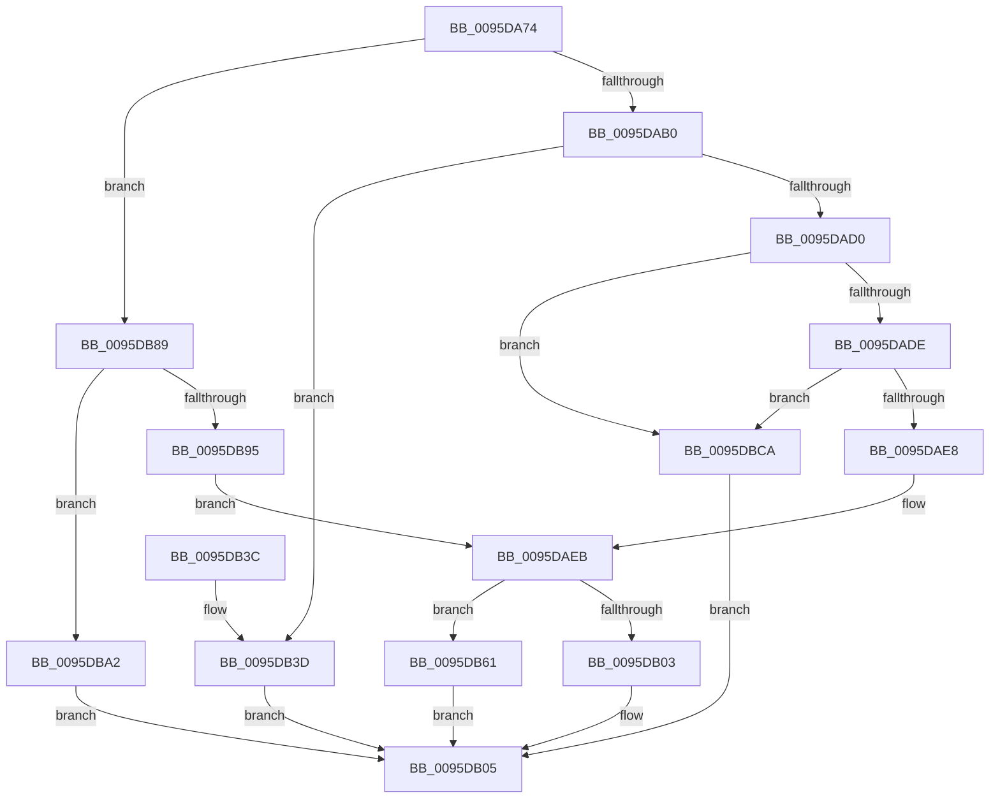

# SdbpGetStringTableItemFromStringRef

- RVA: `0x0095DA74`–`0x0095DBF2` (길이 `382` bytes)
- VA: `0x000000014095DA74`
- 실행 섹션: `PAGE`
- PDB 이름 있음: `예`; PDB Function 태그: `아니요`
- unwind 정보 RVA: `0x00092E08`
- 디코드: `97`개 명령, `382/382` bytes 표시
- 미해석 바이트: `0` (있으면 어셈블리에 `.byte`로 보존)

> 이 문서는 커널 이미지의 기계어와 PDB 기호를 분석해 생성했습니다. 4번과 5번은 함수 원형과 자료형을 바이너리 사용 방식에서 추정한 C 해석이며 원본 소스 복구 결과는 아닙니다.

## 1. Dependencies

- 직접 호출 지점: **6**; 고유 호출 대상: **3**
- 직접 호출자로 확인된 함수: **1**
- RIP 상대 이미지 참조: **6**

### Outgoing calls
- `0x0095DAC5` → [RtlRunOnceExecuteOnce](RtlRunOnceExecuteOnce_function_0095DC00.md) (function, `0x0095DC00`)
- `0x0095DAF4` → [SdbGetTagFromTagID](SdbGetTagFromTagID_function_0095E3C0.md) (function, `0x0095E3C0`)
- `0x0095DB5A` → [AslLogCallPrintf](AslLogCallPrintf_function_0095E4EC.md) (function, `0x0095E4EC`)
- `0x0095DB7A` → [AslLogCallPrintf](AslLogCallPrintf_function_0095E4EC.md) (function, `0x0095E4EC`)
- `0x0095DBBB` → [AslLogCallPrintf](AslLogCallPrintf_function_0095E4EC.md) (function, `0x0095E4EC`)
- `0x0095DBE3` → [AslLogCallPrintf](AslLogCallPrintf_function_0095E4EC.md) (function, `0x0095E4EC`)

### Direct callers
- [SdbpGetMappedStringFromTable](SdbpGetMappedStringFromTable_function_0095DA0C.md) at `0x0095DA24`

### Static image references
- `0x0095DABE` → RVA `0x00A97EA0` (`InitOnceGetStringTableOffset`; read)
- `0x0095DB3D` → RVA `0x00012520` (`.rdata`; read)
- `0x0095DB4E` → RVA `0x000127C0` (`.rdata`; read)
- `0x0095DB61` → RVA `0x000127E8` (`.rdata`; read)
- `0x0095DBA2` → RVA `0x0001C570` (`.rdata`; read)
- `0x0095DBCA` → RVA `0x0003D2C0` (`.rdata`; read)

## 2. Other-region calls and transfers

- 다른 실행 섹션으로 향하는 call: **0**
- 별도 외부 분기/꼬리 이동을 확인하지 못했습니다.

## 3. Assembly (complete function range)

```asm
0095DA74  48 8B C4                        mov rax, rsp
0095DA77  48 89 58 10                     mov qword ptr [rax + 0x10], rbx
0095DA7B  48 89 68 18                     mov qword ptr [rax + 0x18], rbp
0095DA7F  48 89 70 20                     mov qword ptr [rax + 0x20], rsi
0095DA83  57                              push rdi
0095DA84  41 54                           push r12
0095DA86  41 55                           push r13
0095DA88  41 56                           push r14
0095DA8A  41 57                           push r15
0095DA8C  48 83 EC 30                     sub rsp, 0x30
0095DA90  33 DB                           xor ebx, ebx
0095DA92  4D 8B E1                        mov r12, r9
0095DA95  4D 8B E8                        mov r13, r8
0095DA98  44 8B FA                        mov r15d, edx
0095DA9B  48 8B F1                        mov rsi, rcx
0095DA9E  8B EB                           mov ebp, ebx
0095DAA0  44 8B F3                        mov r14d, ebx
0095DAA3  48 89 58 08                     mov qword ptr [rax + 8], rbx
0095DAA7  39 59 10                        cmp dword ptr [rcx + 0x10], ebx
0095DAAA  0F 85 D9 00 00 00               jne 0x14095db89
0095DAB0  48 81 C1 40 0A 00 00            add rcx, 0xa40
0095DAB7  4C 8D 48 08                     lea r9, [rax + 8]
0095DABB  4C 8B C6                        mov r8, rsi
0095DABE  48 8D 15 DB A3 13 00            lea rdx, [rip + 0x13a3db]
0095DAC5  E8 36 01 00 00                  call 0x14095dc00
0095DACA  8B F8                           mov edi, eax
0095DACC  85 C0                           test eax, eax
0095DACE  78 6D                           js 0x14095db3d
0095DAD0  48 8B 44 24 60                  mov rax, qword ptr [rsp + 0x60]
0095DAD5  48 85 C0                        test rax, rax
0095DAD8  0F 84 EC 00 00 00               je 0x14095dbca
0095DADE  8B 00                           mov eax, dword ptr [rax]
0095DAE0  85 C0                           test eax, eax
0095DAE2  0F 84 E2 00 00 00               je 0x14095dbca
0095DAE8  4C 8B F6                        mov r14, rsi
0095DAEB  42 8D 2C 38                     lea ebp, [rax + r15]
0095DAEF  49 8B CE                        mov rcx, r14
0095DAF2  8B D5                           mov edx, ebp
0095DAF4  E8 C7 08 00 00                  call 0x14095e3c0
0095DAF9  B9 01 88 00 00                  mov ecx, 0x8801
0095DAFE  66 3B C1                        cmp ax, cx
0095DB01  75 5E                           jne 0x14095db61
0095DB03  8B FB                           mov edi, ebx
0095DB05  48 8B 74 24 78                  mov rsi, qword ptr [rsp + 0x78]
0095DB0A  85 FF                           test edi, edi
0095DB0C  8B C3                           mov eax, ebx
0095DB0E  F7 D7                           not edi
0095DB10  0F 49 C5                        cmovns eax, ebp
0095DB13  49 0F 49 DE                     cmovns rbx, r14
0095DB17  48 8B 6C 24 70                  mov rbp, qword ptr [rsp + 0x70]
0095DB1C  C1 EF 1F                        shr edi, 0x1f
0095DB1F  41 89 45 00                     mov dword ptr [r13], eax
0095DB23  8B C7                           mov eax, edi
0095DB25  49 89 1C 24                     mov qword ptr [r12], rbx
0095DB29  48 8B 5C 24 68                  mov rbx, qword ptr [rsp + 0x68]
0095DB2E  48 83 C4 30                     add rsp, 0x30
0095DB32  41 5F                           pop r15
0095DB34  41 5E                           pop r14
0095DB36  41 5D                           pop r13
0095DB38  41 5C                           pop r12
0095DB3A  5F                              pop rdi
0095DB3B  C3                              ret
0095DB3C  CC                              int3
0095DB3D  4C 8D 0D DC 49 6B FF            lea r9, [rip - 0x94b624]
0095DB44  89 44 24 20                     mov dword ptr [rsp + 0x20], eax
0095DB48  41 B8 5A 03 00 00               mov r8d, 0x35a
0095DB4E  48 8D 15 6B 4C 6B FF            lea rdx, [rip - 0x94b395]
0095DB55  B9 01 00 00 00                  mov ecx, 1
0095DB5A  E8 8D 09 00 00                  call 0x14095e4ec
0095DB5F  EB A4                           jmp 0x14095db05
0095DB61  4C 8D 0D 80 4C 6B FF            lea r9, [rip - 0x94b380]
0095DB68  41 B8 78 03 00 00               mov r8d, 0x378
0095DB6E  48 8D 15 4B 4C 6B FF            lea rdx, [rip - 0x94b3b5]
0095DB75  B9 01 00 00 00                  mov ecx, 1
0095DB7A  E8 6D 09 00 00                  call 0x14095e4ec
0095DB7F  BF 24 00 00 C0                  mov edi, 0xc0000024
0095DB84  E9 7C FF FF FF                  jmp 0x14095db05
0095DB89  48 8B 81 50 0A 00 00            mov rax, qword ptr [rcx + 0xa50]
0095DB90  48 85 C0                        test rax, rax
0095DB93  74 0D                           je 0x14095dba2
0095DB95  4C 8B F0                        mov r14, rax
0095DB98  B8 06 00 00 00                  mov eax, 6
0095DB9D  E9 49 FF FF FF                  jmp 0x14095daeb
0095DBA2  4C 8D 0D C7 E9 6B FF            lea r9, [rip - 0x941639]
0095DBA9  41 B8 46 03 00 00               mov r8d, 0x346
0095DBAF  48 8D 15 0A 4C 6B FF            lea rdx, [rip - 0x94b3f6]
0095DBB6  B9 01 00 00 00                  mov ecx, 1
0095DBBB  E8 2C 09 00 00                  call 0x14095e4ec
0095DBC0  BF 25 02 00 C0                  mov edi, 0xc0000225
0095DBC5  E9 3B FF FF FF                  jmp 0x14095db05
0095DBCA  4C 8D 0D EF F6 6D FF            lea r9, [rip - 0x920911]
0095DBD1  41 B8 6A 03 00 00               mov r8d, 0x36a
0095DBD7  48 8D 15 E2 4B 6B FF            lea rdx, [rip - 0x94b41e]
0095DBDE  B9 01 00 00 00                  mov ecx, 1
0095DBE3  E8 04 09 00 00                  call 0x14095e4ec
0095DBE8  BF 29 02 00 C0                  mov edi, 0xc0000229
0095DBED  E9 13 FF FF FF                  jmp 0x14095db05
```

## 4. C-style interpretation (structured pseudocode)

```c
__int64 __fastcall SdbpGetStringTableItemFromStringRef(__int64 a1, int a2, __int64 a3, __int64 a4)
{
    __int64 result;
    __int64 v_rbx;
    __int64 v_rdi;
    __int64 v_rsp;
    unsigned __int64 v_stack_p10;
    unsigned __int64 v_stack_p18;
    unsigned __int64 v_stack_p20;
    unsigned __int64 v_stack_p8;

    *(unsigned __int64 *)(v_rsp + 16) = v_rbx;
    *(unsigned __int64 *)(v_rsp + 24) = v_rbp;
    *(unsigned __int64 *)(v_rsp + 32) = v_rsi;
    v_rsp = (v_rsp) - (48);
    v_rbx = 0;
    *(unsigned __int64 *)(v_rsp + 8) = 0;
    if ((*(unsigned int *)(a1 + 16)) != 0) goto loc_0095DB89;
    a1 = (a1) + (0xA40ULL);
    result = RtlRunOnceExecuteOnce(a1, v_rip + 1287131, a1, v_rsp + 8);
    if (sign_flag) goto loc_0095DB3D;
    if (v_stack_p8 == 0) goto loc_0095DBCA;
    if ((unsigned int)((unsigned int)(*(unsigned int *)(v_stack_p8))) == 0) goto loc_0095DBCA;
loc_0095DAEB:
    result = SdbGetTagFromTagID(a1, (unsigned int)((unsigned int)((unsigned int)(*(unsigned int *)(v_stack_p8)) + (unsigned int)(a2) * 1)), a1, v_rsp + 8);
    if (((unsigned __int16)(result)) != ((unsigned __int16)((unsigned int)(0x8801ULL)))) goto loc_0095DB61;
loc_0095DB05:
    v_rdi = (unsigned int)(~(0));
    result = 0;
    if (!sign_flag) {
        result = (unsigned int)((unsigned int)(*(unsigned int *)(v_stack_p8)) + (unsigned int)(a2) * 1);
        v_rbx = a1;
    }
    v_rdi = (unsigned int)((v_rdi) >> (31));
    *(unsigned int *)(a3) = (unsigned int)(result);
    *(unsigned __int64 *)(a4) = v_rbx;
    v_rsp = (v_rsp) + (48);
    return (unsigned int)((unsigned int)(v_rdi));
loc_0095DB3D:
    v_stack_p20 = (unsigned int)((unsigned int)((unsigned int)(v_rdi)));
    result = AslLogCallPrintf(1, v_rip - 9745301, 858, v_rip - 9745956);
    goto loc_0095DB05;
loc_0095DB61:
    result = AslLogCallPrintf(1, v_rip - 9745333, 888, v_rip - 9745280);
    goto loc_0095DB05;
loc_0095DB89:
    if (*(unsigned __int64 *)(1 + 2640) == 0) goto loc_0095DBA2;
    goto loc_0095DAEB;
loc_0095DBA2:
    result = AslLogCallPrintf(1, v_rip - 9745398, 838, v_rip - 9705017);
    goto loc_0095DB05;
loc_0095DBCA:
    result = AslLogCallPrintf(1, v_rip - 9745438, 874, v_rip - 9570577);
    goto loc_0095DB05;
}
```

## 5. (Beta) C Style

```c
int64_t SdbpGetStringTableItemFromStringRef(void *Arg1, int32_t Arg2, void *Arg3, void *Arg4)
{
    uint8_t *arg1 = (uint8_t *)Arg1;
    uint8_t *arg3 = (uint8_t *)Arg3;
    uint8_t *arg4 = (uint8_t *)Arg4;

    int64_t result;
    int64_t local_rbx;
    int64_t local_rdi;
    int64_t local_rsp;
    uint64_t v_stack_p10;
    uint64_t v_stack_p18;
    uint64_t v_stack_p20;
    uint64_t v_stack_p8;

    *(uint64_t *)(local_rsp + 0x10) = local_rbx;
    *(uint64_t *)(local_rsp + 0x18) = local_rbp;
    *(uint64_t *)(local_rsp + 0x20) = local_rsi;
    local_rsp = (local_rsp) - (48);
    local_rbx = 0;
    *(uint64_t *)(local_rsp + 0x8) = 0;
    if ((*(uint32_t *)(arg1 + 0x10)) != 0) goto loc_0095DB89;
    Arg1 = (Arg1) + (0xA40ULL);
    result = RtlRunOnceExecuteOnce(Arg1, v_rip + 1287131, Arg1, local_rsp + 8);
    if (sign_flag) goto loc_0095DB3D;
    if (v_stack_p8 == 0) goto loc_0095DBCA;
    if ((uint32_t)((uint32_t)(*(uint32_t *)(v_stack_p8))) == 0) goto loc_0095DBCA;
loc_0095DAEB:
    result = SdbGetTagFromTagID(Arg1, (uint32_t)((uint32_t)((uint32_t)(*(uint32_t *)(v_stack_p8)) + (uint32_t)(Arg2) * 1)), Arg1, local_rsp + 8);
    if (((uint16_t)(result)) != ((uint16_t)((uint32_t)(0x8801ULL)))) goto loc_0095DB61;
loc_0095DB05:
    local_rdi = (uint32_t)(~(0));
    result = 0;
    if (!sign_flag) {
        result = (uint32_t)((uint32_t)(*(uint32_t *)(v_stack_p8)) + (uint32_t)(Arg2) * 1);
        local_rbx = Arg1;
    }
    local_rdi = (uint32_t)((local_rdi) >> (31));
    *(uint32_t *)(arg3) = (uint32_t)(result);
    *(uint64_t *)(arg4) = local_rbx;
    local_rsp = (local_rsp) + (48);
    return (uint32_t)((uint32_t)(local_rdi));
loc_0095DB3D:
    v_stack_p20 = (uint32_t)((uint32_t)((uint32_t)(local_rdi)));
    result = AslLogCallPrintf(1, v_rip - 9745301, 858, v_rip - 9745956);
    goto loc_0095DB05;
loc_0095DB61:
    result = AslLogCallPrintf(1, v_rip - 9745333, 888, v_rip - 9745280);
    goto loc_0095DB05;
loc_0095DB89:
    if (*(uint64_t *)(1 + 0xA50) == 0) goto loc_0095DBA2;
    goto loc_0095DAEB;
loc_0095DBA2:
    result = AslLogCallPrintf(1, v_rip - 9745398, 838, v_rip - 9705017);
    goto loc_0095DB05;
loc_0095DBCA:
    result = AslLogCallPrintf(1, v_rip - 9745438, 874, v_rip - 9570577);
    goto loc_0095DB05;
}
```

### 관측된 메모리 오프셋

구조체 형식이 확인되지 않은 접근은 인자 기준의 오프셋으로만 기록했습니다.

| 기준 인자 | 오프셋 표현 | 폭 (bit) | 접근 |
|---|---:|---:|---|
| `Arg1` | `+ 0x10` | `32` | `R` |
| `Arg1` | `+ 0xA50` | `64` | `R` |
| `Arg3` | `+ 0x0` | `32` | `W` |
| `Arg4` | `+ 0x0` | `64` | `W` |

## 6. Execution-region graph

[열기: 2D/3D 그래프와 함수 탐색 컨트롤 패널](../../../control-panel.html?section=page&rva=0x0095DA74&view=graph)

- 2D 그래프는 위에서 아래로 흐르고, 3D 그래프는 빈 공간을 드래그해 회전합니다. Shift+드래그는 이동, 휠은 확대·축소, 함수 노드 선택은 대상 보고서 이동입니다.

### Static fallback


