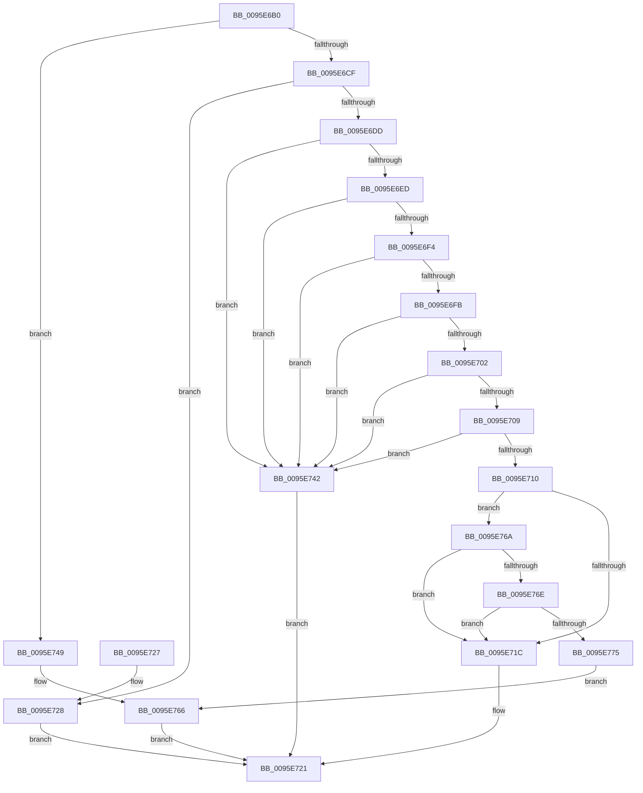

# SdbpGetTagHeadSize

- RVA: `0x0095E6B0`–`0x0095E798` (길이 `232` bytes)
- VA: `0x000000014095E6B0`
- 실행 섹션: `PAGE`
- PDB 이름 있음: `예`; PDB Function 태그: `아니요`
- unwind 정보 RVA: `0x00092F34`
- 디코드: `64`개 명령, `232/232` bytes 표시
- 미해석 바이트: `0` (있으면 어셈블리에 `.byte`로 보존)

> 이 문서는 커널 이미지의 기계어와 PDB 기호를 분석해 생성했습니다. 4번과 5번은 함수 원형과 자료형을 바이너리 사용 방식에서 추정한 C 해석이며 원본 소스 복구 결과는 아닙니다.

## 1. Dependencies

- 직접 호출 지점: **4**; 고유 호출 대상: **3**
- 직접 호출자로 확인된 함수: **3**
- RIP 상대 이미지 참조: **3**

### Outgoing calls
- `0x0095E6C6` → [SdbpReadMappedData](SdbpReadMappedData_function_0095E460.md) (function, `0x0095E460`)
- `0x0095E6CF` → [Feature_SdbValidateRootTagsOnOpen__private_IsEnabledDeviceUsageNoInline](../../text/49/Feature_SdbValidateRootTagsOnOpen__private_IsEnabledDeviceUsageNoInline_function_00494B18.md) (function, `0x00494B18`)
- `0x0095E761` → [AslLogCallPrintf](AslLogCallPrintf_function_0095E4EC.md) (function, `0x0095E4EC`)
- `0x0095E791` → [AslLogCallPrintf](AslLogCallPrintf_function_0095E4EC.md) (function, `0x0095E4EC`)

### Direct callers
- [SdbpGetNextTagId](SdbpGetNextTagId_function_0095D740.md) at `0x0095D781`
- [SdbpGetMappedTagData](SdbpGetMappedTagData_function_0095DD24.md) at `0x0095DD33`
- [SdbpReadTagData](SdbpReadTagData_function_0095E170.md) at `0x0095E1A4`

### Static image references
- `0x0095E74F` → RVA `0x00012608` (`.rdata`; read)
- `0x0095E756` → RVA `0x00012620` (`.rdata`; read)
- `0x0095E77F` → RVA `0x0003D298` (`.rdata`; read)

## 2. Other-region calls and transfers

- 다른 실행 섹션으로 향하는 call: **1**
  - `0x0095E6CF` → [Feature_SdbValidateRootTagsOnOpen__private_IsEnabledDeviceUsageNoInline](../../text/49/Feature_SdbValidateRootTagsOnOpen__private_IsEnabledDeviceUsageNoInline_function_00494B18.md) (`PAGE` → `.text`)
- 별도 외부 분기/꼬리 이동을 확인하지 못했습니다.

## 3. Assembly (complete function range)

```asm
0095E6B0  40 53                           push rbx
0095E6B2  48 83 EC 30                     sub rsp, 0x30
0095E6B6  33 DB                           xor ebx, ebx
0095E6B8  4C 8D 44 24 50                  lea r8, [rsp + 0x50]
0095E6BD  66 89 5C 24 50                  mov word ptr [rsp + 0x50], bx
0095E6C2  44 8D 4B 02                     lea r9d, [rbx + 2]
0095E6C6  E8 95 FD FF FF                  call 0x14095e460
0095E6CB  85 C0                           test eax, eax
0095E6CD  74 7A                           je 0x14095e749
0095E6CF  E8 44 64 B3 FF                  call 0x140494b18
0095E6D4  B9 00 F0 00 00                  mov ecx, 0xf000
0095E6D9  85 C0                           test eax, eax
0095E6DB  74 4B                           je 0x14095e728
0095E6DD  0F B7 54 24 50                  movzx edx, word ptr [rsp + 0x50]
0095E6E2  8B C2                           mov eax, edx
0095E6E4  23 C1                           and eax, ecx
0095E6E6  3D 00 60 00 00                  cmp eax, 0x6000
0095E6EB  74 55                           je 0x14095e742
0095E6ED  3D 00 10 00 00                  cmp eax, 0x1000
0095E6F2  74 4E                           je 0x14095e742
0095E6F4  3D 00 20 00 00                  cmp eax, 0x2000
0095E6F9  74 47                           je 0x14095e742
0095E6FB  3D 00 30 00 00                  cmp eax, 0x3000
0095E700  74 40                           je 0x14095e742
0095E702  3D 00 40 00 00                  cmp eax, 0x4000
0095E707  74 39                           je 0x14095e742
0095E709  3D 00 50 00 00                  cmp eax, 0x5000
0095E70E  74 32                           je 0x14095e742
0095E710  B9 00 70 00 00                  mov ecx, 0x7000
0095E715  3D 00 90 00 00                  cmp eax, 0x9000
0095E71A  75 4E                           jne 0x14095e76a
0095E71C  B8 06 00 00 00                  mov eax, 6
0095E721  48 83 C4 30                     add rsp, 0x30
0095E725  5B                              pop rbx
0095E726  C3                              ret
0095E727  CC                              int3
0095E728  0F B7 44 24 50                  movzx eax, word ptr [rsp + 0x50]
0095E72D  66 23 C1                        and ax, cx
0095E730  B9 00 70 00 00                  mov ecx, 0x7000
0095E735  66 3B C1                        cmp ax, cx
0095E738  1B C0                           sbb eax, eax
0095E73A  83 E0 FC                        and eax, 0xfffffffc
0095E73D  83 C0 06                        add eax, 6
0095E740  EB DF                           jmp 0x14095e721
0095E742  B8 02 00 00 00                  mov eax, 2
0095E747  EB D8                           jmp 0x14095e721
0095E749  41 B8 64 00 00 00               mov r8d, 0x64
0095E74F  4C 8D 0D B2 3E 6B FF            lea r9, [rip - 0x94c14e]
0095E756  48 8D 15 C3 3E 6B FF            lea rdx, [rip - 0x94c13d]
0095E75D  41 8D 48 9D                     lea ecx, [r8 - 0x63]
0095E761  E8 86 FD FF FF                  call 0x14095e4ec
0095E766  33 C0                           xor eax, eax
0095E768  EB B7                           jmp 0x14095e721
0095E76A  3B C1                           cmp eax, ecx
0095E76C  74 AE                           je 0x14095e71c
0095E76E  3D 00 80 00 00                  cmp eax, 0x8000
0095E773  74 A7                           je 0x14095e71c
0095E775  41 B8 79 00 00 00               mov r8d, 0x79
0095E77B  89 54 24 20                     mov dword ptr [rsp + 0x20], edx
0095E77F  4C 8D 0D 12 EB 6D FF            lea r9, [rip - 0x9214ee]
0095E786  48 8D 15 93 3E 6B FF            lea rdx, [rip - 0x94c16d]
0095E78D  41 8D 48 88                     lea ecx, [r8 - 0x78]
0095E791  E8 56 FD FF FF                  call 0x14095e4ec
0095E796  EB CE                           jmp 0x14095e766
```

## 4. C-style interpretation (structured pseudocode)

```c
__int64 __fastcall SdbpGetTagHeadSize(void)
{
    __int64 result;
    __int64 v_rbx;
    __int64 v_rsp;
    unsigned __int64 v_stack_p18;
    unsigned int v_stack_p20;
    unsigned __int16 v_stack_p50;

    v_rsp = (v_rsp) - (48);
    v_rbx = 0;
    v_stack_p18 = 0;
    result = SdbpReadMappedData(a1, a2, v_stack_p18, v_rbx + 2);
    if ((unsigned int)(result) == 0) goto loc_0095E749;
    result = Feature_SdbValidateRootTagsOnOpen__private_IsEnabledDeviceUsageNoInline(a1, a2, v_stack_p18, v_rbx + 2);
    if ((unsigned int)(result) == 0) goto loc_0095E728;
    result = (unsigned int)(((unsigned int)((unsigned int)(v_stack_p18))) & ((unsigned int)((unsigned int)(0xF000ULL))));
    if (((unsigned int)(result)) == 0x6000ULL) goto loc_0095E742;
    if (((unsigned int)(result)) == 0x1000ULL) goto loc_0095E742;
    if (((unsigned int)(result)) == 0x2000ULL) goto loc_0095E742;
    if (((unsigned int)(result)) == 0x3000ULL) goto loc_0095E742;
    if (((unsigned int)(result)) == 0x4000ULL) goto loc_0095E742;
    if (((unsigned int)(result)) == 0x5000ULL) goto loc_0095E742;
    if (((unsigned int)(result)) != 0x9000ULL) goto loc_0095E76A;
loc_0095E71C:
loc_0095E721:
    v_rsp = (v_rsp) + (48);
    return 6;
loc_0095E728:
    result = (unsigned __int16)((v_stack_p50) & ((unsigned __int16)((unsigned int)(0x7000ULL))));
    result = (unsigned int)((result) & (0xFFFFFFFCULL));
    result = (unsigned int)((result) + (6));
    goto loc_0095E721;
loc_0095E742:
    goto loc_0095E721;
loc_0095E749:
    result = AslLogCallPrintf(100 - 99, v_rip - 9748797, 100, v_rip - 9748814);
loc_0095E766:
    result = 0;
    goto loc_0095E721;
loc_0095E76A:
    if (0 == ((unsigned int)(100 - 99))) goto loc_0095E71C;
    if (0 == 0x8000ULL) goto loc_0095E71C;
    v_stack_p20 = (unsigned int)(v_rip - 9748797);
    result = AslLogCallPrintf(121 - 120, v_rip - 9748845, 121, v_rip - 9573614);
    goto loc_0095E766;
}
```

## 5. (Beta) C Style

```c
void SdbpGetTagHeadSize(void)
{
    int64_t result;
    int64_t local_rbx;
    int64_t local_rsp;
    uint64_t v_stack_p18;
    uint32_t v_stack_p20;
    uint16_t v_stack_p50;

    local_rsp = (local_rsp) - (48);
    local_rbx = 0;
    v_stack_p18 = 0;
    result = SdbpReadMappedData(a1, a2, v_stack_p18, local_rbx + 2);
    if ((uint32_t)(result) == 0) goto loc_0095E749;
    result = Feature_SdbValidateRootTagsOnOpen__private_IsEnabledDeviceUsageNoInline(a1, a2, v_stack_p18, local_rbx + 2);
    if ((uint32_t)(result) == 0) goto loc_0095E728;
    result = (uint32_t)(((uint32_t)((uint32_t)(v_stack_p18))) & ((uint32_t)((uint32_t)(0xF000ULL))));
    if (((uint32_t)(result)) == 0x6000ULL) goto loc_0095E742;
    if (((uint32_t)(result)) == 0x1000ULL) goto loc_0095E742;
    if (((uint32_t)(result)) == 0x2000ULL) goto loc_0095E742;
    if (((uint32_t)(result)) == 0x3000ULL) goto loc_0095E742;
    if (((uint32_t)(result)) == 0x4000ULL) goto loc_0095E742;
    if (((uint32_t)(result)) == 0x5000ULL) goto loc_0095E742;
    if (((uint32_t)(result)) != 0x9000ULL) goto loc_0095E76A;
loc_0095E71C:
loc_0095E721:
    local_rsp = (local_rsp) + (48);
    return 6;
loc_0095E728:
    result = (uint16_t)((v_stack_p50) & ((uint16_t)((uint32_t)(0x7000ULL))));
    result = (uint32_t)((result) & (0xFFFFFFFCULL));
    result = (uint32_t)((result) + (6));
    goto loc_0095E721;
loc_0095E742:
    goto loc_0095E721;
loc_0095E749:
    result = AslLogCallPrintf(100 - 99, v_rip - 9748797, 100, v_rip - 9748814);
loc_0095E766:
    result = 0;
    goto loc_0095E721;
loc_0095E76A:
    if (0 == ((uint32_t)(100 - 99))) goto loc_0095E71C;
    if (0 == 0x8000ULL) goto loc_0095E71C;
    v_stack_p20 = (uint32_t)(v_rip - 9748797);
    result = AslLogCallPrintf(121 - 120, v_rip - 9748845, 121, v_rip - 9573614);
    goto loc_0095E766;
}
```

## 6. Execution-region graph

[열기: 2D/3D 그래프와 함수 탐색 컨트롤 패널](../../../control-panel.html?section=page&rva=0x0095E6B0&view=graph)

- 2D 그래프는 위에서 아래로 흐르고, 3D 그래프는 빈 공간을 드래그해 회전합니다. Shift+드래그는 이동, 휠은 확대·축소, 함수 노드 선택은 대상 보고서 이동입니다.

### Static fallback


