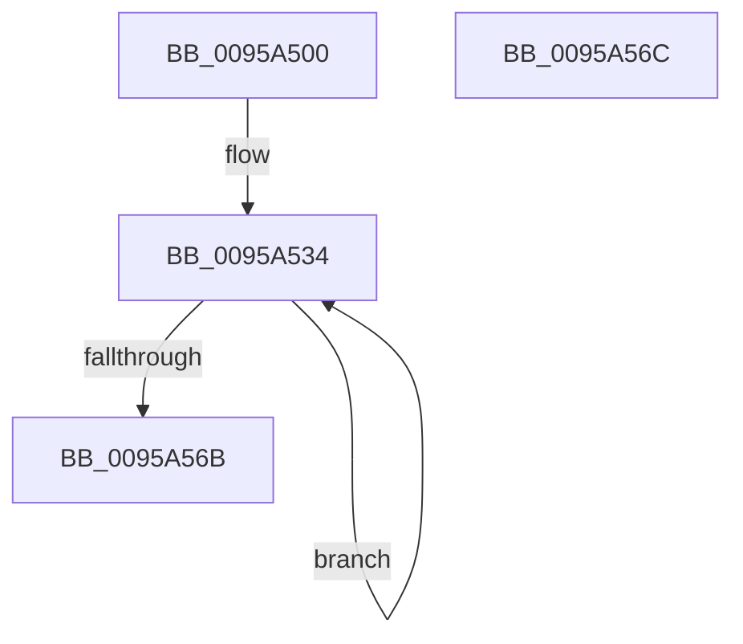

# SdbpInitializeMatchers

- RVA: `0x0095A500`–`0x0095A56D` (길이 `109` bytes)
- VA: `0x000000014095A500`
- 실행 섹션: `PAGE`
- PDB 이름 있음: `예`; PDB Function 태그: `아니요`
- unwind 정보 RVA: `0x000DB714`
- 디코드: `23`개 명령, `109/109` bytes 표시
- 미해석 바이트: `0` (있으면 어셈블리에 `.byte`로 보존)

> 이 문서는 커널 이미지의 기계어와 PDB 기호를 분석해 생성했습니다. 4번과 5번은 함수 원형과 자료형을 바이너리 사용 방식에서 추정한 C 해석이며 원본 소스 복구 결과는 아닙니다.

## 1. Dependencies

- 직접 호출 지점: **0**; 고유 호출 대상: **0**
- 직접 호출자로 확인된 함수: **1**
- RIP 상대 이미지 참조: **4**

### Outgoing calls
- 직접 디코드된 call 명령이 없습니다.

### Direct callers
- [SdbInitDatabaseInMemory](SdbInitDatabaseInMemory_function_0095BC5C.md) at `0x0095BCEC`

### Static image references
- `0x0095A500` → RVA `0x00002280` (`.rdata`; read)
- `0x0095A50A` → RVA `0x00002288` (`.rdata`; read)
- `0x0095A514` → RVA `0x00002290` (`.rdata`; read)
- `0x0095A51E` → RVA `0x00002298` (`.rdata`; read)

## 2. Other-region calls and transfers

- 다른 실행 섹션으로 향하는 call: **0**
- 별도 외부 분기/꼬리 이동을 확인하지 못했습니다.

## 3. Assembly (complete function range)

```asm
0095A500  4C 8D 05 79 7D 6A FF            lea r8, [rip - 0x958287]
0095A507  4C 2B C1                        sub r8, rcx
0095A50A  4C 8D 0D 77 7D 6A FF            lea r9, [rip - 0x958289]
0095A511  4C 2B C9                        sub r9, rcx
0095A514  4C 8D 15 75 7D 6A FF            lea r10, [rip - 0x95828b]
0095A51B  4C 2B D1                        sub r10, rcx
0095A51E  4C 8D 1D 73 7D 6A FF            lea r11, [rip - 0x95828d]
0095A525  4C 2B D9                        sub r11, rcx
0095A528  48 8D 91 58 02 00 00            lea rdx, [rcx + 0x258]
0095A52F  B9 19 00 00 00                  mov ecx, 0x19
0095A534  41 8B 84 10 A8 FD FF FF         mov eax, dword ptr [r8 + rdx - 0x258]
0095A53C  89 42 F8                        mov dword ptr [rdx - 8], eax
0095A53F  49 8B 84 11 A8 FD FF FF         mov rax, qword ptr [r9 + rdx - 0x258]
0095A547  48 89 02                        mov qword ptr [rdx], rax
0095A54A  49 8B 84 12 A8 FD FF FF         mov rax, qword ptr [r10 + rdx - 0x258]
0095A552  48 89 42 08                     mov qword ptr [rdx + 8], rax
0095A556  41 8B 84 13 A8 FD FF FF         mov eax, dword ptr [r11 + rdx - 0x258]
0095A55E  89 42 10                        mov dword ptr [rdx + 0x10], eax
0095A561  48 8D 52 20                     lea rdx, [rdx + 0x20]
0095A565  48 83 E9 01                     sub rcx, 1
0095A569  75 C9                           jne 0x14095a534
0095A56B  C3                              ret
0095A56C  CC                              int3
```

## 4. C-style interpretation (structured pseudocode)

```c
__int64 __fastcall SdbpInitializeMatchers(__int64 a1)
{
    __int64 v_r10;
    __int64 v_r11;

    a3 = (v_rip - 9798279) - (a1);
    a4 = (v_rip - 9798281) - (a1);
    v_r10 = (v_rip - 9798283) - (a1);
    v_r11 = (v_rip - 9798285) - (a1);
loc_0095A534:
    *(unsigned int *)(a1 + 600 - 8) = (unsigned int)((unsigned int)(*(unsigned int *)(a3 + a1 + 600 * 1 - 600)));
    *(unsigned __int64 *)(a1 + 600) = *(unsigned __int64 *)(a4 + a1 + 600 * 1 - 600);
    *(unsigned __int64 *)(a1 + 600 + 8) = *(unsigned __int64 *)(v_r10 + a1 + 600 * 1 - 600);
    *(unsigned int *)(a1 + 600 + 16) = (unsigned int)((unsigned int)(*(unsigned int *)(v_r11 + a1 + 600 * 1 - 600)));
    a1 = (25) - (1);
    if (condition_is_not_equal) goto loc_0095A534;
    return (unsigned int)(*(unsigned int *)(v_r11 + a1 + 600 * 1 - 600));
}
```

## 5. (Beta) C Style

```c
int64_t SdbpInitializeMatchers(void *Arg1)
{
    uint8_t *arg1 = (uint8_t *)Arg1;

    int64_t local_r10;
    int64_t local_r11;

    a3 = (v_rip - 9798279) - (Arg1);
    a4 = (v_rip - 9798281) - (Arg1);
    local_r10 = (v_rip - 9798283) - (Arg1);
    local_r11 = (v_rip - 9798285) - (Arg1);
loc_0095A534:
    *(uint32_t *)(arg1 + 0x258 - 0x8) = (uint32_t)((uint32_t)(*(uint32_t *)(a3 + arg1 + 0x258 * 1 - 0x258)));
    *(uint64_t *)(arg1 + 0x258) = *(uint64_t *)(a4 + arg1 + 0x258 * 1 - 0x258);
    *(uint64_t *)(arg1 + 0x258 + 0x8) = *(uint64_t *)(local_r10 + arg1 + 0x258 * 1 - 0x258);
    *(uint32_t *)(arg1 + 0x258 + 0x10) = (uint32_t)((uint32_t)(*(uint32_t *)(local_r11 + arg1 + 0x258 * 1 - 0x258)));
    Arg1 = (25) - (1);
    if (condition_is_not_equal) goto loc_0095A534;
    return (uint32_t)(*(uint32_t *)(local_r11 + arg1 + 0x258 * 1 - 0x258));
}
```

### 관측된 메모리 오프셋

구조체 형식이 확인되지 않은 접근은 인자 기준의 오프셋으로만 기록했습니다.

| 기준 인자 | 오프셋 표현 | 폭 (bit) | 접근 |
|---|---:|---:|---|
| `Arg1` | `- 0x8` | `32` | `W` |
| `Arg1` | `+ 0x0` | `64` | `W` |
| `Arg1` | `+ 0x8` | `64` | `W` |
| `Arg1` | `+ 0x10` | `32` | `W` |
| `Arg1` | `+ 0x20` | `64` | `R` |
| `Arg1` | `+ 0x258` | `64` | `R` |

## 6. Execution-region graph

[열기: 2D/3D 그래프와 함수 탐색 컨트롤 패널](../../../control-panel.html?section=page&rva=0x0095A500&view=graph)

- 2D 그래프는 위에서 아래로 흐르고, 3D 그래프는 빈 공간을 드래그해 회전합니다. Shift+드래그는 이동, 휠은 확대·축소, 함수 노드 선택은 대상 보고서 이동입니다.

### Static fallback


