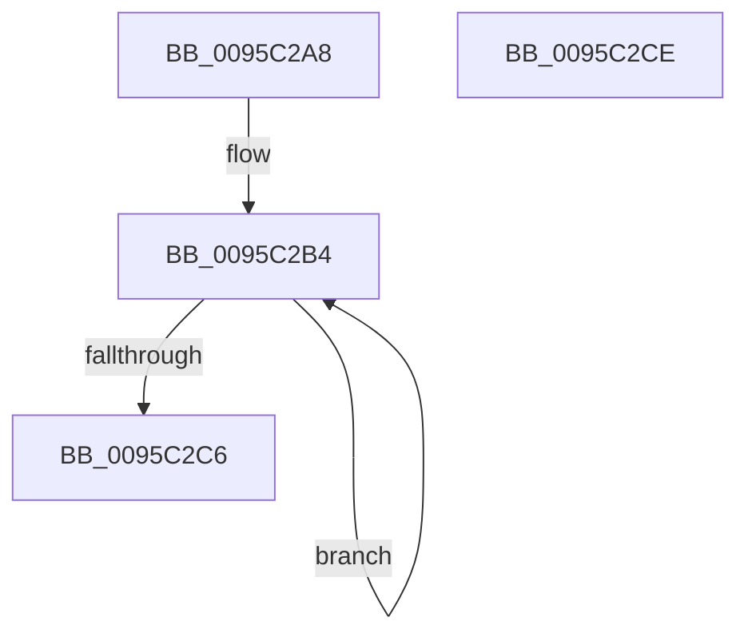

# SdbpKeyToAnsiString

- RVA: `0x0095C2A8`–`0x0095C2CF` (길이 `39` bytes)
- VA: `0x000000014095C2A8`
- 실행 섹션: `PAGE`
- PDB 이름 있음: `예`; PDB Function 태그: `아니요`
- unwind 정보 RVA: `0x000DB714`
- 디코드: `13`개 명령, `39/39` bytes 표시
- 미해석 바이트: `0` (있으면 어셈블리에 `.byte`로 보존)

> 이 문서는 커널 이미지의 기계어와 PDB 기호를 분석해 생성했습니다. 4번과 5번은 함수 원형과 자료형을 바이너리 사용 방식에서 추정한 C 해석이며 원본 소스 복구 결과는 아닙니다.

## 1. Dependencies

- 직접 호출 지점: **0**; 고유 호출 대상: **0**
- 직접 호출자로 확인된 함수: **2**
- RIP 상대 이미지 참조: **0**

### Outgoing calls
- 직접 디코드된 call 명령이 없습니다.

### Direct callers
- [SdbpFindNextIndexedWildCardTag](SdbpFindNextIndexedWildCardTag_function_0095A078.md) at `0x0095A11B`
- [SdbpFindNextIndexedWildCardTag](SdbpFindNextIndexedWildCardTag_function_0095A078.md) at `0x0095A12C`
- [SdbpFindFirstIndexedWildCardTag](SdbpFindFirstIndexedWildCardTag_function_0095DE58.md) at `0x0095DF71`
- [SdbpFindFirstIndexedWildCardTag](SdbpFindFirstIndexedWildCardTag_function_0095DE58.md) at `0x0095DFD5`

### Static image references
- 디코드된 RIP-relative 메모리 참조가 없습니다.

## 2. Other-region calls and transfers

- 다른 실행 섹션으로 향하는 call: **0**
- 별도 외부 분기/꼬리 이동을 확인하지 못했습니다.

## 3. Assembly (complete function range)

```asm
0095C2A8  48 89 4C 24 08                  mov qword ptr [rsp + 8], rcx
0095C2AD  4C 8D 44 24 0F                  lea r8, [rsp + 0xf]
0095C2B2  33 C9                           xor ecx, ecx
0095C2B4  41 8A 00                        mov al, byte ptr [r8]
0095C2B7  49 FF C8                        dec r8
0095C2BA  88 04 11                        mov byte ptr [rcx + rdx], al
0095C2BD  48 FF C1                        inc rcx
0095C2C0  48 83 F9 08                     cmp rcx, 8
0095C2C4  7C EE                           jl 0x14095c2b4
0095C2C6  C6 42 08 00                     mov byte ptr [rdx + 8], 0
0095C2CA  48 8B C2                        mov rax, rdx
0095C2CD  C3                              ret
0095C2CE  CC                              int3
```

## 4. C-style interpretation (structured pseudocode)

```c
__int64 __fastcall SdbpKeyToAnsiString(__int64 a1, __int64 a2)
{
    unsigned __int64 v_stack_p8;
    unsigned __int64 v_stack_pF;

    v_stack_p8 = a1;
    a1 = 0;
loc_0095C2B4:
    a3 = (v_stack_pF) - 1;
    *(unsigned __int8 *)(a1 + a2 * 1) = (unsigned __int8)(*(unsigned __int8 *)(v_stack_pF));
    a1 = (a1) + 1;
    if (a1 < 8) goto loc_0095C2B4;
    *(unsigned __int8 *)(a2 + 8) = 0;
    return a2;
}
```

## 5. (Beta) C Style

```c
void *SdbpKeyToAnsiString(int64_t Arg1, void *Arg2)
{
    uint8_t *arg2 = (uint8_t *)Arg2;

    uint64_t v_stack_p8;
    uint64_t v_stack_pF;

    v_stack_p8 = Arg1;
    Arg1 = 0;
loc_0095C2B4:
    a3 = (v_stack_pF) - 1;
    *(uint8_t *)(Arg1 + arg2 * 1) = (uint8_t)(*(uint8_t *)(v_stack_pF));
    Arg1 = (Arg1) + 1;
    if (Arg1 < 8) goto loc_0095C2B4;
    *(uint8_t *)(arg2 + 0x8) = 0;
    return Arg2;
}
```

### 관측된 메모리 오프셋

구조체 형식이 확인되지 않은 접근은 인자 기준의 오프셋으로만 기록했습니다.

| 기준 인자 | 오프셋 표현 | 폭 (bit) | 접근 |
|---|---:|---:|---|
| `Arg2` | `+ 0x8` | `8` | `W` |

## 6. Execution-region graph

[열기: 2D/3D 그래프와 함수 탐색 컨트롤 패널](../../../control-panel.html?section=page&rva=0x0095C2A8&view=graph)

- 2D 그래프는 위에서 아래로 흐르고, 3D 그래프는 빈 공간을 드래그해 회전합니다. Shift+드래그는 이동, 휠은 확대·축소, 함수 노드 선택은 대상 보고서 이동입니다.

### Static fallback


