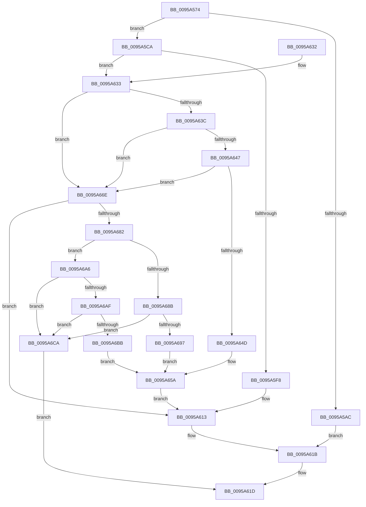

# SdbpOpenDatabaseInMemory

- RVA: `0x0095A574`–`0x0095A6D2` (길이 `350` bytes)
- VA: `0x000000014095A574`
- 실행 섹션: `PAGE`
- PDB 이름 있음: `예`; PDB Function 태그: `아니요`
- unwind 정보 RVA: `0x0009299C`
- 디코드: `94`개 명령, `350/350` bytes 표시
- 미해석 바이트: `0` (있으면 어셈블리에 `.byte`로 보존)

> 이 문서는 커널 이미지의 기계어와 PDB 기호를 분석해 생성했습니다. 4번과 5번은 함수 원형과 자료형을 바이너리 사용 방식에서 추정한 C 해석이며 원본 소스 복구 결과는 아닙니다.

## 1. Dependencies

- 직접 호출 지점: **12**; 고유 호출 대상: **9**
- 직접 호출자로 확인된 함수: **2**
- RIP 상대 이미지 참조: **6**

### Outgoing calls
- `0x0095A59F` → [AslAlloc](AslAlloc_function_0095BD34.md) (function, `0x0095BD34`)
- `0x0095A5C3` → [AslLogCallPrintf](AslLogCallPrintf_function_0095E4EC.md) (function, `0x0095E4EC`)
- `0x0095A5EF` → [SdbpReadMappedData](SdbpReadMappedData_function_0095E460.md) (function, `0x0095E460`)
- `0x0095A60E` → [AslLogCallPrintf](AslLogCallPrintf_function_0095E4EC.md) (function, `0x0095E4EC`)
- `0x0095A616` → [AslFree](AslFree_function_0095B674.md) (function, `0x0095B674`)
- `0x0095A633` → [Feature_SdbValidateRootTagsOnOpen__private_IsEnabledDeviceUsageNoInline](../../text/49/Feature_SdbValidateRootTagsOnOpen__private_IsEnabledDeviceUsageNoInline_function_00494B18.md) (function, `0x00494B18`)
- `0x0095A667` → [AslLogCallPrintf](AslLogCallPrintf_function_0095E4EC.md) (function, `0x0095E4EC`)
- `0x0095A679` → [SdbpValidateAndApplyCompatFlags](../AF/SdbpValidateAndApplyCompatFlags_function_00AF93D8.md) (function, `0x00AF93D8`)
- `0x0095A682` → [Feature_4095108409__private_IsEnabledDeviceUsageNoInline](../../text/69/Feature_4095108409__private_IsEnabledDeviceUsageNoInline_function_0069BFF0.md) (function, `0x0069BFF0`)
- `0x0095A68E` → [SdbpValidateSdbSizeWithRootTags](../81/SdbpValidateSdbSizeWithRootTags_function_0081336C.md) (function, `0x0081336C`)
- `0x0095A6A6` → [Feature_SdbValidateRootTagsOnOpen__private_IsEnabledDeviceUsageNoInline](../../text/49/Feature_SdbValidateRootTagsOnOpen__private_IsEnabledDeviceUsageNoInline_function_00494B18.md) (function, `0x00494B18`)
- `0x0095A6B2` → [SdbpValidateRootTagSizes](../AC/SdbpValidateRootTagSizes_function_00AC5280.md) (function, `0x00AC5280`)

### Direct callers
- [SdbpOpenCompressedDatabase](../81/SdbpOpenCompressedDatabase_function_00818524.md) at `0x008186A6`
- [SdbInitDatabaseInMemory](SdbInitDatabaseInMemory_function_0095BC5C.md) at `0x0095BCB9`

### Static image references
- `0x0095A5AC` → RVA `0x0003BD08` (`.rdata`; read)
- `0x0095A5B9` → RVA `0x0003BAC8` (`.rdata`; read)
- `0x0095A5F8` → RVA `0x0003B070` (`.rdata`; read)
- `0x0095A64D` → RVA `0x0003BA98` (`.rdata`; read)
- `0x0095A697` → RVA `0x0003BA68` (`.rdata`; read)
- `0x0095A6BB` → RVA `0x0003BA40` (`.rdata`; read)

## 2. Other-region calls and transfers

- 다른 실행 섹션으로 향하는 call: **3**
  - `0x0095A633` → [Feature_SdbValidateRootTagsOnOpen__private_IsEnabledDeviceUsageNoInline](../../text/49/Feature_SdbValidateRootTagsOnOpen__private_IsEnabledDeviceUsageNoInline_function_00494B18.md) (`PAGE` → `.text`)
  - `0x0095A682` → [Feature_4095108409__private_IsEnabledDeviceUsageNoInline](../../text/69/Feature_4095108409__private_IsEnabledDeviceUsageNoInline_function_0069BFF0.md) (`PAGE` → `.text`)
  - `0x0095A6A6` → [Feature_SdbValidateRootTagsOnOpen__private_IsEnabledDeviceUsageNoInline](../../text/49/Feature_SdbValidateRootTagsOnOpen__private_IsEnabledDeviceUsageNoInline_function_00494B18.md) (`PAGE` → `.text`)
- 별도 외부 분기/꼬리 이동을 확인하지 못했습니다.

## 3. Assembly (complete function range)

```asm
0095A574  4C 8B DC                        mov r11, rsp
0095A577  49 89 5B 08                     mov qword ptr [r11 + 8], rbx
0095A57B  49 89 6B 10                     mov qword ptr [r11 + 0x10], rbp
0095A57F  49 89 73 18                     mov qword ptr [r11 + 0x18], rsi
0095A583  57                              push rdi
0095A584  48 83 EC 40                     sub rsp, 0x40
0095A588  33 C0                           xor eax, eax
0095A58A  8B FA                           mov edi, edx
0095A58C  49 89 43 E8                     mov qword ptr [r11 - 0x18], rax
0095A590  BA 80 0A 00 00                  mov edx, 0xa80
0095A595  89 44 24 38                     mov dword ptr [rsp + 0x38], eax
0095A599  41 8B F0                        mov esi, r8d
0095A59C  48 8B E9                        mov rbp, rcx
0095A59F  E8 90 17 00 00                  call 0x14095bd34
0095A5A4  48 8B D8                        mov rbx, rax
0095A5A7  48 85 C0                        test rax, rax
0095A5AA  75 1E                           jne 0x14095a5ca
0095A5AC  4C 8D 0D 55 17 6E FF            lea r9, [rip - 0x91e8ab]
0095A5B3  41 B8 42 0B 00 00               mov r8d, 0xb42
0095A5B9  48 8D 15 08 15 6E FF            lea rdx, [rip - 0x91eaf8]
0095A5C0  8D 48 01                        lea ecx, [rax + 1]
0095A5C3  E8 24 3F 00 00                  call 0x14095e4ec
0095A5C8  EB 51                           jmp 0x14095a61b
0095A5CA  83 60 10 00                     and dword ptr [rax + 0x10], 0
0095A5CE  4C 8D 44 24 30                  lea r8, [rsp + 0x30]
0095A5D3  48 83 20 00                     and qword ptr [rax], 0
0095A5D7  33 D2                           xor edx, edx
0095A5D9  89 78 14                        mov dword ptr [rax + 0x14], edi
0095A5DC  48 8B CB                        mov rcx, rbx
0095A5DF  BF 01 00 00 00                  mov edi, 1
0095A5E4  48 89 68 08                     mov qword ptr [rax + 8], rbp
0095A5E8  09 78 18                        or dword ptr [rax + 0x18], edi
0095A5EB  44 8D 4F 0B                     lea r9d, [rdi + 0xb]
0095A5EF  E8 6C 3E 00 00                  call 0x14095e460
0095A5F4  85 C0                           test eax, eax
0095A5F6  75 3B                           jne 0x14095a633
0095A5F8  4C 8D 0D 71 0A 6E FF            lea r9, [rip - 0x91f58f]
0095A5FF  41 B8 4D 0B 00 00               mov r8d, 0xb4d
0095A605  48 8D 15 BC 14 6E FF            lea rdx, [rip - 0x91eb44]
0095A60C  8B CF                           mov ecx, edi
0095A60E  E8 D9 3E 00 00                  call 0x14095e4ec
0095A613  48 8B D3                        mov rdx, rbx
0095A616  E8 59 10 00 00                  call 0x14095b674
0095A61B  33 C0                           xor eax, eax
0095A61D  48 8B 5C 24 50                  mov rbx, qword ptr [rsp + 0x50]
0095A622  48 8B 6C 24 58                  mov rbp, qword ptr [rsp + 0x58]
0095A627  48 8B 74 24 60                  mov rsi, qword ptr [rsp + 0x60]
0095A62C  48 83 C4 40                     add rsp, 0x40
0095A630  5F                              pop rdi
0095A631  C3                              ret
0095A632  CC                              int3
0095A633  E8 E0 A4 B3 FF                  call 0x140494b18
0095A638  85 C0                           test eax, eax
0095A63A  74 32                           je 0x14095a66e
0095A63C  8B 44 24 38                     mov eax, dword ptr [rsp + 0x38]
0095A640  3D 73 64 62 66                  cmp eax, 0x66626473
0095A645  74 27                           je 0x14095a66e
0095A647  40 F6 C6 02                     test sil, 2
0095A64B  75 21                           jne 0x14095a66e
0095A64D  4C 8D 0D 44 14 6E FF            lea r9, [rip - 0x91ebbc]
0095A654  41 B8 53 0B 00 00               mov r8d, 0xb53
0095A65A  48 8D 15 67 14 6E FF            lea rdx, [rip - 0x91eb99]
0095A661  89 44 24 20                     mov dword ptr [rsp + 0x20], eax
0095A665  8B CF                           mov ecx, edi
0095A667  E8 80 3E 00 00                  call 0x14095e4ec
0095A66C  EB A5                           jmp 0x14095a613
0095A66E  44 8B C6                        mov r8d, esi
0095A671  48 8D 54 24 30                  lea rdx, [rsp + 0x30]
0095A676  48 8B CB                        mov rcx, rbx
0095A679  E8 5A ED 19 00                  call 0x140af93d8
0095A67E  85 C0                           test eax, eax
0095A680  74 91                           je 0x14095a613
0095A682  E8 69 19 D4 FF                  call 0x14069bff0
0095A687  85 C0                           test eax, eax
0095A689  74 1B                           je 0x14095a6a6
0095A68B  48 8B CB                        mov rcx, rbx
0095A68E  E8 D9 8C EB FF                  call 0x14081336c
0095A693  85 C0                           test eax, eax
0095A695  79 33                           jns 0x14095a6ca
0095A697  4C 8D 0D CA 13 6E FF            lea r9, [rip - 0x91ec36]
0095A69E  41 B8 5F 0B 00 00               mov r8d, 0xb5f
0095A6A4  EB B4                           jmp 0x14095a65a
0095A6A6  E8 6D A4 B3 FF                  call 0x140494b18
0095A6AB  85 C0                           test eax, eax
0095A6AD  74 1B                           je 0x14095a6ca
0095A6AF  48 8B CB                        mov rcx, rbx
0095A6B2  E8 C9 AB 16 00                  call 0x140ac5280
0095A6B7  85 C0                           test eax, eax
0095A6B9  79 0F                           jns 0x14095a6ca
0095A6BB  4C 8D 0D 7E 13 6E FF            lea r9, [rip - 0x91ec82]
0095A6C2  41 B8 66 0B 00 00               mov r8d, 0xb66
0095A6C8  EB 90                           jmp 0x14095a65a
0095A6CA  48 8B C3                        mov rax, rbx
0095A6CD  E9 4B FF FF FF                  jmp 0x14095a61d
```

## 4. C-style interpretation (structured pseudocode)

```c
__int64 __fastcall SdbpOpenDatabaseInMemory(__int64 a1, int a2, int a3)
{
    __int64 result;
    __int64 v_rsp;
    unsigned int v_stack_m10;
    unsigned __int64 v_stack_m18;
    unsigned __int64 v_stack_p10;
    unsigned __int64 v_stack_p18;
    unsigned int v_stack_p20;
    unsigned __int64 v_stack_p30;
    unsigned int v_stack_p38;
    unsigned __int64 v_stack_p8;

    *(unsigned __int64 *)(v_rsp + 8) = v_rbx;
    *(unsigned __int64 *)(v_rsp + 16) = v_rbp;
    *(unsigned __int64 *)(v_rsp + 24) = v_rsi;
    v_rsp = (v_rsp) - (64);
    result = 0;
    *(unsigned __int64 *)(v_rsp - 24) = 0;
    v_stack_m10 = 0;
    result = AslAlloc(a1, (unsigned int)(0xA80ULL), a3, a4);
    if (result != 0) goto loc_0095A5CA;
    result = AslLogCallPrintf(result + 1, v_rip - 9562872, (unsigned int)(0xB42ULL), v_rip - 9562283);
    goto loc_0095A61B;
loc_0095A5CA:
    a2 = 0;
    *(unsigned int *)(result + 20) = (unsigned int)((unsigned int)(a2));
    *(unsigned __int64 *)(result + 8) = a1;
    result = SdbpReadMappedData(result, a2, v_stack_m18, 1 + 11);
    if ((unsigned int)(result) != 0) goto loc_0095A633;
    result = AslLogCallPrintf(1, v_rip - 9562948, (unsigned int)(0xB4DULL), v_rip - 9565583);
loc_0095A613:
    result = AslFree(1, result, (unsigned int)(0xB4DULL), v_rip - 9565583);
loc_0095A61B:
    result = 0;
loc_0095A61D:
    v_rsp = (v_rsp) + (64);
    return result;
loc_0095A633:
    result = Feature_SdbValidateRootTagsOnOpen__private_IsEnabledDeviceUsageNoInline(1, result, (unsigned int)(0xB4DULL), v_rip - 9565583);
    if ((unsigned int)(result) == 0) goto loc_0095A66E;
    if (((unsigned int)((unsigned int)(v_stack_p38))) == 0x66626473ULL) goto loc_0095A66E;
    if ((((unsigned __int8)(v_stack_p18)) & (2)) != 0) goto loc_0095A66E;
loc_0095A65A:
    v_stack_p20 = (unsigned int)((unsigned int)(v_stack_p38));
    result = AslLogCallPrintf(1, v_rip - 9563033, (unsigned int)(0xB53ULL), v_rip - 9563068);
    goto loc_0095A613;
loc_0095A66E:
    result = SdbpValidateAndApplyCompatFlags(v_stack_p8, v_stack_p30, (unsigned int)((unsigned int)(v_stack_p18)), v_rip - 9563068);
    if ((unsigned int)(result) == 0) goto loc_0095A613;
    result = Feature_4095108409__private_IsEnabledDeviceUsageNoInline(v_stack_p8, v_stack_p30, (unsigned int)((unsigned int)(v_stack_p18)), v_rip - 9563068);
    if ((unsigned int)(result) == 0) goto loc_0095A6A6;
    result = SdbpValidateSdbSizeWithRootTags(v_stack_p8, v_stack_p30, (unsigned int)((unsigned int)(v_stack_p18)), v_rip - 9563068);
    if (!sign_flag) goto loc_0095A6CA;
    goto loc_0095A65A;
loc_0095A6A6:
    result = Feature_SdbValidateRootTagsOnOpen__private_IsEnabledDeviceUsageNoInline(v_stack_p8, v_stack_p30, (unsigned int)(0xB5FULL), v_rip - 9563190);
    if ((unsigned int)(result) == 0) goto loc_0095A6CA;
    result = SdbpValidateRootTagSizes(v_stack_p8, v_stack_p30, (unsigned int)(0xB5FULL), v_rip - 9563190);
    if (!sign_flag) goto loc_0095A6CA;
    goto loc_0095A65A;
loc_0095A6CA:
    goto loc_0095A61D;
}
```

## 5. (Beta) C Style

```c
int64_t SdbpOpenDatabaseInMemory(int64_t Arg1, int32_t Arg2, int32_t Arg3)
{
    int64_t result;
    int64_t local_rsp;
    uint32_t v_stack_m10;
    uint64_t v_stack_m18;
    uint64_t v_stack_p10;
    uint64_t v_stack_p18;
    uint32_t v_stack_p20;
    uint64_t v_stack_p30;
    uint32_t v_stack_p38;
    uint64_t v_stack_p8;

    *(uint64_t *)(local_rsp + 0x8) = local_rbx;
    *(uint64_t *)(local_rsp + 0x10) = local_rbp;
    *(uint64_t *)(local_rsp + 0x18) = local_rsi;
    local_rsp = (local_rsp) - (64);
    result = 0;
    *(uint64_t *)(local_rsp - 0x18) = 0;
    v_stack_m10 = 0;
    result = AslAlloc(Arg1, (uint32_t)(0xA80ULL), Arg3, a4);
    if (result != 0) goto loc_0095A5CA;
    result = AslLogCallPrintf(result + 1, v_rip - 9562872, (uint32_t)(0xB42ULL), v_rip - 9562283);
    goto loc_0095A61B;
loc_0095A5CA:
    Arg2 = 0;
    *(uint32_t *)(result + 0x14) = (uint32_t)((uint32_t)(Arg2));
    *(uint64_t *)(result + 0x8) = Arg1;
    result = SdbpReadMappedData(result, Arg2, v_stack_m18, 1 + 11);
    if ((uint32_t)(result) != 0) goto loc_0095A633;
    result = AslLogCallPrintf(1, v_rip - 9562948, (uint32_t)(0xB4DULL), v_rip - 9565583);
loc_0095A613:
    result = AslFree(1, result, (uint32_t)(0xB4DULL), v_rip - 9565583);
loc_0095A61B:
    result = 0;
loc_0095A61D:
    local_rsp = (local_rsp) + (64);
    return result;
loc_0095A633:
    result = Feature_SdbValidateRootTagsOnOpen__private_IsEnabledDeviceUsageNoInline(1, result, (uint32_t)(0xB4DULL), v_rip - 9565583);
    if ((uint32_t)(result) == 0) goto loc_0095A66E;
    if (((uint32_t)((uint32_t)(v_stack_p38))) == 0x66626473ULL) goto loc_0095A66E;
    if ((((uint8_t)(v_stack_p18)) & (2)) != 0) goto loc_0095A66E;
loc_0095A65A:
    v_stack_p20 = (uint32_t)((uint32_t)(v_stack_p38));
    result = AslLogCallPrintf(1, v_rip - 9563033, (uint32_t)(0xB53ULL), v_rip - 9563068);
    goto loc_0095A613;
loc_0095A66E:
    result = SdbpValidateAndApplyCompatFlags(v_stack_p8, v_stack_p30, (uint32_t)((uint32_t)(v_stack_p18)), v_rip - 9563068);
    if ((uint32_t)(result) == 0) goto loc_0095A613;
    result = Feature_4095108409__private_IsEnabledDeviceUsageNoInline(v_stack_p8, v_stack_p30, (uint32_t)((uint32_t)(v_stack_p18)), v_rip - 9563068);
    if ((uint32_t)(result) == 0) goto loc_0095A6A6;
    result = SdbpValidateSdbSizeWithRootTags(v_stack_p8, v_stack_p30, (uint32_t)((uint32_t)(v_stack_p18)), v_rip - 9563068);
    if (!sign_flag) goto loc_0095A6CA;
    goto loc_0095A65A;
loc_0095A6A6:
    result = Feature_SdbValidateRootTagsOnOpen__private_IsEnabledDeviceUsageNoInline(v_stack_p8, v_stack_p30, (uint32_t)(0xB5FULL), v_rip - 9563190);
    if ((uint32_t)(result) == 0) goto loc_0095A6CA;
    result = SdbpValidateRootTagSizes(v_stack_p8, v_stack_p30, (uint32_t)(0xB5FULL), v_rip - 9563190);
    if (!sign_flag) goto loc_0095A6CA;
    goto loc_0095A65A;
loc_0095A6CA:
    goto loc_0095A61D;
}
```

## 6. Execution-region graph

[열기: 2D/3D 그래프와 함수 탐색 컨트롤 패널](../../../control-panel.html?section=page&rva=0x0095A574&view=graph)

- 2D 그래프는 위에서 아래로 흐르고, 3D 그래프는 빈 공간을 드래그해 회전합니다. Shift+드래그는 이동, 휠은 확대·축소, 함수 노드 선택은 대상 보고서 이동입니다.

### Static fallback


