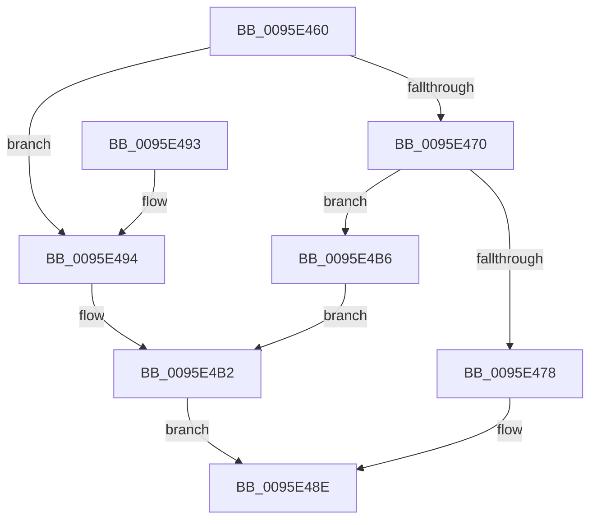

# SdbpReadMappedData

- RVA: `0x0095E460`–`0x0095E4E3` (길이 `131` bytes)
- VA: `0x000000014095E460`
- 실행 섹션: `PAGE`
- PDB 이름 있음: `예`; PDB Function 태그: `아니요`
- unwind 정보 RVA: `0x00092F04`
- 디코드: `33`개 명령, `131/131` bytes 표시
- 미해석 바이트: `0` (있으면 어셈블리에 `.byte`로 보존)

> 이 문서는 커널 이미지의 기계어와 PDB 기호를 분석해 생성했습니다. 4번과 5번은 함수 원형과 자료형을 바이너리 사용 방식에서 추정한 C 해석이며 원본 소스 복구 결과는 아닙니다.

## 1. Dependencies

- 직접 호출 지점: **3**; 고유 호출 대상: **2**
- 직접 호출자로 확인된 함수: **9**
- RIP 상대 이미지 참조: **3**

### Outgoing calls
- `0x0095E484` → [memcpy](../../text/6C/memcpy_function_006C6840.md) (function, `0x006C6840`)
- `0x0095E4AD` → [AslLogCallPrintf](AslLogCallPrintf_function_0095E4EC.md) (function, `0x0095E4EC`)
- `0x0095E4DC` → [AslLogCallPrintf](AslLogCallPrintf_function_0095E4EC.md) (function, `0x0095E4EC`)

### Direct callers
- [SdbOpenDatabaseEx](../81/SdbOpenDatabaseEx_function_00812284.md) at `0x00812480`
- [SdbpValidateSdbSizeWithRootTags](../81/SdbpValidateSdbSizeWithRootTags_function_0081336C.md) at `0x008133E5`
- [SdbpValidateSdbSizeWithRootTags](../81/SdbpValidateSdbSizeWithRootTags_function_0081336C.md) at `0x0081347F`
- [SdbpOpenCompressedDatabase](../81/SdbpOpenCompressedDatabase_function_00818524.md) at `0x008186CA`
- [SdbpOpenDatabaseInMemory](SdbpOpenDatabaseInMemory_function_0095A574.md) at `0x0095A5EF`
- [SdbpReadTagData](SdbpReadTagData_function_0095E170.md) at `0x0095E1B5`
- [SdbGetTagDataSize](SdbGetTagDataSize_function_0095E230.md) at `0x0095E285`
- [SdbpGetTagHeadSize](SdbpGetTagHeadSize_function_0095E6B0.md) at `0x0095E6C6`
- [SdbpValidateRootTagSizes](../AC/SdbpValidateRootTagSizes_function_00AC5280.md) at `0x00AC52F7`
- [SdbpValidateRootTagSizes](../AC/SdbpValidateRootTagSizes_function_00AC5280.md) at `0x00AC53A3`
- [sub_00B27B86](../B2/Unknown_function_00B27B86.md) at `0x00B27C47`

### Static image references
- `0x0095E494` → RVA `0x000123E0` (`.rdata`; read)
- `0x0095E4A1` → RVA `0x00012428` (`.rdata`; read)
- `0x0095E4CE` → RVA `0x0003B460` (`.rdata`; read)

## 2. Other-region calls and transfers

- 다른 실행 섹션으로 향하는 call: **1**
  - `0x0095E484` → [memcpy](../../text/6C/memcpy_function_006C6840.md) (`PAGE` → `.text`)
- 별도 외부 분기/꼬리 이동을 확인하지 못했습니다.

## 3. Assembly (complete function range)

```asm
0095E460  48 83 EC 48                     sub rsp, 0x48
0095E464  46 8D 14 0A                     lea r10d, [rdx + r9]
0095E468  4D 8B D8                        mov r11, r8
0095E46B  45 3B D1                        cmp r10d, r9d
0095E46E  72 24                           jb 0x14095e494
0095E470  8B 41 14                        mov eax, dword ptr [rcx + 0x14]
0095E473  41 3B C2                        cmp eax, r10d
0095E476  72 3E                           jb 0x14095e4b6
0095E478  8B D2                           mov edx, edx
0095E47A  48 03 51 08                     add rdx, qword ptr [rcx + 8]
0095E47E  49 8B CB                        mov rcx, r11
0095E481  45 8B C1                        mov r8d, r9d
0095E484  E8 B7 83 D6 FF                  call 0x1406c6840
0095E489  B8 01 00 00 00                  mov eax, 1
0095E48E  48 83 C4 48                     add rsp, 0x48
0095E492  C3                              ret
0095E493  CC                              int3
0095E494  4C 8D 0D 45 3F 6B FF            lea r9, [rip - 0x94c0bb]
0095E49B  41 B8 47 03 00 00               mov r8d, 0x347
0095E4A1  48 8D 15 80 3F 6B FF            lea rdx, [rip - 0x94c080]
0095E4A8  B9 01 00 00 00                  mov ecx, 1
0095E4AD  E8 3A 00 00 00                  call 0x14095e4ec
0095E4B2  33 C0                           xor eax, eax
0095E4B4  EB D8                           jmp 0x14095e48e
0095E4B6  89 44 24 30                     mov dword ptr [rsp + 0x30], eax
0095E4BA  41 B8 4C 03 00 00               mov r8d, 0x34c
0095E4C0  44 89 4C 24 28                  mov dword ptr [rsp + 0x28], r9d
0095E4C5  B9 01 00 00 00                  mov ecx, 1
0095E4CA  89 54 24 20                     mov dword ptr [rsp + 0x20], edx
0095E4CE  4C 8D 0D 8B CF 6D FF            lea r9, [rip - 0x923075]
0095E4D5  48 8D 15 4C 3F 6B FF            lea rdx, [rip - 0x94c0b4]
0095E4DC  E8 0B 00 00 00                  call 0x14095e4ec
0095E4E1  EB CF                           jmp 0x14095e4b2
```

## 4. C-style interpretation (structured pseudocode)

```c
__int64 __fastcall SdbpReadMappedData(__int64 a1, __int64 a2, __int64 a3, __int64 a4)
{
    __int64 result;
    __int64 v_rsp;
    unsigned int v_stack_p20;
    unsigned int v_stack_p28;
    unsigned int v_stack_p30;

    v_rsp = (v_rsp) - (72);
    if (((unsigned int)(a2 + a4 * 1)) < ((unsigned int)(a4))) goto loc_0095E494;
    if (((unsigned int)((unsigned int)(*(unsigned int *)(a1 + 20)))) < ((unsigned int)(a2 + a4 * 1))) goto loc_0095E4B6;
    a2 = ((unsigned int)((unsigned int)(a2))) + (*(unsigned __int64 *)(a1 + 8));
    result = memcpy(a3, a2, (unsigned int)((unsigned int)(a4)), a4);
loc_0095E48E:
    v_rsp = (v_rsp) + (72);
    return 1;
loc_0095E494:
    result = AslLogCallPrintf(1, v_rip - 9748608, 839, v_rip - 9748667);
loc_0095E4B2:
    result = 0;
    goto loc_0095E48E;
loc_0095E4B6:
    v_stack_p30 = 0;
    v_stack_p28 = (unsigned int)(v_rip - 9748667);
    v_stack_p20 = (unsigned int)(v_rip - 9748608);
    result = AslLogCallPrintf(1, v_rip - 9748660, 844, v_rip - 9580661);
    goto loc_0095E4B2;
}
```

## 5. (Beta) C Style

```c
int64_t SdbpReadMappedData(void *Arg1, void *Arg2, int64_t Arg3, int64_t Arg4)
{
    uint8_t *arg1 = (uint8_t *)Arg1;
    uint8_t *arg2 = (uint8_t *)Arg2;

    int64_t result;
    int64_t local_rsp;
    uint32_t v_stack_p20;
    uint32_t v_stack_p28;
    uint32_t v_stack_p30;

    local_rsp = (local_rsp) - (72);
    if (((uint32_t)(Arg2 + Arg4 * 1)) < ((uint32_t)(Arg4))) goto loc_0095E494;
    if (((uint32_t)((uint32_t)(*(uint32_t *)(arg1 + 0x14)))) < ((uint32_t)(Arg2 + Arg4 * 1))) goto loc_0095E4B6;
    Arg2 = ((uint32_t)((uint32_t)(Arg2))) + (*(uint64_t *)(arg1 + 0x8));
    result = memcpy(Arg3, Arg2, (uint32_t)((uint32_t)(Arg4)), Arg4);
loc_0095E48E:
    local_rsp = (local_rsp) + (72);
    return 1;
loc_0095E494:
    result = AslLogCallPrintf(1, v_rip - 9748608, 839, v_rip - 9748667);
loc_0095E4B2:
    result = 0;
    goto loc_0095E48E;
loc_0095E4B6:
    v_stack_p30 = 0;
    v_stack_p28 = (uint32_t)(v_rip - 9748667);
    v_stack_p20 = (uint32_t)(v_rip - 9748608);
    result = AslLogCallPrintf(1, v_rip - 9748660, 844, v_rip - 9580661);
    goto loc_0095E4B2;
}
```

### 관측된 메모리 오프셋

구조체 형식이 확인되지 않은 접근은 인자 기준의 오프셋으로만 기록했습니다.

| 기준 인자 | 오프셋 표현 | 폭 (bit) | 접근 |
|---|---:|---:|---|
| `Arg1` | `+ 0x8` | `64` | `R` |
| `Arg1` | `+ 0x14` | `32` | `R` |
| `Arg2` | `+ 0x0 + r9*1` | `32` | `R` |

## 6. Execution-region graph

[열기: 2D/3D 그래프와 함수 탐색 컨트롤 패널](../../../control-panel.html?section=page&rva=0x0095E460&view=graph)

- 2D 그래프는 위에서 아래로 흐르고, 3D 그래프는 빈 공간을 드래그해 회전합니다. Shift+드래그는 이동, 휠은 확대·축소, 함수 노드 선택은 대상 보고서 이동입니다.

### Static fallback


