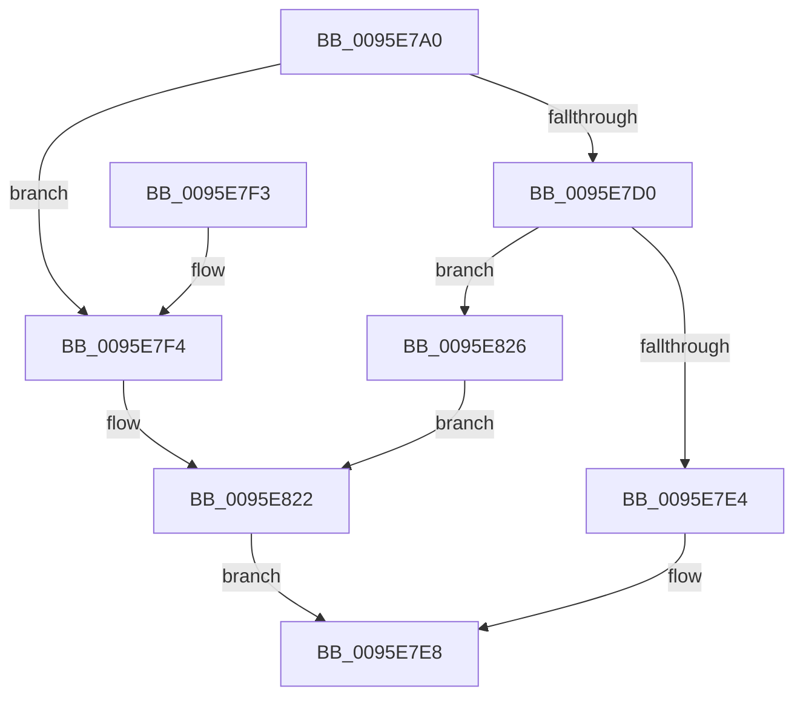

# SdbpReadStringRef

- RVA: `0x0095E7A0`–`0x0095E846` (길이 `166` bytes)
- VA: `0x000000014095E7A0`
- 실행 섹션: `PAGE`
- PDB 이름 있음: `예`; PDB Function 태그: `아니요`
- unwind 정보 RVA: `0x00092F40`
- 디코드: `42`개 명령, `166/166` bytes 표시
- 미해석 바이트: `0` (있으면 어셈블리에 `.byte`로 보존)

> 이 문서는 커널 이미지의 기계어와 PDB 기호를 분석해 생성했습니다. 4번과 5번은 함수 원형과 자료형을 바이너리 사용 방식에서 추정한 C 해석이며 원본 소스 복구 결과는 아닙니다.

## 1. Dependencies

- 직접 호출 지점: **5**; 고유 호출 대상: **3**
- 직접 호출자로 확인된 함수: **1**
- RIP 상대 이미지 참조: **3**

### Outgoing calls
- `0x0095E7B4` → [SdbGetTagFromTagID](SdbGetTagFromTagID_function_0095E3C0.md) (function, `0x0095E3C0`)
- `0x0095E7DB` → [SdbpReadTagData](SdbpReadTagData_function_0095E170.md) (function, `0x0095E170`)
- `0x0095E7F4` → [SdbGetTagFromTagID](SdbGetTagFromTagID_function_0095E3C0.md) (function, `0x0095E3C0`)
- `0x0095E81D` → [AslLogCallPrintf](AslLogCallPrintf_function_0095E4EC.md) (function, `0x0095E4EC`)
- `0x0095E83F` → [AslLogCallPrintf](AslLogCallPrintf_function_0095E4EC.md) (function, `0x0095E4EC`)

### Direct callers
- [SdbGetStringTagPtr](SdbGetStringTagPtr_function_0095DDA8.md) at `0x0095DDE9`

### Static image references
- `0x0095E7FC` → RVA `0x000124F0` (`.rdata`; read)
- `0x0095E807` → RVA `0x000124D8` (`.rdata`; read)
- `0x0095E826` → RVA `0x00012458` (`.rdata`; read)

## 2. Other-region calls and transfers

- 다른 실행 섹션으로 향하는 call: **0**
- 별도 외부 분기/꼬리 이동을 확인하지 못했습니다.

## 3. Assembly (complete function range)

```asm
0095E7A0  48 89 5C 24 08                  mov qword ptr [rsp + 8], rbx
0095E7A5  57                              push rdi
0095E7A6  48 83 EC 30                     sub rsp, 0x30
0095E7AA  83 64 24 50 00                  and dword ptr [rsp + 0x50], 0
0095E7AF  8B DA                           mov ebx, edx
0095E7B1  48 8B F9                        mov rdi, rcx
0095E7B4  E8 07 FC FF FF                  call 0x14095e3c0
0095E7B9  B9 00 F0 00 00                  mov ecx, 0xf000
0095E7BE  8B D3                           mov edx, ebx
0095E7C0  66 23 C1                        and ax, cx
0095E7C3  B9 00 60 00 00                  mov ecx, 0x6000
0095E7C8  66 3B C1                        cmp ax, cx
0095E7CB  48 8B CF                        mov rcx, rdi
0095E7CE  75 24                           jne 0x14095e7f4
0095E7D0  41 B9 04 00 00 00               mov r9d, 4
0095E7D6  4C 8D 44 24 50                  lea r8, [rsp + 0x50]
0095E7DB  E8 90 F9 FF FF                  call 0x14095e170
0095E7E0  85 C0                           test eax, eax
0095E7E2  74 42                           je 0x14095e826
0095E7E4  8B 44 24 50                     mov eax, dword ptr [rsp + 0x50]
0095E7E8  48 8B 5C 24 40                  mov rbx, qword ptr [rsp + 0x40]
0095E7ED  48 83 C4 30                     add rsp, 0x30
0095E7F1  5F                              pop rdi
0095E7F2  C3                              ret
0095E7F3  CC                              int3
0095E7F4  E8 C7 FB FF FF                  call 0x14095e3c0
0095E7F9  0F B7 C0                        movzx eax, ax
0095E7FC  4C 8D 0D ED 3C 6B FF            lea r9, [rip - 0x94c313]
0095E803  89 44 24 28                     mov dword ptr [rsp + 0x28], eax
0095E807  48 8D 15 CA 3C 6B FF            lea rdx, [rip - 0x94c336]
0095E80E  41 B8 7A 02 00 00               mov r8d, 0x27a
0095E814  89 5C 24 20                     mov dword ptr [rsp + 0x20], ebx
0095E818  B9 01 00 00 00                  mov ecx, 1
0095E81D  E8 CA FC FF FF                  call 0x14095e4ec
0095E822  33 C0                           xor eax, eax
0095E824  EB C2                           jmp 0x14095e7e8
0095E826  4C 8D 0D 2B 3C 6B FF            lea r9, [rip - 0x94c3d5]
0095E82D  41 B8 7F 02 00 00               mov r8d, 0x27f
0095E833  48 8D 15 9E 3C 6B FF            lea rdx, [rip - 0x94c362]
0095E83A  B9 01 00 00 00                  mov ecx, 1
0095E83F  E8 A8 FC FF FF                  call 0x14095e4ec
0095E844  EB DC                           jmp 0x14095e822
```

## 4. C-style interpretation (structured pseudocode)

```c
__int64 __fastcall SdbpReadStringRef(__int64 a1, int a2)
{
    __int64 result;
    __int64 v_rsp;
    unsigned int v_stack_p18;
    unsigned int v_stack_p20;
    unsigned int v_stack_p28;
    unsigned __int64 v_stack_p8;

    v_stack_p8 = v_rbx;
    v_rsp = (v_rsp) - (48);
    result = SdbGetTagFromTagID(a1, a2, a3, a4);
    result = (unsigned __int16)((result) & ((unsigned __int16)((unsigned int)(0xF000ULL))));
    if (((unsigned __int16)(result)) != ((unsigned __int16)((unsigned int)(0x6000ULL)))) goto loc_0095E7F4;
    result = SdbpReadTagData(a1, (unsigned int)((unsigned int)((unsigned int)(a2))), v_stack_p18, 4);
    if ((unsigned int)(result) == 0) goto loc_0095E826;
loc_0095E7E8:
    v_rsp = (v_rsp) + (48);
    return (unsigned int)(v_stack_p18);
loc_0095E7F4:
    result = SdbGetTagFromTagID(a1, (unsigned int)((unsigned int)((unsigned int)(a2))), v_stack_p18, 4);
    v_stack_p28 = (unsigned int)((unsigned __int16)(result));
    v_stack_p20 = (unsigned int)(v_stack_p8);
    result = AslLogCallPrintf(1, v_rip - 9749302, 634, v_rip - 9749267);
loc_0095E822:
    result = 0;
    goto loc_0095E7E8;
loc_0095E826:
    result = AslLogCallPrintf(1, v_rip - 9749346, 639, v_rip - 9749461);
    goto loc_0095E822;
}
```

## 5. (Beta) C Style

```c
int64_t SdbpReadStringRef(int64_t Arg1, int32_t Arg2)
{
    int64_t result;
    int64_t local_rsp;
    uint32_t v_stack_p18;
    uint32_t v_stack_p20;
    uint32_t v_stack_p28;
    uint64_t v_stack_p8;

    v_stack_p8 = local_rbx;
    local_rsp = (local_rsp) - (48);
    result = SdbGetTagFromTagID(Arg1, Arg2, a3, a4);
    result = (uint16_t)((result) & ((uint16_t)((uint32_t)(0xF000ULL))));
    if (((uint16_t)(result)) != ((uint16_t)((uint32_t)(0x6000ULL)))) goto loc_0095E7F4;
    result = SdbpReadTagData(Arg1, (uint32_t)((uint32_t)((uint32_t)(Arg2))), v_stack_p18, 4);
    if ((uint32_t)(result) == 0) goto loc_0095E826;
loc_0095E7E8:
    local_rsp = (local_rsp) + (48);
    return (uint32_t)(v_stack_p18);
loc_0095E7F4:
    result = SdbGetTagFromTagID(Arg1, (uint32_t)((uint32_t)((uint32_t)(Arg2))), v_stack_p18, 4);
    v_stack_p28 = (uint32_t)((uint16_t)(result));
    v_stack_p20 = (uint32_t)(v_stack_p8);
    result = AslLogCallPrintf(1, v_rip - 9749302, 634, v_rip - 9749267);
loc_0095E822:
    result = 0;
    goto loc_0095E7E8;
loc_0095E826:
    result = AslLogCallPrintf(1, v_rip - 9749346, 639, v_rip - 9749461);
    goto loc_0095E822;
}
```

## 6. Execution-region graph

[열기: 2D/3D 그래프와 함수 탐색 컨트롤 패널](../../../control-panel.html?section=page&rva=0x0095E7A0&view=graph)

- 2D 그래프는 위에서 아래로 흐르고, 3D 그래프는 빈 공간을 드래그해 회전합니다. Shift+드래그는 이동, 휠은 확대·축소, 함수 노드 선택은 대상 보고서 이동입니다.

### Static fallback


