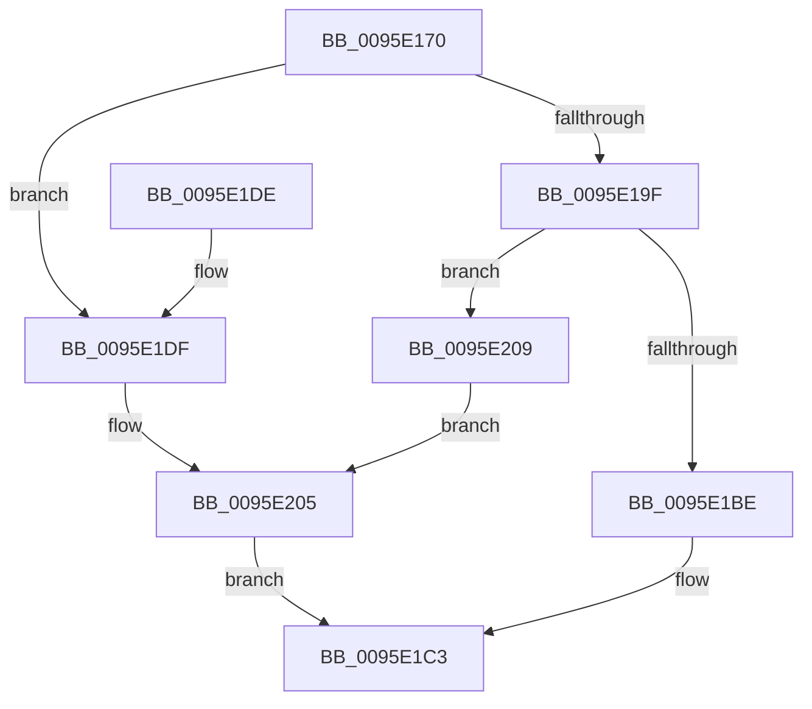

# SdbpReadTagData

- RVA: `0x0095E170`–`0x0095E229` (길이 `185` bytes)
- VA: `0x000000014095E170`
- 실행 섹션: `PAGE`
- PDB 이름 있음: `예`; PDB Function 태그: `아니요`
- unwind 정보 RVA: `0x00092EB4`
- 디코드: `49`개 명령, `185/185` bytes 표시
- 미해석 바이트: `0` (있으면 어셈블리에 `.byte`로 보존)

> 이 문서는 커널 이미지의 기계어와 PDB 기호를 분석해 생성했습니다. 4번과 5번은 함수 원형과 자료형을 바이너리 사용 방식에서 추정한 C 해석이며 원본 소스 복구 결과는 아닙니다.

## 1. Dependencies

- 직접 호출 지점: **5**; 고유 호출 대상: **4**
- 직접 호출자로 확인된 함수: **5**
- RIP 상대 이미지 참조: **3**

### Outgoing calls
- `0x0095E194` → [SdbGetTagDataSize](SdbGetTagDataSize_function_0095E230.md) (function, `0x0095E230`)
- `0x0095E1A4` → [SdbpGetTagHeadSize](SdbpGetTagHeadSize_function_0095E6B0.md) (function, `0x0095E6B0`)
- `0x0095E1B5` → [SdbpReadMappedData](SdbpReadMappedData_function_0095E460.md) (function, `0x0095E460`)
- `0x0095E200` → [AslLogCallPrintf](AslLogCallPrintf_function_0095E4EC.md) (function, `0x0095E4EC`)
- `0x0095E222` → [AslLogCallPrintf](AslLogCallPrintf_function_0095E4EC.md) (function, `0x0095E4EC`)

### Direct callers
- [SdbReadQWORDTag](../81/SdbReadQWORDTag_function_0081706C.md) at `0x008170E2`
- [SdbReadDWORDTag](SdbReadDWORDTag_function_0095D408.md) at `0x0095D44B`
- [SdbReadWORDTag](SdbReadWORDTag_function_0095D898.md) at `0x0095D8DD`
- [SdbpReadStringRef](SdbpReadStringRef_function_0095E7A0.md) at `0x0095E7DB`
- [SdbReadBinaryTag](../A7/SdbReadBinaryTag_function_00A7EC28.md) at `0x00A7EC69`

### Static image references
- `0x0095E1E3` → RVA `0x00012648` (`.rdata`; read)
- `0x0095E1F4` → RVA `0x00012638` (`.rdata`; read)
- `0x0095E209` → RVA `0x0003D340` (`.rdata`; read)

## 2. Other-region calls and transfers

- 다른 실행 섹션으로 향하는 call: **0**
- 별도 외부 분기/꼬리 이동을 확인하지 못했습니다.

## 3. Assembly (complete function range)

```asm
0095E170  48 8B C4                        mov rax, rsp
0095E173  48 89 58 08                     mov qword ptr [rax + 8], rbx
0095E177  48 89 68 10                     mov qword ptr [rax + 0x10], rbp
0095E17B  48 89 70 18                     mov qword ptr [rax + 0x18], rsi
0095E17F  48 89 78 20                     mov qword ptr [rax + 0x20], rdi
0095E183  41 56                           push r14
0095E185  48 83 EC 30                     sub rsp, 0x30
0095E189  41 8B F9                        mov edi, r9d
0095E18C  4D 8B F0                        mov r14, r8
0095E18F  8B F2                           mov esi, edx
0095E191  48 8B E9                        mov rbp, rcx
0095E194  E8 97 00 00 00                  call 0x14095e230
0095E199  8B D8                           mov ebx, eax
0095E19B  3B C7                           cmp eax, edi
0095E19D  77 40                           ja 0x14095e1df
0095E19F  8B D6                           mov edx, esi
0095E1A1  48 8B CD                        mov rcx, rbp
0095E1A4  E8 07 05 00 00                  call 0x14095e6b0
0095E1A9  44 8B CB                        mov r9d, ebx
0095E1AC  4D 8B C6                        mov r8, r14
0095E1AF  48 8B CD                        mov rcx, rbp
0095E1B2  8D 14 06                        lea edx, [rsi + rax]
0095E1B5  E8 A6 02 00 00                  call 0x14095e460
0095E1BA  85 C0                           test eax, eax
0095E1BC  74 4B                           je 0x14095e209
0095E1BE  B8 01 00 00 00                  mov eax, 1
0095E1C3  48 8B 5C 24 40                  mov rbx, qword ptr [rsp + 0x40]
0095E1C8  48 8B 6C 24 48                  mov rbp, qword ptr [rsp + 0x48]
0095E1CD  48 8B 74 24 50                  mov rsi, qword ptr [rsp + 0x50]
0095E1D2  48 8B 7C 24 58                  mov rdi, qword ptr [rsp + 0x58]
0095E1D7  48 83 C4 30                     add rsp, 0x30
0095E1DB  41 5E                           pop r14
0095E1DD  C3                              ret
0095E1DE  CC                              int3
0095E1DF  89 5C 24 28                     mov dword ptr [rsp + 0x28], ebx
0095E1E3  4C 8D 0D 5E 44 6B FF            lea r9, [rip - 0x94bba2]
0095E1EA  41 B8 B7 01 00 00               mov r8d, 0x1b7
0095E1F0  89 7C 24 20                     mov dword ptr [rsp + 0x20], edi
0095E1F4  48 8D 15 3D 44 6B FF            lea rdx, [rip - 0x94bbc3]
0095E1FB  B9 01 00 00 00                  mov ecx, 1
0095E200  E8 E7 02 00 00                  call 0x14095e4ec
0095E205  33 C0                           xor eax, eax
0095E207  EB BA                           jmp 0x14095e1c3
0095E209  4C 8D 0D 30 F1 6D FF            lea r9, [rip - 0x920ed0]
0095E210  41 B8 BE 01 00 00               mov r8d, 0x1be
0095E216  48 8D 15 1B 44 6B FF            lea rdx, [rip - 0x94bbe5]
0095E21D  B9 01 00 00 00                  mov ecx, 1
0095E222  E8 C5 02 00 00                  call 0x14095e4ec
0095E227  EB DC                           jmp 0x14095e205
```

## 4. C-style interpretation (structured pseudocode)

```c
__int64 __fastcall SdbpReadTagData(__int64 a1, int a2, __int64 a3, int a4)
{
    __int64 result;
    __int64 v_rsp;
    unsigned __int64 v_stack_p10;
    unsigned __int64 v_stack_p18;
    unsigned __int64 v_stack_p20;
    unsigned int v_stack_p28;
    unsigned __int64 v_stack_p8;

    *(unsigned __int64 *)(v_rsp + 8) = v_rbx;
    *(unsigned __int64 *)(v_rsp + 16) = v_rbp;
    *(unsigned __int64 *)(v_rsp + 24) = v_rsi;
    *(unsigned __int64 *)(v_rsp + 32) = v_rdi;
    v_rsp = (v_rsp) - (48);
    result = SdbGetTagDataSize(a1, a2, a3, a4);
    if (((unsigned int)(result)) > ((unsigned int)((unsigned int)(a4)))) goto loc_0095E1DF;
    result = SdbpGetTagHeadSize(a1, (unsigned int)((unsigned int)((unsigned int)(a2))), a3, a4);
    result = SdbpReadMappedData(a1, (unsigned int)(a2) + result * 1, a3, (unsigned int)((unsigned int)((unsigned int)((unsigned int)(result)))));
    if ((unsigned int)(result) == 0) goto loc_0095E209;
loc_0095E1C3:
    v_rsp = (v_rsp) + (48);
    return 1;
loc_0095E1DF:
    v_stack_p28 = (unsigned int)(v_stack_p8);
    v_stack_p20 = (unsigned int)(v_stack_p20);
    result = AslLogCallPrintf(1, v_rip - 9747395, 439, v_rip - 9747362);
loc_0095E205:
    result = 0;
    goto loc_0095E1C3;
loc_0095E209:
    result = AslLogCallPrintf(1, v_rip - 9747429, 446, v_rip - 9572048);
    goto loc_0095E205;
}
```

## 5. (Beta) C Style

```c
int64_t SdbpReadTagData(int64_t Arg1, void *Arg2, int64_t Arg3, int32_t Arg4)
{
    uint8_t *arg2 = (uint8_t *)Arg2;

    int64_t result;
    int64_t local_rsp;
    uint64_t v_stack_p10;
    uint64_t v_stack_p18;
    uint64_t v_stack_p20;
    uint32_t v_stack_p28;
    uint64_t v_stack_p8;

    *(uint64_t *)(local_rsp + 0x8) = local_rbx;
    *(uint64_t *)(local_rsp + 0x10) = local_rbp;
    *(uint64_t *)(local_rsp + 0x18) = local_rsi;
    *(uint64_t *)(local_rsp + 0x20) = local_rdi;
    local_rsp = (local_rsp) - (48);
    result = SdbGetTagDataSize(Arg1, Arg2, Arg3, Arg4);
    if (((uint32_t)(result)) > ((uint32_t)((uint32_t)(Arg4)))) goto loc_0095E1DF;
    result = SdbpGetTagHeadSize(Arg1, (uint32_t)((uint32_t)((uint32_t)(Arg2))), Arg3, Arg4);
    result = SdbpReadMappedData(Arg1, (uint32_t)(Arg2) + result * 1, Arg3, (uint32_t)((uint32_t)((uint32_t)((uint32_t)(result)))));
    if ((uint32_t)(result) == 0) goto loc_0095E209;
loc_0095E1C3:
    local_rsp = (local_rsp) + (48);
    return 1;
loc_0095E1DF:
    v_stack_p28 = (uint32_t)(v_stack_p8);
    v_stack_p20 = (uint32_t)(v_stack_p20);
    result = AslLogCallPrintf(1, v_rip - 9747395, 439, v_rip - 9747362);
loc_0095E205:
    result = 0;
    goto loc_0095E1C3;
loc_0095E209:
    result = AslLogCallPrintf(1, v_rip - 9747429, 446, v_rip - 9572048);
    goto loc_0095E205;
}
```

### 관측된 메모리 오프셋

구조체 형식이 확인되지 않은 접근은 인자 기준의 오프셋으로만 기록했습니다.

| 기준 인자 | 오프셋 표현 | 폭 (bit) | 접근 |
|---|---:|---:|---|
| `Arg2` | `+ 0x0 + rax*1` | `32` | `R` |

## 6. Execution-region graph

[열기: 2D/3D 그래프와 함수 탐색 컨트롤 패널](../../../control-panel.html?section=page&rva=0x0095E170&view=graph)

- 2D 그래프는 위에서 아래로 흐르고, 3D 그래프는 빈 공간을 드래그해 회전합니다. Shift+드래그는 이동, 휠은 확대·축소, 함수 노드 선택은 대상 보고서 이동입니다.

### Static fallback


