# SdbpReleaseSearchDBContext

- RVA: `0x00958118`–`0x00958238` (길이 `288` bytes)
- VA: `0x0000000140958118`
- 실행 섹션: `PAGE`
- PDB 이름 있음: `예`; PDB Function 태그: `아니요`
- unwind 정보 RVA: `0x00067A3C`
- 디코드: `81`개 명령, `288/288` bytes 표시
- 미해석 바이트: `0` (있으면 어셈블리에 `.byte`로 보존)

> 이 문서는 커널 이미지의 기계어와 PDB 기호를 분석해 생성했습니다. 4번과 5번은 함수 원형과 자료형을 바이너리 사용 방식에서 추정한 C 해석이며 원본 소스 복구 결과는 아닙니다.

## 1. Dependencies

- 직접 호출 지점: **11**; 고유 호출 대상: **3**
- 직접 호출자로 확인된 함수: **2**
- RIP 상대 이미지 참조: **0**

### Outgoing calls
- `0x0095813C` → [AslFree](AslFree_function_0095B674.md) (function, `0x0095B674`)
- `0x0095814F` → [AslFree](AslFree_function_0095B674.md) (function, `0x0095B674`)
- `0x00958182` → [AslHashFree](../81/AslHashFree_function_0081CC70.md) (function, `0x0081CC70`)
- `0x00958195` → [AslHashFree](../81/AslHashFree_function_0081CC70.md) (function, `0x0081CC70`)
- `0x009581A8` → [AslFree](AslFree_function_0095B674.md) (function, `0x0095B674`)
- `0x009581BE` → [AslFree](AslFree_function_0095B674.md) (function, `0x0095B674`)
- `0x009581D1` → [AslFree](AslFree_function_0095B674.md) (function, `0x0095B674`)
- `0x009581E4` → [AslFree](AslFree_function_0095B674.md) (function, `0x0095B674`)
- `0x009581F7` → [AslFree](AslFree_function_0095B674.md) (function, `0x0095B674`)
- `0x0095820A` → [SdbpFreeAppAttributes](../81/SdbpFreeAppAttributes_function_0081587C.md) (function, `0x0081587C`)
- `0x0095821D` → [SdbpFreeAppAttributes](../81/SdbpFreeAppAttributes_function_0081587C.md) (function, `0x0081587C`)

### Direct callers
- [SdbGetDatabaseMatch](SdbGetDatabaseMatch_function_00958240.md) at `0x00958414`
- [SdbpCheckKObject](SdbpCheckKObject_function_00959F04.md) at `0x0095A044`

### Static image references
- 디코드된 RIP-relative 메모리 참조가 없습니다.

## 2. Other-region calls and transfers

- 다른 실행 섹션으로 향하는 call: **0**
- 별도 외부 분기/꼬리 이동을 확인하지 못했습니다.

## 3. Assembly (complete function range)

```asm
00958118  48 85 C9                        test rcx, rcx
0095811B  0F 84 15 01 00 00               je 0x140958236
00958121  48 89 5C 24 08                  mov qword ptr [rsp + 8], rbx
00958126  48 89 74 24 10                  mov qword ptr [rsp + 0x10], rsi
0095812B  57                              push rdi
0095812C  48 83 EC 20                     sub rsp, 0x20
00958130  48 8B 51 18                     mov rdx, qword ptr [rcx + 0x18]
00958134  48 8B D9                        mov rbx, rcx
00958137  48 85 D2                        test rdx, rdx
0095813A  74 0A                           je 0x140958146
0095813C  E8 33 35 00 00                  call 0x14095b674
00958141  48 83 63 18 00                  and qword ptr [rbx + 0x18], 0
00958146  48 8B 53 40                     mov rdx, qword ptr [rbx + 0x40]
0095814A  48 85 D2                        test rdx, rdx
0095814D  74 0A                           je 0x140958159
0095814F  E8 20 35 00 00                  call 0x14095b674
00958154  48 83 63 40 00                  and qword ptr [rbx + 0x40], 0
00958159  48 8B 53 48                     mov rdx, qword ptr [rbx + 0x48]
0095815D  48 85 D2                        test rdx, rdx
00958160  74 66                           je 0x1409581c8
00958162  33 F6                           xor esi, esi
00958164  39 32                           cmp dword ptr [rdx], esi
00958166  76 56                           jbe 0x1409581be
00958168  48 8D 0C 76                     lea rcx, [rsi + rsi*2]
0095816C  48 C1 E1 04                     shl rcx, 4
00958170  48 8D 7A 08                     lea rdi, [rdx + 8]
00958174  48 03 F9                        add rdi, rcx
00958177  74 3B                           je 0x1409581b4
00958179  48 8B 4F 10                     mov rcx, qword ptr [rdi + 0x10]
0095817D  48 85 C9                        test rcx, rcx
00958180  74 0A                           je 0x14095818c
00958182  E8 E9 4A EC FF                  call 0x14081cc70
00958187  48 83 67 10 00                  and qword ptr [rdi + 0x10], 0
0095818C  48 8B 4F 18                     mov rcx, qword ptr [rdi + 0x18]
00958190  48 85 C9                        test rcx, rcx
00958193  74 0A                           je 0x14095819f
00958195  E8 D6 4A EC FF                  call 0x14081cc70
0095819A  48 83 67 18 00                  and qword ptr [rdi + 0x18], 0
0095819F  48 8B 57 28                     mov rdx, qword ptr [rdi + 0x28]
009581A3  48 85 D2                        test rdx, rdx
009581A6  74 0C                           je 0x1409581b4
009581A8  E8 C7 34 00 00                  call 0x14095b674
009581AD  0F 57 C0                        xorps xmm0, xmm0
009581B0  0F 11 47 20                     movups xmmword ptr [rdi + 0x20], xmm0
009581B4  48 8B 53 48                     mov rdx, qword ptr [rbx + 0x48]
009581B8  FF C6                           inc esi
009581BA  3B 32                           cmp esi, dword ptr [rdx]
009581BC  72 AA                           jb 0x140958168
009581BE  E8 B1 34 00 00                  call 0x14095b674
009581C3  48 83 63 48 00                  and qword ptr [rbx + 0x48], 0
009581C8  48 8B 53 20                     mov rdx, qword ptr [rbx + 0x20]
009581CC  48 85 D2                        test rdx, rdx
009581CF  74 0A                           je 0x1409581db
009581D1  E8 9E 34 00 00                  call 0x14095b674
009581D6  48 83 63 20 00                  and qword ptr [rbx + 0x20], 0
009581DB  48 8B 53 28                     mov rdx, qword ptr [rbx + 0x28]
009581DF  48 85 D2                        test rdx, rdx
009581E2  74 0A                           je 0x1409581ee
009581E4  E8 8B 34 00 00                  call 0x14095b674
009581E9  48 83 63 28 00                  and qword ptr [rbx + 0x28], 0
009581EE  48 8B 53 30                     mov rdx, qword ptr [rbx + 0x30]
009581F2  48 85 D2                        test rdx, rdx
009581F5  74 0A                           je 0x140958201
009581F7  E8 78 34 00 00                  call 0x14095b674
009581FC  48 83 63 30 00                  and qword ptr [rbx + 0x30], 0
00958201  48 8B 4B 58                     mov rcx, qword ptr [rbx + 0x58]
00958205  48 85 C9                        test rcx, rcx
00958208  74 0A                           je 0x140958214
0095820A  E8 6D D6 EB FF                  call 0x14081587c
0095820F  48 83 63 58 00                  and qword ptr [rbx + 0x58], 0
00958214  48 8B 4B 60                     mov rcx, qword ptr [rbx + 0x60]
00958218  48 85 C9                        test rcx, rcx
0095821B  74 0A                           je 0x140958227
0095821D  E8 5A D6 EB FF                  call 0x14081587c
00958222  48 83 63 60 00                  and qword ptr [rbx + 0x60], 0
00958227  48 8B 5C 24 30                  mov rbx, qword ptr [rsp + 0x30]
0095822C  48 8B 74 24 38                  mov rsi, qword ptr [rsp + 0x38]
00958231  48 83 C4 20                     add rsp, 0x20
00958235  5F                              pop rdi
00958236  C3                              ret
00958237  CC                              int3
```

## 4. C-style interpretation (structured pseudocode)

```c
__int64 __fastcall SdbpReleaseSearchDBContext(__int64 a1)
{
    __int64 result;
    __int64 v_rdi;
    __int64 v_rsi;
    __int64 v_rsp;
    unsigned __int64 v_stack_p10;
    unsigned __int64 v_stack_p8;

    if (a1 == 0) goto loc_00958236;
    v_stack_p8 = v_rbx;
    v_stack_p10 = v_rsi;
    v_rsp = (v_rsp) - (32);
    if (*(unsigned __int64 *)(a1 + 24) != 0) {
        result = AslFree(a1, *(unsigned __int64 *)(a1 + 24), a3, a4);
    }
    if (*(unsigned __int64 *)(a1 + 64) != 0) {
        result = AslFree(a1, *(unsigned __int64 *)(a1 + 64), a3, a4);
    }
    if (*(unsigned __int64 *)(a1 + 72) == 0) goto loc_009581C8;
    v_rsi = 0;
    if ((*(unsigned int *)(*(unsigned __int64 *)(a1 + 72))) <= 0) goto loc_009581BE;
loc_00958168:
    a1 = (v_rsi + v_rsi * 2) << (4);
    v_rdi = (*(unsigned __int64 *)(a1 + 72) + 8) + (a1);
    if (condition_is_equal) goto loc_009581B4;
    if (*(unsigned __int64 *)(v_rdi + 16) != 0) {
        result = AslHashFree(*(unsigned __int64 *)(v_rdi + 16), *(unsigned __int64 *)(a1 + 72), a3, a4);
    }
    if (*(unsigned __int64 *)(v_rdi + 24) != 0) {
        result = AslHashFree(*(unsigned __int64 *)(v_rdi + 24), *(unsigned __int64 *)(a1 + 72), a3, a4);
    }
    if (*(unsigned __int64 *)(v_rdi + 40) != 0) {
        result = AslFree(*(unsigned __int64 *)(v_rdi + 24), *(unsigned __int64 *)(v_rdi + 40), a3, a4);
        *(unsigned __int64 *)(v_rdi + 32) = v_xmm0;
    }
    v_rsi = (unsigned int)((v_rsi) + 1);
    if (((unsigned int)(v_rsi)) < (*(unsigned int *)(*(unsigned __int64 *)(a1 + 72)))) goto loc_00958168;
loc_009581BE:
    result = AslFree(*(unsigned __int64 *)(v_rdi + 24), *(unsigned __int64 *)(a1 + 72), a3, a4);
loc_009581C8:
    if (*(unsigned __int64 *)(a1 + 32) != 0) {
        result = AslFree(*(unsigned __int64 *)(v_rdi + 24), *(unsigned __int64 *)(a1 + 32), a3, a4);
    }
    if (*(unsigned __int64 *)(a1 + 40) != 0) {
        result = AslFree(*(unsigned __int64 *)(v_rdi + 24), *(unsigned __int64 *)(a1 + 40), a3, a4);
    }
    if (*(unsigned __int64 *)(a1 + 48) != 0) {
        result = AslFree(*(unsigned __int64 *)(v_rdi + 24), *(unsigned __int64 *)(a1 + 48), a3, a4);
    }
    if (*(unsigned __int64 *)(a1 + 88) != 0) {
        result = SdbpFreeAppAttributes(*(unsigned __int64 *)(a1 + 88), *(unsigned __int64 *)(a1 + 48), a3, a4);
    }
    if (*(unsigned __int64 *)(a1 + 96) != 0) {
        result = SdbpFreeAppAttributes(*(unsigned __int64 *)(a1 + 96), *(unsigned __int64 *)(a1 + 48), a3, a4);
    }
    v_rsp = (v_rsp) + (32);
loc_00958236:
    return result;
}
```

## 5. (Beta) C Style

```c
int64_t SdbpReleaseSearchDBContext(int64_t Arg1)
{
    int64_t result;
    int64_t local_rdi;
    int64_t local_rsi;
    int64_t local_rsp;
    uint64_t v_stack_p10;
    uint64_t v_stack_p8;

    if (Arg1 == 0) goto loc_00958236;
    v_stack_p8 = local_rbx;
    v_stack_p10 = local_rsi;
    local_rsp = (local_rsp) - (32);
    if (*(uint64_t *)(Arg1 + 0x18) != 0) {
        result = AslFree(Arg1, *(uint64_t *)(Arg1 + 0x18), a3, a4);
    }
    if (*(uint64_t *)(Arg1 + 0x40) != 0) {
        result = AslFree(Arg1, *(uint64_t *)(Arg1 + 0x40), a3, a4);
    }
    if (*(uint64_t *)(Arg1 + 0x48) == 0) goto loc_009581C8;
    local_rsi = 0;
    if ((*(uint32_t *)(*(uint64_t *)(Arg1 + 0x48))) <= 0) goto loc_009581BE;
loc_00958168:
    Arg1 = (local_rsi + local_rsi * 2) << (4);
    local_rdi = (*(uint64_t *)(Arg1 + 0x48) + 8) + (Arg1);
    if (condition_is_equal) goto loc_009581B4;
    if (*(uint64_t *)(local_rdi + 0x10) != 0) {
        result = AslHashFree(*(uint64_t *)(local_rdi + 0x10), *(uint64_t *)(Arg1 + 0x48), a3, a4);
    }
    if (*(uint64_t *)(local_rdi + 0x18) != 0) {
        result = AslHashFree(*(uint64_t *)(local_rdi + 0x18), *(uint64_t *)(Arg1 + 0x48), a3, a4);
    }
    if (*(uint64_t *)(local_rdi + 0x28) != 0) {
        result = AslFree(*(uint64_t *)(local_rdi + 0x18), *(uint64_t *)(local_rdi + 0x28), a3, a4);
        *(uint64_t *)(local_rdi + 0x20) = v_xmm0;
    }
    local_rsi = (uint32_t)((local_rsi) + 1);
    if (((uint32_t)(local_rsi)) < (*(uint32_t *)(*(uint64_t *)(Arg1 + 0x48)))) goto loc_00958168;
loc_009581BE:
    result = AslFree(*(uint64_t *)(local_rdi + 0x18), *(uint64_t *)(Arg1 + 0x48), a3, a4);
loc_009581C8:
    if (*(uint64_t *)(Arg1 + 0x20) != 0) {
        result = AslFree(*(uint64_t *)(local_rdi + 0x18), *(uint64_t *)(Arg1 + 0x20), a3, a4);
    }
    if (*(uint64_t *)(Arg1 + 0x28) != 0) {
        result = AslFree(*(uint64_t *)(local_rdi + 0x18), *(uint64_t *)(Arg1 + 0x28), a3, a4);
    }
    if (*(uint64_t *)(Arg1 + 0x30) != 0) {
        result = AslFree(*(uint64_t *)(local_rdi + 0x18), *(uint64_t *)(Arg1 + 0x30), a3, a4);
    }
    if (*(uint64_t *)(Arg1 + 0x58) != 0) {
        result = SdbpFreeAppAttributes(*(uint64_t *)(Arg1 + 0x58), *(uint64_t *)(Arg1 + 0x30), a3, a4);
    }
    if (*(uint64_t *)(Arg1 + 0x60) != 0) {
        result = SdbpFreeAppAttributes(*(uint64_t *)(Arg1 + 0x60), *(uint64_t *)(Arg1 + 0x30), a3, a4);
    }
    local_rsp = (local_rsp) + (32);
loc_00958236:
    return result;
}
```

## 6. Execution-region graph

[열기: 2D/3D 그래프와 함수 탐색 컨트롤 패널](../../../control-panel.html?section=page&rva=0x00958118&view=graph)

- 2D 그래프는 위에서 아래로 흐르고, 3D 그래프는 빈 공간을 드래그해 회전합니다. Shift+드래그는 이동, 휠은 확대·축소, 함수 노드 선택은 대상 보고서 이동입니다.

### Static fallback

```mermaid
flowchart TD
  bb_00958118[BB_00958118]
  bb_00958121[BB_00958121]
  bb_0095813C[BB_0095813C]
  bb_00958146[BB_00958146]
  bb_0095814F[BB_0095814F]
  bb_00958159[BB_00958159]
  bb_00958162[BB_00958162]
  bb_00958168[BB_00958168]
  bb_00958179[BB_00958179]
  bb_00958182[BB_00958182]
  bb_0095818C[BB_0095818C]
  bb_00958195[BB_00958195]
  bb_0095819F[BB_0095819F]
  bb_009581A8[BB_009581A8]
  bb_009581B4[BB_009581B4]
  bb_009581BE[BB_009581BE]
  bb_009581C8[BB_009581C8]
  bb_009581D1[BB_009581D1]
  bb_009581DB[BB_009581DB]
  bb_009581E4[BB_009581E4]
  bb_009581EE[BB_009581EE]
  bb_009581F7[BB_009581F7]
  bb_00958201[BB_00958201]
  bb_0095820A[BB_0095820A]
  bb_00958214[BB_00958214]
  bb_0095821D[BB_0095821D]
  bb_00958227[BB_00958227]
  bb_00958236[BB_00958236]
  bb_00958237[BB_00958237]
  bb_00958118 -->|branch| bb_00958236
  bb_00958118 -->|fallthrough| bb_00958121
  bb_00958121 -->|branch| bb_00958146
  bb_00958121 -->|fallthrough| bb_0095813C
  bb_0095813C -->|flow| bb_00958146
  bb_00958146 -->|branch| bb_00958159
  bb_00958146 -->|fallthrough| bb_0095814F
  bb_0095814F -->|flow| bb_00958159
  bb_00958159 -->|branch| bb_009581C8
  bb_00958159 -->|fallthrough| bb_00958162
  bb_00958162 -->|branch| bb_009581BE
  bb_00958162 -->|fallthrough| bb_00958168
  bb_00958168 -->|branch| bb_009581B4
  bb_00958168 -->|fallthrough| bb_00958179
  bb_00958179 -->|branch| bb_0095818C
  bb_00958179 -->|fallthrough| bb_00958182
  bb_00958182 -->|flow| bb_0095818C
  bb_0095818C -->|branch| bb_0095819F
  bb_0095818C -->|fallthrough| bb_00958195
  bb_00958195 -->|flow| bb_0095819F
  bb_0095819F -->|branch| bb_009581B4
  bb_0095819F -->|fallthrough| bb_009581A8
  bb_009581A8 -->|flow| bb_009581B4
  bb_009581B4 -->|branch| bb_00958168
  bb_009581B4 -->|fallthrough| bb_009581BE
  bb_009581BE -->|flow| bb_009581C8
  bb_009581C8 -->|branch| bb_009581DB
  bb_009581C8 -->|fallthrough| bb_009581D1
  bb_009581D1 -->|flow| bb_009581DB
  bb_009581DB -->|branch| bb_009581EE
  bb_009581DB -->|fallthrough| bb_009581E4
  bb_009581E4 -->|flow| bb_009581EE
  bb_009581EE -->|branch| bb_00958201
  bb_009581EE -->|fallthrough| bb_009581F7
  bb_009581F7 -->|flow| bb_00958201
  bb_00958201 -->|branch| bb_00958214
  bb_00958201 -->|fallthrough| bb_0095820A
  bb_0095820A -->|flow| bb_00958214
  bb_00958214 -->|branch| bb_00958227
  bb_00958214 -->|fallthrough| bb_0095821D
  bb_0095821D -->|flow| bb_00958227
  bb_00958227 -->|flow| bb_00958236
```


