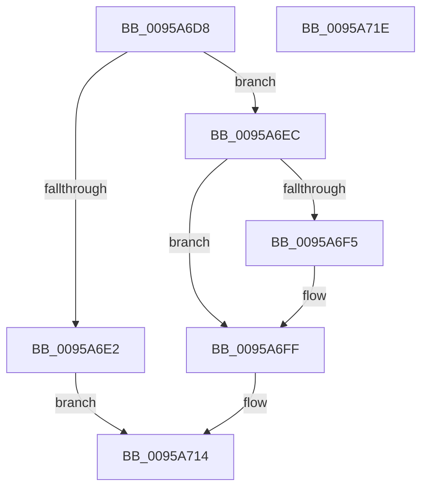

# SdbpRemoveSDBLookupEntry

- RVA: `0x0095A6D8`–`0x0095A71F` (길이 `71` bytes)
- VA: `0x000000014095A6D8`
- 실행 섹션: `PAGE`
- PDB 이름 있음: `예`; PDB Function 태그: `아니요`
- unwind 정보 RVA: `0x0005C788`
- 디코드: `19`개 명령, `71/71` bytes 표시
- 미해석 바이트: `0` (있으면 어셈블리에 `.byte`로 보존)

> 이 문서는 커널 이미지의 기계어와 PDB 기호를 분석해 생성했습니다. 4번과 5번은 함수 원형과 자료형을 바이너리 사용 방식에서 추정한 C 해석이며 원본 소스 복구 결과는 아닙니다.

## 1. Dependencies

- 직접 호출 지점: **1**; 고유 호출 대상: **1**
- 직접 호출자로 확인된 함수: **1**
- RIP 상대 이미지 참조: **0**

### Outgoing calls
- `0x0095A714` → [AslFree](AslFree_function_0095B674.md) (function, `0x0095B674`)

### Direct callers
- [SdbpCleanupUserSDBCache](SdbpCleanupUserSDBCache_function_0095B69C.md) at `0x0095B6BA`

### Static image references
- 디코드된 RIP-relative 메모리 참조가 없습니다.

## 2. Other-region calls and transfers

- 다른 실행 섹션으로 향하는 call: **0**
- 별도 외부 분기/꼬리 이동을 확인하지 못했습니다.

## 3. Assembly (complete function range)

```asm
0095A6D8  48 83 EC 28                     sub rsp, 0x28
0095A6DC  48 39 52 08                     cmp qword ptr [rdx + 8], rdx
0095A6E0  75 0A                           jne 0x14095a6ec
0095A6E2  48 83 A1 40 02 00 00 00         and qword ptr [rcx + 0x240], 0
0095A6EA  EB 28                           jmp 0x14095a714
0095A6EC  48 39 91 40 02 00 00            cmp qword ptr [rcx + 0x240], rdx
0095A6F3  75 0A                           jne 0x14095a6ff
0095A6F5  48 8B 02                        mov rax, qword ptr [rdx]
0095A6F8  48 89 81 40 02 00 00            mov qword ptr [rcx + 0x240], rax
0095A6FF  48 8B 4A 08                     mov rcx, qword ptr [rdx + 8]
0095A703  48 8B 02                        mov rax, qword ptr [rdx]
0095A706  48 89 01                        mov qword ptr [rcx], rax
0095A709  48 8B 0A                        mov rcx, qword ptr [rdx]
0095A70C  48 8B 42 08                     mov rax, qword ptr [rdx + 8]
0095A710  48 89 41 08                     mov qword ptr [rcx + 8], rax
0095A714  E8 5B 0F 00 00                  call 0x14095b674
0095A719  48 83 C4 28                     add rsp, 0x28
0095A71D  C3                              ret
0095A71E  CC                              int3
```

## 4. C-style interpretation (structured pseudocode)

```c
__int64 __fastcall SdbpRemoveSDBLookupEntry(__int64 a1, __int64 a2)
{
    __int64 result;
    __int64 v_rsp;

    v_rsp = (v_rsp) - (40);
    if ((*(unsigned __int64 *)(a2 + 8)) != a2) goto loc_0095A6EC;
    goto loc_0095A714;
loc_0095A6EC:
    if ((*(unsigned __int64 *)(a1 + 576)) == a2) {
        result = *(unsigned __int64 *)(a2);
        *(unsigned __int64 *)(a1 + 576) = result;
    }
    *(unsigned __int64 *)(*(unsigned __int64 *)(a2 + 8)) = *(unsigned __int64 *)(a2);
    *(unsigned __int64 *)(*(unsigned __int64 *)(a2) + 8) = *(unsigned __int64 *)(a2 + 8);
loc_0095A714:
    result = AslFree(*(unsigned __int64 *)(a2), a2, a3, a4);
    v_rsp = (v_rsp) + (40);
    return result;
}
```

## 5. (Beta) C Style

```c
int64_t SdbpRemoveSDBLookupEntry(void *Arg1, void *Arg2)
{
    uint8_t *arg1 = (uint8_t *)Arg1;
    uint8_t *arg2 = (uint8_t *)Arg2;

    int64_t result;
    int64_t local_rsp;

    local_rsp = (local_rsp) - (40);
    if ((*(uint64_t *)(arg2 + 0x8)) != Arg2) goto loc_0095A6EC;
    goto loc_0095A714;
loc_0095A6EC:
    if ((*(uint64_t *)(arg1 + 0x240)) == Arg2) {
        result = *(uint64_t *)(arg2);
        *(uint64_t *)(arg1 + 0x240) = result;
    }
    *(uint64_t *)(*(uint64_t *)(arg2 + 0x8)) = *(uint64_t *)(arg2);
    *(uint64_t *)(*(uint64_t *)(arg2) + 0x8) = *(uint64_t *)(arg2 + 0x8);
loc_0095A714:
    result = AslFree(*(uint64_t *)(arg2), Arg2, a3, a4);
    local_rsp = (local_rsp) + (40);
    return result;
}
```

### 관측된 메모리 오프셋

구조체 형식이 확인되지 않은 접근은 인자 기준의 오프셋으로만 기록했습니다.

| 기준 인자 | 오프셋 표현 | 폭 (bit) | 접근 |
|---|---:|---:|---|
| `Arg1` | `+ 0x240` | `64` | `R` |
| `Arg1` | `+ 0x240` | `64` | `R/W` |
| `Arg1` | `+ 0x240` | `64` | `W` |
| `Arg2` | `+ 0x0` | `64` | `R` |
| `Arg2` | `+ 0x8` | `64` | `R` |

## 6. Execution-region graph

[열기: 2D/3D 그래프와 함수 탐색 컨트롤 패널](../../../control-panel.html?section=page&rva=0x0095A6D8&view=graph)

- 2D 그래프는 위에서 아래로 흐르고, 3D 그래프는 빈 공간을 드래그해 회전합니다. Shift+드래그는 이동, 휠은 확대·축소, 함수 노드 선택은 대상 보고서 이동입니다.

### Static fallback


