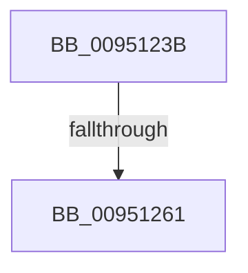

# sub_0095123B

- RVA: `0x0095123B`–`0x0095126C` (길이 `49` bytes)
- VA: `0x000000014095123B`
- 실행 섹션: `PAGE`
- PDB 이름 있음: `아니요`; PDB Function 태그: `아니요`
- unwind 정보 RVA: `0x00091CE8`
- 디코드: `12`개 명령, `49/49` bytes 표시
- 미해석 바이트: `0` (있으면 어셈블리에 `.byte`로 보존)

> 이 문서는 커널 이미지의 기계어와 PDB 기호를 분석해 생성했습니다. 4번과 5번은 함수 원형과 자료형을 바이너리 사용 방식에서 추정한 C 해석이며 원본 소스 복구 결과는 아닙니다.

## 1. Dependencies

- 직접 호출 지점: **1**; 고유 호출 대상: **1**
- 직접 호출자로 확인된 함수: **0**
- RIP 상대 이미지 참조: **0**

### Outgoing calls
- `0x0095124C` → [PsGetCurrentServerSiloGlobals](../../text/2F/PsGetCurrentServerSiloGlobals_function_002FE1F0.md) (function, `0x002FE1F0`)

### Direct callers
- 이 함수 시작 RVA로 연결되는 직접 call은 확인되지 않았습니다. 간접 호출은 완전히 역산할 수 없습니다.

### Static image references
- 디코드된 RIP-relative 메모리 참조가 없습니다.

## 2. Other-region calls and transfers

- 다른 실행 섹션으로 향하는 call: **1**
  - `0x0095124C` → [PsGetCurrentServerSiloGlobals](../../text/2F/PsGetCurrentServerSiloGlobals_function_002FE1F0.md) (`PAGE` → `.text`)
- call이 아닌 외부 분기/꼬리 이동: **2**
  - `0x0095125B` → [sub_00951326](Unknown_function_00951326.md) (`tail-transfer`)
  - `0x0095126A` → [sub_009512B0](Unknown_function_009512B0.md) (`tail-transfer`)

## 3. Assembly (complete function range)

```asm
0095123B  48 89 5C 24 40                  mov qword ptr [rsp + 0x40], rbx
00951240  44 8B CE                        mov r9d, esi
00951243  48 89 7C 24 58                  mov qword ptr [rsp + 0x58], rdi
00951248  49 8D 78 18                     lea rdi, [r8 + 0x18]
0095124C  E8 9F CF 9A FF                  call 0x1402fe1f0
00951251  48 8B 98 B0 04 00 00            mov rbx, qword ptr [rax + 0x4b0]
00951258  48 85 FF                        test rdi, rdi
0095125B  0F 84 C5 00 00 00               je 0x140951326
00951261  44 0F B7 DA                     movzx r11d, dx
00951265  41 D1 EB                        shr r11d, 1
00951268  89 37                           mov dword ptr [rdi], esi
0095126A  74 44                           je 0x1409512b0
```

## 4. C-style interpretation (structured pseudocode)

```c
__int64 __fastcall sub_0095123B(__int64 a1, unsigned __int16 a2, __int64 a3)
{
    __int64 result;
    __int64 v_r11;
    unsigned __int64 v_stack_p40;
    unsigned __int64 v_stack_p58;

    v_stack_p40 = v_rbx;
    v_stack_p58 = v_rdi;
    result = PsGetCurrentServerSiloGlobals(a1, a2, a3, (unsigned int)((unsigned int)(v_rsi)));
    v_r11 = (unsigned int)((a2) >> (1));
    *(unsigned int *)(a3 + 24) = (unsigned int)(v_rsi);
}
```

## 5. (Beta) C Style

```c
int64_t sub_0095123B(int64_t Arg1, uint16_t Arg2, void *Arg3)
{
    uint8_t *arg3 = (uint8_t *)Arg3;

    int64_t result;
    int64_t local_r11;
    uint64_t v_stack_p40;
    uint64_t v_stack_p58;

    v_stack_p40 = local_rbx;
    v_stack_p58 = local_rdi;
    result = PsGetCurrentServerSiloGlobals(Arg1, Arg2, Arg3, (uint32_t)((uint32_t)(local_rsi)));
    local_r11 = (uint32_t)((Arg2) >> (1));
    *(uint32_t *)(arg3 + 0x18) = (uint32_t)(local_rsi);
}
```

### 관측된 메모리 오프셋

구조체 형식이 확인되지 않은 접근은 인자 기준의 오프셋으로만 기록했습니다.

| 기준 인자 | 오프셋 표현 | 폭 (bit) | 접근 |
|---|---:|---:|---|
| `Arg3` | `+ 0x18` | `64` | `R` |

## 6. Execution-region graph

[열기: 2D/3D 그래프와 함수 탐색 컨트롤 패널](../../../control-panel.html?section=page&rva=0x0095123B&view=graph)

- 2D 그래프는 위에서 아래로 흐르고, 3D 그래프는 빈 공간을 드래그해 회전합니다. Shift+드래그는 이동, 휠은 확대·축소, 함수 노드 선택은 대상 보고서 이동입니다.

### Static fallback


