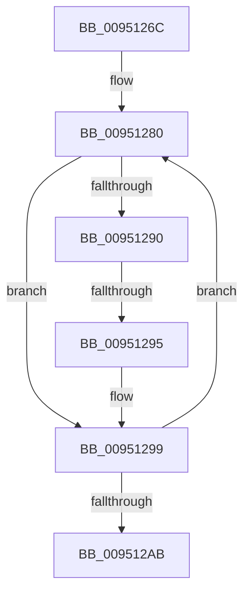

# sub_0095126C

- RVA: `0x0095126C`–`0x009512B0` (길이 `68` bytes)
- VA: `0x000000014095126C`
- 실행 섹션: `PAGE`
- PDB 이름 있음: `아니요`; PDB Function 태그: `아니요`
- unwind 정보 RVA: `0x00091D00`
- 디코드: `17`개 명령, `68/68` bytes 표시
- 미해석 바이트: `0` (있으면 어셈블리에 `.byte`로 보존)

> 이 문서는 커널 이미지의 기계어와 PDB 기호를 분석해 생성했습니다. 4번과 5번은 함수 원형과 자료형을 바이너리 사용 방식에서 추정한 C 해석이며 원본 소스 복구 결과는 아닙니다.

## 1. Dependencies

- 직접 호출 지점: **0**; 고유 호출 대상: **0**
- 직접 호출자로 확인된 함수: **0**
- RIP 상대 이미지 참조: **0**

### Outgoing calls
- 직접 디코드된 call 명령이 없습니다.

### Direct callers
- 이 함수 시작 RVA로 연결되는 직접 call은 확인되지 않았습니다. 간접 호출은 완전히 역산할 수 없습니다.

### Static image references
- 디코드된 RIP-relative 메모리 참조가 없습니다.

## 2. Other-region calls and transfers

- 다른 실행 섹션으로 향하는 call: **0**
- call이 아닌 외부 분기/꼬리 이동: **1**
  - `0x00951293` → [sub_009512C6](Unknown_function_009512C6.md) (`tail-transfer`)

## 3. Assembly (complete function range)

```asm
0095126C  48 89 6C 24 48                  mov qword ptr [rsp + 0x48], rbp
00951271  BD C0 00 00 00                  mov ebp, 0xc0
00951276  66 66 0F 1F 84 00 00 00 00 00   nop word ptr [rax + rax]
00951280  41 0F B7 02                     movzx eax, word ptr [r10]
00951284  4D 8D 52 02                     lea r10, [r10 + 2]
00951288  41 FF CB                        dec r11d
0095128B  83 F8 61                        cmp eax, 0x61
0095128E  72 09                           jb 0x140951299
00951290  83 F8 7A                        cmp eax, 0x7a
00951293  77 31                           ja 0x1409512c6
00951295  66 83 E8 20                     sub ax, 0x20
00951299  45 69 C9 3F 00 01 00            imul r9d, r9d, 0x1003f
009512A0  0F B7 C8                        movzx ecx, ax
009512A3  44 03 C9                        add r9d, ecx
009512A6  45 85 DB                        test r11d, r11d
009512A9  75 D5                           jne 0x140951280
009512AB  48 8B 6C 24 48                  mov rbp, qword ptr [rsp + 0x48]
```

## 4. C-style interpretation (structured pseudocode)

```c
__int64 __fastcall sub_0095126C(__int64 a1, __int64 a2, __int64 a3, int a4, __int64 a5, __int64 a6, __int64 a7, __int64 a8, __int64 a9)
{
    __int64 result;
    __int64 v_r11;
    unsigned __int64 v_stack_p48;

    v_stack_p48 = v_rbp;
loc_00951280:
    v_r11 = (unsigned int)((v_r11) - 1);
    if (((unsigned int)(*(unsigned __int16 *)(v_r10))) < 97) goto loc_00951299;
    result = (unsigned __int16)((*(unsigned __int16 *)(v_r10)) - (32));
loc_00951299:
    a4 = (unsigned int)((a4) * (a4));
    a4 = (unsigned int)((a4) + ((unsigned int)((unsigned __int16)(result))));
    if ((unsigned int)(v_r11) != 0) goto loc_00951280;
    return result;
}
```

## 5. (Beta) C Style

```c
int64_t sub_0095126C(int64_t Arg1, int64_t Arg2, int64_t Arg3, int32_t Arg4, uint64_t Arg5, uint64_t Arg6, uint64_t Arg7, uint64_t Arg8, int64_t Arg9)
{
    int64_t result;
    int64_t local_r11;
    uint64_t v_stack_p48;

    v_stack_p48 = local_rbp;
loc_00951280:
    local_r11 = (uint32_t)((local_r11) - 1);
    if (((uint32_t)(*(uint16_t *)(local_r10))) < 97) goto loc_00951299;
    result = (uint16_t)((*(uint16_t *)(local_r10)) - (32));
loc_00951299:
    Arg4 = (uint32_t)((Arg4) * (Arg4));
    Arg4 = (uint32_t)((Arg4) + ((uint32_t)((uint16_t)(result))));
    if ((uint32_t)(local_r11) != 0) goto loc_00951280;
    return result;
}
```

## 6. Execution-region graph

[열기: 2D/3D 그래프와 함수 탐색 컨트롤 패널](../../../control-panel.html?section=page&rva=0x0095126C&view=graph)

- 2D 그래프는 위에서 아래로 흐르고, 3D 그래프는 빈 공간을 드래그해 회전합니다. Shift+드래그는 이동, 휠은 확대·축소, 함수 노드 선택은 대상 보고서 이동입니다.

### Static fallback


