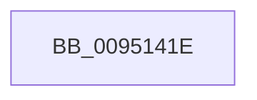

# sub_0095141E

- RVA: `0x0095141E`–`0x00951442` (길이 `36` bytes)
- VA: `0x000000014095141E`
- 실행 섹션: `PAGE`
- PDB 이름 있음: `아니요`; PDB Function 태그: `아니요`
- unwind 정보 RVA: `0x00091D94`
- 디코드: `8`개 명령, `36/36` bytes 표시
- 미해석 바이트: `0` (있으면 어셈블리에 `.byte`로 보존)

> 이 문서는 커널 이미지의 기계어와 PDB 기호를 분석해 생성했습니다. 4번과 5번은 함수 원형과 자료형을 바이너리 사용 방식에서 추정한 C 해석이며 원본 소스 복구 결과는 아닙니다.

## 1. Dependencies

- 직접 호출 지점: **1**; 고유 호출 대상: **1**
- 직접 호출자로 확인된 함수: **0**
- RIP 상대 이미지 참조: **0**

### Outgoing calls
- `0x00951429` → [PsGetCurrentServerSiloGlobals](../../text/2F/PsGetCurrentServerSiloGlobals_function_002FE1F0.md) (function, `0x002FE1F0`)

### Direct callers
- 이 함수 시작 RVA로 연결되는 직접 call은 확인되지 않았습니다. 간접 호출은 완전히 역산할 수 없습니다.

### Static image references
- 디코드된 RIP-relative 메모리 참조가 없습니다.

## 2. Other-region calls and transfers

- 다른 실행 섹션으로 향하는 call: **1**
  - `0x00951429` → [PsGetCurrentServerSiloGlobals](../../text/2F/PsGetCurrentServerSiloGlobals_function_002FE1F0.md) (`PAGE` → `.text`)
- call이 아닌 외부 분기/꼬리 이동: **1**
  - `0x00951440` → [sub_00951483](Unknown_function_00951483.md) (`tail-transfer`)

## 3. Assembly (complete function range)

```asm
0095141E  48 89 9C 24 D8 00 00 00         mov qword ptr [rsp + 0xd8], rbx
00951426  44 8B CD                        mov r9d, ebp
00951429  E8 C2 CD 9A FF                  call 0x1402fe1f0
0095142E  44 0F B7 DA                     movzx r11d, dx
00951432  41 D1 EB                        shr r11d, 1
00951435  48 8B 98 B0 04 00 00            mov rbx, qword ptr [rax + 0x4b0]
0095143C  89 6C 24 58                     mov dword ptr [rsp + 0x58], ebp
00951440  74 41                           je 0x140951483
```

## 4. C-style interpretation (structured pseudocode)

```c
__int64 __fastcall sub_0095141E(__int64 a1, unsigned __int16 a2)
{
    __int64 result;
    __int64 v_r11;
    unsigned int v_stack_p58;
    unsigned __int64 v_stack_pD8;

    v_stack_pD8 = v_rbx;
    result = PsGetCurrentServerSiloGlobals(a1, a2, a3, (unsigned int)((unsigned int)(v_rbp)));
    v_r11 = (unsigned int)((a2) >> (1));
    v_stack_p58 = (unsigned int)(v_rbp);
}
```

## 5. (Beta) C Style

```c
int64_t sub_0095141E(int64_t Arg1, uint16_t Arg2)
{
    int64_t result;
    int64_t local_r11;
    uint32_t v_stack_p58;
    uint64_t v_stack_pD8;

    v_stack_pD8 = local_rbx;
    result = PsGetCurrentServerSiloGlobals(Arg1, Arg2, a3, (uint32_t)((uint32_t)(local_rbp)));
    local_r11 = (uint32_t)((Arg2) >> (1));
    v_stack_p58 = (uint32_t)(local_rbp);
}
```

## 6. Execution-region graph

[열기: 2D/3D 그래프와 함수 탐색 컨트롤 패널](../../../control-panel.html?section=page&rva=0x0095141E&view=graph)

- 2D 그래프는 위에서 아래로 흐르고, 3D 그래프는 빈 공간을 드래그해 회전합니다. Shift+드래그는 이동, 휠은 확대·축소, 함수 노드 선택은 대상 보고서 이동입니다.

### Static fallback


