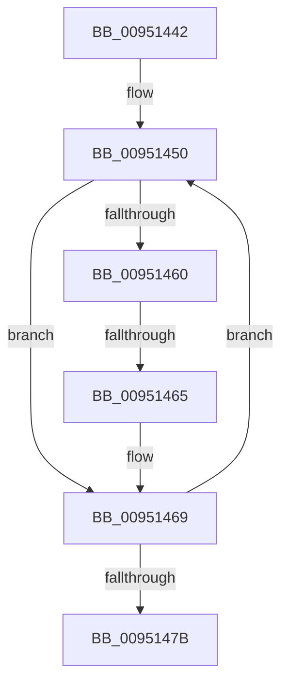

# sub_00951442

- RVA: `0x00951442`–`0x00951483` (길이 `65` bytes)
- VA: `0x0000000140951442`
- 실행 섹션: `PAGE`
- PDB 이름 있음: `아니요`; PDB Function 태그: `아니요`
- unwind 정보 RVA: `0x00091DA8`
- 디코드: `17`개 명령, `65/65` bytes 표시
- 미해석 바이트: `0` (있으면 어셈블리에 `.byte`로 보존)

> 이 문서는 커널 이미지의 기계어와 PDB 기호를 분석해 생성했습니다. 4번과 5번은 함수 원형과 자료형을 바이너리 사용 방식에서 추정한 C 해석이며 원본 소스 복구 결과는 아닙니다.

## 1. Dependencies

- 직접 호출 지점: **0**; 고유 호출 대상: **0**
- 직접 호출자로 확인된 함수: **0**
- RIP 상대 이미지 참조: **0**

### Outgoing calls
- 직접 디코드된 call 명령이 없습니다.

### Direct callers
- 이 함수 시작 RVA로 연결되는 직접 call은 확인되지 않았습니다. 간접 호출은 완전히 역산할 수 없습니다.

### Static image references
- 디코드된 RIP-relative 메모리 참조가 없습니다.

## 2. Other-region calls and transfers

- 다른 실행 섹션으로 향하는 call: **0**
- call이 아닌 외부 분기/꼬리 이동: **1**
  - `0x00951463` → [sub_009514C8](Unknown_function_009514C8.md) (`tail-transfer`)

## 3. Assembly (complete function range)

```asm
00951442  48 89 B4 24 E0 00 00 00         mov qword ptr [rsp + 0xe0], rsi
0095144A  BE C0 00 00 00                  mov esi, 0xc0
0095144F  90                              nop
00951450  41 0F B7 02                     movzx eax, word ptr [r10]
00951454  4D 8D 52 02                     lea r10, [r10 + 2]
00951458  41 FF CB                        dec r11d
0095145B  83 F8 61                        cmp eax, 0x61
0095145E  72 09                           jb 0x140951469
00951460  83 F8 7A                        cmp eax, 0x7a
00951463  77 63                           ja 0x1409514c8
00951465  66 83 E8 20                     sub ax, 0x20
00951469  45 69 C9 3F 00 01 00            imul r9d, r9d, 0x1003f
00951470  0F B7 C8                        movzx ecx, ax
00951473  44 03 C9                        add r9d, ecx
00951476  45 85 DB                        test r11d, r11d
00951479  75 D5                           jne 0x140951450
0095147B  48 8B B4 24 E0 00 00 00         mov rsi, qword ptr [rsp + 0xe0]
```

## 4. C-style interpretation (structured pseudocode)

```c
__int64 __fastcall sub_00951442(__int64 a1, __int64 a2, __int64 a3, int a4, __int64 a5, __int64 a6, __int64 a7, __int64 a8, __int64 a9, __int64 a10, __int64 a11, __int64 a12, __int64 a13, __int64 a14, __int64 a15, __int64 a16, __int64 a17, __int64 a18, __int64 a19, __int64 a20, __int64 a21, __int64 a22, __int64 a23, __int64 a24, __int64 a25, __int64 a26, __int64 a27, __int64 a28)
{
    __int64 result;
    __int64 v_r11;
    unsigned __int64 v_stack_pE0;

    v_stack_pE0 = v_rsi;
loc_00951450:
    v_r11 = (unsigned int)((v_r11) - 1);
    if (((unsigned int)(*(unsigned __int16 *)(v_r10))) < 97) goto loc_00951469;
    result = (unsigned __int16)((*(unsigned __int16 *)(v_r10)) - (32));
loc_00951469:
    a4 = (unsigned int)((a4) * (a4));
    a4 = (unsigned int)((a4) + ((unsigned int)((unsigned __int16)(result))));
    if ((unsigned int)(v_r11) != 0) goto loc_00951450;
    return result;
}
```

## 5. (Beta) C Style

```c
int64_t sub_00951442(int64_t Arg1, int64_t Arg2, int64_t Arg3, int32_t Arg4, uint64_t Arg5, uint64_t Arg6, uint64_t Arg7, uint64_t Arg8, uint64_t Arg9, uint64_t Arg10, uint64_t Arg11, uint64_t Arg12, uint64_t Arg13, uint64_t Arg14, uint64_t Arg15, uint64_t Arg16, uint64_t Arg17, uint64_t Arg18, uint64_t Arg19, uint64_t Arg20, uint64_t Arg21, uint64_t Arg22, uint64_t Arg23, uint64_t Arg24, uint64_t Arg25, uint64_t Arg26, uint64_t Arg27, int64_t Arg28)
{
    int64_t result;
    int64_t local_r11;
    uint64_t v_stack_pE0;

    v_stack_pE0 = local_rsi;
loc_00951450:
    local_r11 = (uint32_t)((local_r11) - 1);
    if (((uint32_t)(*(uint16_t *)(local_r10))) < 97) goto loc_00951469;
    result = (uint16_t)((*(uint16_t *)(local_r10)) - (32));
loc_00951469:
    Arg4 = (uint32_t)((Arg4) * (Arg4));
    Arg4 = (uint32_t)((Arg4) + ((uint32_t)((uint16_t)(result))));
    if ((uint32_t)(local_r11) != 0) goto loc_00951450;
    return result;
}
```

## 6. Execution-region graph

[열기: 2D/3D 그래프와 함수 탐색 컨트롤 패널](../../../control-panel.html?section=page&rva=0x00951442&view=graph)

- 2D 그래프는 위에서 아래로 흐르고, 3D 그래프는 빈 공간을 드래그해 회전합니다. Shift+드래그는 이동, 휠은 확대·축소, 함수 노드 선택은 대상 보고서 이동입니다.

### Static fallback


