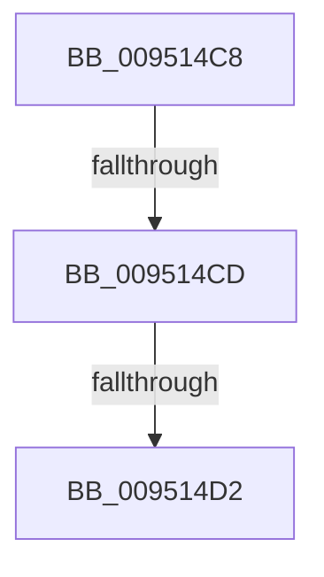

# sub_009514C8

- RVA: `0x009514C8`–`0x009514FE` (길이 `54` bytes)
- VA: `0x00000001409514C8`
- 실행 섹션: `PAGE`
- PDB 이름 있음: `아니요`; PDB Function 태그: `아니요`
- unwind 정보 RVA: `0x00091DE0`
- 디코드: `17`개 명령, `54/54` bytes 표시
- 미해석 바이트: `0` (있으면 어셈블리에 `.byte`로 보존)

> 이 문서는 커널 이미지의 기계어와 PDB 기호를 분석해 생성했습니다. 4번과 5번은 함수 원형과 자료형을 바이너리 사용 방식에서 추정한 C 해석이며 원본 소스 복구 결과는 아닙니다.

## 1. Dependencies

- 직접 호출 지점: **0**; 고유 호출 대상: **0**
- 직접 호출자로 확인된 함수: **0**
- RIP 상대 이미지 참조: **0**

### Outgoing calls
- 직접 디코드된 call 명령이 없습니다.

### Direct callers
- 이 함수 시작 RVA로 연결되는 직접 call은 확인되지 않았습니다. 간접 호출은 완전히 역산할 수 없습니다.

### Static image references
- 디코드된 RIP-relative 메모리 참조가 없습니다.

## 2. Other-region calls and transfers

- 다른 실행 섹션으로 향하는 call: **0**
- call이 아닌 외부 분기/꼬리 이동: **3**
  - `0x009514CB` → [sub_00951442 + 0x27](Unknown_function_00951442.md) (`tail-transfer`)
  - `0x009514D0` → [sub_00951442 + 0x27](Unknown_function_00951442.md) (`tail-transfer`)
  - `0x009514F9` → [sub_00951442 + 0x27](Unknown_function_00951442.md) (`tail-transfer`)

## 3. Assembly (complete function range)

```asm
009514C8  48 85 DB                        test rbx, rbx
009514CB  74 9C                           je 0x140951469
009514CD  66 3B C6                        cmp ax, si
009514D0  72 97                           jb 0x140951469
009514D2  48 8B C8                        mov rcx, rax
009514D5  44 8B C0                        mov r8d, eax
009514D8  48 C1 E9 08                     shr rcx, 8
009514DC  41 83 E0 0F                     and r8d, 0xf
009514E0  0F B7 14 4B                     movzx edx, word ptr [rbx + rcx*2]
009514E4  8B C8                           mov ecx, eax
009514E6  C1 E9 04                        shr ecx, 4
009514E9  83 E1 0F                        and ecx, 0xf
009514EC  03 D1                           add edx, ecx
009514EE  0F B7 14 53                     movzx edx, word ptr [rbx + rdx*2]
009514F2  41 03 D0                        add edx, r8d
009514F5  66 03 04 53                     add ax, word ptr [rbx + rdx*2]
009514F9  E9 6B FF FF FF                  jmp 0x140951469
```

## 4. C-style interpretation (structured pseudocode)

```c
__int64 __fastcall sub_009514C8(void)
{
    __int64 result;

    a1 = (result) >> (8);
    a3 = (unsigned int)(((unsigned int)((unsigned int)(result))) & (15));
    a1 = (unsigned int)(((unsigned int)((unsigned int)(result))) >> (4));
    a1 = (unsigned int)((a1) & (15));
    a2 = (unsigned int)((*(unsigned __int16 *)(v_rbx + a1 * 2)) + ((unsigned int)(a1)));
    a2 = (unsigned int)((*(unsigned __int16 *)(v_rbx + a2 * 2)) + ((unsigned int)(a3)));
    result = (unsigned __int16)((result) + (*(unsigned __int16 *)(v_rbx + a2 * 2)));
}
```

## 5. (Beta) C Style

```c
void sub_009514C8(void)
{
    int64_t result;

    a1 = (result) >> (8);
    a3 = (uint32_t)(((uint32_t)((uint32_t)(result))) & (15));
    a1 = (uint32_t)(((uint32_t)((uint32_t)(result))) >> (4));
    a1 = (uint32_t)((a1) & (15));
    a2 = (uint32_t)((*(uint16_t *)(local_rbx + a1 * 2)) + ((uint32_t)(a1)));
    a2 = (uint32_t)((*(uint16_t *)(local_rbx + a2 * 2)) + ((uint32_t)(a3)));
    result = (uint16_t)((result) + (*(uint16_t *)(local_rbx + a2 * 2)));
}
```

## 6. Execution-region graph

[열기: 2D/3D 그래프와 함수 탐색 컨트롤 패널](../../../control-panel.html?section=page&rva=0x009514C8&view=graph)

- 2D 그래프는 위에서 아래로 흐르고, 3D 그래프는 빈 공간을 드래그해 회전합니다. Shift+드래그는 이동, 휠은 확대·축소, 함수 노드 선택은 대상 보고서 이동입니다.

### Static fallback


