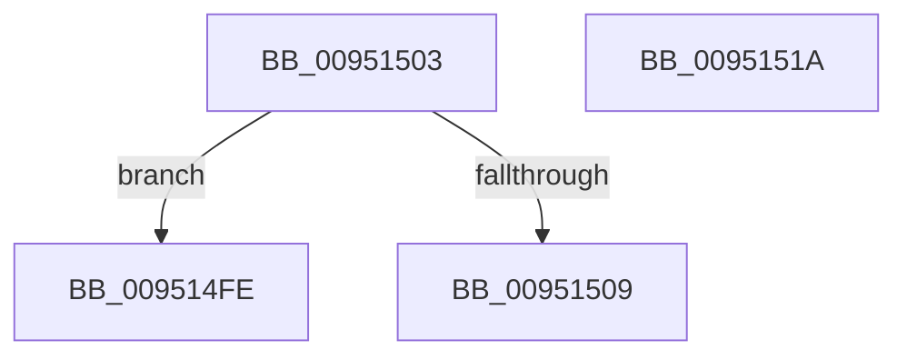

# sub_009514FE

- RVA: `0x009514FE`–`0x00951529` (길이 `43` bytes)
- VA: `0x00000001409514FE`
- 실행 섹션: `PAGE`
- PDB 이름 있음: `아니요`; PDB Function 태그: `아니요`
- unwind 정보 RVA: `0x00091DF8`
- 디코드: `11`개 명령, `43/43` bytes 표시
- 미해석 바이트: `0` (있으면 어셈블리에 `.byte`로 보존)

> 이 문서는 커널 이미지의 기계어와 PDB 기호를 분석해 생성했습니다. 4번과 5번은 함수 원형과 자료형을 바이너리 사용 방식에서 추정한 C 해석이며 원본 소스 복구 결과는 아닙니다.

## 1. Dependencies

- 직접 호출 지점: **0**; 고유 호출 대상: **0**
- 직접 호출자로 확인된 함수: **0**
- RIP 상대 이미지 참조: **0**

### Outgoing calls
- 직접 디코드된 call 명령이 없습니다.

### Direct callers
- 이 함수 시작 RVA로 연결되는 직접 call은 확인되지 않았습니다. 간접 호출은 완전히 역산할 수 없습니다.

### Static image references
- 디코드된 RIP-relative 메모리 참조가 없습니다.

## 2. Other-region calls and transfers

- 다른 실행 섹션으로 향하는 call: **0**
- call이 아닌 외부 분기/꼬리 이동: **3**
  - `0x00951501` → [sub_0095149E + 0x8](Unknown_function_0095149E.md) (`tail-transfer`)
  - `0x00951515` → [sub_0095141E](Unknown_function_0095141E.md) (`tail-transfer`)
  - `0x00951524` → [PiDmLookupObject + 0xAC](PiDmLookupObject_function_00951360.md) (`tail-transfer`)

## 3. Assembly (complete function range)

```asm
009514FE  48 8B C5                        mov rax, rbp
00951501  EB A3                           jmp 0x1409514a6
00951503  66 83 FA 08                     cmp dx, 8
00951507  76 F5                           jbe 0x1409514fe
00951509  B8 F8 FF 00 00                  mov eax, 0xfff8
0095150E  66 03 D0                        add dx, ax
00951511  49 83 C2 08                     add r10, 8
00951515  E9 04 FF FF FF                  jmp 0x14095141e
0095151A  4C 8B 54 24 30                  mov r10, qword ptr [rsp + 0x30]
0095151F  0F B7 54 24 28                  movzx edx, word ptr [rsp + 0x28]
00951524  E9 E3 FE FF FF                  jmp 0x14095140c
```

## 4. C-style interpretation (structured pseudocode)

```c
__int64 __fastcall sub_009514FE(__int64 a1, unsigned __int16 a2)
{
    unsigned __int16 v_stack_p28;
    unsigned __int64 v_stack_p30;
}
```

## 5. (Beta) C Style

```c
int64_t sub_009514FE(int64_t Arg1, uint16_t Arg2)
{
    uint16_t v_stack_p28;
    uint64_t v_stack_p30;
}
```

## 6. Execution-region graph

[열기: 2D/3D 그래프와 함수 탐색 컨트롤 패널](../../../control-panel.html?section=page&rva=0x009514FE&view=graph)

- 2D 그래프는 위에서 아래로 흐르고, 3D 그래프는 빈 공간을 드래그해 회전합니다. Shift+드래그는 이동, 휠은 확대·축소, 함수 노드 선택은 대상 보고서 이동입니다.

### Static fallback


