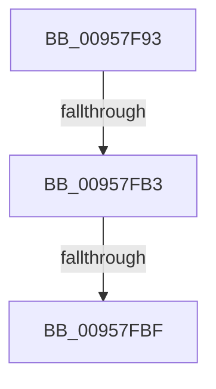

# sub_00957F93

- RVA: `0x00957F93`–`0x00958014` (길이 `129` bytes)
- VA: `0x0000000140957F93`
- 실행 섹션: `PAGE`
- PDB 이름 있음: `아니요`; PDB Function 태그: `아니요`
- unwind 정보 RVA: `0x00092498`
- 디코드: `31`개 명령, `129/129` bytes 표시
- 미해석 바이트: `0` (있으면 어셈블리에 `.byte`로 보존)

> 이 문서는 커널 이미지의 기계어와 PDB 기호를 분석해 생성했습니다. 4번과 5번은 함수 원형과 자료형을 바이너리 사용 방식에서 추정한 C 해석이며 원본 소스 복구 결과는 아닙니다.

## 1. Dependencies

- 직접 호출 지점: **3**; 고유 호출 대상: **3**
- 직접 호출자로 확인된 함수: **0**
- RIP 상대 이미지 참조: **0**

### Outgoing calls
- `0x00957FA4` → [PspLockThreadSecurityShared](../../text/3C/PspLockThreadSecurityShared_function_003C4720.md) (function, `0x003C4720`)
- `0x00957FE0` → [ObfReferenceObjectWithTag](../../text/21/ObfReferenceObjectWithTag_function_00210710.md) (function, `0x00210710`)
- `0x00958005` → [PspUnlockThreadSecurityShared](../../text/3C/PspUnlockThreadSecurityShared_function_003C2E40.md) (function, `0x003C2E40`)

### Direct callers
- 이 함수 시작 RVA로 연결되는 직접 call은 확인되지 않았습니다. 간접 호출은 완전히 역산할 수 없습니다.

### Static image references
- 디코드된 RIP-relative 메모리 참조가 없습니다.

## 2. Other-region calls and transfers

- 다른 실행 섹션으로 향하는 call: **3**
  - `0x00957FA4` → [PspLockThreadSecurityShared](../../text/3C/PspLockThreadSecurityShared_function_003C4720.md) (`PAGE` → `.text`)
  - `0x00957FE0` → [ObfReferenceObjectWithTag](../../text/21/ObfReferenceObjectWithTag_function_00210710.md) (`PAGE` → `.text`)
  - `0x00958005` → [PspUnlockThreadSecurityShared](../../text/3C/PspUnlockThreadSecurityShared_function_003C2E40.md) (`PAGE` → `.text`)
- call이 아닌 외부 분기/꼬리 이동: **3**
  - `0x00957FB1` → [sub_00958014](Unknown_function_00958014.md) (`tail-transfer`)
  - `0x00957FBD` → [sub_00958014 + 0x4](Unknown_function_00958014.md) (`tail-transfer`)
  - `0x0095800F` → [PsReferenceImpersonationToken + 0x2B](PsReferenceImpersonationToken_function_00957F50.md) (`tail-transfer`)

## 3. Assembly (complete function range)

```asm
00957F93  48 89 6C 24 40                  mov qword ptr [rsp + 0x40], rbp
00957F98  65 48 8B 2C 25 88 01 00 00      mov rbp, qword ptr gs:[0x188]
00957FA1  48 8B D5                        mov rdx, rbp
00957FA4  E8 77 C7 A6 FF                  call 0x1403c4720
00957FA9  8B 83 A0 05 00 00               mov eax, dword ptr [rbx + 0x5a0]
00957FAF  A8 08                           test al, 8
00957FB1  74 61                           je 0x140958014
00957FB3  48 8B BB 48 06 00 00            mov rdi, qword ptr [rbx + 0x648]
00957FBA  48 85 FF                        test rdi, rdi
00957FBD  75 59                           jne 0x140958018
00957FBF  48 8B BB 38 05 00 00            mov rdi, qword ptr [rbx + 0x538]
00957FC6  8B 83 A0 05 00 00               mov eax, dword ptr [rbx + 0x5a0]
00957FCC  48 83 E7 F8                     and rdi, 0xfffffffffffffff8
00957FD0  C1 E8 08                        shr eax, 8
00957FD3  24 01                           and al, 1
00957FD5  BA 44 66 6C 74                  mov edx, 0x746c6644
00957FDA  41 88 07                        mov byte ptr [r15], al
00957FDD  48 8B CF                        mov rcx, rdi
00957FE0  E8 2B 87 8B FF                  call 0x140210710
00957FE5  8B 83 38 05 00 00               mov eax, dword ptr [rbx + 0x538]
00957FEB  83 E0 03                        and eax, 3
00957FEE  89 06                           mov dword ptr [rsi], eax
00957FF0  0F B6 83 38 05 00 00            movzx eax, byte ptr [rbx + 0x538]
00957FF7  C0 E8 02                        shr al, 2
00957FFA  24 01                           and al, 1
00957FFC  41 88 06                        mov byte ptr [r14], al
00957FFF  48 8B D5                        mov rdx, rbp
00958002  48 8B CB                        mov rcx, rbx
00958005  E8 36 AE A6 FF                  call 0x1403c2e40
0095800A  48 8B 6C 24 40                  mov rbp, qword ptr [rsp + 0x40]
0095800F  E9 67 FF FF FF                  jmp 0x140957f7b
```

## 4. C-style interpretation (structured pseudocode)

```c
__int64 __fastcall sub_00957F93(__int64 a1, __int64 a2, __int64 a3, __int64 a4, __int64 a5, __int64 a6, __int64 a7, __int64 a8)
{
    __int64 result;
    __int64 v_rdi;
    unsigned __int64 v_stack_p40;

    v_stack_p40 = v_rbp;
    result = PspLockThreadSecurityShared(a1, *(unsigned __int64 *)(gs_base + (0 + 392)), a3, a4);
    v_rdi = (*(unsigned __int64 *)(v_rbx + 1336)) & (-8);
    result = (unsigned int)(((unsigned int)(*(unsigned int *)(v_rbx + 1440))) >> (8));
    result = (unsigned __int8)((result) & (1));
    *(unsigned __int8 *)(v_r15) = (unsigned __int8)(result);
    result = ObfReferenceObjectWithTag(v_rdi, (unsigned int)(0x746C6644ULL), a3, a4);
    result = (unsigned int)(((unsigned int)(*(unsigned int *)(v_rbx + 1336))) & (3));
    *(unsigned int *)(v_rsi) = (unsigned int)(result);
    result = (unsigned __int8)((*(unsigned __int8 *)(v_rbx + 1336)) >> (2));
    result = (unsigned __int8)((result) & (1));
    *(unsigned __int8 *)(v_r14) = (unsigned __int8)(result);
    result = PspUnlockThreadSecurityShared(v_rbx, *(unsigned __int64 *)(gs_base + (0 + 392)), a3, a4);
}
```

## 5. (Beta) C Style

```c
int64_t sub_00957F93(int64_t Arg1, int64_t Arg2, int64_t Arg3, int64_t Arg4, uint64_t Arg5, uint64_t Arg6, uint64_t Arg7, int64_t Arg8)
{
    int64_t result;
    int64_t local_rdi;
    uint64_t v_stack_p40;

    v_stack_p40 = local_rbp;
    result = PspLockThreadSecurityShared(Arg1, *(uint64_t *)(gs_base + (0 + 0x188)), Arg3, Arg4);
    local_rdi = (*(uint64_t *)(local_rbx + 0x538)) & (-8);
    result = (uint32_t)(((uint32_t)(*(uint32_t *)(local_rbx + 0x5A0))) >> (8));
    result = (uint8_t)((result) & (1));
    *(uint8_t *)(local_r15) = (uint8_t)(result);
    result = ObfReferenceObjectWithTag(local_rdi, (uint32_t)(0x746C6644ULL), Arg3, Arg4);
    result = (uint32_t)(((uint32_t)(*(uint32_t *)(local_rbx + 0x538))) & (3));
    *(uint32_t *)(local_rsi) = (uint32_t)(result);
    result = (uint8_t)((*(uint8_t *)(local_rbx + 0x538)) >> (2));
    result = (uint8_t)((result) & (1));
    *(uint8_t *)(local_r14) = (uint8_t)(result);
    result = PspUnlockThreadSecurityShared(local_rbx, *(uint64_t *)(gs_base + (0 + 0x188)), Arg3, Arg4);
}
```

## 6. Execution-region graph

[열기: 2D/3D 그래프와 함수 탐색 컨트롤 패널](../../../control-panel.html?section=page&rva=0x00957F93&view=graph)

- 2D 그래프는 위에서 아래로 흐르고, 3D 그래프는 빈 공간을 드래그해 회전합니다. Shift+드래그는 이동, 휠은 확대·축소, 함수 노드 선택은 대상 보고서 이동입니다.

### Static fallback


