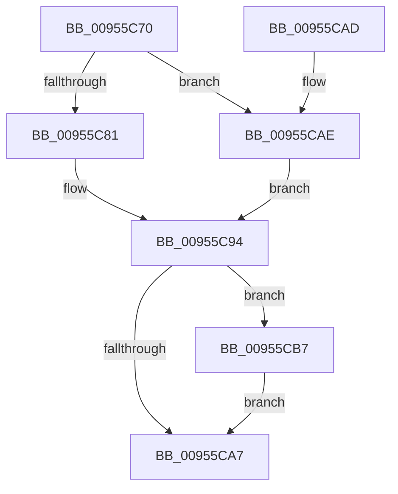

# WdtpCancelTimer

- RVA: `0x00955C70`–`0x00955CD0` (길이 `96` bytes)
- VA: `0x0000000140955C70`
- 실행 섹션: `PAGE`
- PDB 이름 있음: `예`; PDB Function 태그: `아니요`
- unwind 정보 RVA: `0x00092370`
- 디코드: `30`개 명령, `96/96` bytes 표시
- 미해석 바이트: `0` (있으면 어셈블리에 `.byte`로 보존)

> 이 문서는 커널 이미지의 기계어와 PDB 기호를 분석해 생성했습니다. 4번과 5번은 함수 원형과 자료형을 바이너리 사용 방식에서 추정한 C 해석이며 원본 소스 복구 결과는 아닙니다.

## 1. Dependencies

- 직접 호출 지점: **3**; 고유 호출 대상: **3**
- 직접 호출자로 확인된 함수: **1**
- RIP 상대 이미지 참조: **0**

### Outgoing calls
- `0x00955C8A` → [ExDeleteTimer](../../text/39/ExDeleteTimer_function_0039F2E0.md) (function, `0x0039F2E0`)
- `0x00955CB0` → [ExCancelTimer](../../text/3A/ExCancelTimer_function_003A01A0.md) (function, `0x003A01A0`)
- `0x00955CC9` → [KeWaitForSingleObject](../../text/20/KeWaitForSingleObject_function_0020E6B0.md) (function, `0x0020E6B0`)

### Direct callers
- [PnpDisableWatchdog](PnpDisableWatchdog_function_00955B00.md) at `0x00955B2B`

### Static image references
- 디코드된 RIP-relative 메모리 참조가 없습니다.

## 2. Other-region calls and transfers

- 다른 실행 섹션으로 향하는 call: **3**
  - `0x00955C8A` → [ExDeleteTimer](../../text/39/ExDeleteTimer_function_0039F2E0.md) (`PAGE` → `.text`)
  - `0x00955CB0` → [ExCancelTimer](../../text/3A/ExCancelTimer_function_003A01A0.md) (`PAGE` → `.text`)
  - `0x00955CC9` → [KeWaitForSingleObject](../../text/20/KeWaitForSingleObject_function_0020E6B0.md) (`PAGE` → `.text`)
- 별도 외부 분기/꼬리 이동을 확인하지 못했습니다.

## 3. Assembly (complete function range)

```asm
00955C70  40 53                           push rbx
00955C72  48 83 EC 30                     sub rsp, 0x30
00955C76  48 8B D9                        mov rbx, rcx
00955C79  48 8B 49 30                     mov rcx, qword ptr [rcx + 0x30]
00955C7D  84 D2                           test dl, dl
00955C7F  74 2D                           je 0x140955cae
00955C81  41 B0 01                        mov r8b, 1
00955C84  45 33 C9                        xor r9d, r9d
00955C87  41 8A D0                        mov dl, r8b
00955C8A  E8 51 96 A4 FF                  call 0x14039f2e0
00955C8F  48 83 63 30 00                  and qword ptr [rbx + 0x30], 0
00955C94  48 83 63 78 00                  and qword ptr [rbx + 0x78], 0
00955C99  83 A3 80 00 00 00 00            and dword ptr [rbx + 0x80], 0
00955CA0  8B 43 58                        mov eax, dword ptr [rbx + 0x58]
00955CA3  85 C0                           test eax, eax
00955CA5  7F 10                           jg 0x140955cb7
00955CA7  48 83 C4 30                     add rsp, 0x30
00955CAB  5B                              pop rbx
00955CAC  C3                              ret
00955CAD  CC                              int3
00955CAE  33 D2                           xor edx, edx
00955CB0  E8 EB A4 A4 FF                  call 0x1403a01a0
00955CB5  EB DD                           jmp 0x140955c94
00955CB7  48 83 64 24 20 00               and qword ptr [rsp + 0x20], 0
00955CBD  48 8D 4B 60                     lea rcx, [rbx + 0x60]
00955CC1  45 33 C9                        xor r9d, r9d
00955CC4  45 33 C0                        xor r8d, r8d
00955CC7  33 D2                           xor edx, edx
00955CC9  E8 E2 89 8B FF                  call 0x14020e6b0
00955CCE  EB D7                           jmp 0x140955ca7
```

## 4. C-style interpretation (structured pseudocode)

```c
__int64 __fastcall WdtpCancelTimer(__int64 a1, unsigned __int8 a2, __int64 a3, int a4)
{
    __int64 result;
    __int64 v_rsp;
    unsigned __int64 v_stack_p20;

    v_rsp = (v_rsp) - (48);
    if (a2 == 0) goto loc_00955CAE;
    a4 = 0;
    result = ExDeleteTimer(*(unsigned __int64 *)(a1 + 48), 1, 1, a4);
loc_00955C94:
    if (condition_is_greater) goto loc_00955CB7;
loc_00955CA7:
    v_rsp = (v_rsp) + (48);
    return (unsigned int)(*(unsigned int *)(a1 + 88));
loc_00955CAE:
    a2 = 0;
    result = ExCancelTimer(*(unsigned __int64 *)(a1 + 48), a2, 1, a4);
    goto loc_00955C94;
loc_00955CB7:
    a4 = 0;
    a3 = 0;
    a2 = 0;
    result = KeWaitForSingleObject(a1 + 96, a2, a3, a4);
    goto loc_00955CA7;
}
```

## 5. (Beta) C Style

```c
int64_t WdtpCancelTimer(void *Arg1, uint8_t Arg2, int64_t Arg3, int32_t Arg4)
{
    uint8_t *arg1 = (uint8_t *)Arg1;

    int64_t result;
    int64_t local_rsp;
    uint64_t v_stack_p20;

    local_rsp = (local_rsp) - (48);
    if (Arg2 == 0) goto loc_00955CAE;
    Arg4 = 0;
    result = ExDeleteTimer(*(uint64_t *)(arg1 + 0x30), 1, 1, Arg4);
loc_00955C94:
    if (condition_is_greater) goto loc_00955CB7;
loc_00955CA7:
    local_rsp = (local_rsp) + (48);
    return (uint32_t)(*(uint32_t *)(arg1 + 0x58));
loc_00955CAE:
    Arg2 = 0;
    result = ExCancelTimer(*(uint64_t *)(arg1 + 0x30), Arg2, 1, Arg4);
    goto loc_00955C94;
loc_00955CB7:
    Arg4 = 0;
    Arg3 = 0;
    Arg2 = 0;
    result = KeWaitForSingleObject(Arg1 + 96, Arg2, Arg3, Arg4);
    goto loc_00955CA7;
}
```

### 관측된 메모리 오프셋

구조체 형식이 확인되지 않은 접근은 인자 기준의 오프셋으로만 기록했습니다.

| 기준 인자 | 오프셋 표현 | 폭 (bit) | 접근 |
|---|---:|---:|---|
| `Arg1` | `+ 0x30` | `64` | `R` |
| `Arg1` | `+ 0x30` | `64` | `R/W` |
| `Arg1` | `+ 0x58` | `32` | `R` |
| `Arg1` | `+ 0x60` | `64` | `R` |
| `Arg1` | `+ 0x78` | `64` | `R/W` |
| `Arg1` | `+ 0x80` | `32` | `R/W` |

## 6. Execution-region graph

[열기: 2D/3D 그래프와 함수 탐색 컨트롤 패널](../../../control-panel.html?section=page&rva=0x00955C70&view=graph)

- 2D 그래프는 위에서 아래로 흐르고, 3D 그래프는 빈 공간을 드래그해 회전합니다. Shift+드래그는 이동, 휠은 확대·축소, 함수 노드 선택은 대상 보고서 이동입니다.

### Static fallback


