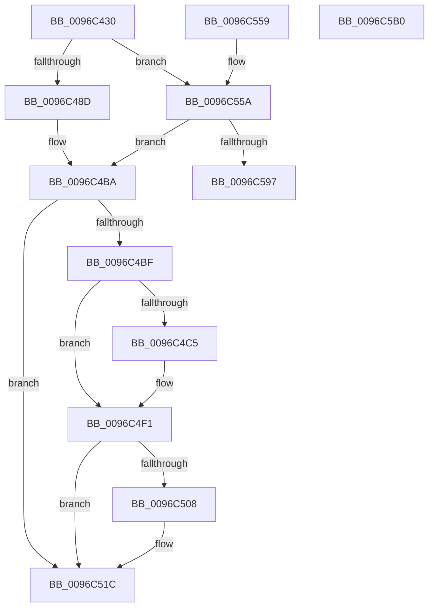

# CcMapData

- RVA: `0x0096C430`–`0x0096C5B1` (길이 `385` bytes)
- VA: `0x000000014096C430`
- 실행 섹션: `PAGE`
- PDB 이름 있음: `예`; PDB Function 태그: `아니요`
- unwind 정보 RVA: `0x000952F0`
- 디코드: `91`개 명령, `385/385` bytes 표시
- 미해석 바이트: `0` (있으면 어셈블리에 `.byte`로 보존)

> 이 문서는 커널 이미지의 기계어와 PDB 기호를 분석해 생성했습니다. 4번과 5번은 함수 원형과 자료형을 바이너리 사용 방식에서 추정한 C 해석이며 원본 소스 복구 결과는 아닙니다.

## 1. Dependencies

- 직접 호출 지점: **3**; 고유 호출 대상: **3**
- 직접 호출자로 확인된 함수: **0**
- RIP 상대 이미지 참조: **0**

### Outgoing calls
- `0x0096C4AA` → [CcGetVirtualAddress](../../text/34/CcGetVirtualAddress_function_00340C9C.md) (function, `0x00340C9C`)
- `0x0096C4FC` → [CcMapAndRead](../../text/2F/CcMapAndRead_function_002F6AC0.md) (function, `0x002F6AC0`)
- `0x0096C58A` → [CcPinFileData](../../text/33/CcPinFileData_function_0033FB40.md) (function, `0x0033FB40`)

### Direct callers
- 이 함수 시작 RVA로 연결되는 직접 call은 확인되지 않았습니다. 간접 호출은 완전히 역산할 수 없습니다.

### Static image references
- 디코드된 RIP-relative 메모리 참조가 없습니다.

## 2. Other-region calls and transfers

- 다른 실행 섹션으로 향하는 call: **3**
  - `0x0096C4AA` → [CcGetVirtualAddress](../../text/34/CcGetVirtualAddress_function_00340C9C.md) (`PAGE` → `.text`)
  - `0x0096C4FC` → [CcMapAndRead](../../text/2F/CcMapAndRead_function_002F6AC0.md) (`PAGE` → `.text`)
  - `0x0096C58A` → [CcPinFileData](../../text/33/CcPinFileData_function_0033FB40.md) (`PAGE` → `.text`)
- 별도 외부 분기/꼬리 이동을 확인하지 못했습니다.

## 3. Assembly (complete function range)

```asm
0096C430  48 89 5C 24 10                  mov qword ptr [rsp + 0x10], rbx
0096C435  44 89 4C 24 20                  mov dword ptr [rsp + 0x20], r9d
0096C43A  56                              push rsi
0096C43B  57                              push rdi
0096C43C  41 56                           push r14
0096C43E  48 83 EC 70                     sub rsp, 0x70
0096C442  41 8B D9                        mov ebx, r9d
0096C445  45 8B F0                        mov r14d, r8d
0096C448  4C 8B D1                        mov r10, rcx
0096C44B  33 FF                           xor edi, edi
0096C44D  89 BC 24 90 00 00 00            mov dword ptr [rsp + 0x90], edi
0096C454  48 89 7C 24 60                  mov qword ptr [rsp + 0x60], rdi
0096C459  48 89 7C 24 58                  mov qword ptr [rsp + 0x58], rdi
0096C45E  41 83 E1 01                     and r9d, 1
0096C462  42 8D 04 8D 4C 89 00 00         lea eax, [r9*4 + 0x894c]
0096C46A  65 FF 00                        inc dword ptr gs:[rax]
0096C46D  65 48 8B 04 25 88 01 00 00      mov rax, qword ptr gs:[0x188]
0096C476  89 B8 DC 05 00 00               mov dword ptr [rax + 0x5dc], edi
0096C47C  48 8B 41 28                     mov rax, qword ptr [rcx + 0x28]
0096C480  48 8B 48 08                     mov rcx, qword ptr [rax + 8]
0096C484  45 85 C9                        test r9d, r9d
0096C487  0F 84 CD 00 00 00               je 0x14096c55a
0096C48D  8B C3                           mov eax, ebx
0096C48F  C1 E8 06                        shr eax, 6
0096C492  83 E0 01                        and eax, 1
0096C495  89 7C 24 28                     mov dword ptr [rsp + 0x28], edi
0096C499  89 44 24 20                     mov dword ptr [rsp + 0x20], eax
0096C49D  4C 8D 4C 24 54                  lea r9, [rsp + 0x54]
0096C4A2  4C 8D 44 24 58                  lea r8, [rsp + 0x58]
0096C4A7  48 8B 12                        mov rdx, qword ptr [rdx]
0096C4AA  E8 ED 47 9D FF                  call 0x140340c9c
0096C4AF  48 8B B4 24 B8 00 00 00         mov rsi, qword ptr [rsp + 0xb8]
0096C4B7  48 89 06                        mov qword ptr [rsi], rax
0096C4BA  F6 C3 10                        test bl, 0x10
0096C4BD  75 5D                           jne 0x14096c51c
0096C4BF  0F BA E3 08                     bt ebx, 8
0096C4C3  73 2C                           jae 0x14096c4f1
0096C4C5  65 48 8B 04 25 88 01 00 00      mov rax, qword ptr gs:[0x188]
0096C4CE  0F B6 88 AD 05 00 00            movzx ecx, byte ptr [rax + 0x5ad]
0096C4D5  83 C1 02                        add ecx, 2
0096C4D8  8B F9                           mov edi, ecx
0096C4DA  89 8C 24 90 00 00 00            mov dword ptr [rsp + 0x90], ecx
0096C4E1  65 48 8B 04 25 88 01 00 00      mov rax, qword ptr gs:[0x188]
0096C4EA  C6 80 AD 05 00 00 01            mov byte ptr [rax + 0x5ad], 1
0096C4F1  4C 8B 0E                        mov r9, qword ptr [rsi]
0096C4F4  41 B0 01                        mov r8b, 1
0096C4F7  33 D2                           xor edx, edx
0096C4F9  41 8B CE                        mov ecx, r14d
0096C4FC  E8 BF A5 98 FF                  call 0x1402f6ac0
0096C501  90                              nop
0096C502  0F BA E3 08                     bt ebx, 8
0096C506  73 14                           jae 0x14096c51c
0096C508  65 48 8B 04 25 88 01 00 00      mov rax, qword ptr gs:[0x188]
0096C511  40 80 EF 02                     sub dil, 2
0096C515  40 88 B8 AD 05 00 00            mov byte ptr [rax + 0x5ad], dil
0096C51C  65 48 8B 04 25 88 01 00 00      mov rax, qword ptr gs:[0x188]
0096C525  8B 88 DC 05 00 00               mov ecx, dword ptr [rax + 0x5dc]
0096C52B  65 01 0C 25 90 89 00 00         add dword ptr gs:[0x8990], ecx
0096C533  48 8B 4C 24 58                  mov rcx, qword ptr [rsp + 0x58]
0096C538  48 FF C1                        inc rcx
0096C53B  48 8B 84 24 B0 00 00 00         mov rax, qword ptr [rsp + 0xb0]
0096C543  48 89 08                        mov qword ptr [rax], rcx
0096C546  B0 01                           mov al, 1
0096C548  48 8B 9C 24 98 00 00 00         mov rbx, qword ptr [rsp + 0x98]
0096C550  48 83 C4 70                     add rsp, 0x70
0096C554  41 5E                           pop r14
0096C556  5F                              pop rdi
0096C557  5E                              pop rsi
0096C558  C3                              ret
0096C559  CC                              int3
0096C55A  48 8D 44 24 60                  lea rax, [rsp + 0x60]
0096C55F  48 89 44 24 40                  mov qword ptr [rsp + 0x40], rax
0096C564  48 8B B4 24 B8 00 00 00         mov rsi, qword ptr [rsp + 0xb8]
0096C56C  48 89 74 24 38                  mov qword ptr [rsp + 0x38], rsi
0096C571  48 8D 44 24 58                  lea rax, [rsp + 0x58]
0096C576  48 89 44 24 30                  mov qword ptr [rsp + 0x30], rax
0096C57B  89 5C 24 28                     mov dword ptr [rsp + 0x28], ebx
0096C57F  40 88 7C 24 20                  mov byte ptr [rsp + 0x20], dil
0096C584  41 B1 01                        mov r9b, 1
0096C587  49 8B CA                        mov rcx, r10
0096C58A  E8 B1 35 9D FF                  call 0x14033fb40
0096C58F  84 C0                           test al, al
0096C591  0F 85 23 FF FF FF               jne 0x14096c4ba
0096C597  65 FF 04 25 8C 89 00 00         inc dword ptr gs:[0x898c]
0096C59F  48 8B 9C 24 98 00 00 00         mov rbx, qword ptr [rsp + 0x98]
0096C5A7  48 83 C4 70                     add rsp, 0x70
0096C5AB  41 5E                           pop r14
0096C5AD  5F                              pop rdi
0096C5AE  5E                              pop rsi
0096C5AF  C3                              ret
0096C5B0  CC                              int3
```

## 4. C-style interpretation (structured pseudocode)

```c
__int64 __fastcall CcMapData(__int64 a1, __int64 a2, int a3, int a4, __int64 a5, __int64 a6)
{
    __int64 result;
    __int64 v_rdi;
    __int64 v_rsp;
    unsigned __int64 v_stack_m28;
    unsigned __int64 v_stack_m30;
    unsigned __int64 v_stack_m34;
    unsigned int v_stack_m60;
    unsigned int v_stack_m68;
    unsigned __int64 v_stack_p10;
    unsigned int v_stack_p20;
    unsigned int v_stack_p28;
    unsigned __int64 v_stack_p30;
    unsigned __int64 v_stack_p38;
    unsigned __int64 v_stack_p40;
    unsigned __int64 v_stack_p58;
    unsigned __int64 v_stack_p60;
    unsigned int v_stack_p8;
    unsigned __int64 v_stack_p98;

    v_stack_p10 = v_rbx;
    v_stack_p20 = a4;
    v_rsp = (v_rsp) - (112);
    v_rdi = 0;
    v_stack_p8 = 0;
    v_stack_m28 = 0;
    v_stack_m30 = 0;
    a4 = (unsigned int)((a4) & (1));
    *(unsigned int *)(*(unsigned __int64 *)(gs_base + (0 + 392)) + 1500) = 0;
    if (a4 == 0) goto loc_0096C55A;
    result = (unsigned int)(((unsigned int)((unsigned int)((unsigned int)(a4)))) >> (6));
    result = (unsigned int)((result) & (1));
    v_stack_m60 = 0;
    v_stack_m68 = (unsigned int)(result);
    result = CcGetVirtualAddress(*(unsigned __int64 *)(*(unsigned __int64 *)(a1 + 40) + 8), *(unsigned __int64 *)(a2), v_stack_m30, v_stack_m34);
    *(unsigned __int64 *)(a6) = result;
loc_0096C4BA:
    if ((((unsigned __int8)((unsigned int)(a4))) & (16)) != 0) goto loc_0096C51C;
    if (!(condition_is_above_or_equal)) {
        result = *(unsigned __int64 *)(gs_base + (0 + 392));
        a1 = *(unsigned __int8 *)(result + 1453);
        a1 = (unsigned int)((a1) + (2));
        v_rdi = (unsigned int)(a1);
        v_stack_p8 = (unsigned int)(a1);
        result = *(unsigned __int64 *)(gs_base + (0 + 392));
        *(unsigned __int8 *)(result + 1453) = 1;
    }
    a2 = 0;
    result = CcMapAndRead((unsigned int)((unsigned int)((unsigned int)(a3))), a2, 1, *(unsigned __int64 *)(a6));
    if (!(condition_is_above_or_equal)) {
        result = *(unsigned __int64 *)(gs_base + (0 + 392));
        v_rdi = (unsigned __int8)((v_rdi) - (2));
        *(unsigned __int8 *)(result + 1453) = (unsigned __int8)(v_rdi);
    }
    a1 = (v_stack_m30) + 1;
    *(unsigned __int64 *)(a5) = a1;
    v_rsp = (v_rsp) + (112);
    return 1;
loc_0096C55A:
    v_stack_p40 = v_stack_p60;
    v_stack_p38 = a6;
    v_stack_p30 = v_stack_p58;
    v_stack_p28 = (unsigned int)(v_stack_p10);
    v_stack_p20 = (unsigned __int8)(v_rdi);
    result = CcPinFileData(a1, a2, 1, 1);
    if ((unsigned __int8)(result) != 0) goto loc_0096C4BA;
    v_rsp = (v_rsp) + (112);
    return result;
}
```

## 5. (Beta) C Style

```c
int64_t CcMapData(void *Arg1, void *Arg2, int32_t Arg3, int32_t Arg4, void *Arg5, void *Arg6)
{
    uint8_t *arg1 = (uint8_t *)Arg1;
    uint8_t *arg2 = (uint8_t *)Arg2;
    uint8_t *arg5 = (uint8_t *)Arg5;
    uint8_t *arg6 = (uint8_t *)Arg6;

    int64_t result;
    int64_t local_rdi;
    int64_t local_rsp;
    uint64_t v_stack_m28;
    uint64_t v_stack_m30;
    uint64_t v_stack_m34;
    uint32_t v_stack_m60;
    uint32_t v_stack_m68;
    uint64_t v_stack_p10;
    uint32_t v_stack_p20;
    uint32_t v_stack_p28;
    uint64_t v_stack_p30;
    uint64_t v_stack_p38;
    uint64_t v_stack_p40;
    uint64_t v_stack_p58;
    uint64_t v_stack_p60;
    uint32_t v_stack_p8;
    uint64_t v_stack_p98;

    v_stack_p10 = local_rbx;
    v_stack_p20 = Arg4;
    local_rsp = (local_rsp) - (112);
    local_rdi = 0;
    v_stack_p8 = 0;
    v_stack_m28 = 0;
    v_stack_m30 = 0;
    Arg4 = (uint32_t)((Arg4) & (1));
    *(uint32_t *)(*(uint64_t *)(gs_base + (0 + 0x188)) + 0x5DC) = 0;
    if (Arg4 == 0) goto loc_0096C55A;
    result = (uint32_t)(((uint32_t)((uint32_t)((uint32_t)(Arg4)))) >> (6));
    result = (uint32_t)((result) & (1));
    v_stack_m60 = 0;
    v_stack_m68 = (uint32_t)(result);
    result = CcGetVirtualAddress(*(uint64_t *)(*(uint64_t *)(arg1 + 0x28) + 0x8), *(uint64_t *)(arg2), v_stack_m30, v_stack_m34);
    *(uint64_t *)(arg6) = result;
loc_0096C4BA:
    if ((((uint8_t)((uint32_t)(Arg4))) & (16)) != 0) goto loc_0096C51C;
    if (!(condition_is_above_or_equal)) {
        result = *(uint64_t *)(gs_base + (0 + 0x188));
        Arg1 = *(uint8_t *)(result + 0x5AD);
        Arg1 = (uint32_t)((Arg1) + (2));
        local_rdi = (uint32_t)(Arg1);
        v_stack_p8 = (uint32_t)(Arg1);
        result = *(uint64_t *)(gs_base + (0 + 0x188));
        *(uint8_t *)(result + 0x5AD) = 1;
    }
    Arg2 = 0;
    result = CcMapAndRead((uint32_t)((uint32_t)((uint32_t)(Arg3))), Arg2, 1, *(uint64_t *)(arg6));
    if (!(condition_is_above_or_equal)) {
        result = *(uint64_t *)(gs_base + (0 + 0x188));
        local_rdi = (uint8_t)((local_rdi) - (2));
        *(uint8_t *)(result + 0x5AD) = (uint8_t)(local_rdi);
    }
    Arg1 = (v_stack_m30) + 1;
    *(void **)(arg5) = Arg1;
    local_rsp = (local_rsp) + (112);
    return 1;
loc_0096C55A:
    v_stack_p40 = v_stack_p60;
    v_stack_p38 = Arg6;
    v_stack_p30 = v_stack_p58;
    v_stack_p28 = (uint32_t)(v_stack_p10);
    v_stack_p20 = (uint8_t)(local_rdi);
    result = CcPinFileData(Arg1, Arg2, 1, 1);
    if ((uint8_t)(result) != 0) goto loc_0096C4BA;
    local_rsp = (local_rsp) + (112);
    return result;
}
```

### 관측된 메모리 오프셋

구조체 형식이 확인되지 않은 접근은 인자 기준의 오프셋으로만 기록했습니다.

| 기준 인자 | 오프셋 표현 | 폭 (bit) | 접근 |
|---|---:|---:|---|
| `Arg1` | `+ 0x28` | `64` | `R` |
| `Arg2` | `+ 0x0` | `64` | `R` |
| `Arg5` | `+ 0x0` | `64` | `W` |
| `Arg6` | `+ 0x0` | `64` | `R` |
| `Arg6` | `+ 0x0` | `64` | `W` |

## 6. Execution-region graph

[열기: 2D/3D 그래프와 함수 탐색 컨트롤 패널](../../../control-panel.html?section=page&rva=0x0096C430&view=graph)

- 2D 그래프는 위에서 아래로 흐르고, 3D 그래프는 빈 공간을 드래그해 회전합니다. Shift+드래그는 이동, 휠은 확대·축소, 함수 노드 선택은 대상 보고서 이동입니다.

### Static fallback


