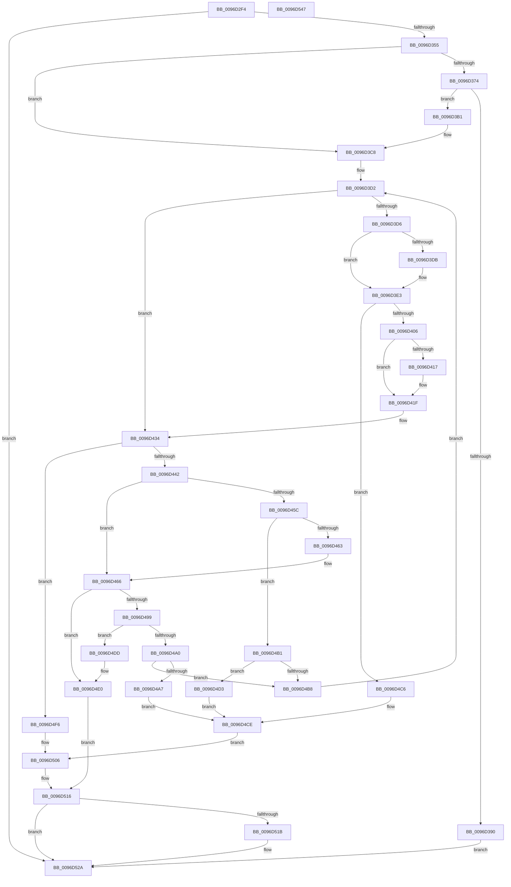

# CmCheckRegistry

- RVA: `0x0096D2F4`–`0x0096D548` (길이 `596` bytes)
- VA: `0x000000014096D2F4`
- 실행 섹션: `PAGE`
- PDB 이름 있음: `예`; PDB Function 태그: `아니요`
- unwind 정보 RVA: `0x00095DA0`
- 디코드: `165`개 명령, `596/596` bytes 표시
- 미해석 바이트: `0` (있으면 어셈블리에 `.byte`로 보존)

> 이 문서는 커널 이미지의 기계어와 PDB 기호를 분석해 생성했습니다. 4번과 5번은 함수 원형과 자료형을 바이너리 사용 방식에서 추정한 C 해석이며 원본 소스 복구 결과는 아닙니다.

## 1. Dependencies

- 직접 호출 지점: **9**; 고유 호출 대상: **6**
- 직접 호출자로 확인된 함수: **2**
- RIP 상대 이미지 참조: **2**

### Outgoing calls
- `0x0096D383` → [guard_dispatch_icall](../../text/6B/guard_dispatch_icall_function_006BAAD0.md) (function, `0x006BAAD0`)
- `0x0096D3A7` → [SetFailureLocation](../../text/46/SetFailureLocation_function_0046EF54.md) (function, `0x0046EF54`)
- `0x0096D3C0` → [RtlClearAllBits](../../text/45/RtlClearAllBits_function_00450230.md) (function, `0x00450230`)
- `0x0096D3DE` → [RtlClearAllBits](../../text/45/RtlClearAllBits_function_00450230.md) (function, `0x00450230`)
- `0x0096D3F7` → [HvCheckHive](HvCheckHive_function_0096D550.md) (function, `0x0096D550`)
- `0x0096D451` → [CmpValidateHiveSecurityDescriptors](CmpValidateHiveSecurityDescriptors_function_0096DAFC.md) (function, `0x0096DAFC`)
- `0x0096D48E` → [CmpCheckRegistry2](CmpCheckRegistry2_function_0096E990.md) (function, `0x0096E990`)
- `0x0096D511` → [SetFailureLocation](../../text/46/SetFailureLocation_function_0046EF54.md) (function, `0x0046EF54`)
- `0x0096D525` → [guard_dispatch_icall](../../text/6B/guard_dispatch_icall_function_006BAAD0.md) (function, `0x006BAAD0`)

### Direct callers
- [CmpCreateHive](../87/CmpCreateHive_function_00879DF0.md) at `0x0087A1BE`
- [sub_00B1845C](../B1/Unknown_function_00B1845C.md) at `0x00B1854B`

### Static image references
- `0x0096D31F` → RVA `0x00FD9A90` (`PAGEDATA`; read)
- `0x0096D40F` → RVA `0x00E0EC70` (`.data`; read)

## 2. Other-region calls and transfers

- 다른 실행 섹션으로 향하는 call: **6**
  - `0x0096D383` → [guard_dispatch_icall](../../text/6B/guard_dispatch_icall_function_006BAAD0.md) (`PAGE` → `.text`)
  - `0x0096D3A7` → [SetFailureLocation](../../text/46/SetFailureLocation_function_0046EF54.md) (`PAGE` → `.text`)
  - `0x0096D3C0` → [RtlClearAllBits](../../text/45/RtlClearAllBits_function_00450230.md) (`PAGE` → `.text`)
  - `0x0096D3DE` → [RtlClearAllBits](../../text/45/RtlClearAllBits_function_00450230.md) (`PAGE` → `.text`)
  - `0x0096D511` → [SetFailureLocation](../../text/46/SetFailureLocation_function_0046EF54.md) (`PAGE` → `.text`)
  - `0x0096D525` → [guard_dispatch_icall](../../text/6B/guard_dispatch_icall_function_006BAAD0.md) (`PAGE` → `.text`)
- 별도 외부 분기/꼬리 이동을 확인하지 못했습니다.

## 3. Assembly (complete function range)

```asm
0096D2F4  48 89 5C 24 18                  mov qword ptr [rsp + 0x18], rbx
0096D2F9  89 54 24 10                     mov dword ptr [rsp + 0x10], edx
0096D2FD  55                              push rbp
0096D2FE  56                              push rsi
0096D2FF  57                              push rdi
0096D300  41 54                           push r12
0096D302  41 55                           push r13
0096D304  41 56                           push r14
0096D306  41 57                           push r15
0096D308  48 8D 6C 24 D9                  lea rbp, [rsp - 0x27]
0096D30D  48 81 EC 90 00 00 00            sub rsp, 0x90
0096D314  33 DB                           xor ebx, ebx
0096D316  0F 57 C0                        xorps xmm0, xmm0
0096D319  33 C0                           xor eax, eax
0096D31B  48 89 5D DF                     mov qword ptr [rbp - 0x21], rbx
0096D31F  48 3B 0D 6A C7 66 00            cmp rcx, qword ptr [rip + 0x66c76a]
0096D326  4D 8B F0                        mov r14, r8
0096D329  48 8B F9                        mov rdi, rcx
0096D32C  48 89 5D E7                     mov qword ptr [rbp - 0x19], rbx
0096D330  44 8B EB                        mov r13d, ebx
0096D333  48 89 45 1F                     mov qword ptr [rbp + 0x1f], rax
0096D337  44 8B E3                        mov r12d, ebx
0096D33A  89 5D D7                        mov dword ptr [rbp - 0x29], ebx
0096D33D  0F 11 45 EF                     movups xmmword ptr [rbp - 0x11], xmm0
0096D341  40 8A F3                        mov sil, bl
0096D344  88 5D 67                        mov byte ptr [rbp + 0x67], bl
0096D347  0F 11 45 FF                     movups xmmword ptr [rbp - 1], xmm0
0096D34B  0F 11 45 0F                     movups xmmword ptr [rbp + 0xf], xmm0
0096D34F  0F 84 D5 01 00 00               je 0x14096d52a
0096D355  8B 99 18 01 00 00               mov ebx, dword ptr [rcx + 0x118]
0096D35B  C1 EB 03                        shr ebx, 3
0096D35E  44 8D 7B 07                     lea r15d, [rbx + 7]
0096D362  41 C1 EF 03                     shr r15d, 3
0096D366  41 83 C7 07                     add r15d, 7
0096D36A  41 83 E7 F8                     and r15d, 0xfffffff8
0096D36E  0F BA E2 13                     bt edx, 0x13
0096D372  73 54                           jae 0x14096d3c8
0096D374  48 8B 41 18                     mov rax, qword ptr [rcx + 0x18]
0096D378  33 D2                           xor edx, edx
0096D37A  41 8B CF                        mov ecx, r15d
0096D37D  41 B8 43 4D 4C 62               mov r8d, 0x624c4d43
0096D383  E8 48 D7 D4 FF                  call 0x1406baad0
0096D388  4C 8B E8                        mov r13, rax
0096D38B  48 85 C0                        test rax, rax
0096D38E  75 21                           jne 0x14096d3b1
0096D390  44 21 64 24 20                  and dword ptr [rsp + 0x20], r12d
0096D395  45 8D 44 24 0B                  lea r8d, [r12 + 0xb]
0096D39A  BB 9A 00 00 C0                  mov ebx, 0xc000009a
0096D39F  33 D2                           xor edx, edx
0096D3A1  44 8B CB                        mov r9d, ebx
0096D3A4  49 8B CE                        mov rcx, r14
0096D3A7  E8 A8 1B B0 FF                  call 0x14046ef54
0096D3AC  E9 79 01 00 00                  jmp 0x14096d52a
0096D3B1  48 8D 4D DF                     lea rcx, [rbp - 0x21]
0096D3B5  89 5D DF                        mov dword ptr [rbp - 0x21], ebx
0096D3B8  48 89 45 E7                     mov qword ptr [rbp - 0x19], rax
0096D3BC  4C 8D 65 DF                     lea r12, [rbp - 0x21]
0096D3C0  E8 6B 2E AE FF                  call 0x140450230
0096D3C5  8B 55 6F                        mov edx, dword ptr [rbp + 0x6f]
0096D3C8  8B C2                           mov eax, edx
0096D3CA  25 00 00 01 00                  and eax, 0x10000
0096D3CF  89 45 7F                        mov dword ptr [rbp + 0x7f], eax
0096D3D2  85 C0                           test eax, eax
0096D3D4  74 5E                           je 0x14096d434
0096D3D6  4D 85 E4                        test r12, r12
0096D3D9  74 08                           je 0x14096d3e3
0096D3DB  49 8B CC                        mov rcx, r12
0096D3DE  E8 4D 2E AE FF                  call 0x140450230
0096D3E3  48 8D 45 EF                     lea rax, [rbp - 0x11]
0096D3E7  4C 89 74 24 28                  mov qword ptr [rsp + 0x28], r14
0096D3EC  4D 8B CC                        mov r9, r12
0096D3EF  48 89 44 24 20                  mov qword ptr [rsp + 0x20], rax
0096D3F4  48 8B CF                        mov rcx, rdi
0096D3F7  E8 54 01 00 00                  call 0x14096d550
0096D3FC  8B D8                           mov ebx, eax
0096D3FE  85 C0                           test eax, eax
0096D400  0F 88 C0 00 00 00               js 0x14096d4c6
0096D406  8B 55 0F                        mov edx, dword ptr [rbp + 0xf]
0096D409  03 55 FF                        add edx, dword ptr [rbp - 1]
0096D40C  03 55 EF                        add edx, dword ptr [rbp - 0x11]
0096D40F  3B 15 5B 18 4A 00               cmp edx, dword ptr [rip + 0x4a185b]
0096D415  76 08                           jbe 0x14096d41f
0096D417  0F BA AF 10 10 00 00 0A         bts dword ptr [rdi + 0x1010], 0xa
0096D41F  8B 45 1F                        mov eax, dword ptr [rbp + 0x1f]
0096D422  8B 55 6F                        mov edx, dword ptr [rbp + 0x6f]
0096D425  89 87 90 12 00 00               mov dword ptr [rdi + 0x1290], eax
0096D42B  8B 45 23                        mov eax, dword ptr [rbp + 0x23]
0096D42E  89 87 94 12 00 00               mov dword ptr [rdi + 0x1294], eax
0096D434  48 8B 47 40                     mov rax, qword ptr [rdi + 0x40]
0096D438  83 78 24 00                     cmp dword ptr [rax + 0x24], 0
0096D43C  0F 8C B4 00 00 00               jl 0x14096d4f6
0096D442  4D 8B CC                        mov r9, r12
0096D445  4C 89 74 24 20                  mov qword ptr [rsp + 0x20], r14
0096D44A  4C 8D 45 67                     lea r8, [rbp + 0x67]
0096D44E  48 8B CF                        mov rcx, rdi
0096D451  E8 A6 06 00 00                  call 0x14096dafc
0096D456  8B D8                           mov ebx, eax
0096D458  85 C0                           test eax, eax
0096D45A  79 0A                           jns 0x14096d466
0096D45C  3D 2A 00 00 80                  cmp eax, 0x8000002a
0096D461  75 4E                           jne 0x14096d4b1
0096D463  40 B6 01                        mov sil, 1
0096D466  4C 8B 47 40                     mov r8, qword ptr [rdi + 0x40]
0096D46A  48 8D 45 D7                     lea rax, [rbp - 0x29]
0096D46E  8B 55 6F                        mov edx, dword ptr [rbp + 0x6f]
0096D471  48 8B CF                        mov rcx, rdi
0096D474  48 89 44 24 38                  mov qword ptr [rsp + 0x38], rax
0096D479  8A 45 67                        mov al, byte ptr [rbp + 0x67]
0096D47C  45 8B 40 24                     mov r8d, dword ptr [r8 + 0x24]
0096D480  4C 89 74 24 30                  mov qword ptr [rsp + 0x30], r14
0096D485  4C 89 64 24 28                  mov qword ptr [rsp + 0x28], r12
0096D48A  88 44 24 20                     mov byte ptr [rsp + 0x20], al
0096D48E  E8 FD 14 00 00                  call 0x14096e990
0096D493  8B D8                           mov ebx, eax
0096D495  85 C0                           test eax, eax
0096D497  79 47                           jns 0x14096d4e0
0096D499  3D 2A 00 00 80                  cmp eax, 0x8000002a
0096D49E  74 3D                           je 0x14096d4dd
0096D4A0  3D 2D 02 00 C0                  cmp eax, 0xc000022d
0096D4A5  74 11                           je 0x14096d4b8
0096D4A7  C7 44 24 20 40 00 00 00         mov dword ptr [rsp + 0x20], 0x40
0096D4AF  EB 1D                           jmp 0x14096d4ce
0096D4B1  3D 2D 02 00 C0                  cmp eax, 0xc000022d
0096D4B6  75 1B                           jne 0x14096d4d3
0096D4B8  8B 45 7F                        mov eax, dword ptr [rbp + 0x7f]
0096D4BB  40 B6 01                        mov sil, 1
0096D4BE  8B 55 6F                        mov edx, dword ptr [rbp + 0x6f]
0096D4C1  E9 0C FF FF FF                  jmp 0x14096d3d2
0096D4C6  C7 44 24 20 10 00 00 00         mov dword ptr [rsp + 0x20], 0x10
0096D4CE  44 8B C8                        mov r9d, eax
0096D4D1  EB 33                           jmp 0x14096d506
0096D4D3  C7 44 24 20 30 00 00 00         mov dword ptr [rsp + 0x20], 0x30
0096D4DB  EB F1                           jmp 0x14096d4ce
0096D4DD  40 B6 01                        mov sil, 1
0096D4E0  8B 45 D7                        mov eax, dword ptr [rbp - 0x29]
0096D4E3  40 F6 DE                        neg sil
0096D4E6  89 87 9C 12 00 00               mov dword ptr [rdi + 0x129c], eax
0096D4EC  1B DB                           sbb ebx, ebx
0096D4EE  81 E3 2A 00 00 80               and ebx, 0x8000002a
0096D4F4  EB 20                           jmp 0x14096d516
0096D4F6  BB 4C 01 00 C0                  mov ebx, 0xc000014c
0096D4FB  C7 44 24 20 20 00 00 00         mov dword ptr [rsp + 0x20], 0x20
0096D503  44 8B CB                        mov r9d, ebx
0096D506  41 B8 0B 00 00 00               mov r8d, 0xb
0096D50C  33 D2                           xor edx, edx
0096D50E  49 8B CE                        mov rcx, r14
0096D511  E8 3E 1A B0 FF                  call 0x14046ef54
0096D516  4D 85 ED                        test r13, r13
0096D519  74 0F                           je 0x14096d52a
0096D51B  48 8B 47 20                     mov rax, qword ptr [rdi + 0x20]
0096D51F  41 8B D7                        mov edx, r15d
0096D522  49 8B CD                        mov rcx, r13
0096D525  E8 A6 D5 D4 FF                  call 0x1406baad0
0096D52A  8B C3                           mov eax, ebx
0096D52C  48 8B 9C 24 E0 00 00 00         mov rbx, qword ptr [rsp + 0xe0]
0096D534  48 81 C4 90 00 00 00            add rsp, 0x90
0096D53B  41 5F                           pop r15
0096D53D  41 5E                           pop r14
0096D53F  41 5D                           pop r13
0096D541  41 5C                           pop r12
0096D543  5F                              pop rdi
0096D544  5E                              pop rsi
0096D545  5D                              pop rbp
0096D546  C3                              ret
0096D547  CC                              int3
```

## 4. C-style interpretation (structured pseudocode)

```c
__int64 __fastcall CmCheckRegistry(__int64 a1, int a2, __int64 a3)
{
    __int64 result;
    __int64 v_r15;
    __int64 v_rbx;
    __int64 v_rsi;
    __int64 v_rsp;
    unsigned int v_stack_m3C;
    unsigned __int64 v_stack_m40;
    unsigned __int64 v_stack_m50;
    unsigned __int64 v_stack_m5F;
    unsigned __int64 v_stack_m60;
    unsigned __int64 v_stack_m70;
    unsigned __int64 v_stack_m78;
    unsigned __int64 v_stack_m80;
    unsigned int v_stack_m88;
    unsigned __int64 v_stack_m90;
    unsigned __int64 v_stack_m98;
    unsigned __int64 v_stack_mA0;
    unsigned int v_stack_mA8;
    unsigned int v_stack_p10;
    unsigned __int64 v_stack_p18;
    unsigned int v_stack_p20;
    unsigned __int8 v_stack_p8;

    v_stack_p18 = v_rbx;
    v_stack_p10 = a2;
    v_rsp = (v_rsp) - (144);
    v_rbx = 0;
    result = 0;
    v_stack_m80 = 0;
    v_stack_m78 = 0;
    v_stack_m40 = 0;
    v_stack_m88 = 0;
    v_stack_m70 = v_xmm0;
    v_stack_p8 = 0;
    v_stack_m60 = v_xmm0;
    v_stack_m50 = v_xmm0;
    if (a1 == (*(unsigned __int64 *)(v_rip + 6735722))) goto loc_0096D52A;
    v_rbx = (unsigned int)(((unsigned int)(*(unsigned int *)(a1 + 280))) >> (3));
    v_r15 = (unsigned int)((v_rbx + 7) >> (3));
    v_r15 = (unsigned int)((v_r15) + (7));
    v_r15 = (unsigned int)((v_r15) & (0xFFFFFFF8ULL));
    if (condition_is_above_or_equal) goto loc_0096D3C8;
    a2 = 0;
    result = guard_dispatch_icall((unsigned int)((unsigned int)(v_r15)), a2, (unsigned int)(0x624C4D43ULL), a4);
    if (result != 0) goto loc_0096D3B1;
    a2 = 0;
    result = SetFailureLocation(a3, a2, 0 + 11, (unsigned int)((unsigned int)((unsigned int)(0xC000009AULL))));
    goto loc_0096D52A;
loc_0096D3B1:
    v_stack_m80 = (unsigned int)((unsigned int)(0xC000009AULL));
    v_stack_m78 = result;
    result = RtlClearAllBits(v_stack_m80, a2, 0 + 11, (unsigned int)((unsigned int)((unsigned int)(0xC000009AULL))));
loc_0096D3C8:
    result = (unsigned int)(((unsigned int)((unsigned int)((unsigned int)(v_stack_p10)))) & (0x10000ULL));
    v_stack_p20 = (unsigned int)(result);
loc_0096D3D2:
    if ((unsigned int)(result) == 0) goto loc_0096D434;
    if (v_stack_m80 != 0) {
        a1 = v_stack_m80;
        result = RtlClearAllBits(a1, (unsigned int)(v_stack_p10), 0 + 11, (unsigned int)((unsigned int)((unsigned int)(0xC000009AULL))));
    }
    v_stack_mA0 = a3;
    v_stack_mA8 = v_stack_m70;
    result = HvCheckHive(a1, (unsigned int)(v_stack_p10), 0 + 11, v_stack_m80);
    if (sign_flag) goto loc_0096D4C6;
    a2 = (unsigned int)(((unsigned int)(v_stack_m50)) + (v_stack_m60));
    a2 = (unsigned int)((a2) + (v_stack_m70));
    if (a2 >= = (*(unsigned int *)(v_rip + 4855899))) {
    }
    *(unsigned int *)(a1 + 4752) = (unsigned int)((unsigned int)(v_stack_m40));
    *(unsigned int *)(a1 + 4756) = (unsigned int)((unsigned int)(v_stack_m3C));
loc_0096D434:
    if ((*(unsigned int *)(*(unsigned __int64 *)(a1 + 64) + 36)) < 0) goto loc_0096D4F6;
    v_stack_mA8 = a3;
    result = CmpValidateHiveSecurityDescriptors(a1, (unsigned int)(v_stack_p10), v_stack_p8, v_stack_m80);
    if (!sign_flag) goto loc_0096D466;
    if (((unsigned int)(result)) != 0x8000002AULL) goto loc_0096D4B1;
loc_0096D466:
    v_stack_m90 = v_stack_m88;
    v_stack_m98 = a3;
    v_stack_mA0 = v_stack_m80;
    v_stack_mA8 = (unsigned __int8)(v_stack_p8);
    result = CmpCheckRegistry2(a1, (unsigned int)(v_stack_p10), (unsigned int)(*(unsigned int *)(*(unsigned __int64 *)(a1 + 64) + 36)), v_stack_m80);
    if (!sign_flag) goto loc_0096D4E0;
    if (((unsigned int)(result)) == 0x8000002AULL) goto loc_0096D4DD;
    if (((unsigned int)(result)) == 0xC000022DULL) goto loc_0096D4B8;
    v_stack_mA8 = 64;
    goto loc_0096D4CE;
loc_0096D4B1:
    if (((unsigned int)(result)) != 0xC000022DULL) goto loc_0096D4D3;
loc_0096D4B8:
    goto loc_0096D3D2;
loc_0096D4C6:
    v_stack_mA8 = 16;
loc_0096D4CE:
    goto loc_0096D506;
loc_0096D4D3:
    v_stack_mA8 = 48;
    goto loc_0096D4CE;
loc_0096D4DD:
loc_0096D4E0:
    v_rsi = (unsigned __int8)(-(1));
    *(unsigned int *)(a1 + 4764) = (unsigned int)((unsigned int)(v_stack_m88));
    v_rbx = (unsigned int)(((unsigned int)((unsigned int)(result))) & (0x8000002AULL));
    goto loc_0096D516;
loc_0096D4F6:
    v_stack_mA8 = 32;
loc_0096D506:
    a2 = 0;
    result = SetFailureLocation(a3, a2, 11, (unsigned int)((unsigned int)((unsigned int)(0xC000014CULL))));
loc_0096D516:
    if (result != 0) {
        result = *(unsigned __int64 *)(a1 + 32);
        a2 = (unsigned int)(v_r15);
        a1 = result;
        result = guard_dispatch_icall(a1, a2, 11, (unsigned int)((unsigned int)((unsigned int)(0xC000014CULL))));
    }
    v_rsp = (v_rsp) + (144);
    return (unsigned int)((unsigned int)((unsigned int)(0xC000014CULL)));
}
```

## 5. (Beta) C Style

```c
int64_t CmCheckRegistry(int64_t Arg1, int32_t Arg2, int64_t Arg3)
{
    int64_t result;
    int64_t local_r15;
    int64_t local_rbx;
    int64_t local_rsi;
    int64_t local_rsp;
    uint32_t v_stack_m3C;
    uint64_t v_stack_m40;
    uint64_t v_stack_m50;
    uint64_t v_stack_m5F;
    uint64_t v_stack_m60;
    uint64_t v_stack_m70;
    uint64_t v_stack_m78;
    uint64_t v_stack_m80;
    uint32_t v_stack_m88;
    uint64_t v_stack_m90;
    uint64_t v_stack_m98;
    uint64_t v_stack_mA0;
    uint32_t v_stack_mA8;
    uint32_t v_stack_p10;
    uint64_t v_stack_p18;
    uint32_t v_stack_p20;
    uint8_t v_stack_p8;

    v_stack_p18 = local_rbx;
    v_stack_p10 = Arg2;
    local_rsp = (local_rsp) - (144);
    local_rbx = 0;
    result = 0;
    v_stack_m80 = 0;
    v_stack_m78 = 0;
    v_stack_m40 = 0;
    v_stack_m88 = 0;
    v_stack_m70 = v_xmm0;
    v_stack_p8 = 0;
    v_stack_m60 = v_xmm0;
    v_stack_m50 = v_xmm0;
    if (Arg1 == (*(uint64_t *)(v_rip + 0x66C76A))) goto loc_0096D52A;
    local_rbx = (uint32_t)(((uint32_t)(*(uint32_t *)(Arg1 + 0x118))) >> (3));
    local_r15 = (uint32_t)((local_rbx + 7) >> (3));
    local_r15 = (uint32_t)((local_r15) + (7));
    local_r15 = (uint32_t)((local_r15) & (0xFFFFFFF8ULL));
    if (condition_is_above_or_equal) goto loc_0096D3C8;
    Arg2 = 0;
    result = guard_dispatch_icall((uint32_t)((uint32_t)(local_r15)), Arg2, (uint32_t)(0x624C4D43ULL), a4);
    if (result != 0) goto loc_0096D3B1;
    Arg2 = 0;
    result = SetFailureLocation(Arg3, Arg2, 0 + 11, (uint32_t)((uint32_t)((uint32_t)(0xC000009AULL))));
    goto loc_0096D52A;
loc_0096D3B1:
    v_stack_m80 = (uint32_t)((uint32_t)(0xC000009AULL));
    v_stack_m78 = result;
    result = RtlClearAllBits(v_stack_m80, Arg2, 0 + 11, (uint32_t)((uint32_t)((uint32_t)(0xC000009AULL))));
loc_0096D3C8:
    result = (uint32_t)(((uint32_t)((uint32_t)((uint32_t)(v_stack_p10)))) & (0x10000ULL));
    v_stack_p20 = (uint32_t)(result);
loc_0096D3D2:
    if ((uint32_t)(result) == 0) goto loc_0096D434;
    if (v_stack_m80 != 0) {
        Arg1 = v_stack_m80;
        result = RtlClearAllBits(Arg1, (uint32_t)(v_stack_p10), 0 + 11, (uint32_t)((uint32_t)((uint32_t)(0xC000009AULL))));
    }
    v_stack_mA0 = Arg3;
    v_stack_mA8 = v_stack_m70;
    result = HvCheckHive(Arg1, (uint32_t)(v_stack_p10), 0 + 11, v_stack_m80);
    if (sign_flag) goto loc_0096D4C6;
    Arg2 = (uint32_t)(((uint32_t)(v_stack_m50)) + (v_stack_m60));
    Arg2 = (uint32_t)((Arg2) + (v_stack_m70));
    if (Arg2 >= = (*(uint32_t *)(v_rip + 0x4A185B))) {
    }
    *(uint32_t *)(Arg1 + 0x1290) = (uint32_t)((uint32_t)(v_stack_m40));
    *(uint32_t *)(Arg1 + 0x1294) = (uint32_t)((uint32_t)(v_stack_m3C));
loc_0096D434:
    if ((*(uint32_t *)(*(uint64_t *)(Arg1 + 0x40) + 0x24)) < 0) goto loc_0096D4F6;
    v_stack_mA8 = Arg3;
    result = CmpValidateHiveSecurityDescriptors(Arg1, (uint32_t)(v_stack_p10), v_stack_p8, v_stack_m80);
    if (!sign_flag) goto loc_0096D466;
    if (((uint32_t)(result)) != 0x8000002AULL) goto loc_0096D4B1;
loc_0096D466:
    v_stack_m90 = v_stack_m88;
    v_stack_m98 = Arg3;
    v_stack_mA0 = v_stack_m80;
    v_stack_mA8 = (uint8_t)(v_stack_p8);
    result = CmpCheckRegistry2(Arg1, (uint32_t)(v_stack_p10), (uint32_t)(*(uint32_t *)(*(uint64_t *)(Arg1 + 0x40) + 0x24)), v_stack_m80);
    if (!sign_flag) goto loc_0096D4E0;
    if (((uint32_t)(result)) == 0x8000002AULL) goto loc_0096D4DD;
    if (((uint32_t)(result)) == 0xC000022DULL) goto loc_0096D4B8;
    v_stack_mA8 = 64;
    goto loc_0096D4CE;
loc_0096D4B1:
    if (((uint32_t)(result)) != 0xC000022DULL) goto loc_0096D4D3;
loc_0096D4B8:
    goto loc_0096D3D2;
loc_0096D4C6:
    v_stack_mA8 = 16;
loc_0096D4CE:
    goto loc_0096D506;
loc_0096D4D3:
    v_stack_mA8 = 48;
    goto loc_0096D4CE;
loc_0096D4DD:
loc_0096D4E0:
    local_rsi = (uint8_t)(-(1));
    *(uint32_t *)(Arg1 + 0x129C) = (uint32_t)((uint32_t)(v_stack_m88));
    local_rbx = (uint32_t)(((uint32_t)((uint32_t)(result))) & (0x8000002AULL));
    goto loc_0096D516;
loc_0096D4F6:
    v_stack_mA8 = 32;
loc_0096D506:
    Arg2 = 0;
    result = SetFailureLocation(Arg3, Arg2, 11, (uint32_t)((uint32_t)((uint32_t)(0xC000014CULL))));
loc_0096D516:
    if (result != 0) {
        result = *(uint64_t *)(Arg1 + 0x20);
        Arg2 = (uint32_t)(local_r15);
        Arg1 = result;
        result = guard_dispatch_icall(Arg1, Arg2, 11, (uint32_t)((uint32_t)((uint32_t)(0xC000014CULL))));
    }
    local_rsp = (local_rsp) + (144);
    return (uint32_t)((uint32_t)((uint32_t)(0xC000014CULL)));
}
```

## 6. Execution-region graph

[열기: 2D/3D 그래프와 함수 탐색 컨트롤 패널](../../../control-panel.html?section=page&rva=0x0096D2F4&view=graph)

- 2D 그래프는 위에서 아래로 흐르고, 3D 그래프는 빈 공간을 드래그해 회전합니다. Shift+드래그는 이동, 휠은 확대·축소, 함수 노드 선택은 대상 보고서 이동입니다.

### Static fallback


