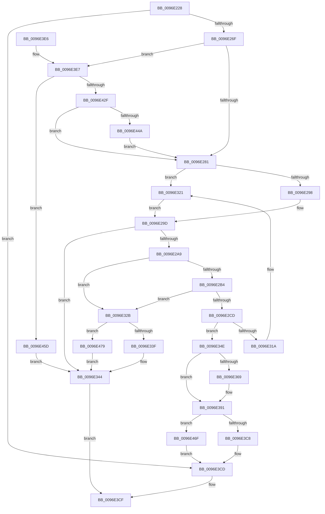

# CmpAddSecurityCellToCache

- RVA: `0x0096E228`–`0x0096E483` (길이 `603` bytes)
- VA: `0x000000014096E228`
- 실행 섹션: `PAGE`
- PDB 이름 있음: `예`; PDB Function 태그: `아니요`
- unwind 정보 RVA: `0x00095E40`
- 디코드: `153`개 명령, `603/603` bytes 표시
- 미해석 바이트: `0` (있으면 어셈블리에 `.byte`로 보존)

> 이 문서는 커널 이미지의 기계어와 PDB 기호를 분석해 생성했습니다. 4번과 5번은 함수 원형과 자료형을 바이너리 사용 방식에서 추정한 C 해석이며 원본 소스 복구 결과는 아닙니다.

## 1. Dependencies

- 직접 호출 지점: **14**; 고유 호출 대상: **8**
- 직접 호출자로 확인된 함수: **3**
- RIP 상대 이미지 참조: **0**

### Outgoing calls
- `0x0096E262` → [CmpFindSecurityCellCacheIndex](../../text/42/CmpFindSecurityCellCacheIndex_function_00428060.md) (function, `0x00428060`)
- `0x0096E298` → [HvpGetCellFlat](../85/HvpGetCellFlat_function_00854C60.md) (function, `0x00854C60`)
- `0x0096E2C0` → [guard_dispatch_icall](../../text/6B/guard_dispatch_icall_function_006BAAD0.md) (function, `0x006BAAD0`)
- `0x0096E2D9` → [memcpy](../../text/6C/memcpy_function_006C6840.md) (function, `0x006C6840`)
- `0x0096E2F3` → [CmpSecConvKey](CmpSecConvKey_function_0096E48C.md) (function, `0x0096E48C`)
- `0x0096E321` → [HvpGetCellPaged](../85/HvpGetCellPaged_function_00854CB0.md) (function, `0x00854CB0`)
- `0x0096E33F` → [HvpReleaseCellPaged](../85/HvpReleaseCellPaged_function_00855F40.md) (function, `0x00855F40`)
- `0x0096E38C` → [memcpy](../../text/6C/memcpy_function_006C6840.md) (function, `0x006C6840`)
- `0x0096E3C8` → [HvpReleaseCellPaged](../85/HvpReleaseCellPaged_function_00855F40.md) (function, `0x00855F40`)
- `0x0096E418` → [guard_dispatch_icall](../../text/6B/guard_dispatch_icall_function_006BAAD0.md) (function, `0x006BAAD0`)
- `0x0096E43C` → [memcpy](../../text/6C/memcpy_function_006C6840.md) (function, `0x006C6840`)
- `0x0096E453` → [guard_dispatch_icall](../../text/6B/guard_dispatch_icall_function_006BAAD0.md) (function, `0x006BAAD0`)
- `0x0096E46F` → [HvpReleaseCellFlat](../85/HvpReleaseCellFlat_function_0085CC20.md) (function, `0x0085CC20`)
- `0x0096E479` → [HvpReleaseCellFlat](../85/HvpReleaseCellFlat_function_0085CC20.md) (function, `0x0085CC20`)

### Direct callers
- [CmpSetSecurityDescriptorInfo](../94/CmpSetSecurityDescriptorInfo_function_00949688.md) at `0x00949BF5`
- [CmpValidateHiveSecurityDescriptors](CmpValidateHiveSecurityDescriptors_function_0096DAFC.md) at `0x0096DC58`
- [CmpInsertSecurityCellList](CmpInsertSecurityCellList_function_0096DF40.md) at `0x0096DFCC`

### Static image references
- 디코드된 RIP-relative 메모리 참조가 없습니다.

## 2. Other-region calls and transfers

- 다른 실행 섹션으로 향하는 call: **7**
  - `0x0096E262` → [CmpFindSecurityCellCacheIndex](../../text/42/CmpFindSecurityCellCacheIndex_function_00428060.md) (`PAGE` → `.text`)
  - `0x0096E2C0` → [guard_dispatch_icall](../../text/6B/guard_dispatch_icall_function_006BAAD0.md) (`PAGE` → `.text`)
  - `0x0096E2D9` → [memcpy](../../text/6C/memcpy_function_006C6840.md) (`PAGE` → `.text`)
  - `0x0096E38C` → [memcpy](../../text/6C/memcpy_function_006C6840.md) (`PAGE` → `.text`)
  - `0x0096E418` → [guard_dispatch_icall](../../text/6B/guard_dispatch_icall_function_006BAAD0.md) (`PAGE` → `.text`)
  - `0x0096E43C` → [memcpy](../../text/6C/memcpy_function_006C6840.md) (`PAGE` → `.text`)
  - `0x0096E453` → [guard_dispatch_icall](../../text/6B/guard_dispatch_icall_function_006BAAD0.md) (`PAGE` → `.text`)
- 별도 외부 분기/꼬리 이동을 확인하지 못했습니다.

## 3. Assembly (complete function range)

```asm
0096E228  48 89 5C 24 08                  mov qword ptr [rsp + 8], rbx
0096E22D  48 89 74 24 10                  mov qword ptr [rsp + 0x10], rsi
0096E232  4C 89 4C 24 20                  mov qword ptr [rsp + 0x20], r9
0096E237  55                              push rbp
0096E238  57                              push rdi
0096E239  41 54                           push r12
0096E23B  41 56                           push r14
0096E23D  41 57                           push r15
0096E23F  48 8B EC                        mov rbp, rsp
0096E242  48 83 EC 30                     sub rsp, 0x30
0096E246  83 4D F0 FF                     or dword ptr [rbp - 0x10], 0xffffffff
0096E24A  45 8A F0                        mov r14b, r8b
0096E24D  45 33 E4                        xor r12d, r12d
0096E250  4C 8D 45 48                     lea r8, [rbp + 0x48]
0096E254  44 89 65 48                     mov dword ptr [rbp + 0x48], r12d
0096E258  44 8B FA                        mov r15d, edx
0096E25B  44 89 65 F4                     mov dword ptr [rbp - 0xc], r12d
0096E25F  48 8B F9                        mov rdi, rcx
0096E262  E8 F9 9D AB FF                  call 0x140428060
0096E267  3C 01                           cmp al, 1
0096E269  0F 84 5E 01 00 00               je 0x14096e3cd
0096E26F  8B 8F 54 07 00 00               mov ecx, dword ptr [rdi + 0x754]
0096E275  39 8F 50 07 00 00               cmp dword ptr [rdi + 0x750], ecx
0096E27B  0F 84 66 01 00 00               je 0x14096e3e7
0096E281  F6 87 8C 00 00 00 01            test byte ptr [rdi + 0x8c], 1
0096E288  4C 8D 45 F0                     lea r8, [rbp - 0x10]
0096E28C  41 8B D7                        mov edx, r15d
0096E28F  48 8B CF                        mov rcx, rdi
0096E292  0F 84 89 00 00 00               je 0x14096e321
0096E298  E8 C3 69 EE FF                  call 0x140854c60
0096E29D  48 8B F0                        mov rsi, rax
0096E2A0  48 85 C0                        test rax, rax
0096E2A3  0F 84 9B 00 00 00               je 0x14096e344
0096E2A9  8B 48 10                        mov ecx, dword ptr [rax + 0x10]
0096E2AC  83 C1 20                        add ecx, 0x20
0096E2AF  83 F9 20                        cmp ecx, 0x20
0096E2B2  76 77                           jbe 0x14096e32b
0096E2B4  48 8B 47 18                     mov rax, qword ptr [rdi + 0x18]
0096E2B8  33 D2                           xor edx, edx
0096E2BA  41 B8 43 4D 53 63               mov r8d, 0x63534d43
0096E2C0  E8 0B C8 D4 FF                  call 0x1406baad0
0096E2C5  4C 8B F0                        mov r14, rax
0096E2C8  48 85 C0                        test rax, rax
0096E2CB  74 5E                           je 0x14096e32b
0096E2CD  44 8B 46 10                     mov r8d, dword ptr [rsi + 0x10]
0096E2D1  48 8D 48 20                     lea rcx, [rax + 0x20]
0096E2D5  48 8D 56 14                     lea rdx, [rsi + 0x14]
0096E2D9  E8 62 85 D5 FF                  call 0x1406c6840
0096E2DE  45 89 3E                        mov dword ptr [r14], r15d
0096E2E1  48 8D 56 14                     lea rdx, [rsi + 0x14]
0096E2E5  8B 4E 10                        mov ecx, dword ptr [rsi + 0x10]
0096E2E8  41 89 4E 18                     mov dword ptr [r14 + 0x18], ecx
0096E2EC  45 89 66 1C                     mov dword ptr [r14 + 0x1c], r12d
0096E2F0  8B 4E 10                        mov ecx, dword ptr [rsi + 0x10]
0096E2F3  E8 94 01 00 00                  call 0x14096e48c
0096E2F8  41 89 46 04                     mov dword ptr [r14 + 4], eax
0096E2FC  48 8D 97 68 07 00 00            lea rdx, [rdi + 0x768]
0096E303  83 E0 3F                        and eax, 0x3f
0096E306  49 8D 4E 08                     lea rcx, [r14 + 8]
0096E30A  48 C1 E0 04                     shl rax, 4
0096E30E  48 03 D0                        add rdx, rax
0096E311  48 8B 42 08                     mov rax, qword ptr [rdx + 8]
0096E315  48 39 10                        cmp qword ptr [rax], rdx
0096E318  74 34                           je 0x14096e34e
0096E31A  B9 03 00 00 00                  mov ecx, 3
0096E31F  CD 29                           int 0x29
0096E321  E8 8A 69 EE FF                  call 0x140854cb0
0096E326  E9 72 FF FF FF                  jmp 0x14096e29d
0096E32B  F6 87 8C 00 00 00 01            test byte ptr [rdi + 0x8c], 1
0096E332  48 8D 55 F0                     lea rdx, [rbp - 0x10]
0096E336  48 8B CF                        mov rcx, rdi
0096E339  0F 85 3A 01 00 00               jne 0x14096e479
0096E33F  E8 FC 7B EE FF                  call 0x140855f40
0096E344  B8 9A 00 00 C0                  mov eax, 0xc000009a
0096E349  E9 81 00 00 00                  jmp 0x14096e3cf
0096E34E  8B 5D 48                        mov ebx, dword ptr [rbp + 0x48]
0096E351  48 89 11                        mov qword ptr [rcx], rdx
0096E354  48 89 41 08                     mov qword ptr [rcx + 8], rax
0096E358  48 89 08                        mov qword ptr [rax], rcx
0096E35B  48 89 4A 08                     mov qword ptr [rdx + 8], rcx
0096E35F  8B 87 50 07 00 00               mov eax, dword ptr [rdi + 0x750]
0096E365  3B D8                           cmp ebx, eax
0096E367  73 28                           jae 0x14096e391
0096E369  4C 8B 8F 60 07 00 00            mov r9, qword ptr [rdi + 0x760]
0096E370  8D 4B 01                        lea ecx, [rbx + 1]
0096E373  2B C3                           sub eax, ebx
0096E375  48 C1 E1 04                     shl rcx, 4
0096E379  44 8B C0                        mov r8d, eax
0096E37C  8B D3                           mov edx, ebx
0096E37E  48 C1 E2 04                     shl rdx, 4
0096E382  49 03 C9                        add rcx, r9
0096E385  49 C1 E0 04                     shl r8, 4
0096E389  49 03 D1                        add rdx, r9
0096E38C  E8 AF 84 D5 FF                  call 0x1406c6840
0096E391  48 8B 87 60 07 00 00            mov rax, qword ptr [rdi + 0x760]
0096E398  48 8D 55 F0                     lea rdx, [rbp - 0x10]
0096E39C  48 8B CB                        mov rcx, rbx
0096E39F  48 03 C9                        add rcx, rcx
0096E3A2  44 89 3C C8                     mov dword ptr [rax + rcx*8], r15d
0096E3A6  48 8B 87 60 07 00 00            mov rax, qword ptr [rdi + 0x760]
0096E3AD  4C 89 74 C8 08                  mov qword ptr [rax + rcx*8 + 8], r14
0096E3B2  48 8B CF                        mov rcx, rdi
0096E3B5  FF 87 50 07 00 00               inc dword ptr [rdi + 0x750]
0096E3BB  F6 87 8C 00 00 00 01            test byte ptr [rdi + 0x8c], 1
0096E3C2  0F 85 A7 00 00 00               jne 0x14096e46f
0096E3C8  E8 73 7B EE FF                  call 0x140855f40
0096E3CD  33 C0                           xor eax, eax
0096E3CF  48 8B 5C 24 60                  mov rbx, qword ptr [rsp + 0x60]
0096E3D4  48 8B 74 24 68                  mov rsi, qword ptr [rsp + 0x68]
0096E3D9  48 83 C4 30                     add rsp, 0x30
0096E3DD  41 5F                           pop r15
0096E3DF  41 5E                           pop r14
0096E3E1  41 5C                           pop r12
0096E3E3  5F                              pop rdi
0096E3E4  5D                              pop rbp
0096E3E5  C3                              ret
0096E3E6  CC                              int3
0096E3E7  48 8B 9F 60 07 00 00            mov rbx, qword ptr [rdi + 0x760]
0096E3EE  8D 41 10                        lea eax, [rcx + 0x10]
0096E3F1  8B F1                           mov esi, ecx
0096E3F3  41 B8 43 4D 53 63               mov r8d, 0x63534d43
0096E3F9  81 C1 00 01 00 00               add ecx, 0x100
0096E3FF  C1 E6 04                        shl esi, 4
0096E402  41 80 FE 01                     cmp r14b, 1
0096E406  0F 45 C8                        cmovne ecx, eax
0096E409  33 D2                           xor edx, edx
0096E40B  89 8F 54 07 00 00               mov dword ptr [rdi + 0x754], ecx
0096E411  48 8B 47 18                     mov rax, qword ptr [rdi + 0x18]
0096E415  C1 E1 04                        shl ecx, 4
0096E418  E8 B3 C6 D4 FF                  call 0x1406baad0
0096E41D  8B 8F 50 07 00 00               mov ecx, dword ptr [rdi + 0x750]
0096E423  48 89 87 60 07 00 00            mov qword ptr [rdi + 0x760], rax
0096E42A  48 85 C0                        test rax, rax
0096E42D  74 2E                           je 0x14096e45d
0096E42F  44 8B C1                        mov r8d, ecx
0096E432  48 8B D3                        mov rdx, rbx
0096E435  49 C1 E0 04                     shl r8, 4
0096E439  48 8B C8                        mov rcx, rax
0096E43C  E8 FF 83 D5 FF                  call 0x1406c6840
0096E441  48 85 DB                        test rbx, rbx
0096E444  0F 84 37 FE FF FF               je 0x14096e281
0096E44A  48 8B 47 20                     mov rax, qword ptr [rdi + 0x20]
0096E44E  8B D6                           mov edx, esi
0096E450  48 8B CB                        mov rcx, rbx
0096E453  E8 78 C6 D4 FF                  call 0x1406baad0
0096E458  E9 24 FE FF FF                  jmp 0x14096e281
0096E45D  48 89 9F 60 07 00 00            mov qword ptr [rdi + 0x760], rbx
0096E464  89 8F 54 07 00 00               mov dword ptr [rdi + 0x754], ecx
0096E46A  E9 D5 FE FF FF                  jmp 0x14096e344
0096E46F  E8 AC E7 EE FF                  call 0x14085cc20
0096E474  E9 54 FF FF FF                  jmp 0x14096e3cd
0096E479  E8 A2 E7 EE FF                  call 0x14085cc20
0096E47E  E9 C1 FE FF FF                  jmp 0x14096e344
```

## 4. C-style interpretation (structured pseudocode)

```c
__int64 __fastcall CmpAddSecurityCellToCache(__int64 a1, int a2, unsigned __int8 a3, __int64 a4)
{
    __int64 result;
    __int64 v_r12;
    __int64 v_rsi;
    __int64 v_rsp;
    unsigned int v_stack_m34;
    unsigned int v_stack_m38;
    unsigned __int64 v_stack_p10;
    unsigned __int64 v_stack_p20;
    unsigned __int64 v_stack_p8;

    v_stack_p8 = v_rbx;
    v_stack_p10 = v_rsi;
    v_stack_p20 = a4;
    v_rsp = (v_rsp) - (48);
    v_r12 = 0;
    v_stack_p20 = 0;
    v_stack_m34 = 0;
    result = CmpFindSecurityCellCacheIndex(a1, a2, v_stack_p20, a4);
    if (((unsigned __int8)(result)) == 1) goto loc_0096E3CD;
    if ((*(unsigned int *)(a1 + 1872)) == ((unsigned int)((unsigned int)(*(unsigned int *)(a1 + 1876))))) goto loc_0096E3E7;
loc_0096E281:
    if (((*(unsigned __int8 *)(a1 + 140)) & (1)) == 0) goto loc_0096E321;
    result = HvpGetCellFlat(a1, (unsigned int)((unsigned int)((unsigned int)(a2))), v_stack_m38, a4);
loc_0096E29D:
    if (result == 0) goto loc_0096E344;
    a1 = (unsigned int)(((unsigned int)(*(unsigned int *)(result + 16))) + (32));
    if (((unsigned int)(a1)) <= 32) goto loc_0096E32B;
    a2 = 0;
    result = guard_dispatch_icall(a1, a2, (unsigned int)(0x63534D43ULL), a4);
    if (result == 0) goto loc_0096E32B;
    result = memcpy(result + 32, result + 20, (unsigned int)(*(unsigned int *)(result + 16)), a4);
    *(unsigned int *)(result) = (unsigned int)((unsigned int)(a2));
    *(unsigned int *)(result + 24) = (unsigned int)((unsigned int)(*(unsigned int *)(result + 16)));
    *(unsigned int *)(result + 28) = 0;
    result = CmpSecConvKey((unsigned int)(*(unsigned int *)(result + 16)), result + 20, (unsigned int)(*(unsigned int *)(result + 16)), a4);
    *(unsigned int *)(result + 4) = (unsigned int)(result);
    result = (unsigned int)((result) & (63));
    result = (result) << (4);
    a2 = (a1 + 1896) + (result);
    if ((*(unsigned __int64 *)(*(unsigned __int64 *)(a2 + 8))) == a2) goto loc_0096E34E;
loc_0096E321:
    result = HvpGetCellPaged(3, a2, (unsigned int)(*(unsigned int *)(result + 16)), a4);
    goto loc_0096E29D;
loc_0096E32B:
    if (((*(unsigned __int8 *)(a1 + 140)) & (1)) != 0) goto loc_0096E479;
    result = HvpReleaseCellPaged(a1, v_stack_m38, (unsigned int)(*(unsigned int *)(result + 16)), a4);
loc_0096E344:
    goto loc_0096E3CF;
loc_0096E34E:
    *(unsigned __int64 *)(a1) = v_stack_m38;
    *(unsigned __int64 *)(a1 + 8) = (unsigned int)(0xC000009AULL);
    *(unsigned __int64 *)((unsigned int)(0xC000009AULL)) = a1;
    *(unsigned __int64 *)(v_stack_m38 + 8) = a1;
    result = (unsigned int)(*(unsigned int *)(a1 + 1872));
    if (((unsigned int)((unsigned int)(v_stack_p20))) < ((unsigned int)((unsigned int)(*(unsigned int *)(a1 + 1872))))) {
        a4 = *(unsigned __int64 *)(a1 + 1888);
        a1 = (unsigned int)(v_stack_p20) + 1;
        result = (unsigned int)(((unsigned int)(*(unsigned int *)(a1 + 1872))) - ((unsigned int)((unsigned int)(v_stack_p20))));
        a1 = (a1) << (4);
        a3 = (unsigned int)(result);
        a2 = (unsigned int)((unsigned int)(v_stack_p20));
        a2 = (a2) << (4);
        a1 = (a1) + (a4);
        a3 = (a3) << (4);
        a2 = (a2) + (a4);
        result = memcpy(a1, a2, a3, a4);
    }
    a1 = ((unsigned int)(v_stack_p20)) + ((unsigned int)(v_stack_p20));
    *(unsigned int *)(*(unsigned __int64 *)(a1 + 1888) + a1 * 8) = (unsigned int)((unsigned int)(a2));
    *(unsigned __int64 *)(*(unsigned __int64 *)(a1 + 1888) + a1 * 8 + 8) = result;
    if (((*(unsigned __int8 *)(a1 + 140)) & (1)) != 0) goto loc_0096E46F;
    result = HvpReleaseCellPaged(a1, v_stack_m38, a3, a4);
loc_0096E3CD:
    result = 0;
loc_0096E3CF:
    v_rsp = (v_rsp) + (48);
    return result;
loc_0096E3E7:
    a1 = (unsigned int)((a1) + (256));
    v_rsi = (unsigned int)(((unsigned int)((unsigned int)(a1))) << (4));
    if (0 != 1) { a1 = (unsigned int)(a1 + 16); }
    a2 = 0;
    *(unsigned int *)(a1 + 1876) = (unsigned int)(a1);
    a1 = (unsigned int)((a1) << (4));
    result = guard_dispatch_icall(a1, a2, (unsigned int)(0x63534D43ULL), a4);
    *(unsigned __int64 *)(a1 + 1888) = result;
    if (result == 0) goto loc_0096E45D;
    a3 = ((unsigned int)((unsigned int)((unsigned int)(*(unsigned int *)(a1 + 1872))))) << (4);
    result = memcpy(result, *(unsigned __int64 *)(a1 + 1888), a3, a4);
    if (*(unsigned __int64 *)(a1 + 1888) == 0) goto loc_0096E281;
    result = guard_dispatch_icall(*(unsigned __int64 *)(a1 + 1888), (unsigned int)((unsigned int)(v_rsi)), a3, a4);
    goto loc_0096E281;
loc_0096E45D:
    *(unsigned __int64 *)(a1 + 1888) = *(unsigned __int64 *)(a1 + 1888);
    *(unsigned int *)(a1 + 1876) = (unsigned int)(*(unsigned __int64 *)(a1 + 1888));
    goto loc_0096E344;
loc_0096E46F:
    result = HvpReleaseCellFlat(*(unsigned __int64 *)(a1 + 1888), (unsigned int)((unsigned int)(v_rsi)), a3, a4);
    goto loc_0096E3CD;
loc_0096E479:
    result = HvpReleaseCellFlat(*(unsigned __int64 *)(a1 + 1888), (unsigned int)((unsigned int)(v_rsi)), a3, a4);
    goto loc_0096E344;
}
```

## 5. (Beta) C Style

```c
int64_t CmpAddSecurityCellToCache(void *Arg1, int32_t Arg2, uint8_t Arg3, int64_t Arg4)
{
    uint8_t *arg1 = (uint8_t *)Arg1;

    int64_t result;
    int64_t local_r12;
    int64_t local_rsi;
    int64_t local_rsp;
    uint32_t v_stack_m34;
    uint32_t v_stack_m38;
    uint64_t v_stack_p10;
    uint64_t v_stack_p20;
    uint64_t v_stack_p8;

    v_stack_p8 = local_rbx;
    v_stack_p10 = local_rsi;
    v_stack_p20 = Arg4;
    local_rsp = (local_rsp) - (48);
    local_r12 = 0;
    v_stack_p20 = 0;
    v_stack_m34 = 0;
    result = CmpFindSecurityCellCacheIndex(Arg1, Arg2, v_stack_p20, Arg4);
    if (((uint8_t)(result)) == 1) goto loc_0096E3CD;
    if ((*(uint32_t *)(arg1 + 0x750)) == ((uint32_t)((uint32_t)(*(uint32_t *)(arg1 + 0x754))))) goto loc_0096E3E7;
loc_0096E281:
    if (((*(uint8_t *)(arg1 + 0x8C)) & (1)) == 0) goto loc_0096E321;
    result = HvpGetCellFlat(Arg1, (uint32_t)((uint32_t)((uint32_t)(Arg2))), v_stack_m38, Arg4);
loc_0096E29D:
    if (result == 0) goto loc_0096E344;
    Arg1 = (uint32_t)(((uint32_t)(*(uint32_t *)(result + 0x10))) + (32));
    if (((uint32_t)(Arg1)) <= 32) goto loc_0096E32B;
    Arg2 = 0;
    result = guard_dispatch_icall(Arg1, Arg2, (uint32_t)(0x63534D43ULL), Arg4);
    if (result == 0) goto loc_0096E32B;
    result = memcpy(result + 32, result + 20, (uint32_t)(*(uint32_t *)(result + 0x10)), Arg4);
    *(uint32_t *)(result) = (uint32_t)((uint32_t)(Arg2));
    *(uint32_t *)(result + 0x18) = (uint32_t)((uint32_t)(*(uint32_t *)(result + 0x10)));
    *(uint32_t *)(result + 0x1C) = 0;
    result = CmpSecConvKey((uint32_t)(*(uint32_t *)(result + 0x10)), result + 20, (uint32_t)(*(uint32_t *)(result + 0x10)), Arg4);
    *(uint32_t *)(result + 0x4) = (uint32_t)(result);
    result = (uint32_t)((result) & (63));
    result = (result) << (4);
    Arg2 = (Arg1 + 1896) + (result);
    if ((*(uint64_t *)(*(uint64_t *)(Arg2 + 0x8))) == Arg2) goto loc_0096E34E;
loc_0096E321:
    result = HvpGetCellPaged(3, Arg2, (uint32_t)(*(uint32_t *)(result + 0x10)), Arg4);
    goto loc_0096E29D;
loc_0096E32B:
    if (((*(uint8_t *)(arg1 + 0x8C)) & (1)) != 0) goto loc_0096E479;
    result = HvpReleaseCellPaged(Arg1, v_stack_m38, (uint32_t)(*(uint32_t *)(result + 0x10)), Arg4);
loc_0096E344:
    goto loc_0096E3CF;
loc_0096E34E:
    *(uint64_t *)(arg1) = v_stack_m38;
    *(uint64_t *)(arg1 + 0x8) = (uint32_t)(0xC000009AULL);
    *(void **)((uint32_t)(0xC000009AULL)) = Arg1;
    *(void **)(v_stack_m38 + 0x8) = Arg1;
    result = (uint32_t)(*(uint32_t *)(arg1 + 0x750));
    if (((uint32_t)((uint32_t)(v_stack_p20))) < ((uint32_t)((uint32_t)(*(uint32_t *)(arg1 + 0x750))))) {
        Arg4 = *(uint64_t *)(arg1 + 0x760);
        Arg1 = (uint32_t)(v_stack_p20) + 1;
        result = (uint32_t)(((uint32_t)(*(uint32_t *)(arg1 + 0x750))) - ((uint32_t)((uint32_t)(v_stack_p20))));
        Arg1 = (Arg1) << (4);
        Arg3 = (uint32_t)(result);
        Arg2 = (uint32_t)((uint32_t)(v_stack_p20));
        Arg2 = (Arg2) << (4);
        Arg1 = (Arg1) + (Arg4);
        Arg3 = (Arg3) << (4);
        Arg2 = (Arg2) + (Arg4);
        result = memcpy(Arg1, Arg2, Arg3, Arg4);
    }
    Arg1 = ((uint32_t)(v_stack_p20)) + ((uint32_t)(v_stack_p20));
    *(uint32_t *)(*(uint64_t *)(arg1 + 0x760) + arg1 * 8) = (uint32_t)((uint32_t)(Arg2));
    *(uint64_t *)(*(uint64_t *)(arg1 + 0x760) + arg1 * 8 + 0x8) = result;
    if (((*(uint8_t *)(arg1 + 0x8C)) & (1)) != 0) goto loc_0096E46F;
    result = HvpReleaseCellPaged(Arg1, v_stack_m38, Arg3, Arg4);
loc_0096E3CD:
    result = 0;
loc_0096E3CF:
    local_rsp = (local_rsp) + (48);
    return result;
loc_0096E3E7:
    Arg1 = (uint32_t)((Arg1) + (256));
    local_rsi = (uint32_t)(((uint32_t)((uint32_t)(Arg1))) << (4));
    if (0 != 1) { Arg1 = (uint32_t)(Arg1 + 16); }
    Arg2 = 0;
    *(uint32_t *)(arg1 + 0x754) = (uint32_t)(Arg1);
    Arg1 = (uint32_t)((Arg1) << (4));
    result = guard_dispatch_icall(Arg1, Arg2, (uint32_t)(0x63534D43ULL), Arg4);
    *(uint64_t *)(arg1 + 0x760) = result;
    if (result == 0) goto loc_0096E45D;
    Arg3 = ((uint32_t)((uint32_t)((uint32_t)(*(uint32_t *)(arg1 + 0x750))))) << (4);
    result = memcpy(result, *(uint64_t *)(arg1 + 0x760), Arg3, Arg4);
    if (*(uint64_t *)(arg1 + 0x760) == 0) goto loc_0096E281;
    result = guard_dispatch_icall(*(uint64_t *)(arg1 + 0x760), (uint32_t)((uint32_t)(local_rsi)), Arg3, Arg4);
    goto loc_0096E281;
loc_0096E45D:
    *(uint64_t *)(arg1 + 0x760) = *(uint64_t *)(arg1 + 0x760);
    *(uint32_t *)(arg1 + 0x754) = (uint32_t)(*(uint64_t *)(arg1 + 0x760));
    goto loc_0096E344;
loc_0096E46F:
    result = HvpReleaseCellFlat(*(uint64_t *)(arg1 + 0x760), (uint32_t)((uint32_t)(local_rsi)), Arg3, Arg4);
    goto loc_0096E3CD;
loc_0096E479:
    result = HvpReleaseCellFlat(*(uint64_t *)(arg1 + 0x760), (uint32_t)((uint32_t)(local_rsi)), Arg3, Arg4);
    goto loc_0096E344;
}
```

### 관측된 메모리 오프셋

구조체 형식이 확인되지 않은 접근은 인자 기준의 오프셋으로만 기록했습니다.

| 기준 인자 | 오프셋 표현 | 폭 (bit) | 접근 |
|---|---:|---:|---|
| `Arg1` | `+ 0x8` | `64` | `R` |
| `Arg1` | `+ 0x8` | `64` | `W` |
| `Arg1` | `+ 0x18` | `64` | `R` |
| `Arg1` | `+ 0x20` | `64` | `R` |
| `Arg1` | `+ 0x8C` | `8` | `R` |
| `Arg1` | `+ 0x750` | `32` | `R` |
| `Arg1` | `+ 0x750` | `32` | `R/W` |
| `Arg1` | `+ 0x754` | `32` | `R` |
| `Arg1` | `+ 0x754` | `32` | `W` |
| `Arg1` | `+ 0x760` | `64` | `R` |
| `Arg1` | `+ 0x760` | `64` | `W` |
| `Arg1` | `+ 0x768` | `64` | `R` |

## 6. Execution-region graph

[열기: 2D/3D 그래프와 함수 탐색 컨트롤 패널](../../../control-panel.html?section=page&rva=0x0096E228&view=graph)

- 2D 그래프는 위에서 아래로 흐르고, 3D 그래프는 빈 공간을 드래그해 회전합니다. Shift+드래그는 이동, 휠은 확대·축소, 함수 노드 선택은 대상 보고서 이동입니다.

### Static fallback


