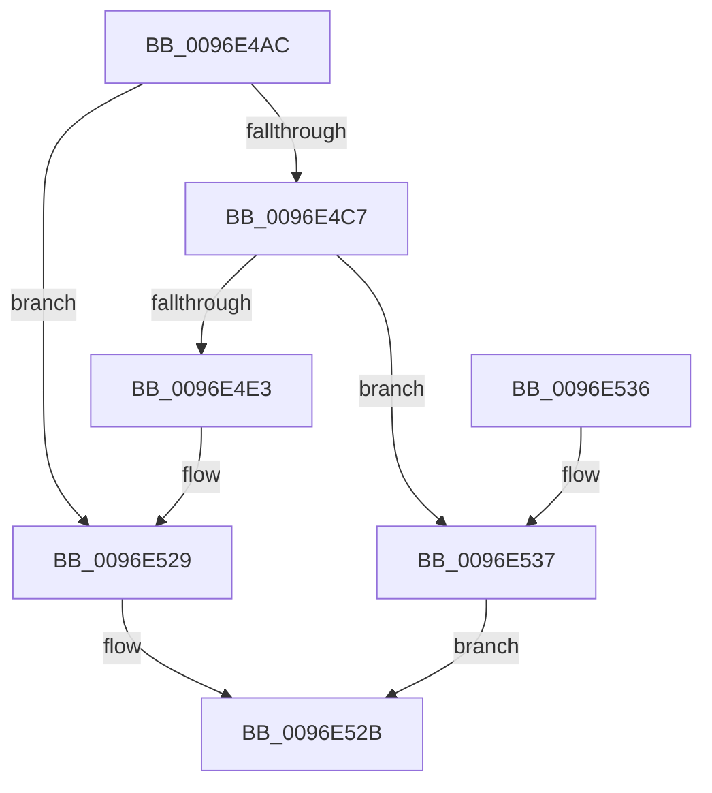

# CmpAdjustSecurityCacheSize

- RVA: `0x0096E4AC`–`0x0096E539` (길이 `141` bytes)
- VA: `0x000000014096E4AC`
- 실행 섹션: `PAGE`
- PDB 이름 있음: `예`; PDB Function 태그: `아니요`
- unwind 정보 RVA: `0x00095E5C`
- 디코드: `35`개 명령, `141/141` bytes 표시
- 미해석 바이트: `0` (있으면 어셈블리에 `.byte`로 보존)

> 이 문서는 커널 이미지의 기계어와 PDB 기호를 분석해 생성했습니다. 4번과 5번은 함수 원형과 자료형을 바이너리 사용 방식에서 추정한 C 해석이며 원본 소스 복구 결과는 아닙니다.

## 1. Dependencies

- 직접 호출 지점: **3**; 고유 호출 대상: **2**
- 직접 호출자로 확인된 함수: **1**
- RIP 상대 이미지 참조: **0**

### Outgoing calls
- `0x0096E4D6` → [guard_dispatch_icall](../../text/6B/guard_dispatch_icall_function_006BAAD0.md) (function, `0x006BAAD0`)
- `0x0096E4F8` → [memcpy](../../text/6C/memcpy_function_006C6840.md) (function, `0x006C6840`)
- `0x0096E511` → [guard_dispatch_icall](../../text/6B/guard_dispatch_icall_function_006BAAD0.md) (function, `0x006BAAD0`)

### Direct callers
- [CmpValidateHiveSecurityDescriptors](CmpValidateHiveSecurityDescriptors_function_0096DAFC.md) at `0x0096DCD2`

### Static image references
- 디코드된 RIP-relative 메모리 참조가 없습니다.

## 2. Other-region calls and transfers

- 다른 실행 섹션으로 향하는 call: **3**
  - `0x0096E4D6` → [guard_dispatch_icall](../../text/6B/guard_dispatch_icall_function_006BAAD0.md) (`PAGE` → `.text`)
  - `0x0096E4F8` → [memcpy](../../text/6C/memcpy_function_006C6840.md) (`PAGE` → `.text`)
  - `0x0096E511` → [guard_dispatch_icall](../../text/6B/guard_dispatch_icall_function_006BAAD0.md) (`PAGE` → `.text`)
- 별도 외부 분기/꼬리 이동을 확인하지 못했습니다.

## 3. Assembly (complete function range)

```asm
0096E4AC  48 89 5C 24 08                  mov qword ptr [rsp + 8], rbx
0096E4B1  57                              push rdi
0096E4B2  48 83 EC 20                     sub rsp, 0x20
0096E4B6  48 8B D9                        mov rbx, rcx
0096E4B9  8B 89 50 07 00 00               mov ecx, dword ptr [rcx + 0x750]
0096E4BF  3B 8B 54 07 00 00               cmp ecx, dword ptr [rbx + 0x754]
0096E4C5  73 62                           jae 0x14096e529
0096E4C7  48 8B 43 18                     mov rax, qword ptr [rbx + 0x18]
0096E4CB  33 D2                           xor edx, edx
0096E4CD  C1 E1 04                        shl ecx, 4
0096E4D0  41 B8 43 4D 53 63               mov r8d, 0x63534d43
0096E4D6  E8 F5 C5 D4 FF                  call 0x1406baad0
0096E4DB  48 8B F8                        mov rdi, rax
0096E4DE  48 85 C0                        test rax, rax
0096E4E1  74 54                           je 0x14096e537
0096E4E3  44 8B 83 50 07 00 00            mov r8d, dword ptr [rbx + 0x750]
0096E4EA  48 8B C8                        mov rcx, rax
0096E4ED  48 8B 93 60 07 00 00            mov rdx, qword ptr [rbx + 0x760]
0096E4F4  49 C1 E0 04                     shl r8, 4
0096E4F8  E8 43 83 D5 FF                  call 0x1406c6840
0096E4FD  8B 93 54 07 00 00               mov edx, dword ptr [rbx + 0x754]
0096E503  48 8B 43 20                     mov rax, qword ptr [rbx + 0x20]
0096E507  48 8B 8B 60 07 00 00            mov rcx, qword ptr [rbx + 0x760]
0096E50E  C1 E2 04                        shl edx, 4
0096E511  E8 BA C5 D4 FF                  call 0x1406baad0
0096E516  8B 83 50 07 00 00               mov eax, dword ptr [rbx + 0x750]
0096E51C  89 83 54 07 00 00               mov dword ptr [rbx + 0x754], eax
0096E522  48 89 BB 60 07 00 00            mov qword ptr [rbx + 0x760], rdi
0096E529  B0 01                           mov al, 1
0096E52B  48 8B 5C 24 30                  mov rbx, qword ptr [rsp + 0x30]
0096E530  48 83 C4 20                     add rsp, 0x20
0096E534  5F                              pop rdi
0096E535  C3                              ret
0096E536  CC                              int3
0096E537  EB F2                           jmp 0x14096e52b
```

## 4. C-style interpretation (structured pseudocode)

```c
__int64 __fastcall CmpAdjustSecurityCacheSize(__int64 a1, int a2)
{
    __int64 result;
    __int64 v_rsp;
    unsigned __int64 v_stack_p8;

    v_stack_p8 = v_rbx;
    v_rsp = (v_rsp) - (32);
    if (((unsigned int)((unsigned int)(*(unsigned int *)(a1 + 1872)))) >= (*(unsigned int *)(a1 + 1876))) goto loc_0096E529;
    a2 = 0;
    a1 = (unsigned int)(((unsigned int)(*(unsigned int *)(a1 + 1872))) << (4));
    result = guard_dispatch_icall(a1, a2, (unsigned int)(0x63534D43ULL), a4);
    if (result == 0) goto loc_0096E537;
    a3 = ((unsigned int)(*(unsigned int *)(a1 + 1872))) << (4);
    result = memcpy(result, *(unsigned __int64 *)(a1 + 1888), a3, a4);
    a2 = (unsigned int)(((unsigned int)(*(unsigned int *)(a1 + 1876))) << (4));
    result = guard_dispatch_icall(*(unsigned __int64 *)(a1 + 1888), a2, a3, a4);
    *(unsigned int *)(a1 + 1876) = (unsigned int)((unsigned int)(*(unsigned int *)(a1 + 1872)));
    *(unsigned __int64 *)(a1 + 1888) = result;
loc_0096E529:
loc_0096E52B:
    v_rsp = (v_rsp) + (32);
    return 1;
loc_0096E537:
    goto loc_0096E52B;
}
```

## 5. (Beta) C Style

```c
int64_t CmpAdjustSecurityCacheSize(void *Arg1, int32_t Arg2)
{
    uint8_t *arg1 = (uint8_t *)Arg1;

    int64_t result;
    int64_t local_rsp;
    uint64_t v_stack_p8;

    v_stack_p8 = local_rbx;
    local_rsp = (local_rsp) - (32);
    if (((uint32_t)((uint32_t)(*(uint32_t *)(arg1 + 0x750)))) >= (*(uint32_t *)(arg1 + 0x754))) goto loc_0096E529;
    Arg2 = 0;
    Arg1 = (uint32_t)(((uint32_t)(*(uint32_t *)(arg1 + 0x750))) << (4));
    result = guard_dispatch_icall(Arg1, Arg2, (uint32_t)(0x63534D43ULL), a4);
    if (result == 0) goto loc_0096E537;
    a3 = ((uint32_t)(*(uint32_t *)(arg1 + 0x750))) << (4);
    result = memcpy(result, *(uint64_t *)(arg1 + 0x760), a3, a4);
    Arg2 = (uint32_t)(((uint32_t)(*(uint32_t *)(arg1 + 0x754))) << (4));
    result = guard_dispatch_icall(*(uint64_t *)(arg1 + 0x760), Arg2, a3, a4);
    *(uint32_t *)(arg1 + 0x754) = (uint32_t)((uint32_t)(*(uint32_t *)(arg1 + 0x750)));
    *(uint64_t *)(arg1 + 0x760) = result;
loc_0096E529:
loc_0096E52B:
    local_rsp = (local_rsp) + (32);
    return 1;
loc_0096E537:
    goto loc_0096E52B;
}
```

### 관측된 메모리 오프셋

구조체 형식이 확인되지 않은 접근은 인자 기준의 오프셋으로만 기록했습니다.

| 기준 인자 | 오프셋 표현 | 폭 (bit) | 접근 |
|---|---:|---:|---|
| `Arg1` | `+ 0x18` | `64` | `R` |
| `Arg1` | `+ 0x20` | `64` | `R` |
| `Arg1` | `+ 0x750` | `32` | `R` |
| `Arg1` | `+ 0x754` | `32` | `R` |
| `Arg1` | `+ 0x754` | `32` | `W` |
| `Arg1` | `+ 0x760` | `64` | `R` |
| `Arg1` | `+ 0x760` | `64` | `W` |

## 6. Execution-region graph

[열기: 2D/3D 그래프와 함수 탐색 컨트롤 패널](../../../control-panel.html?section=page&rva=0x0096E4AC&view=graph)

- 2D 그래프는 위에서 아래로 흐르고, 3D 그래프는 빈 공간을 드래그해 회전합니다. Shift+드래그는 이동, 휠은 확대·축소, 함수 노드 선택은 대상 보고서 이동입니다.

### Static fallback


