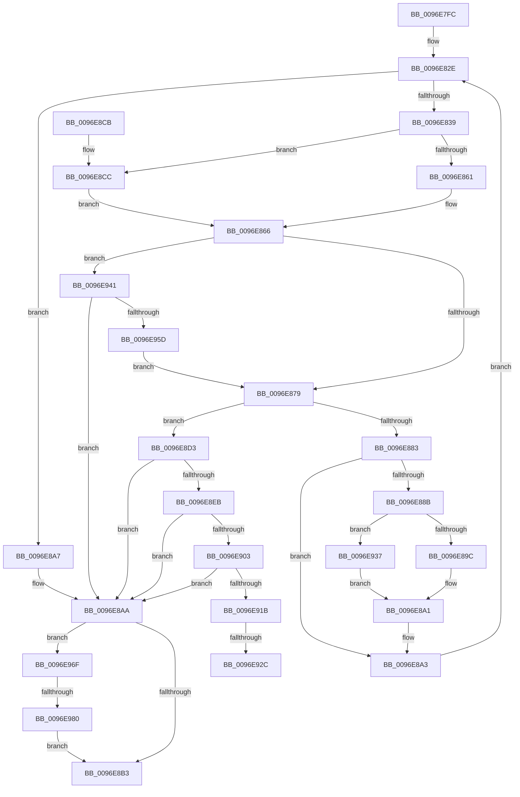

# CmpCheckAndFixSecurityCellsRefcount

- RVA: `0x0096E7FC`–`0x0096E98A` (길이 `398` bytes)
- VA: `0x000000014096E7FC`
- 실행 섹션: `PAGE`
- PDB 이름 있음: `예`; PDB Function 태그: `예`
- unwind 정보 RVA: `0x00095E98`
- 디코드: `118`개 명령, `398/398` bytes 표시
- 미해석 바이트: `0` (있으면 어셈블리에 `.byte`로 보존)

> 이 문서는 커널 이미지의 기계어와 PDB 기호를 분석해 생성했습니다. 4번과 5번은 함수 원형과 자료형을 바이너리 사용 방식에서 추정한 C 해석이며 원본 소스 복구 결과는 아닙니다.

## 1. Dependencies

- 직접 호출 지점: **11**; 고유 호출 대상: **6**
- 직접 호출자로 확인된 함수: **1**
- RIP 상대 이미지 참조: **0**

### Outgoing calls
- `0x0096E820` → [HvpGetCellContextInitialize](../85/HvpGetCellContextInitialize_function_00855F10.md) (function, `0x00855F10`)
- `0x0096E861` → [HvpGetCellFlat](../85/HvpGetCellFlat_function_00854C60.md) (function, `0x00854C60`)
- `0x0096E89C` → [HvpReleaseCellPaged](../85/HvpReleaseCellPaged_function_00855F40.md) (function, `0x00855F40`)
- `0x0096E8CC` → [HvpGetCellPaged](../85/HvpGetCellPaged_function_00854CB0.md) (function, `0x00854CB0`)
- `0x0096E8DF` → [HvpMarkCellDirty](../85/HvpMarkCellDirty_function_00858080.md) (function, `0x00858080`)
- `0x0096E8F7` → [HvpMarkCellDirty](../85/HvpMarkCellDirty_function_00858080.md) (function, `0x00858080`)
- `0x0096E90F` → [HvpMarkCellDirty](../85/HvpMarkCellDirty_function_00858080.md) (function, `0x00858080`)
- `0x0096E92C` → [HvpReleaseCellFlat](../85/HvpReleaseCellFlat_function_0085CC20.md) (function, `0x0085CC20`)
- `0x0096E937` → [HvpReleaseCellFlat](../85/HvpReleaseCellFlat_function_0085CC20.md) (function, `0x0085CC20`)
- `0x0096E94D` → [HvpMarkCellDirty](../85/HvpMarkCellDirty_function_00858080.md) (function, `0x00858080`)
- `0x0096E980` → [HvpReleaseCellFlat](../85/HvpReleaseCellFlat_function_0085CC20.md) (function, `0x0085CC20`)

### Direct callers
- [sub_0096E9E9](Unknown_function_0096E9E9.md) at `0x0096ED03`

### Static image references
- 디코드된 RIP-relative 메모리 참조가 없습니다.

## 2. Other-region calls and transfers

- 다른 실행 섹션으로 향하는 call: **0**
- call이 아닌 외부 분기/꼬리 이동: **3**
  - `0x0096E926` → [sub_00B28CCC](../B2/Unknown_function_00B28CCC.md) (`tail-transfer`)
  - `0x0096E932` → [sub_00B28CCC + 0x5](../B2/Unknown_function_00B28CCC.md) (`tail-transfer`)
  - `0x0096E97A` → [sub_00B28CCC + 0x24](../B2/Unknown_function_00B28CCC.md) (`tail-transfer`)

## 3. Assembly (complete function range)

```asm
0096E7FC  48 89 5C 24 18                  mov qword ptr [rsp + 0x18], rbx
0096E801  55                              push rbp
0096E802  56                              push rsi
0096E803  57                              push rdi
0096E804  41 54                           push r12
0096E806  41 55                           push r13
0096E808  41 56                           push r14
0096E80A  41 57                           push r15
0096E80C  48 83 EC 20                     sub rsp, 0x20
0096E810  48 83 64 24 68 00               and qword ptr [rsp + 0x68], 0
0096E816  48 8B D9                        mov rbx, rcx
0096E819  48 8D 4C 24 68                  lea rcx, [rsp + 0x68]
0096E81E  33 F6                           xor esi, esi
0096E820  E8 EB 76 EE FF                  call 0x140855f10
0096E825  33 ED                           xor ebp, ebp
0096E827  48 8D BB 8C 00 00 00            lea rdi, [rbx + 0x8c]
0096E82E  44 8B F5                        mov r14d, ebp
0096E831  3B AB 50 07 00 00               cmp ebp, dword ptr [rbx + 0x750]
0096E837  73 6E                           jae 0x14096e8a7
0096E839  44 8B FD                        mov r15d, ebp
0096E83C  48 8D BB 8C 00 00 00            lea rdi, [rbx + 0x8c]
0096E843  49 C1 E7 04                     shl r15, 4
0096E847  4C 8D 44 24 68                  lea r8, [rsp + 0x68]
0096E84C  4C 03 BB 60 07 00 00            add r15, qword ptr [rbx + 0x760]
0096E853  48 8B CB                        mov rcx, rbx
0096E856  F6 07 01                        test byte ptr [rdi], 1
0096E859  45 8B 27                        mov r12d, dword ptr [r15]
0096E85C  41 8B D4                        mov edx, r12d
0096E85F  74 6B                           je 0x14096e8cc
0096E861  E8 FA 63 EE FF                  call 0x140854c60
0096E866  48 8B F0                        mov rsi, rax
0096E869  49 8B 47 08                     mov rax, qword ptr [r15 + 8]
0096E86D  8B 48 1C                        mov ecx, dword ptr [rax + 0x1c]
0096E870  39 4E 0C                        cmp dword ptr [rsi + 0xc], ecx
0096E873  0F 85 C8 00 00 00               jne 0x14096e941
0096E879  49 8B 47 08                     mov rax, qword ptr [r15 + 8]
0096E87D  83 78 1C 00                     cmp dword ptr [rax + 0x1c], 0
0096E881  74 50                           je 0x14096e8d3
0096E883  41 8B EE                        mov ebp, r14d
0096E886  48 85 F6                        test rsi, rsi
0096E889  74 18                           je 0x14096e8a3
0096E88B  F6 07 01                        test byte ptr [rdi], 1
0096E88E  48 8D 54 24 68                  lea rdx, [rsp + 0x68]
0096E893  48 8B CB                        mov rcx, rbx
0096E896  0F 85 9B 00 00 00               jne 0x14096e937
0096E89C  E8 9F 76 EE FF                  call 0x140855f40
0096E8A1  33 F6                           xor esi, esi
0096E8A3  FF C5                           inc ebp
0096E8A5  EB 87                           jmp 0x14096e82e
0096E8A7  45 33 F6                        xor r14d, r14d
0096E8AA  48 85 F6                        test rsi, rsi
0096E8AD  0F 85 BC 00 00 00               jne 0x14096e96f
0096E8B3  48 8B 5C 24 70                  mov rbx, qword ptr [rsp + 0x70]
0096E8B8  41 8B C6                        mov eax, r14d
0096E8BB  48 83 C4 20                     add rsp, 0x20
0096E8BF  41 5F                           pop r15
0096E8C1  41 5E                           pop r14
0096E8C3  41 5D                           pop r13
0096E8C5  41 5C                           pop r12
0096E8C7  5F                              pop rdi
0096E8C8  5E                              pop rsi
0096E8C9  5D                              pop rbp
0096E8CA  C3                              ret
0096E8CB  CC                              int3
0096E8CC  E8 DF 63 EE FF                  call 0x140854cb0
0096E8D1  EB 93                           jmp 0x14096e866
0096E8D3  45 33 C9                        xor r9d, r9d
0096E8D6  45 33 C0                        xor r8d, r8d
0096E8D9  41 8B D4                        mov edx, r12d
0096E8DC  48 8B CB                        mov rcx, rbx
0096E8DF  E8 9C 97 EE FF                  call 0x140858080
0096E8E4  44 8B F0                        mov r14d, eax
0096E8E7  85 C0                           test eax, eax
0096E8E9  78 BF                           js 0x14096e8aa
0096E8EB  8B 56 04                        mov edx, dword ptr [rsi + 4]
0096E8EE  45 33 C9                        xor r9d, r9d
0096E8F1  45 33 C0                        xor r8d, r8d
0096E8F4  48 8B CB                        mov rcx, rbx
0096E8F7  E8 84 97 EE FF                  call 0x140858080
0096E8FC  44 8B F0                        mov r14d, eax
0096E8FF  85 C0                           test eax, eax
0096E901  78 A7                           js 0x14096e8aa
0096E903  8B 56 08                        mov edx, dword ptr [rsi + 8]
0096E906  45 33 C9                        xor r9d, r9d
0096E909  45 33 C0                        xor r8d, r8d
0096E90C  48 8B CB                        mov rcx, rbx
0096E90F  E8 6C 97 EE FF                  call 0x140858080
0096E914  44 8B F0                        mov r14d, eax
0096E917  85 C0                           test eax, eax
0096E919  78 8F                           js 0x14096e8aa
0096E91B  F6 07 01                        test byte ptr [rdi], 1
0096E91E  48 8D 54 24 68                  lea rdx, [rsp + 0x68]
0096E923  48 8B CB                        mov rcx, rbx
0096E926  0F 84 A0 A3 1B 00               je 0x140b28ccc
0096E92C  E8 EF E2 EE FF                  call 0x14085cc20
0096E931  90                              nop
0096E932  E9 9A A3 1B 00                  jmp 0x140b28cd1
0096E937  E8 E4 E2 EE FF                  call 0x14085cc20
0096E93C  E9 60 FF FF FF                  jmp 0x14096e8a1
0096E941  41 8B 17                        mov edx, dword ptr [r15]
0096E944  45 33 C9                        xor r9d, r9d
0096E947  45 33 C0                        xor r8d, r8d
0096E94A  48 8B CB                        mov rcx, rbx
0096E94D  E8 2E 97 EE FF                  call 0x140858080
0096E952  44 8B F0                        mov r14d, eax
0096E955  85 C0                           test eax, eax
0096E957  0F 88 4D FF FF FF               js 0x14096e8aa
0096E95D  49 8B 47 08                     mov rax, qword ptr [r15 + 8]
0096E961  44 8B F5                        mov r14d, ebp
0096E964  8B 48 1C                        mov ecx, dword ptr [rax + 0x1c]
0096E967  89 4E 0C                        mov dword ptr [rsi + 0xc], ecx
0096E96A  E9 0A FF FF FF                  jmp 0x14096e879
0096E96F  F6 07 01                        test byte ptr [rdi], 1
0096E972  48 8D 54 24 68                  lea rdx, [rsp + 0x68]
0096E977  48 8B CB                        mov rcx, rbx
0096E97A  0F 84 70 A3 1B 00               je 0x140b28cf0
0096E980  E8 9B E2 EE FF                  call 0x14085cc20
0096E985  E9 29 FF FF FF                  jmp 0x14096e8b3
```

## 4. C-style interpretation (structured pseudocode)

```c
__int64 __fastcall CmpCheckAndFixSecurityCellsRefcount(__int64 a1, __int64 a2, __int64 a3, int a4)
{
    __int64 result;
    __int64 v_r14;
    __int64 v_r15;
    __int64 v_rbp;
    __int64 v_rsi;
    __int64 v_rsp;
    unsigned __int64 v_stack_p10;
    unsigned __int64 v_stack_p18;
    unsigned __int64 v_stack_p68;

    v_stack_p18 = v_rbx;
    v_rsp = (v_rsp) - (32);
    v_rsi = 0;
    result = HvpGetCellContextInitialize(v_stack_p10, a2, a3, a4);
    v_rbp = 0;
loc_0096E82E:
    if (0 >= (*(unsigned int *)(a1 + 1872))) goto loc_0096E8A7;
    v_r15 = (0) << (4);
    v_r15 = (v_r15) + (*(unsigned __int64 *)(a1 + 1888));
    if (((*(unsigned __int8 *)(a1 + 140)) & (1)) == 0) goto loc_0096E8CC;
    result = HvpGetCellFlat(a1, (unsigned int)((unsigned int)((unsigned int)(*(unsigned int *)(v_r15)))), v_stack_p10, a4);
loc_0096E866:
    if ((*(unsigned int *)(result + 12)) != ((unsigned int)((unsigned int)(*(unsigned int *)(*(unsigned __int64 *)(v_r15 + 8) + 28))))) goto loc_0096E941;
loc_0096E879:
    if ((*(unsigned int *)(*(unsigned __int64 *)(v_r15 + 8) + 28)) == 0) goto loc_0096E8D3;
    if (result == 0) goto loc_0096E8A3;
    if (((*(unsigned __int8 *)(a1 + 140)) & (1)) != 0) goto loc_0096E937;
    result = HvpReleaseCellPaged(a1, v_stack_p10, v_stack_p10, a4);
loc_0096E8A1:
    v_rsi = 0;
loc_0096E8A3:
    v_rbp = (unsigned int)((0) + 1);
    goto loc_0096E82E;
loc_0096E8A7:
    v_r14 = 0;
loc_0096E8AA:
    if (0 != 0) goto loc_0096E96F;
loc_0096E8B3:
    v_rsp = (v_rsp) + (32);
    return 0;
loc_0096E8CC:
    result = HvpGetCellPaged(a1, v_stack_p10, v_stack_p10, a4);
    goto loc_0096E866;
loc_0096E8D3:
    a4 = 0;
    a3 = 0;
    result = HvpMarkCellDirty(v_stack_p18, (unsigned int)((unsigned int)((unsigned int)(*(unsigned int *)(v_r15)))), a3, a4);
    if (sign_flag) goto loc_0096E8AA;
    a4 = 0;
    a3 = 0;
    result = HvpMarkCellDirty(v_stack_p18, (unsigned int)(*(unsigned int *)(v_rsi + 4)), a3, a4);
    if (sign_flag) goto loc_0096E8AA;
    a4 = 0;
    a3 = 0;
    result = HvpMarkCellDirty(v_stack_p18, (unsigned int)(*(unsigned int *)(v_rsi + 8)), a3, a4);
    if (sign_flag) goto loc_0096E8AA;
    result = HvpReleaseCellFlat(v_stack_p18, v_stack_p68, a3, a4);
loc_0096E937:
    result = HvpReleaseCellFlat(v_stack_p18, v_stack_p68, a3, a4);
    goto loc_0096E8A1;
loc_0096E941:
    a4 = 0;
    a3 = 0;
    result = HvpMarkCellDirty(v_stack_p18, (unsigned int)(*(unsigned int *)(v_r15)), a3, a4);
    if (sign_flag) goto loc_0096E8AA;
    *(unsigned int *)(v_rsi + 12) = (unsigned int)((unsigned int)(*(unsigned int *)(*(unsigned __int64 *)(v_r15 + 8) + 28)));
    goto loc_0096E879;
loc_0096E96F:
    result = HvpReleaseCellFlat(v_stack_p18, v_stack_p68, a3, a4);
    goto loc_0096E8B3;
}
```

## 5. (Beta) C Style

```c
int64_t CmpCheckAndFixSecurityCellsRefcount(void *Arg1, int64_t Arg2, int64_t Arg3, int32_t Arg4)
{
    uint8_t *arg1 = (uint8_t *)Arg1;

    int64_t result;
    int64_t local_r14;
    int64_t local_r15;
    int64_t local_rbp;
    int64_t local_rsi;
    int64_t local_rsp;
    uint64_t v_stack_p10;
    uint64_t v_stack_p18;
    uint64_t v_stack_p68;

    v_stack_p18 = local_rbx;
    local_rsp = (local_rsp) - (32);
    local_rsi = 0;
    result = HvpGetCellContextInitialize(v_stack_p10, Arg2, Arg3, Arg4);
    local_rbp = 0;
loc_0096E82E:
    if (0 >= (*(uint32_t *)(arg1 + 0x750))) goto loc_0096E8A7;
    local_r15 = (0) << (4);
    local_r15 = (local_r15) + (*(uint64_t *)(arg1 + 0x760));
    if (((*(uint8_t *)(arg1 + 0x8C)) & (1)) == 0) goto loc_0096E8CC;
    result = HvpGetCellFlat(Arg1, (uint32_t)((uint32_t)((uint32_t)(*(uint32_t *)(local_r15)))), v_stack_p10, Arg4);
loc_0096E866:
    if ((*(uint32_t *)(result + 0xC)) != ((uint32_t)((uint32_t)(*(uint32_t *)(*(uint64_t *)(local_r15 + 0x8) + 0x1C))))) goto loc_0096E941;
loc_0096E879:
    if ((*(uint32_t *)(*(uint64_t *)(local_r15 + 0x8) + 0x1C)) == 0) goto loc_0096E8D3;
    if (result == 0) goto loc_0096E8A3;
    if (((*(uint8_t *)(arg1 + 0x8C)) & (1)) != 0) goto loc_0096E937;
    result = HvpReleaseCellPaged(Arg1, v_stack_p10, v_stack_p10, Arg4);
loc_0096E8A1:
    local_rsi = 0;
loc_0096E8A3:
    local_rbp = (uint32_t)((0) + 1);
    goto loc_0096E82E;
loc_0096E8A7:
    local_r14 = 0;
loc_0096E8AA:
    if (0 != 0) goto loc_0096E96F;
loc_0096E8B3:
    local_rsp = (local_rsp) + (32);
    return 0;
loc_0096E8CC:
    result = HvpGetCellPaged(Arg1, v_stack_p10, v_stack_p10, Arg4);
    goto loc_0096E866;
loc_0096E8D3:
    Arg4 = 0;
    Arg3 = 0;
    result = HvpMarkCellDirty(v_stack_p18, (uint32_t)((uint32_t)((uint32_t)(*(uint32_t *)(local_r15)))), Arg3, Arg4);
    if (sign_flag) goto loc_0096E8AA;
    Arg4 = 0;
    Arg3 = 0;
    result = HvpMarkCellDirty(v_stack_p18, (uint32_t)(*(uint32_t *)(local_rsi + 0x4)), Arg3, Arg4);
    if (sign_flag) goto loc_0096E8AA;
    Arg4 = 0;
    Arg3 = 0;
    result = HvpMarkCellDirty(v_stack_p18, (uint32_t)(*(uint32_t *)(local_rsi + 0x8)), Arg3, Arg4);
    if (sign_flag) goto loc_0096E8AA;
    result = HvpReleaseCellFlat(v_stack_p18, v_stack_p68, Arg3, Arg4);
loc_0096E937:
    result = HvpReleaseCellFlat(v_stack_p18, v_stack_p68, Arg3, Arg4);
    goto loc_0096E8A1;
loc_0096E941:
    Arg4 = 0;
    Arg3 = 0;
    result = HvpMarkCellDirty(v_stack_p18, (uint32_t)(*(uint32_t *)(local_r15)), Arg3, Arg4);
    if (sign_flag) goto loc_0096E8AA;
    *(uint32_t *)(local_rsi + 0xC) = (uint32_t)((uint32_t)(*(uint32_t *)(*(uint64_t *)(local_r15 + 0x8) + 0x1C)));
    goto loc_0096E879;
loc_0096E96F:
    result = HvpReleaseCellFlat(v_stack_p18, v_stack_p68, Arg3, Arg4);
    goto loc_0096E8B3;
}
```

### 관측된 메모리 오프셋

구조체 형식이 확인되지 않은 접근은 인자 기준의 오프셋으로만 기록했습니다.

| 기준 인자 | 오프셋 표현 | 폭 (bit) | 접근 |
|---|---:|---:|---|
| `Arg1` | `+ 0x0` | `8` | `R` |
| `Arg1` | `+ 0x8C` | `64` | `R` |
| `Arg1` | `+ 0x750` | `32` | `R` |
| `Arg1` | `+ 0x760` | `64` | `R` |

## 6. Execution-region graph

[열기: 2D/3D 그래프와 함수 탐색 컨트롤 패널](../../../control-panel.html?section=page&rva=0x0096E7FC&view=graph)

- 2D 그래프는 위에서 아래로 흐르고, 3D 그래프는 빈 공간을 드래그해 회전합니다. Shift+드래그는 이동, 휠은 확대·축소, 함수 노드 선택은 대상 보고서 이동입니다.

### Static fallback


