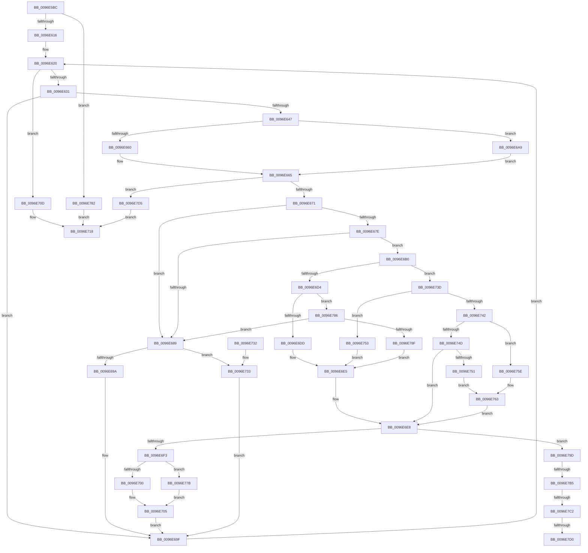

# CmpCheckLeaf

- RVA: `0x0096E5BC`–`0x0096E7F4` (길이 `568` bytes)
- VA: `0x000000014096E5BC`
- 실행 섹션: `PAGE`
- PDB 이름 있음: `예`; PDB Function 태그: `예`
- unwind 정보 RVA: `0x00095E6C`
- 디코드: `156`개 명령, `568/568` bytes 표시
- 미해석 바이트: `0` (있으면 어셈블리에 `.byte`로 보존)

> 이 문서는 커널 이미지의 기계어와 PDB 기호를 분석해 생성했습니다. 4번과 5번은 함수 원형과 자료형을 바이너리 사용 방식에서 추정한 C 해석이며 원본 소스 복구 결과는 아닙니다.

## 1. Dependencies

- 직접 호출 지점: **13**; 고유 호출 대상: **11**
- 직접 호출자로 확인된 함수: **1**
- RIP 상대 이미지 참조: **2**

### Outgoing calls
- `0x0096E5F7` → [HvpGetCellContextInitialize](../85/HvpGetCellContextInitialize_function_00855F10.md) (function, `0x00855F10`)
- `0x0096E63E` → [HvIsCellAllocated](../85/HvIsCellAllocated_function_00855D60.md) (function, `0x00855D60`)
- `0x0096E660` → [HvpGetCellFlat](../85/HvpGetCellFlat_function_00854C60.md) (function, `0x00854C60`)
- `0x0096E69A` → [HvpReleaseCellPaged](../85/HvpReleaseCellPaged_function_00855F40.md) (function, `0x00855F40`)
- `0x0096E6A9` → [HvpGetCellPaged](../85/HvpGetCellPaged_function_00854CB0.md) (function, `0x00854CB0`)
- `0x0096E6E0` → [CmpHashCompressedComponent](../85/CmpHashCompressedComponent_function_0085E420.md) (function, `0x0085E420`)
- `0x0096E700` → [HvpReleaseCellPaged](../85/HvpReleaseCellPaged_function_00855F40.md) (function, `0x00855F40`)
- `0x0096E733` → [HvpReleaseCellFlat](../85/HvpReleaseCellFlat_function_0085CC20.md) (function, `0x0085CC20`)
- `0x0096E757` → [CmpGenerateFastLeafHintForUnicodeString](CmpGenerateFastLeafHintForUnicodeString_function_0096E540.md) (function, `0x0096E540`)
- `0x0096E76D` → [memcpy](../../text/6C/memcpy_function_006C6840.md) (function, `0x006C6840`)
- `0x0096E77B` → [HvpReleaseCellFlat](../85/HvpReleaseCellFlat_function_0085CC20.md) (function, `0x0085CC20`)
- `0x0096E793` → [CmpHashUnicodeComponent](../84/CmpHashUnicodeComponent_function_0084AC24.md) (function, `0x0084AC24`)
- `0x0096E7EA` → [SetFailureLocation](../../text/46/SetFailureLocation_function_0046EF54.md) (function, `0x0046EF54`)

### Direct callers
- [CmpCheckKey](CmpCheckKey_function_0096EE2C.md) at `0x0096F58B`
- [CmpCheckKey](CmpCheckKey_function_0096EE2C.md) at `0x009705B0`

### Static image references
- `0x0096E7B5` → RVA `0x00FD8002` (`PAGEDATA`; read)
- `0x0096E7C2` → RVA `0x00EF7C60` (`.data`; read)

## 2. Other-region calls and transfers

- 다른 실행 섹션으로 향하는 call: **2**
  - `0x0096E76D` → [memcpy](../../text/6C/memcpy_function_006C6840.md) (`PAGE` → `.text`)
  - `0x0096E7EA` → [SetFailureLocation](../../text/46/SetFailureLocation_function_0046EF54.md) (`PAGE` → `.text`)
- call이 아닌 외부 분기/꼬리 이동: **4**
  - `0x0096E7AF` → [sub_00B28C32 + 0x54](../B2/Unknown_function_00B28C32.md) (`tail-transfer`)
  - `0x0096E7BC` → [sub_00B28C32](../B2/Unknown_function_00B28C32.md) (`tail-transfer`)
  - `0x0096E7CA` → [sub_00B28C32](../B2/Unknown_function_00B28C32.md) (`tail-transfer`)
  - `0x0096E7D0` → [sub_00B28C32 + 0x54](../B2/Unknown_function_00B28C32.md) (`tail-transfer`)

## 3. Assembly (complete function range)

```asm
0096E5BC  48 89 5C 24 08                  mov qword ptr [rsp + 8], rbx
0096E5C1  44 89 4C 24 20                  mov dword ptr [rsp + 0x20], r9d
0096E5C6  89 54 24 10                     mov dword ptr [rsp + 0x10], edx
0096E5CA  55                              push rbp
0096E5CB  56                              push rsi
0096E5CC  57                              push rdi
0096E5CD  41 54                           push r12
0096E5CF  41 55                           push r13
0096E5D1  41 56                           push r14
0096E5D3  41 57                           push r15
0096E5D5  48 8B EC                        mov rbp, rsp
0096E5D8  48 83 EC 50                     sub rsp, 0x50
0096E5DC  48 8B F1                        mov rsi, rcx
0096E5DF  33 FF                           xor edi, edi
0096E5E1  0F 57 C0                        xorps xmm0, xmm0
0096E5E4  48 89 7D E8                     mov qword ptr [rbp - 0x18], rdi
0096E5E8  48 8D 4D E8                     lea rcx, [rbp - 0x18]
0096E5EC  40 88 7D 50                     mov byte ptr [rbp + 0x50], dil
0096E5F0  0F 11 45 F0                     movups xmmword ptr [rbp - 0x10], xmm0
0096E5F4  4D 8B E0                        mov r12, r8
0096E5F7  E8 14 79 EE FF                  call 0x140855f10
0096E5FC  41 0F B7 00                     movzx eax, word ptr [r8]
0096E600  BA 6C 66 00 00                  mov edx, 0x666c
0096E605  66 2B C2                        sub ax, dx
0096E608  B9 FF FD 00 00                  mov ecx, 0xfdff
0096E60D  66 85 C1                        test cx, ax
0096E610  0F 85 6C 01 00 00               jne 0x14096e782
0096E616  8B CF                           mov ecx, edi
0096E618  44 8D 77 20                     lea r14d, [rdi + 0x20]
0096E61C  44 8D 6F 17                     lea r13d, [rdi + 0x17]
0096E620  41 0F B7 44 24 02               movzx eax, word ptr [r12 + 2]
0096E626  89 4D E0                        mov dword ptr [rbp - 0x20], ecx
0096E629  3B C8                           cmp ecx, eax
0096E62B  0F 83 DC 00 00 00               jae 0x14096e70d
0096E631  8B D9                           mov ebx, ecx
0096E633  45 33 C0                        xor r8d, r8d
0096E636  48 8B CE                        mov rcx, rsi
0096E639  41 8B 54 DC 04                  mov edx, dword ptr [r12 + rbx*8 + 4]
0096E63E  E8 1D 77 EE FF                  call 0x140855d60
0096E643  84 C0                           test al, al
0096E645  74 58                           je 0x14096e69f
0096E647  41 8B 54 DC 04                  mov edx, dword ptr [r12 + rbx*8 + 4]
0096E64C  4C 8D BE 8C 00 00 00            lea r15, [rsi + 0x8c]
0096E653  41 F6 07 01                     test byte ptr [r15], 1
0096E657  4C 8D 45 E8                     lea r8, [rbp - 0x18]
0096E65B  48 8B CE                        mov rcx, rsi
0096E65E  74 49                           je 0x14096e6a9
0096E660  E8 FB 65 EE FF                  call 0x140854c60
0096E665  48 8B C8                        mov rcx, rax
0096E668  48 85 C0                        test rax, rax
0096E66B  0F 84 64 01 00 00               je 0x14096e7d5
0096E671  B8 FC FF FF FF                  mov eax, 0xfffffffc
0096E676  2B 41 FC                        sub eax, dword ptr [rcx - 4]
0096E679  83 F8 4C                        cmp eax, 0x4c
0096E67C  72 0B                           jb 0x14096e689
0096E67E  0F B7 51 48                     movzx edx, word ptr [rcx + 0x48]
0096E682  83 C0 B4                        add eax, -0x4c
0096E685  3B D0                           cmp edx, eax
0096E687  76 27                           jbe 0x14096e6b0
0096E689  41 F6 07 01                     test byte ptr [r15], 1
0096E68D  48 8D 55 E8                     lea rdx, [rbp - 0x18]
0096E691  48 8B CE                        mov rcx, rsi
0096E694  0F 85 99 00 00 00               jne 0x14096e733
0096E69A  E8 A1 78 EE FF                  call 0x140855f40
0096E69F  8B 4D E0                        mov ecx, dword ptr [rbp - 0x20]
0096E6A2  FF C1                           inc ecx
0096E6A4  E9 77 FF FF FF                  jmp 0x14096e620
0096E6A9  E8 02 66 EE FF                  call 0x140854cb0
0096E6AE  EB B5                           jmp 0x14096e665
0096E6B0  0F B7 41 02                     movzx eax, word ptr [rcx + 2]
0096E6B4  4C 8D 49 4C                     lea r9, [rcx + 0x4c]
0096E6B8  66 41 23 C6                     and ax, r14w
0096E6BC  66 89 55 F2                     mov word ptr [rbp - 0xe], dx
0096E6C0  B9 6C 68 00 00                  mov ecx, 0x686c
0096E6C5  66 89 55 F0                     mov word ptr [rbp - 0x10], dx
0096E6C9  4C 89 4D F8                     mov qword ptr [rbp - 8], r9
0096E6CD  66 41 39 0C 24                  cmp word ptr [r12], cx
0096E6D2  75 69                           jne 0x14096e73d
0096E6D4  66 85 C0                        test ax, ax
0096E6D7  0F 84 A9 00 00 00               je 0x14096e786
0096E6DD  49 8B C9                        mov rcx, r9
0096E6E0  E8 3B FD EE FF                  call 0x14085e420
0096E6E5  44 8B F0                        mov r14d, eax
0096E6E8  45 39 74 DC 08                  cmp dword ptr [r12 + rbx*8 + 8], r14d
0096E6ED  0F 85 AA 00 00 00               jne 0x14096e79d
0096E6F3  41 F6 07 01                     test byte ptr [r15], 1
0096E6F7  48 8D 55 E8                     lea rdx, [rbp - 0x18]
0096E6FB  48 8B CE                        mov rcx, rsi
0096E6FE  75 7B                           jne 0x14096e77b
0096E700  E8 3B 78 EE FF                  call 0x140855f40
0096E705  41 BE 20 00 00 00               mov r14d, 0x20
0096E70B  EB 92                           jmp 0x14096e69f
0096E70D  F6 5D 50                        neg byte ptr [rbp + 0x50]
0096E710  1B DB                           sbb ebx, ebx
0096E712  81 E3 2A 00 00 80               and ebx, 0x8000002a
0096E718  8B C3                           mov eax, ebx
0096E71A  48 8B 9C 24 90 00 00 00         mov rbx, qword ptr [rsp + 0x90]
0096E722  48 83 C4 50                     add rsp, 0x50
0096E726  41 5F                           pop r15
0096E728  41 5E                           pop r14
0096E72A  41 5D                           pop r13
0096E72C  41 5C                           pop r12
0096E72E  5F                              pop rdi
0096E72F  5E                              pop rsi
0096E730  5D                              pop rbp
0096E731  C3                              ret
0096E732  CC                              int3
0096E733  E8 E8 E4 EE FF                  call 0x14085cc20
0096E738  E9 62 FF FF FF                  jmp 0x14096e69f
0096E73D  66 85 C0                        test ax, ax
0096E740  74 11                           je 0x14096e753
0096E742  89 7D E4                        mov dword ptr [rbp - 0x1c], edi
0096E745  44 8B F7                        mov r14d, edi
0096E748  83 FA 04                        cmp edx, 4
0096E74B  73 11                           jae 0x14096e75e
0096E74D  85 D2                           test edx, edx
0096E74F  74 97                           je 0x14096e6e8
0096E751  EB 10                           jmp 0x14096e763
0096E753  48 8D 4D F0                     lea rcx, [rbp - 0x10]
0096E757  E8 E4 FD FF FF                  call 0x14096e540
0096E75C  EB 87                           jmp 0x14096e6e5
0096E75E  BA 04 00 00 00                  mov edx, 4
0096E763  44 8B C2                        mov r8d, edx
0096E766  48 8D 4D E4                     lea rcx, [rbp - 0x1c]
0096E76A  49 8B D1                        mov rdx, r9
0096E76D  E8 CE 80 D5 FF                  call 0x1406c6840
0096E772  44 8B 75 E4                     mov r14d, dword ptr [rbp - 0x1c]
0096E776  E9 6D FF FF FF                  jmp 0x14096e6e8
0096E77B  E8 A0 E4 EE FF                  call 0x14085cc20
0096E780  EB 83                           jmp 0x14096e705
0096E782  8B DF                           mov ebx, edi
0096E784  EB 92                           jmp 0x14096e718
0096E786  F6 C2 01                        test dl, 1
0096E789  0F 85 FA FE FF FF               jne 0x14096e689
0096E78F  48 8D 4D F0                     lea rcx, [rbp - 0x10]
0096E793  E8 8C C4 ED FF                  call 0x14084ac24
0096E798  E9 48 FF FF FF                  jmp 0x14096e6e5
0096E79D  F7 45 48 00 00 02 00            test dword ptr [rbp + 0x48], 0x20000
0096E7A4  B9 4C 01 00 C0                  mov ecx, 0xc000014c
0096E7A9  8B D9                           mov ebx, ecx
0096E7AB  C6 45 50 01                     mov byte ptr [rbp + 0x50], 1
0096E7AF  0F 85 D1 A4 1B 00               jne 0x140b28c86
0096E7B5  40 38 3D 46 98 66 00            cmp byte ptr [rip + 0x669846], dil
0096E7BC  0F 85 70 A4 1B 00               jne 0x140b28c32
0096E7C2  8B 05 98 94 58 00               mov eax, dword ptr [rip + 0x589498]
0096E7C8  A8 06                           test al, 6
0096E7CA  0F 85 62 A4 1B 00               jne 0x140b28c32
0096E7D0  E9 B1 A4 1B 00                  jmp 0x140b28c86
0096E7D5  48 8B 4D 60                     mov rcx, qword ptr [rbp + 0x60]
0096E7D9  BB 9A 00 00 C0                  mov ebx, 0xc000009a
0096E7DE  44 8B CB                        mov r9d, ebx
0096E7E1  89 7C 24 20                     mov dword ptr [rsp + 0x20], edi
0096E7E5  45 8B C5                        mov r8d, r13d
0096E7E8  33 D2                           xor edx, edx
0096E7EA  E8 65 07 B0 FF                  call 0x14046ef54
0096E7EF  E9 24 FF FF FF                  jmp 0x14096e718
```

## 4. C-style interpretation (structured pseudocode)

```c
__int64 __fastcall CmpCheckLeaf(__int64 a1, int a2, __int64 a3, int a4, __int64 a5)
{
    __int64 result;
    __int64 v_rbx;
    __int64 v_rdi;
    __int64 v_rsp;
    unsigned __int64 v_stack_m40;
    unsigned __int16 v_stack_m46;
    unsigned __int64 v_stack_m48;
    unsigned __int64 v_stack_m50;
    unsigned int v_stack_m54;
    unsigned int v_stack_m58;
    unsigned int v_stack_p10;
    unsigned __int8 v_stack_p18;
    unsigned int v_stack_p20;
    unsigned __int64 v_stack_p8;

    v_stack_p8 = v_rbx;
    v_stack_p20 = a4;
    v_stack_p10 = a2;
    v_rsp = (v_rsp) - (80);
    v_rdi = 0;
    v_stack_m50 = 0;
    v_stack_p18 = 0;
    v_stack_m48 = v_xmm0;
    result = HvpGetCellContextInitialize(v_stack_m50, a2, a3, a4);
    result = (unsigned __int16)((*(unsigned __int16 *)(a3)) - ((unsigned __int16)((unsigned int)(0x666CULL))));
    if ((((unsigned __int16)((unsigned int)(0xFDFFULL))) & ((unsigned __int16)(result))) != 0) goto loc_0096E782;
loc_0096E620:
    v_stack_m58 = 0;
    if (0 >= ((unsigned int)(*(unsigned __int16 *)(a3 + 2)))) goto loc_0096E70D;
    a3 = 0;
    result = HvIsCellAllocated(a1, (unsigned int)(*(unsigned int *)(a3 + 0 * 8 + 4)), a3, a4);
    if ((unsigned __int8)(result) == 0) goto loc_0096E69F;
    if (((*(unsigned __int8 *)(a1 + 140)) & (1)) == 0) goto loc_0096E6A9;
    result = HvpGetCellFlat(a1, (unsigned int)(*(unsigned int *)(a3 + 0 * 8 + 4)), v_stack_m50, a4);
loc_0096E665:
    if (result == 0) goto loc_0096E7D5;
    result = (unsigned int)(((unsigned int)(0xFFFFFFFCULL)) - (*(unsigned int *)(result - 4)));
    if (((unsigned int)(result)) < 76) goto loc_0096E689;
    result = (unsigned int)((result) + (-76));
    if (((unsigned int)(*(unsigned __int16 *)(result + 72))) <= ((unsigned int)(result))) goto loc_0096E6B0;
loc_0096E689:
    if (((*(unsigned __int8 *)(a1 + 140)) & (1)) != 0) goto loc_0096E733;
    result = HvpReleaseCellPaged(a1, v_stack_m50, v_stack_m50, a4);
loc_0096E69F:
    a1 = (unsigned int)(((unsigned int)(v_stack_m58)) + 1);
    goto loc_0096E620;
loc_0096E6A9:
    result = HvpGetCellPaged(a1, v_stack_m50, v_stack_m50, a4);
    goto loc_0096E665;
loc_0096E6B0:
    result = (unsigned __int16)((*(unsigned __int16 *)(a1 + 2)) & ((unsigned __int16)(v_rdi + 32)));
    v_stack_m46 = (unsigned __int16)(v_stack_m50);
    v_stack_m48 = (unsigned __int16)(v_stack_m50);
    v_stack_m40 = a1 + 76;
    if ((*(unsigned __int16 *)(a3)) != ((unsigned __int16)((unsigned int)(0x686CULL)))) goto loc_0096E73D;
    if ((unsigned __int16)(result) == 0) goto loc_0096E786;
    result = CmpHashCompressedComponent(a1 + 76, v_stack_m50, v_stack_m50, a1 + 76);
loc_0096E6E5:
loc_0096E6E8:
    if ((*(unsigned int *)(a3 + 0 * 8 + 8)) != ((unsigned int)((unsigned int)((unsigned int)(result))))) goto loc_0096E79D;
    if (((*(unsigned __int8 *)(a1 + 140)) & (1)) != 0) goto loc_0096E77B;
    result = HvpReleaseCellPaged(a1, v_stack_m50, v_stack_m50, a1 + 76);
loc_0096E705:
    goto loc_0096E69F;
loc_0096E70D:
    v_rbx = (unsigned int)((0) & (0x8000002AULL));
loc_0096E718:
    v_rsp = (v_rsp) + (80);
    return (unsigned int)((unsigned int)(v_rbx));
loc_0096E733:
    result = HvpReleaseCellFlat(a1, v_stack_m50, v_stack_m50, a1 + 76);
    goto loc_0096E69F;
loc_0096E73D:
    if ((unsigned __int16)(result) == 0) goto loc_0096E753;
    v_stack_m54 = 0;
    if (((unsigned int)(v_stack_m50)) >= 4) goto loc_0096E75E;
    if ((unsigned int)(v_stack_m50) == 0) goto loc_0096E6E8;
    goto loc_0096E763;
loc_0096E753:
    result = CmpGenerateFastLeafHintForUnicodeString(v_stack_m48, v_stack_m50, v_stack_m50, a1 + 76);
    goto loc_0096E6E5;
loc_0096E75E:
loc_0096E763:
    result = memcpy(v_stack_m54, a1 + 76, 4, a1 + 76);
    goto loc_0096E6E8;
loc_0096E77B:
    result = HvpReleaseCellFlat(v_stack_m54, a1 + 76, 4, a1 + 76);
    goto loc_0096E705;
loc_0096E782:
    goto loc_0096E718;
loc_0096E786:
    if ((((unsigned __int8)(a1 + 76)) & (1)) != 0) goto loc_0096E689;
    result = CmpHashUnicodeComponent(v_stack_m48, a1 + 76, 4, a1 + 76);
    goto loc_0096E6E5;
loc_0096E79D:
    v_stack_p18 = 1;
loc_0096E7D5:
    v_stack_p20 = 0;
    a2 = 0;
    result = SetFailureLocation(a5, a2, (unsigned int)((unsigned int)(v_rdi + 23)), (unsigned int)((unsigned int)((unsigned int)(0xC000009AULL))));
    goto loc_0096E718;
}
```

## 5. (Beta) C Style

```c
int64_t CmpCheckLeaf(void *Arg1, int32_t Arg2, void *Arg3, int32_t Arg4, int64_t Arg5)
{
    uint8_t *arg1 = (uint8_t *)Arg1;
    uint8_t *arg3 = (uint8_t *)Arg3;

    int64_t result;
    int64_t local_rbx;
    int64_t local_rdi;
    int64_t local_rsp;
    uint64_t v_stack_m40;
    uint16_t v_stack_m46;
    uint64_t v_stack_m48;
    uint64_t v_stack_m50;
    uint32_t v_stack_m54;
    uint32_t v_stack_m58;
    uint32_t v_stack_p10;
    uint8_t v_stack_p18;
    uint32_t v_stack_p20;
    uint64_t v_stack_p8;

    v_stack_p8 = local_rbx;
    v_stack_p20 = Arg4;
    v_stack_p10 = Arg2;
    local_rsp = (local_rsp) - (80);
    local_rdi = 0;
    v_stack_m50 = 0;
    v_stack_p18 = 0;
    v_stack_m48 = v_xmm0;
    result = HvpGetCellContextInitialize(v_stack_m50, Arg2, Arg3, Arg4);
    result = (uint16_t)((*(uint16_t *)(arg3)) - ((uint16_t)((uint32_t)(0x666CULL))));
    if ((((uint16_t)((uint32_t)(0xFDFFULL))) & ((uint16_t)(result))) != 0) goto loc_0096E782;
loc_0096E620:
    v_stack_m58 = 0;
    if (0 >= ((uint32_t)(*(uint16_t *)(arg3 + 0x2)))) goto loc_0096E70D;
    Arg3 = 0;
    result = HvIsCellAllocated(Arg1, (uint32_t)(*(uint32_t *)(arg3 + 0x0 * 8 + 0x4)), Arg3, Arg4);
    if ((uint8_t)(result) == 0) goto loc_0096E69F;
    if (((*(uint8_t *)(arg1 + 0x8C)) & (1)) == 0) goto loc_0096E6A9;
    result = HvpGetCellFlat(Arg1, (uint32_t)(*(uint32_t *)(arg3 + 0x0 * 8 + 0x4)), v_stack_m50, Arg4);
loc_0096E665:
    if (result == 0) goto loc_0096E7D5;
    result = (uint32_t)(((uint32_t)(0xFFFFFFFCULL)) - (*(uint32_t *)(result - 0x4)));
    if (((uint32_t)(result)) < 76) goto loc_0096E689;
    result = (uint32_t)((result) + (-76));
    if (((uint32_t)(*(uint16_t *)(result + 0x48))) <= ((uint32_t)(result))) goto loc_0096E6B0;
loc_0096E689:
    if (((*(uint8_t *)(arg1 + 0x8C)) & (1)) != 0) goto loc_0096E733;
    result = HvpReleaseCellPaged(Arg1, v_stack_m50, v_stack_m50, Arg4);
loc_0096E69F:
    Arg1 = (uint32_t)(((uint32_t)(v_stack_m58)) + 1);
    goto loc_0096E620;
loc_0096E6A9:
    result = HvpGetCellPaged(Arg1, v_stack_m50, v_stack_m50, Arg4);
    goto loc_0096E665;
loc_0096E6B0:
    result = (uint16_t)((*(uint16_t *)(arg1 + 0x2)) & ((uint16_t)(local_rdi + 32)));
    v_stack_m46 = (uint16_t)(v_stack_m50);
    v_stack_m48 = (uint16_t)(v_stack_m50);
    v_stack_m40 = Arg1 + 76;
    if ((*(uint16_t *)(arg3)) != ((uint16_t)((uint32_t)(0x686CULL)))) goto loc_0096E73D;
    if ((uint16_t)(result) == 0) goto loc_0096E786;
    result = CmpHashCompressedComponent(Arg1 + 76, v_stack_m50, v_stack_m50, Arg1 + 76);
loc_0096E6E5:
loc_0096E6E8:
    if ((*(uint32_t *)(arg3 + 0x0 * 8 + 0x8)) != ((uint32_t)((uint32_t)((uint32_t)(result))))) goto loc_0096E79D;
    if (((*(uint8_t *)(arg1 + 0x8C)) & (1)) != 0) goto loc_0096E77B;
    result = HvpReleaseCellPaged(Arg1, v_stack_m50, v_stack_m50, Arg1 + 76);
loc_0096E705:
    goto loc_0096E69F;
loc_0096E70D:
    local_rbx = (uint32_t)((0) & (0x8000002AULL));
loc_0096E718:
    local_rsp = (local_rsp) + (80);
    return (uint32_t)((uint32_t)(local_rbx));
loc_0096E733:
    result = HvpReleaseCellFlat(Arg1, v_stack_m50, v_stack_m50, Arg1 + 76);
    goto loc_0096E69F;
loc_0096E73D:
    if ((uint16_t)(result) == 0) goto loc_0096E753;
    v_stack_m54 = 0;
    if (((uint32_t)(v_stack_m50)) >= 4) goto loc_0096E75E;
    if ((uint32_t)(v_stack_m50) == 0) goto loc_0096E6E8;
    goto loc_0096E763;
loc_0096E753:
    result = CmpGenerateFastLeafHintForUnicodeString(v_stack_m48, v_stack_m50, v_stack_m50, Arg1 + 76);
    goto loc_0096E6E5;
loc_0096E75E:
loc_0096E763:
    result = memcpy(v_stack_m54, Arg1 + 76, 4, Arg1 + 76);
    goto loc_0096E6E8;
loc_0096E77B:
    result = HvpReleaseCellFlat(v_stack_m54, Arg1 + 76, 4, Arg1 + 76);
    goto loc_0096E705;
loc_0096E782:
    goto loc_0096E718;
loc_0096E786:
    if ((((uint8_t)(Arg1 + 76)) & (1)) != 0) goto loc_0096E689;
    result = CmpHashUnicodeComponent(v_stack_m48, Arg1 + 76, 4, Arg1 + 76);
    goto loc_0096E6E5;
loc_0096E79D:
    v_stack_p18 = 1;
loc_0096E7D5:
    v_stack_p20 = 0;
    Arg2 = 0;
    result = SetFailureLocation(Arg5, Arg2, (uint32_t)((uint32_t)(local_rdi + 23)), (uint32_t)((uint32_t)((uint32_t)(0xC000009AULL))));
    goto loc_0096E718;
}
```

### 관측된 메모리 오프셋

구조체 형식이 확인되지 않은 접근은 인자 기준의 오프셋으로만 기록했습니다.

| 기준 인자 | 오프셋 표현 | 폭 (bit) | 접근 |
|---|---:|---:|---|
| `Arg1` | `+ 0x0` | `8` | `R` |
| `Arg1` | `+ 0x8C` | `64` | `R` |
| `Arg3` | `+ 0x0` | `16` | `R` |
| `Arg3` | `+ 0x2` | `16` | `R` |
| `Arg3` | `+ 0x4 + rbx*8` | `32` | `R` |
| `Arg3` | `+ 0x8 + rbx*8` | `32` | `R` |

## 6. Execution-region graph

[열기: 2D/3D 그래프와 함수 탐색 컨트롤 패널](../../../control-panel.html?section=page&rva=0x0096E5BC&view=graph)

- 2D 그래프는 위에서 아래로 흐르고, 3D 그래프는 빈 공간을 드래그해 회전합니다. Shift+드래그는 이동, 휠은 확대·축소, 함수 노드 선택은 대상 보고서 이동입니다.

### Static fallback


