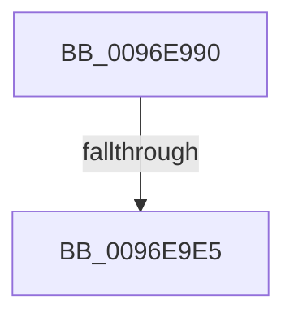

# CmpCheckRegistry2

- RVA: `0x0096E990`–`0x0096E9E9` (길이 `89` bytes)
- VA: `0x000000014096E990`
- 실행 섹션: `PAGE`
- PDB 이름 있음: `예`; PDB Function 태그: `예`
- unwind 정보 RVA: `0x00095EC4`
- 디코드: `26`개 명령, `89/89` bytes 표시
- 미해석 바이트: `0` (있으면 어셈블리에 `.byte`로 보존)

> 이 문서는 커널 이미지의 기계어와 PDB 기호를 분석해 생성했습니다. 4번과 5번은 함수 원형과 자료형을 바이너리 사용 방식에서 추정한 C 해석이며 원본 소스 복구 결과는 아닙니다.

## 1. Dependencies

- 직접 호출 지점: **2**; 고유 호출 대상: **2**
- 직접 호출자로 확인된 함수: **1**
- RIP 상대 이미지 참조: **0**

### Outgoing calls
- `0x0096E9BD` → [HvpGetCellContextInitialize](../85/HvpGetCellContextInitialize_function_00855F10.md) (function, `0x00855F10`)
- `0x0096E9D3` → [guard_dispatch_icall](../../text/6B/guard_dispatch_icall_function_006BAAD0.md) (function, `0x006BAAD0`)

### Direct callers
- [CmCheckRegistry](CmCheckRegistry_function_0096D2F4.md) at `0x0096D48E`

### Static image references
- 디코드된 RIP-relative 메모리 참조가 없습니다.

## 2. Other-region calls and transfers

- 다른 실행 섹션으로 향하는 call: **1**
  - `0x0096E9D3` → [guard_dispatch_icall](../../text/6B/guard_dispatch_icall_function_006BAAD0.md) (`PAGE` → `.text`)
- call이 아닌 외부 분기/꼬리 이동: **1**
  - `0x0096E9DF` → [sub_0096ED94](Unknown_function_0096ED94.md) (`tail-transfer`)

## 3. Assembly (complete function range)

```asm
0096E990  44 89 4C 24 20                  mov dword ptr [rsp + 0x20], r9d
0096E995  89 54 24 10                     mov dword ptr [rsp + 0x10], edx
0096E999  55                              push rbp
0096E99A  53                              push rbx
0096E99B  56                              push rsi
0096E99C  57                              push rdi
0096E99D  41 57                           push r15
0096E99F  48 8B EC                        mov rbp, rsp
0096E9A2  48 83 EC 70                     sub rsp, 0x70
0096E9A6  48 8B F1                        mov rsi, rcx
0096E9A9  45 33 FF                        xor r15d, r15d
0096E9AC  48 8D 4D E0                     lea rcx, [rbp - 0x20]
0096E9B0  4C 89 7D E0                     mov qword ptr [rbp - 0x20], r15
0096E9B4  44 88 7D 48                     mov byte ptr [rbp + 0x48], r15b
0096E9B8  41 8B D8                        mov ebx, r8d
0096E9BB  8B FA                           mov edi, edx
0096E9BD  E8 4E 75 EE FF                  call 0x140855f10
0096E9C2  48 8B 46 18                     mov rax, qword ptr [rsi + 0x18]
0096E9C6  B9 00 28 00 00                  mov ecx, 0x2800
0096E9CB  33 D2                           xor edx, edx
0096E9CD  41 B8 43 4D 63 73               mov r8d, 0x73634d43
0096E9D3  E8 F8 C0 D4 FF                  call 0x1406baad0
0096E9D8  48 89 45 D8                     mov qword ptr [rbp - 0x28], rax
0096E9DC  48 85 C0                        test rax, rax
0096E9DF  0F 84 AF 03 00 00               je 0x14096ed94
0096E9E5  48 8B 55 60                     mov rdx, qword ptr [rbp + 0x60]
```

## 4. C-style interpretation (structured pseudocode)

```c
__int64 __fastcall CmpCheckRegistry2(__int64 a1, int a2, int a3, int a4, __int64 a5, __int64 a6, __int64 a7)
{
    __int64 result;
    __int64 v_r15;
    __int64 v_rsp;
    unsigned __int64 v_stack_m48;
    unsigned __int64 v_stack_m50;
    unsigned int v_stack_p10;
    unsigned int v_stack_p20;

    v_stack_p20 = a4;
    v_stack_p10 = a2;
    v_rsp = (v_rsp) - (112);
    v_r15 = 0;
    v_stack_m48 = 0;
    v_stack_p20 = 0;
    result = HvpGetCellContextInitialize(v_stack_m48, a2, a3, a4);
    a2 = 0;
    result = guard_dispatch_icall((unsigned int)(0x2800ULL), a2, (unsigned int)(0x73634D43ULL), a4);
    v_stack_m50 = result;
    return result;
}
```

## 5. (Beta) C Style

```c
int64_t CmpCheckRegistry2(void *Arg1, int32_t Arg2, int32_t Arg3, int32_t Arg4, uint64_t Arg5, uint64_t Arg6, int64_t Arg7)
{
    uint8_t *arg1 = (uint8_t *)Arg1;

    int64_t result;
    int64_t local_r15;
    int64_t local_rsp;
    uint64_t v_stack_m48;
    uint64_t v_stack_m50;
    uint32_t v_stack_p10;
    uint32_t v_stack_p20;

    v_stack_p20 = Arg4;
    v_stack_p10 = Arg2;
    local_rsp = (local_rsp) - (112);
    local_r15 = 0;
    v_stack_m48 = 0;
    v_stack_p20 = 0;
    result = HvpGetCellContextInitialize(v_stack_m48, Arg2, Arg3, Arg4);
    Arg2 = 0;
    result = guard_dispatch_icall((uint32_t)(0x2800ULL), Arg2, (uint32_t)(0x73634D43ULL), Arg4);
    v_stack_m50 = result;
    return result;
}
```

### 관측된 메모리 오프셋

구조체 형식이 확인되지 않은 접근은 인자 기준의 오프셋으로만 기록했습니다.

| 기준 인자 | 오프셋 표현 | 폭 (bit) | 접근 |
|---|---:|---:|---|
| `Arg1` | `+ 0x18` | `64` | `R` |

## 6. Execution-region graph

[열기: 2D/3D 그래프와 함수 탐색 컨트롤 패널](../../../control-panel.html?section=page&rva=0x0096E990&view=graph)

- 2D 그래프는 위에서 아래로 흐르고, 3D 그래프는 빈 공간을 드래그해 회전합니다. Shift+드래그는 이동, 휠은 확대·축소, 함수 노드 선택은 대상 보고서 이동입니다.

### Static fallback


