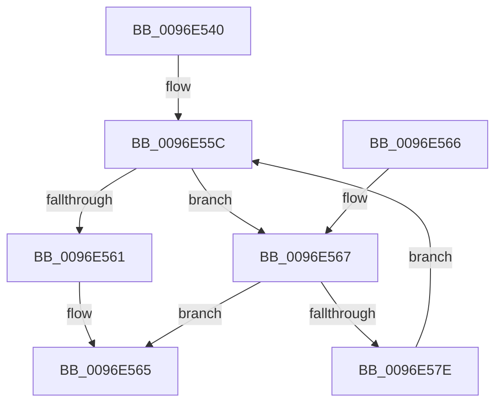

# CmpGenerateFastLeafHintForUnicodeString

- RVA: `0x0096E540`–`0x0096E587` (길이 `71` bytes)
- VA: `0x000000014096E540`
- 실행 섹션: `PAGE`
- PDB 이름 있음: `예`; PDB Function 태그: `아니요`
- unwind 정보 RVA: `0x000DB714`
- 디코드: `23`개 명령, `71/71` bytes 표시
- 미해석 바이트: `0` (있으면 어셈블리에 `.byte`로 보존)

> 이 문서는 커널 이미지의 기계어와 PDB 기호를 분석해 생성했습니다. 4번과 5번은 함수 원형과 자료형을 바이너리 사용 방식에서 추정한 C 해석이며 원본 소스 복구 결과는 아닙니다.

## 1. Dependencies

- 직접 호출 지점: **0**; 고유 호출 대상: **0**
- 직접 호출자로 확인된 함수: **2**
- RIP 상대 이미지 참조: **0**

### Outgoing calls
- 직접 디코드된 call 명령이 없습니다.

### Direct callers
- [CmpAddToLeaf](../85/CmpAddToLeaf_function_0085BC2C.md) at `0x0085BE89`
- [CmpCheckLeaf](CmpCheckLeaf_function_0096E5BC.md) at `0x0096E757`

### Static image references
- 디코드된 RIP-relative 메모리 참조가 없습니다.

## 2. Other-region calls and transfers

- 다른 실행 섹션으로 향하는 call: **0**
- 별도 외부 분기/꼬리 이동을 확인하지 못했습니다.

## 3. Assembly (complete function range)

```asm
0096E540  44 0F B7 01                     movzx r8d, word ptr [rcx]
0096E544  33 C0                           xor eax, eax
0096E546  41 D1 E8                        shr r8d, 1
0096E549  4C 8B D9                        mov r11, rcx
0096E54C  89 44 24 08                     mov dword ptr [rsp + 8], eax
0096E550  8B D0                           mov edx, eax
0096E552  8D 48 04                        lea ecx, [rax + 4]
0096E555  44 3B C1                        cmp r8d, ecx
0096E558  44 0F 43 C1                     cmovae r8d, ecx
0096E55C  41 3B D0                        cmp edx, r8d
0096E55F  72 06                           jb 0x14096e567
0096E561  8B 44 24 08                     mov eax, dword ptr [rsp + 8]
0096E565  C3                              ret
0096E566  CC                              int3
0096E567  49 8B 4B 08                     mov rcx, qword ptr [r11 + 8]
0096E56B  44 8B CA                        mov r9d, edx
0096E56E  46 0F B7 14 49                  movzx r10d, word ptr [rcx + r9*2]
0096E573  B9 FF 00 00 00                  mov ecx, 0xff
0096E578  66 44 3B D1                     cmp r10w, cx
0096E57C  77 E7                           ja 0x14096e565
0096E57E  46 88 54 0C 08                  mov byte ptr [rsp + r9 + 8], r10b
0096E583  FF C2                           inc edx
0096E585  EB D5                           jmp 0x14096e55c
```

## 4. C-style interpretation (structured pseudocode)

```c
__int64 __fastcall CmpGenerateFastLeafHintForUnicodeString(__int64 a1)
{
    __int64 result;
    unsigned int v_stack_p8;

    result = 0;
    a3 = (unsigned int)((*(unsigned __int16 *)(a1)) >> (1));
    v_stack_p8 = 0;
    if (((unsigned int)(a3)) >= ((unsigned int)(result + 4))) { a3 = (unsigned int)(result + 4); }
loc_0096E55C:
    if (0 < ((unsigned int)(a3))) goto loc_0096E567;
loc_0096E565:
    return (unsigned int)(v_stack_p8);
loc_0096E567:
    if (((unsigned __int16)(*(unsigned __int16 *)(*(unsigned __int64 *)(a1 + 8) + 0 * 2))) > 255) goto loc_0096E565;
    *(unsigned __int8 *)(v_rsp + 0 * 1 + 8) = (unsigned __int8)(*(unsigned __int16 *)(*(unsigned __int64 *)(a1 + 8) + 0 * 2));
    a2 = (unsigned int)((0) + 1);
    goto loc_0096E55C;
}
```

## 5. (Beta) C Style

```c
int64_t CmpGenerateFastLeafHintForUnicodeString(void *Arg1)
{
    uint8_t *arg1 = (uint8_t *)Arg1;

    int64_t result;
    uint32_t v_stack_p8;

    result = 0;
    a3 = (uint32_t)((*(uint16_t *)(arg1)) >> (1));
    v_stack_p8 = 0;
    if (((uint32_t)(a3)) >= ((uint32_t)(result + 4))) { a3 = (uint32_t)(result + 4); }
loc_0096E55C:
    if (0 < ((uint32_t)(a3))) goto loc_0096E567;
loc_0096E565:
    return (uint32_t)(v_stack_p8);
loc_0096E567:
    if (((uint16_t)(*(uint16_t *)(*(uint64_t *)(arg1 + 0x8) + 0x0 * 2))) > 255) goto loc_0096E565;
    *(uint8_t *)(local_rsp + 0x0 * 1 + 0x8) = (uint8_t)(*(uint16_t *)(*(uint64_t *)(arg1 + 0x8) + 0x0 * 2));
    a2 = (uint32_t)((0) + 1);
    goto loc_0096E55C;
}
```

### 관측된 메모리 오프셋

구조체 형식이 확인되지 않은 접근은 인자 기준의 오프셋으로만 기록했습니다.

| 기준 인자 | 오프셋 표현 | 폭 (bit) | 접근 |
|---|---:|---:|---|
| `Arg1` | `+ 0x0` | `16` | `R` |
| `Arg1` | `+ 0x8` | `64` | `R` |

## 6. Execution-region graph

[열기: 2D/3D 그래프와 함수 탐색 컨트롤 패널](../../../control-panel.html?section=page&rva=0x0096E540&view=graph)

- 2D 그래프는 위에서 아래로 흐르고, 3D 그래프는 빈 공간을 드래그해 회전합니다. Shift+드래그는 이동, 휠은 확대·축소, 함수 노드 선택은 대상 보고서 이동입니다.

### Static fallback


