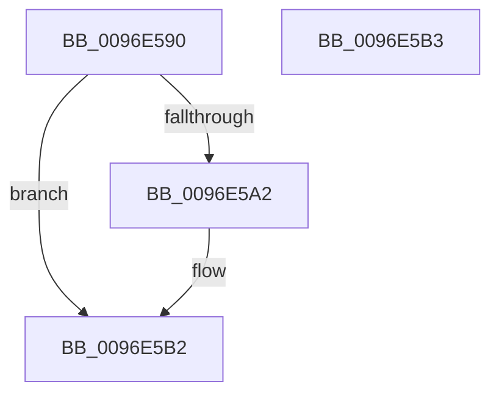

# CmpGetIndexElementSize

- RVA: `0x0096E590`–`0x0096E5B4` (길이 `36` bytes)
- VA: `0x000000014096E590`
- 실행 섹션: `PAGE`
- PDB 이름 있음: `예`; PDB Function 태그: `아니요`
- unwind 정보 RVA: `0x000DB714`
- 디코드: `11`개 명령, `36/36` bytes 표시
- 미해석 바이트: `0` (있으면 어셈블리에 `.byte`로 보존)

> 이 문서는 커널 이미지의 기계어와 PDB 기호를 분석해 생성했습니다. 4번과 5번은 함수 원형과 자료형을 바이너리 사용 방식에서 추정한 C 해석이며 원본 소스 복구 결과는 아닙니다.

## 1. Dependencies

- 직접 호출 지점: **0**; 고유 호출 대상: **0**
- 직접 호출자로 확인된 함수: **1**
- RIP 상대 이미지 참조: **0**

### Outgoing calls
- 직접 디코드된 call 명령이 없습니다.

### Direct callers
- [CmpCheckKey](CmpCheckKey_function_0096EE2C.md) at `0x0096F4EE`
- [CmpCheckKey](CmpCheckKey_function_0096EE2C.md) at `0x0096F50A`
- [CmpCheckKey](CmpCheckKey_function_0096EE2C.md) at `0x00970529`
- [CmpCheckKey](CmpCheckKey_function_0096EE2C.md) at `0x00970545`

### Static image references
- 디코드된 RIP-relative 메모리 참조가 없습니다.

## 2. Other-region calls and transfers

- 다른 실행 섹션으로 향하는 call: **0**
- 별도 외부 분기/꼬리 이동을 확인하지 못했습니다.

## 3. Assembly (complete function range)

```asm
0096E590  0F B7 11                        movzx edx, word ptr [rcx]
0096E593  B8 6C 66 00 00                  mov eax, 0x666c
0096E598  66 3B D0                        cmp dx, ax
0096E59B  B8 08 00 00 00                  mov eax, 8
0096E5A0  74 10                           je 0x14096e5b2
0096E5A2  41 B8 6C 68 00 00               mov r8d, 0x686c
0096E5A8  8D 48 FC                        lea ecx, [rax - 4]
0096E5AB  66 41 3B D0                     cmp dx, r8w
0096E5AF  0F 45 C1                        cmovne eax, ecx
0096E5B2  C3                              ret
0096E5B3  CC                              int3
```

## 4. C-style interpretation (structured pseudocode)

```c
__int64 __fastcall CmpGetIndexElementSize(__int64 a1)
{
    __int64 result;

    result = 8;
    if (((unsigned __int16)(*(unsigned __int16 *)(a1))) != ((unsigned __int16)((unsigned int)(0x666CULL)))) {
        a3 = 0x686CULL;
        a1 = 8 - 4;
        result = 8;
        if (((unsigned __int16)(*(unsigned __int16 *)(a1))) != ((unsigned __int16)(a3))) { result = (unsigned int)(a1); }
    }
    return result;
}
```

## 5. (Beta) C Style

```c
int64_t CmpGetIndexElementSize(void *Arg1)
{
    uint8_t *arg1 = (uint8_t *)Arg1;

    int64_t result;

    result = 8;
    if (((uint16_t)(*(uint16_t *)(arg1))) != ((uint16_t)((uint32_t)(0x666CULL)))) {
        a3 = 0x686CULL;
        Arg1 = 8 - 4;
        result = 8;
        if (((uint16_t)(*(uint16_t *)(arg1))) != ((uint16_t)(a3))) { result = (uint32_t)(Arg1); }
    }
    return result;
}
```

### 관측된 메모리 오프셋

구조체 형식이 확인되지 않은 접근은 인자 기준의 오프셋으로만 기록했습니다.

| 기준 인자 | 오프셋 표현 | 폭 (bit) | 접근 |
|---|---:|---:|---|
| `Arg1` | `+ 0x0` | `16` | `R` |

## 6. Execution-region graph

[열기: 2D/3D 그래프와 함수 탐색 컨트롤 패널](../../../control-panel.html?section=page&rva=0x0096E590&view=graph)

- 2D 그래프는 위에서 아래로 흐르고, 3D 그래프는 빈 공간을 드래그해 회전합니다. Shift+드래그는 이동, 휠은 확대·축소, 함수 노드 선택은 대상 보고서 이동입니다.

### Static fallback


