# CmpInsertSecurityCellList

- RVA: `0x0096DF40`–`0x0096E221` (길이 `737` bytes)
- VA: `0x000000014096DF40`
- 실행 섹션: `PAGE`
- PDB 이름 있음: `예`; PDB Function 태그: `아니요`
- unwind 정보 RVA: `0x00095E24`
- 디코드: `192`개 명령, `737/737` bytes 표시
- 미해석 바이트: `0` (있으면 어셈블리에 `.byte`로 보존)

> 이 문서는 커널 이미지의 기계어와 PDB 기호를 분석해 생성했습니다. 4번과 5번은 함수 원형과 자료형을 바이너리 사용 방식에서 추정한 C 해석이며 원본 소스 복구 결과는 아닙니다.

## 1. Dependencies

- 직접 호출 지점: **23**; 고유 호출 대상: **6**
- 직접 호출자로 확인된 함수: **1**
- RIP 상대 이미지 참조: **0**

### Outgoing calls
- `0x0096DFAE` → [HvpGetCellFlat](../85/HvpGetCellFlat_function_00854C60.md) (function, `0x00854C60`)
- `0x0096DFCC` → [CmpAddSecurityCellToCache](CmpAddSecurityCellToCache_function_0096E228.md) (function, `0x0096E228`)
- `0x0096DFFE` → [HvpReleaseCellPaged](../85/HvpReleaseCellPaged_function_00855F40.md) (function, `0x00855F40`)
- `0x0096E01C` → [HvpReleaseCellPaged](../85/HvpReleaseCellPaged_function_00855F40.md) (function, `0x00855F40`)
- `0x0096E043` → [HvpReleaseCellPaged](../85/HvpReleaseCellPaged_function_00855F40.md) (function, `0x00855F40`)
- `0x0096E061` → [HvpReleaseCellPaged](../85/HvpReleaseCellPaged_function_00855F40.md) (function, `0x00855F40`)
- `0x0096E099` → [HvpGetCellFlat](../85/HvpGetCellFlat_function_00854C60.md) (function, `0x00854C60`)
- `0x0096E0CF` → [HvpGetCellFlat](../85/HvpGetCellFlat_function_00854C60.md) (function, `0x00854C60`)
- `0x0096E0EE` → [HvpGetCellFlat](../85/HvpGetCellFlat_function_00854C60.md) (function, `0x00854C60`)
- `0x0096E104` → [HvpMarkCellDirty](../85/HvpMarkCellDirty_function_00858080.md) (function, `0x00858080`)
- `0x0096E121` → [HvpMarkCellDirty](../85/HvpMarkCellDirty_function_00858080.md) (function, `0x00858080`)
- `0x0096E152` → [HvpGetCellPaged](../85/HvpGetCellPaged_function_00854CB0.md) (function, `0x00854CB0`)
- `0x0096E17A` → [HvpGetCellFlat](../85/HvpGetCellFlat_function_00854C60.md) (function, `0x00854C60`)
- `0x0096E187` → [HvpGetCellPaged](../85/HvpGetCellPaged_function_00854CB0.md) (function, `0x00854CB0`)
- `0x0096E191` → [HvpGetCellPaged](../85/HvpGetCellPaged_function_00854CB0.md) (function, `0x00854CB0`)
- `0x0096E19B` → [HvpGetCellPaged](../85/HvpGetCellPaged_function_00854CB0.md) (function, `0x00854CB0`)
- `0x0096E1BE` → [HvpReleaseCellPaged](../85/HvpReleaseCellPaged_function_00855F40.md) (function, `0x00855F40`)
- `0x0096E1C8` → [HvpGetCellPaged](../85/HvpGetCellPaged_function_00854CB0.md) (function, `0x00854CB0`)
- `0x0096E1CF` → [HvpReleaseCellFlat](../85/HvpReleaseCellFlat_function_0085CC20.md) (function, `0x0085CC20`)
- `0x0096E1D9` → [HvpReleaseCellFlat](../85/HvpReleaseCellFlat_function_0085CC20.md) (function, `0x0085CC20`)
- `0x0096E1E3` → [HvpReleaseCellFlat](../85/HvpReleaseCellFlat_function_0085CC20.md) (function, `0x0085CC20`)
- `0x0096E1ED` → [HvpReleaseCellFlat](../85/HvpReleaseCellFlat_function_0085CC20.md) (function, `0x0085CC20`)
- `0x0096E1F7` → [HvpReleaseCellFlat](../85/HvpReleaseCellFlat_function_0085CC20.md) (function, `0x0085CC20`)

### Direct callers
- [CmpGetSecurityDescriptorNodeEx](../94/CmpGetSecurityDescriptorNodeEx_function_00949268.md) at `0x00949435`

### Static image references
- 디코드된 RIP-relative 메모리 참조가 없습니다.

## 2. Other-region calls and transfers

- 다른 실행 섹션으로 향하는 call: **0**
- 별도 외부 분기/꼬리 이동을 확인하지 못했습니다.

## 3. Assembly (complete function range)

```asm
0096DF40  48 89 5C 24 10                  mov qword ptr [rsp + 0x10], rbx
0096DF45  44 88 4C 24 20                  mov byte ptr [rsp + 0x20], r9b
0096DF4A  55                              push rbp
0096DF4B  56                              push rsi
0096DF4C  57                              push rdi
0096DF4D  41 54                           push r12
0096DF4F  41 55                           push r13
0096DF51  41 56                           push r14
0096DF53  41 57                           push r15
0096DF55  48 8B EC                        mov rbp, rsp
0096DF58  48 83 EC 50                     sub rsp, 0x50
0096DF5C  48 8B D9                        mov rbx, rcx
0096DF5F  44 8B F2                        mov r14d, edx
0096DF62  33 D2                           xor edx, edx
0096DF64  83 C9 FF                        or ecx, 0xffffffff
0096DF67  41 8B F0                        mov esi, r8d
0096DF6A  48 89 55 40                     mov qword ptr [rbp + 0x40], rdx
0096DF6E  89 4D D0                        mov dword ptr [rbp - 0x30], ecx
0096DF71  4C 8D 45 F0                     lea r8, [rbp - 0x10]
0096DF75  F6 83 8C 00 00 00 01            test byte ptr [rbx + 0x8c], 1
0096DF7C  44 8B FA                        mov r15d, edx
0096DF7F  89 55 D4                        mov dword ptr [rbp - 0x2c], edx
0096DF82  44 8B E2                        mov r12d, edx
0096DF85  89 4D D8                        mov dword ptr [rbp - 0x28], ecx
0096DF88  44 8B EA                        mov r13d, edx
0096DF8B  89 55 DC                        mov dword ptr [rbp - 0x24], edx
0096DF8E  89 4D F0                        mov dword ptr [rbp - 0x10], ecx
0096DF91  89 55 F4                        mov dword ptr [rbp - 0xc], edx
0096DF94  89 4D E8                        mov dword ptr [rbp - 0x18], ecx
0096DF97  89 55 EC                        mov dword ptr [rbp - 0x14], edx
0096DF9A  89 4D E0                        mov dword ptr [rbp - 0x20], ecx
0096DF9D  48 8B CB                        mov rcx, rbx
0096DFA0  89 55 E4                        mov dword ptr [rbp - 0x1c], edx
0096DFA3  88 55 50                        mov byte ptr [rbp + 0x50], dl
0096DFA6  8B D6                           mov edx, esi
0096DFA8  0F 84 A4 01 00 00               je 0x14096e152
0096DFAE  E8 AD 6C EE FF                  call 0x140854c60
0096DFB3  48 8B F8                        mov rdi, rax
0096DFB6  85 F6                           test esi, esi
0096DFB8  0F 89 C4 00 00 00               jns 0x14096e082
0096DFBE  89 77 08                        mov dword ptr [rdi + 8], esi
0096DFC1  89 77 04                        mov dword ptr [rdi + 4], esi
0096DFC4  45 33 C0                        xor r8d, r8d
0096DFC7  8B D6                           mov edx, esi
0096DFC9  48 8B CB                        mov rcx, rbx
0096DFCC  E8 57 02 00 00                  call 0x14096e228
0096DFD1  33 F6                           xor esi, esi
0096DFD3  44 8B F0                        mov r14d, eax
0096DFD6  85 C0                           test eax, eax
0096DFD8  0F 88 23 02 00 00               js 0x14096e201
0096DFDE  44 8B F6                        mov r14d, esi
0096DFE1  48 8B 4D 40                     mov rcx, qword ptr [rbp + 0x40]
0096DFE5  48 85 C9                        test rcx, rcx
0096DFE8  74 19                           je 0x14096e003
0096DFEA  F6 83 8C 00 00 00 01            test byte ptr [rbx + 0x8c], 1
0096DFF1  48 8D 55 D0                     lea rdx, [rbp - 0x30]
0096DFF5  48 8B CB                        mov rcx, rbx
0096DFF8  0F 85 D1 01 00 00               jne 0x14096e1cf
0096DFFE  E8 3D 7F EE FF                  call 0x140855f40
0096E003  4D 85 FF                        test r15, r15
0096E006  74 19                           je 0x14096e021
0096E008  F6 83 8C 00 00 00 01            test byte ptr [rbx + 0x8c], 1
0096E00F  48 8D 55 D8                     lea rdx, [rbp - 0x28]
0096E013  48 8B CB                        mov rcx, rbx
0096E016  0F 85 BD 01 00 00               jne 0x14096e1d9
0096E01C  E8 1F 7F EE FF                  call 0x140855f40
0096E021  4D 85 ED                        test r13, r13
0096E024  0F 85 7B 01 00 00               jne 0x14096e1a5
0096E02A  4D 85 E4                        test r12, r12
0096E02D  74 19                           je 0x14096e048
0096E02F  F6 83 8C 00 00 00 01            test byte ptr [rbx + 0x8c], 1
0096E036  48 8D 55 E8                     lea rdx, [rbp - 0x18]
0096E03A  48 8B CB                        mov rcx, rbx
0096E03D  0F 85 A0 01 00 00               jne 0x14096e1e3
0096E043  E8 F8 7E EE FF                  call 0x140855f40
0096E048  48 85 FF                        test rdi, rdi
0096E04B  74 19                           je 0x14096e066
0096E04D  F6 83 8C 00 00 00 01            test byte ptr [rbx + 0x8c], 1
0096E054  48 8D 55 F0                     lea rdx, [rbp - 0x10]
0096E058  48 8B CB                        mov rcx, rbx
0096E05B  0F 85 8C 01 00 00               jne 0x14096e1ed
0096E061  E8 DA 7E EE FF                  call 0x140855f40
0096E066  48 8B 9C 24 98 00 00 00         mov rbx, qword ptr [rsp + 0x98]
0096E06E  41 8B C6                        mov eax, r14d
0096E071  48 83 C4 50                     add rsp, 0x50
0096E075  41 5F                           pop r15
0096E077  41 5E                           pop r14
0096E079  41 5D                           pop r13
0096E07B  41 5C                           pop r12
0096E07D  5F                              pop rdi
0096E07E  5E                              pop rsi
0096E07F  5D                              pop rbp
0096E080  C3                              ret
0096E081  CC                              int3
0096E082  F6 83 8C 00 00 00 01            test byte ptr [rbx + 0x8c], 1
0096E089  4C 8D 45 E8                     lea r8, [rbp - 0x18]
0096E08D  41 8B D6                        mov edx, r14d
0096E090  48 8B CB                        mov rcx, rbx
0096E093  0F 84 EE 00 00 00               je 0x14096e187
0096E099  E8 C2 6B EE FF                  call 0x140854c60
0096E09E  4C 8B E0                        mov r12, rax
0096E0A1  33 C9                           xor ecx, ecx
0096E0A3  0F B7 40 02                     movzx eax, word ptr [rax + 2]
0096E0A7  66 83 E0 04                     and ax, 4
0096E0AB  38 4D 58                        cmp byte ptr [rbp + 0x58], cl
0096E0AE  0F 84 A8 00 00 00               je 0x14096e15c
0096E0B4  4D 8B EC                        mov r13, r12
0096E0B7  F6 83 8C 00 00 00 01            test byte ptr [rbx + 0x8c], 1
0096E0BE  4C 8D 45 D8                     lea r8, [rbp - 0x28]
0096E0C2  41 8B 55 2C                     mov edx, dword ptr [r13 + 0x2c]
0096E0C6  48 8B CB                        mov rcx, rbx
0096E0C9  0F 84 C2 00 00 00               je 0x14096e191
0096E0CF  E8 8C 6B EE FF                  call 0x140854c60
0096E0D4  F6 83 8C 00 00 00 01            test byte ptr [rbx + 0x8c], 1
0096E0DB  4C 8D 45 D0                     lea r8, [rbp - 0x30]
0096E0DF  8B 50 04                        mov edx, dword ptr [rax + 4]
0096E0E2  4C 8B F8                        mov r15, rax
0096E0E5  48 8B CB                        mov rcx, rbx
0096E0E8  0F 84 AD 00 00 00               je 0x14096e19b
0096E0EE  E8 6D 6B EE FF                  call 0x140854c60
0096E0F3  41 8B 55 2C                     mov edx, dword ptr [r13 + 0x2c]
0096E0F7  45 33 C9                        xor r9d, r9d
0096E0FA  45 33 C0                        xor r8d, r8d
0096E0FD  48 89 45 40                     mov qword ptr [rbp + 0x40], rax
0096E101  48 8B CB                        mov rcx, rbx
0096E104  E8 77 9F EE FF                  call 0x140858080
0096E109  44 8B F0                        mov r14d, eax
0096E10C  85 C0                           test eax, eax
0096E10E  0F 88 CD FE FF FF               js 0x14096dfe1
0096E114  41 8B 57 04                     mov edx, dword ptr [r15 + 4]
0096E118  45 33 C9                        xor r9d, r9d
0096E11B  45 33 C0                        xor r8d, r8d
0096E11E  48 8B CB                        mov rcx, rbx
0096E121  E8 5A 9F EE FF                  call 0x140858080
0096E126  48 8B 4D 40                     mov rcx, qword ptr [rbp + 0x40]
0096E12A  44 8B F0                        mov r14d, eax
0096E12D  85 C0                           test eax, eax
0096E12F  0F 88 B0 FE FF FF               js 0x14096dfe5
0096E135  41 8B 47 04                     mov eax, dword ptr [r15 + 4]
0096E139  89 47 04                        mov dword ptr [rdi + 4], eax
0096E13C  8B 41 08                        mov eax, dword ptr [rcx + 8]
0096E13F  89 47 08                        mov dword ptr [rdi + 8], eax
0096E142  41 89 77 04                     mov dword ptr [r15 + 4], esi
0096E146  89 71 08                        mov dword ptr [rcx + 8], esi
0096E149  C6 45 50 01                     mov byte ptr [rbp + 0x50], 1
0096E14D  E9 72 FE FF FF                  jmp 0x14096dfc4
0096E152  E8 59 6B EE FF                  call 0x140854cb0
0096E157  E9 57 FE FF FF                  jmp 0x14096dfb3
0096E15C  66 85 C0                        test ax, ax
0096E15F  0F 85 59 FE FF FF               jne 0x14096dfbe
0096E165  F6 83 8C 00 00 00 01            test byte ptr [rbx + 0x8c], 1
0096E16C  4C 8D 45 E0                     lea r8, [rbp - 0x20]
0096E170  41 8B 54 24 10                  mov edx, dword ptr [r12 + 0x10]
0096E175  48 8B CB                        mov rcx, rbx
0096E178  74 4E                           je 0x14096e1c8
0096E17A  E8 E1 6A EE FF                  call 0x140854c60
0096E17F  4C 8B E8                        mov r13, rax
0096E182  E9 30 FF FF FF                  jmp 0x14096e0b7
0096E187  E8 24 6B EE FF                  call 0x140854cb0
0096E18C  E9 0D FF FF FF                  jmp 0x14096e09e
0096E191  E8 1A 6B EE FF                  call 0x140854cb0
0096E196  E9 39 FF FF FF                  jmp 0x14096e0d4
0096E19B  E8 10 6B EE FF                  call 0x140854cb0
0096E1A0  E9 4E FF FF FF                  jmp 0x14096e0f3
0096E1A5  4D 3B EC                        cmp r13, r12
0096E1A8  0F 84 7C FE FF FF               je 0x14096e02a
0096E1AE  F6 83 8C 00 00 00 01            test byte ptr [rbx + 0x8c], 1
0096E1B5  48 8D 55 E0                     lea rdx, [rbp - 0x20]
0096E1B9  48 8B CB                        mov rcx, rbx
0096E1BC  75 39                           jne 0x14096e1f7
0096E1BE  E8 7D 7D EE FF                  call 0x140855f40
0096E1C3  E9 62 FE FF FF                  jmp 0x14096e02a
0096E1C8  E8 E3 6A EE FF                  call 0x140854cb0
0096E1CD  EB B0                           jmp 0x14096e17f
0096E1CF  E8 4C EA EE FF                  call 0x14085cc20
0096E1D4  E9 2A FE FF FF                  jmp 0x14096e003
0096E1D9  E8 42 EA EE FF                  call 0x14085cc20
0096E1DE  E9 3E FE FF FF                  jmp 0x14096e021
0096E1E3  E8 38 EA EE FF                  call 0x14085cc20
0096E1E8  E9 5B FE FF FF                  jmp 0x14096e048
0096E1ED  E8 2E EA EE FF                  call 0x14085cc20
0096E1F2  E9 6F FE FF FF                  jmp 0x14096e066
0096E1F7  E8 24 EA EE FF                  call 0x14085cc20
0096E1FC  E9 29 FE FF FF                  jmp 0x14096e02a
0096E201  48 8B 4D 40                     mov rcx, qword ptr [rbp + 0x40]
0096E205  40 38 75 50                     cmp byte ptr [rbp + 0x50], sil
0096E209  0F 84 D6 FD FF FF               je 0x14096dfe5
0096E20F  8B 47 04                        mov eax, dword ptr [rdi + 4]
0096E212  41 89 47 04                     mov dword ptr [r15 + 4], eax
0096E216  8B 47 08                        mov eax, dword ptr [rdi + 8]
0096E219  89 41 08                        mov dword ptr [rcx + 8], eax
0096E21C  E9 C4 FD FF FF                  jmp 0x14096dfe5
```

## 4. C-style interpretation (structured pseudocode)

```c
__int64 __fastcall CmpInsertSecurityCellList(__int64 a1, int a2, int a3, int a4)
{
    __int64 result;
    __int64 v_rsi;
    __int64 v_rsp;
    unsigned int v_stack_m44;
    unsigned __int64 v_stack_m48;
    unsigned int v_stack_m4C;
    unsigned int v_stack_m50;
    unsigned int v_stack_m54;
    unsigned int v_stack_m58;
    unsigned int v_stack_m5C;
    unsigned int v_stack_m60;
    unsigned int v_stack_m64;
    unsigned int v_stack_m68;
    unsigned __int64 v_stack_p10;
    unsigned __int8 v_stack_p18;
    unsigned __int8 v_stack_p20;
    unsigned __int64 v_stack_p8;

    v_stack_p10 = v_rbx;
    v_stack_p20 = (unsigned __int8)(a4);
    v_rsp = (v_rsp) - (80);
    a2 = 0;
    a1 = (unsigned int)((a1) | (0xFFFFFFFFULL));
    v_stack_p8 = 0;
    v_stack_m68 = (unsigned int)(a1);
    v_stack_m64 = 0;
    v_stack_m60 = (unsigned int)(a1);
    v_stack_m5C = 0;
    v_stack_m48 = (unsigned int)(a1);
    v_stack_m44 = 0;
    v_stack_m50 = (unsigned int)(a1);
    v_stack_m4C = 0;
    v_stack_m58 = (unsigned int)(a1);
    v_stack_m54 = 0;
    v_stack_p18 = 0;
    if (((*(unsigned __int8 *)(a1 + 140)) & (1)) == 0) goto loc_0096E152;
    result = HvpGetCellFlat(a1, (unsigned int)((unsigned int)((unsigned int)(a3))), v_stack_m48, a4);
loc_0096DFB3:
    if (!sign_flag) goto loc_0096E082;
loc_0096DFBE:
    *(unsigned int *)(result + 8) = (unsigned int)((unsigned int)(a3));
    *(unsigned int *)(result + 4) = (unsigned int)((unsigned int)(a3));
loc_0096DFC4:
    a3 = 0;
    result = CmpAddSecurityCellToCache(a1, (unsigned int)((unsigned int)((unsigned int)(a3))), a3, a4);
    v_rsi = 0;
    if (sign_flag) goto loc_0096E201;
loc_0096DFE1:
loc_0096DFE5:
    if (v_stack_p8 == 0) goto loc_0096E003;
    if (((*(unsigned __int8 *)(a1 + 140)) & (1)) != 0) goto loc_0096E1CF;
    result = HvpReleaseCellPaged(a1, v_stack_m68, a3, a4);
loc_0096E003:
    if (0 == 0) goto loc_0096E021;
    if (((*(unsigned __int8 *)(a1 + 140)) & (1)) != 0) goto loc_0096E1D9;
    result = HvpReleaseCellPaged(a1, v_stack_m60, a3, a4);
loc_0096E021:
    if (0 != 0) goto loc_0096E1A5;
loc_0096E02A:
    if (0 == 0) goto loc_0096E048;
    if (((*(unsigned __int8 *)(a1 + 140)) & (1)) != 0) goto loc_0096E1E3;
    result = HvpReleaseCellPaged(a1, v_stack_m50, a3, a4);
loc_0096E048:
    if (result == 0) goto loc_0096E066;
    if (((*(unsigned __int8 *)(a1 + 140)) & (1)) != 0) goto loc_0096E1ED;
    result = HvpReleaseCellPaged(a1, v_stack_m48, a3, a4);
loc_0096E066:
    v_rsp = (v_rsp) + (80);
    return 0;
loc_0096E082:
    if (((*(unsigned __int8 *)(v_stack_p10 + 140)) & (1)) == 0) goto loc_0096E187;
    result = HvpGetCellFlat(v_stack_p10, 0, v_stack_m50, a4);
loc_0096E09E:
    a1 = 0;
    result = (unsigned __int16)((*(unsigned __int16 *)(result + 2)) & (4));
    if (v_stack_p20 == 0) goto loc_0096E15C;
loc_0096E0B7:
    if (((*(unsigned __int8 *)(v_stack_p10 + 140)) & (1)) == 0) goto loc_0096E191;
    result = HvpGetCellFlat(v_stack_p10, (unsigned int)(*(unsigned int *)(result + 44)), v_stack_m60, a4);
loc_0096E0D4:
    if (((*(unsigned __int8 *)(v_stack_p10 + 140)) & (1)) == 0) goto loc_0096E19B;
    result = HvpGetCellFlat(v_stack_p10, (unsigned int)(*(unsigned int *)(result + 4)), v_stack_m68, a4);
loc_0096E0F3:
    a4 = 0;
    a3 = 0;
    v_stack_p8 = result;
    result = HvpMarkCellDirty(v_stack_p10, (unsigned int)(*(unsigned int *)(result + 44)), a3, a4);
    if (sign_flag) goto loc_0096DFE1;
    a4 = 0;
    a3 = 0;
    result = HvpMarkCellDirty(v_stack_p10, (unsigned int)(*(unsigned int *)(result + 4)), a3, a4);
    if (sign_flag) goto loc_0096DFE5;
    *(unsigned int *)(result + 4) = (unsigned int)((unsigned int)(*(unsigned int *)(result + 4)));
    *(unsigned int *)(result + 8) = (unsigned int)((unsigned int)(*(unsigned int *)(v_stack_p8 + 8)));
    *(unsigned int *)(result + 4) = 0;
    *(unsigned int *)(v_stack_p8 + 8) = 0;
    v_stack_p18 = 1;
    goto loc_0096DFC4;
loc_0096E152:
    result = HvpGetCellPaged(v_stack_p8, (unsigned int)(*(unsigned int *)(result + 4)), a3, a4);
    goto loc_0096DFB3;
loc_0096E15C:
    if ((unsigned __int16)(result) != 0) goto loc_0096DFBE;
    if (((*(unsigned __int8 *)(v_stack_p10 + 140)) & (1)) == 0) goto loc_0096E1C8;
    result = HvpGetCellFlat(v_stack_p10, (unsigned int)(*(unsigned int *)(result + 16)), v_stack_m58, a4);
loc_0096E17F:
    goto loc_0096E0B7;
loc_0096E187:
    result = HvpGetCellPaged(v_stack_p10, (unsigned int)(*(unsigned int *)(result + 16)), v_stack_m58, a4);
    goto loc_0096E09E;
loc_0096E191:
    result = HvpGetCellPaged(v_stack_p10, (unsigned int)(*(unsigned int *)(result + 16)), v_stack_m58, a4);
    goto loc_0096E0D4;
loc_0096E19B:
    result = HvpGetCellPaged(v_stack_p10, (unsigned int)(*(unsigned int *)(result + 16)), v_stack_m58, a4);
    goto loc_0096E0F3;
loc_0096E1A5:
    if (result == result) goto loc_0096E02A;
    if (((*(unsigned __int8 *)(v_stack_p10 + 140)) & (1)) != 0) goto loc_0096E1F7;
    result = HvpReleaseCellPaged(v_stack_p10, v_stack_m58, v_stack_m58, a4);
    goto loc_0096E02A;
loc_0096E1C8:
    result = HvpGetCellPaged(v_stack_p10, v_stack_m58, v_stack_m58, a4);
    goto loc_0096E17F;
loc_0096E1CF:
    result = HvpReleaseCellFlat(v_stack_p10, v_stack_m58, v_stack_m58, a4);
    goto loc_0096E003;
loc_0096E1D9:
    result = HvpReleaseCellFlat(v_stack_p10, v_stack_m58, v_stack_m58, a4);
    goto loc_0096E021;
loc_0096E1E3:
    result = HvpReleaseCellFlat(v_stack_p10, v_stack_m58, v_stack_m58, a4);
    goto loc_0096E048;
loc_0096E1ED:
    result = HvpReleaseCellFlat(v_stack_p10, v_stack_m58, v_stack_m58, a4);
    goto loc_0096E066;
loc_0096E1F7:
    result = HvpReleaseCellFlat(v_stack_p10, v_stack_m58, v_stack_m58, a4);
    goto loc_0096E02A;
loc_0096E201:
    if (v_stack_p18 == 0) goto loc_0096DFE5;
    *(unsigned int *)(result + 4) = (unsigned int)((unsigned int)(*(unsigned int *)(result + 4)));
    *(unsigned int *)(v_stack_p8 + 8) = (unsigned int)((unsigned int)(*(unsigned int *)(result + 8)));
    goto loc_0096DFE5;
}
```

## 5. (Beta) C Style

```c
int64_t CmpInsertSecurityCellList(void *Arg1, int32_t Arg2, int32_t Arg3, int32_t Arg4)
{
    uint8_t *arg1 = (uint8_t *)Arg1;

    int64_t result;
    int64_t local_rsi;
    int64_t local_rsp;
    uint32_t v_stack_m44;
    uint64_t v_stack_m48;
    uint32_t v_stack_m4C;
    uint32_t v_stack_m50;
    uint32_t v_stack_m54;
    uint32_t v_stack_m58;
    uint32_t v_stack_m5C;
    uint32_t v_stack_m60;
    uint32_t v_stack_m64;
    uint32_t v_stack_m68;
    uint64_t v_stack_p10;
    uint8_t v_stack_p18;
    uint8_t v_stack_p20;
    uint64_t v_stack_p8;

    v_stack_p10 = local_rbx;
    v_stack_p20 = (uint8_t)(Arg4);
    local_rsp = (local_rsp) - (80);
    Arg2 = 0;
    Arg1 = (uint32_t)((Arg1) | (0xFFFFFFFFULL));
    v_stack_p8 = 0;
    v_stack_m68 = (uint32_t)(Arg1);
    v_stack_m64 = 0;
    v_stack_m60 = (uint32_t)(Arg1);
    v_stack_m5C = 0;
    v_stack_m48 = (uint32_t)(Arg1);
    v_stack_m44 = 0;
    v_stack_m50 = (uint32_t)(Arg1);
    v_stack_m4C = 0;
    v_stack_m58 = (uint32_t)(Arg1);
    v_stack_m54 = 0;
    v_stack_p18 = 0;
    if (((*(uint8_t *)(arg1 + 0x8C)) & (1)) == 0) goto loc_0096E152;
    result = HvpGetCellFlat(Arg1, (uint32_t)((uint32_t)((uint32_t)(Arg3))), v_stack_m48, Arg4);
loc_0096DFB3:
    if (!sign_flag) goto loc_0096E082;
loc_0096DFBE:
    *(uint32_t *)(result + 0x8) = (uint32_t)((uint32_t)(Arg3));
    *(uint32_t *)(result + 0x4) = (uint32_t)((uint32_t)(Arg3));
loc_0096DFC4:
    Arg3 = 0;
    result = CmpAddSecurityCellToCache(Arg1, (uint32_t)((uint32_t)((uint32_t)(Arg3))), Arg3, Arg4);
    local_rsi = 0;
    if (sign_flag) goto loc_0096E201;
loc_0096DFE1:
loc_0096DFE5:
    if (v_stack_p8 == 0) goto loc_0096E003;
    if (((*(uint8_t *)(arg1 + 0x8C)) & (1)) != 0) goto loc_0096E1CF;
    result = HvpReleaseCellPaged(Arg1, v_stack_m68, Arg3, Arg4);
loc_0096E003:
    if (0 == 0) goto loc_0096E021;
    if (((*(uint8_t *)(arg1 + 0x8C)) & (1)) != 0) goto loc_0096E1D9;
    result = HvpReleaseCellPaged(Arg1, v_stack_m60, Arg3, Arg4);
loc_0096E021:
    if (0 != 0) goto loc_0096E1A5;
loc_0096E02A:
    if (0 == 0) goto loc_0096E048;
    if (((*(uint8_t *)(arg1 + 0x8C)) & (1)) != 0) goto loc_0096E1E3;
    result = HvpReleaseCellPaged(Arg1, v_stack_m50, Arg3, Arg4);
loc_0096E048:
    if (result == 0) goto loc_0096E066;
    if (((*(uint8_t *)(arg1 + 0x8C)) & (1)) != 0) goto loc_0096E1ED;
    result = HvpReleaseCellPaged(Arg1, v_stack_m48, Arg3, Arg4);
loc_0096E066:
    local_rsp = (local_rsp) + (80);
    return 0;
loc_0096E082:
    if (((*(uint8_t *)(v_stack_p10 + 0x8C)) & (1)) == 0) goto loc_0096E187;
    result = HvpGetCellFlat(v_stack_p10, 0, v_stack_m50, Arg4);
loc_0096E09E:
    Arg1 = 0;
    result = (uint16_t)((*(uint16_t *)(result + 0x2)) & (4));
    if (v_stack_p20 == 0) goto loc_0096E15C;
loc_0096E0B7:
    if (((*(uint8_t *)(v_stack_p10 + 0x8C)) & (1)) == 0) goto loc_0096E191;
    result = HvpGetCellFlat(v_stack_p10, (uint32_t)(*(uint32_t *)(result + 0x2C)), v_stack_m60, Arg4);
loc_0096E0D4:
    if (((*(uint8_t *)(v_stack_p10 + 0x8C)) & (1)) == 0) goto loc_0096E19B;
    result = HvpGetCellFlat(v_stack_p10, (uint32_t)(*(uint32_t *)(result + 0x4)), v_stack_m68, Arg4);
loc_0096E0F3:
    Arg4 = 0;
    Arg3 = 0;
    v_stack_p8 = result;
    result = HvpMarkCellDirty(v_stack_p10, (uint32_t)(*(uint32_t *)(result + 0x2C)), Arg3, Arg4);
    if (sign_flag) goto loc_0096DFE1;
    Arg4 = 0;
    Arg3 = 0;
    result = HvpMarkCellDirty(v_stack_p10, (uint32_t)(*(uint32_t *)(result + 0x4)), Arg3, Arg4);
    if (sign_flag) goto loc_0096DFE5;
    *(uint32_t *)(result + 0x4) = (uint32_t)((uint32_t)(*(uint32_t *)(result + 0x4)));
    *(uint32_t *)(result + 0x8) = (uint32_t)((uint32_t)(*(uint32_t *)(v_stack_p8 + 0x8)));
    *(uint32_t *)(result + 0x4) = 0;
    *(uint32_t *)(v_stack_p8 + 0x8) = 0;
    v_stack_p18 = 1;
    goto loc_0096DFC4;
loc_0096E152:
    result = HvpGetCellPaged(v_stack_p8, (uint32_t)(*(uint32_t *)(result + 0x4)), Arg3, Arg4);
    goto loc_0096DFB3;
loc_0096E15C:
    if ((uint16_t)(result) != 0) goto loc_0096DFBE;
    if (((*(uint8_t *)(v_stack_p10 + 0x8C)) & (1)) == 0) goto loc_0096E1C8;
    result = HvpGetCellFlat(v_stack_p10, (uint32_t)(*(uint32_t *)(result + 0x10)), v_stack_m58, Arg4);
loc_0096E17F:
    goto loc_0096E0B7;
loc_0096E187:
    result = HvpGetCellPaged(v_stack_p10, (uint32_t)(*(uint32_t *)(result + 0x10)), v_stack_m58, Arg4);
    goto loc_0096E09E;
loc_0096E191:
    result = HvpGetCellPaged(v_stack_p10, (uint32_t)(*(uint32_t *)(result + 0x10)), v_stack_m58, Arg4);
    goto loc_0096E0D4;
loc_0096E19B:
    result = HvpGetCellPaged(v_stack_p10, (uint32_t)(*(uint32_t *)(result + 0x10)), v_stack_m58, Arg4);
    goto loc_0096E0F3;
loc_0096E1A5:
    if (result == result) goto loc_0096E02A;
    if (((*(uint8_t *)(v_stack_p10 + 0x8C)) & (1)) != 0) goto loc_0096E1F7;
    result = HvpReleaseCellPaged(v_stack_p10, v_stack_m58, v_stack_m58, Arg4);
    goto loc_0096E02A;
loc_0096E1C8:
    result = HvpGetCellPaged(v_stack_p10, v_stack_m58, v_stack_m58, Arg4);
    goto loc_0096E17F;
loc_0096E1CF:
    result = HvpReleaseCellFlat(v_stack_p10, v_stack_m58, v_stack_m58, Arg4);
    goto loc_0096E003;
loc_0096E1D9:
    result = HvpReleaseCellFlat(v_stack_p10, v_stack_m58, v_stack_m58, Arg4);
    goto loc_0096E021;
loc_0096E1E3:
    result = HvpReleaseCellFlat(v_stack_p10, v_stack_m58, v_stack_m58, Arg4);
    goto loc_0096E048;
loc_0096E1ED:
    result = HvpReleaseCellFlat(v_stack_p10, v_stack_m58, v_stack_m58, Arg4);
    goto loc_0096E066;
loc_0096E1F7:
    result = HvpReleaseCellFlat(v_stack_p10, v_stack_m58, v_stack_m58, Arg4);
    goto loc_0096E02A;
loc_0096E201:
    if (v_stack_p18 == 0) goto loc_0096DFE5;
    *(uint32_t *)(result + 0x4) = (uint32_t)((uint32_t)(*(uint32_t *)(result + 0x4)));
    *(uint32_t *)(v_stack_p8 + 0x8) = (uint32_t)((uint32_t)(*(uint32_t *)(result + 0x8)));
    goto loc_0096DFE5;
}
```

### 관측된 메모리 오프셋

구조체 형식이 확인되지 않은 접근은 인자 기준의 오프셋으로만 기록했습니다.

| 기준 인자 | 오프셋 표현 | 폭 (bit) | 접근 |
|---|---:|---:|---|
| `Arg1` | `+ 0x8C` | `8` | `R` |

## 6. Execution-region graph

[열기: 2D/3D 그래프와 함수 탐색 컨트롤 패널](../../../control-panel.html?section=page&rva=0x0096DF40&view=graph)

- 2D 그래프는 위에서 아래로 흐르고, 3D 그래프는 빈 공간을 드래그해 회전합니다. Shift+드래그는 이동, 휠은 확대·축소, 함수 노드 선택은 대상 보고서 이동입니다.

### Static fallback

```mermaid
flowchart TD
  bb_0096DF40[BB_0096DF40]
  bb_0096DFAE[BB_0096DFAE]
  bb_0096DFB3[BB_0096DFB3]
  bb_0096DFBE[BB_0096DFBE]
  bb_0096DFC4[BB_0096DFC4]
  bb_0096DFDE[BB_0096DFDE]
  bb_0096DFE1[BB_0096DFE1]
  bb_0096DFE5[BB_0096DFE5]
  bb_0096DFEA[BB_0096DFEA]
  bb_0096DFFE[BB_0096DFFE]
  bb_0096E003[BB_0096E003]
  bb_0096E008[BB_0096E008]
  bb_0096E01C[BB_0096E01C]
  bb_0096E021[BB_0096E021]
  bb_0096E02A[BB_0096E02A]
  bb_0096E02F[BB_0096E02F]
  bb_0096E043[BB_0096E043]
  bb_0096E048[BB_0096E048]
  bb_0096E04D[BB_0096E04D]
  bb_0096E061[BB_0096E061]
  bb_0096E066[BB_0096E066]
  bb_0096E081[BB_0096E081]
  bb_0096E082[BB_0096E082]
  bb_0096E099[BB_0096E099]
  bb_0096E09E[BB_0096E09E]
  bb_0096E0B4[BB_0096E0B4]
  bb_0096E0B7[BB_0096E0B7]
  bb_0096E0CF[BB_0096E0CF]
  bb_0096E0D4[BB_0096E0D4]
  bb_0096E0EE[BB_0096E0EE]
  bb_0096E0F3[BB_0096E0F3]
  bb_0096E114[BB_0096E114]
  bb_0096E135[BB_0096E135]
  bb_0096E152[BB_0096E152]
  bb_0096E15C[BB_0096E15C]
  bb_0096E165[BB_0096E165]
  bb_0096E17A[BB_0096E17A]
  bb_0096E17F[BB_0096E17F]
  bb_0096E187[BB_0096E187]
  bb_0096E191[BB_0096E191]
  bb_0096E19B[BB_0096E19B]
  bb_0096E1A5[BB_0096E1A5]
  bb_0096E1AE[BB_0096E1AE]
  bb_0096E1BE[BB_0096E1BE]
  bb_0096E1C8[BB_0096E1C8]
  bb_0096E1CF[BB_0096E1CF]
  bb_0096E1D9[BB_0096E1D9]
  bb_0096E1E3[BB_0096E1E3]
  bb_0096E1ED[BB_0096E1ED]
  bb_0096E1F7[BB_0096E1F7]
  bb_0096E201[BB_0096E201]
  bb_0096E20F[BB_0096E20F]
  bb_0096DF40 -->|branch| bb_0096E152
  bb_0096DF40 -->|fallthrough| bb_0096DFAE
  bb_0096DFAE -->|flow| bb_0096DFB3
  bb_0096DFB3 -->|branch| bb_0096E082
  bb_0096DFB3 -->|fallthrough| bb_0096DFBE
  bb_0096DFBE -->|flow| bb_0096DFC4
  bb_0096DFC4 -->|branch| bb_0096E201
  bb_0096DFC4 -->|fallthrough| bb_0096DFDE
  bb_0096DFDE -->|flow| bb_0096DFE1
  bb_0096DFE1 -->|flow| bb_0096DFE5
  bb_0096DFE5 -->|branch| bb_0096E003
  bb_0096DFE5 -->|fallthrough| bb_0096DFEA
  bb_0096DFEA -->|branch| bb_0096E1CF
  bb_0096DFEA -->|fallthrough| bb_0096DFFE
  bb_0096DFFE -->|flow| bb_0096E003
  bb_0096E003 -->|branch| bb_0096E021
  bb_0096E003 -->|fallthrough| bb_0096E008
  bb_0096E008 -->|branch| bb_0096E1D9
  bb_0096E008 -->|fallthrough| bb_0096E01C
  bb_0096E01C -->|flow| bb_0096E021
  bb_0096E021 -->|branch| bb_0096E1A5
  bb_0096E021 -->|fallthrough| bb_0096E02A
  bb_0096E02A -->|branch| bb_0096E048
  bb_0096E02A -->|fallthrough| bb_0096E02F
  bb_0096E02F -->|branch| bb_0096E1E3
  bb_0096E02F -->|fallthrough| bb_0096E043
  bb_0096E043 -->|flow| bb_0096E048
  bb_0096E048 -->|branch| bb_0096E066
  bb_0096E048 -->|fallthrough| bb_0096E04D
  bb_0096E04D -->|branch| bb_0096E1ED
  bb_0096E04D -->|fallthrough| bb_0096E061
  bb_0096E061 -->|flow| bb_0096E066
  bb_0096E081 -->|flow| bb_0096E082
  bb_0096E082 -->|branch| bb_0096E187
  bb_0096E082 -->|fallthrough| bb_0096E099
  bb_0096E099 -->|flow| bb_0096E09E
  bb_0096E09E -->|branch| bb_0096E15C
  bb_0096E09E -->|fallthrough| bb_0096E0B4
  bb_0096E0B4 -->|flow| bb_0096E0B7
  bb_0096E0B7 -->|branch| bb_0096E191
  bb_0096E0B7 -->|fallthrough| bb_0096E0CF
  bb_0096E0CF -->|flow| bb_0096E0D4
  bb_0096E0D4 -->|branch| bb_0096E19B
  bb_0096E0D4 -->|fallthrough| bb_0096E0EE
  bb_0096E0EE -->|flow| bb_0096E0F3
  bb_0096E0F3 -->|branch| bb_0096DFE1
  bb_0096E0F3 -->|fallthrough| bb_0096E114
  bb_0096E114 -->|branch| bb_0096DFE5
  bb_0096E114 -->|fallthrough| bb_0096E135
  bb_0096E135 -->|branch| bb_0096DFC4
  bb_0096E152 -->|branch| bb_0096DFB3
  bb_0096E15C -->|branch| bb_0096DFBE
  bb_0096E15C -->|fallthrough| bb_0096E165
  bb_0096E165 -->|branch| bb_0096E1C8
  bb_0096E165 -->|fallthrough| bb_0096E17A
  bb_0096E17A -->|flow| bb_0096E17F
  bb_0096E17F -->|branch| bb_0096E0B7
  bb_0096E187 -->|branch| bb_0096E09E
  bb_0096E191 -->|branch| bb_0096E0D4
  bb_0096E19B -->|branch| bb_0096E0F3
  bb_0096E1A5 -->|branch| bb_0096E02A
  bb_0096E1A5 -->|fallthrough| bb_0096E1AE
  bb_0096E1AE -->|branch| bb_0096E1F7
  bb_0096E1AE -->|fallthrough| bb_0096E1BE
  bb_0096E1BE -->|branch| bb_0096E02A
  bb_0096E1C8 -->|branch| bb_0096E17F
  bb_0096E1CF -->|branch| bb_0096E003
  bb_0096E1D9 -->|branch| bb_0096E021
  bb_0096E1E3 -->|branch| bb_0096E048
  bb_0096E1ED -->|branch| bb_0096E066
  bb_0096E1F7 -->|branch| bb_0096E02A
  bb_0096E201 -->|branch| bb_0096DFE5
  bb_0096E201 -->|fallthrough| bb_0096E20F
  bb_0096E20F -->|branch| bb_0096DFE5
```


