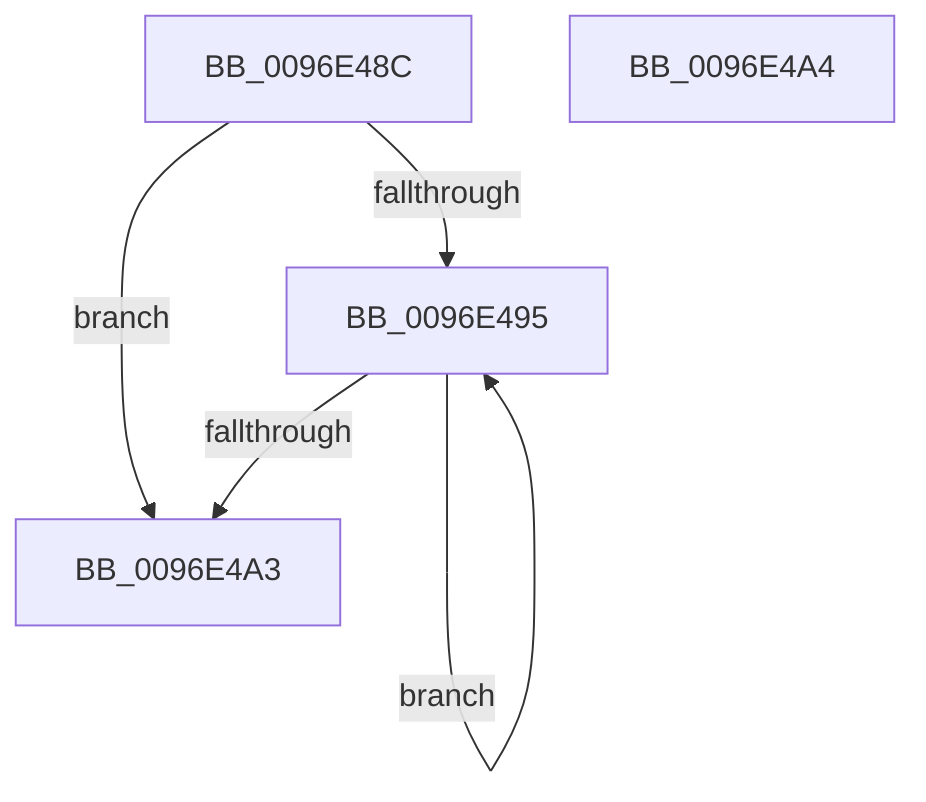

# CmpSecConvKey

- RVA: `0x0096E48C`–`0x0096E4A5` (길이 `25` bytes)
- VA: `0x000000014096E48C`
- 실행 섹션: `PAGE`
- PDB 이름 있음: `예`; PDB Function 태그: `아니요`
- unwind 정보 RVA: `0x000DB714`
- 디코드: `11`개 명령, `25/25` bytes 표시
- 미해석 바이트: `0` (있으면 어셈블리에 `.byte`로 보존)

> 이 문서는 커널 이미지의 기계어와 PDB 기호를 분석해 생성했습니다. 4번과 5번은 함수 원형과 자료형을 바이너리 사용 방식에서 추정한 C 해석이며 원본 소스 복구 결과는 아닙니다.

## 1. Dependencies

- 직접 호출 지점: **0**; 고유 호출 대상: **0**
- 직접 호출자로 확인된 함수: **1**
- RIP 상대 이미지 참조: **0**

### Outgoing calls
- 직접 디코드된 call 명령이 없습니다.

### Direct callers
- [CmpAddSecurityCellToCache](CmpAddSecurityCellToCache_function_0096E228.md) at `0x0096E2F3`

### Static image references
- 디코드된 RIP-relative 메모리 참조가 없습니다.

## 2. Other-region calls and transfers

- 다른 실행 섹션으로 향하는 call: **0**
- 별도 외부 분기/꼬리 이동을 확인하지 못했습니다.

## 3. Assembly (complete function range)

```asm
0096E48C  33 C0                           xor eax, eax
0096E48E  C1 E9 02                        shr ecx, 2
0096E491  85 C9                           test ecx, ecx
0096E493  74 0E                           je 0x14096e4a3
0096E495  C1 C8 1D                        ror eax, 0x1d
0096E498  03 02                           add eax, dword ptr [rdx]
0096E49A  48 8D 52 04                     lea rdx, [rdx + 4]
0096E49E  83 C1 FF                        add ecx, -1
0096E4A1  75 F2                           jne 0x14096e495
0096E4A3  C3                              ret
0096E4A4  CC                              int3
```

## 4. C-style interpretation (structured pseudocode)

```c
__int64 __fastcall CmpSecConvKey(int a1, __int64 a2)
{
    __int64 result;

    result = 0;
    a1 = (unsigned int)((a1) >> (2));
    if (a1 == 0) goto loc_0096E4A3;
loc_0096E495:
    result = (unsigned int)((result) + (*(unsigned int *)(a2)));
    a1 = (unsigned int)((a1) + (-1));
    if (condition_is_not_equal) goto loc_0096E495;
loc_0096E4A3:
    return result;
}
```

## 5. (Beta) C Style

```c
int64_t CmpSecConvKey(int32_t Arg1, void *Arg2)
{
    uint8_t *arg2 = (uint8_t *)Arg2;

    int64_t result;

    result = 0;
    Arg1 = (uint32_t)((Arg1) >> (2));
    if (Arg1 == 0) goto loc_0096E4A3;
loc_0096E495:
    result = (uint32_t)((result) + (*(uint32_t *)(arg2)));
    Arg1 = (uint32_t)((Arg1) + (-1));
    if (condition_is_not_equal) goto loc_0096E495;
loc_0096E4A3:
    return result;
}
```

### 관측된 메모리 오프셋

구조체 형식이 확인되지 않은 접근은 인자 기준의 오프셋으로만 기록했습니다.

| 기준 인자 | 오프셋 표현 | 폭 (bit) | 접근 |
|---|---:|---:|---|
| `Arg2` | `+ 0x0` | `32` | `R` |
| `Arg2` | `+ 0x4` | `64` | `R` |

## 6. Execution-region graph

[열기: 2D/3D 그래프와 함수 탐색 컨트롤 패널](../../../control-panel.html?section=page&rva=0x0096E48C&view=graph)

- 2D 그래프는 위에서 아래로 흐르고, 3D 그래프는 빈 공간을 드래그해 회전합니다. Shift+드래그는 이동, 휠은 확대·축소, 함수 노드 선택은 대상 보고서 이동입니다.

### Static fallback


