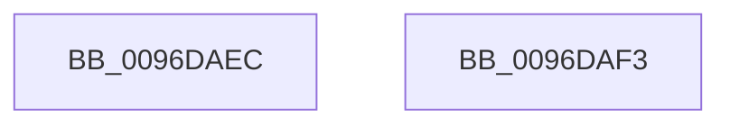

# HvAddToLayoutStats

- RVA: `0x0096DAEC`–`0x0096DAF4` (길이 `8` bytes)
- VA: `0x000000014096DAEC`
- 실행 섹션: `PAGE`
- PDB 이름 있음: `예`; PDB Function 태그: `아니요`
- unwind 정보 RVA: `0x000DB714`
- 디코드: `4`개 명령, `8/8` bytes 표시
- 미해석 바이트: `0` (있으면 어셈블리에 `.byte`로 보존)

> 이 문서는 커널 이미지의 기계어와 PDB 기호를 분석해 생성했습니다. 4번과 5번은 함수 원형과 자료형을 바이너리 사용 방식에서 추정한 C 해석이며 원본 소스 복구 결과는 아닙니다.

## 1. Dependencies

- 직접 호출 지점: **0**; 고유 호출 대상: **0**
- 직접 호출자로 확인된 함수: **2**
- RIP 상대 이미지 참조: **0**

### Outgoing calls
- 직접 디코드된 call 명령이 없습니다.

### Direct callers
- [HvCheckHive](HvCheckHive_function_0096D550.md) at `0x0096D66D`
- [HvCheckBin](HvCheckBin_function_0096D790.md) at `0x0096D8E9`
- [HvCheckBin](HvCheckBin_function_0096D790.md) at `0x0096D95A`
- [HvCheckBin](HvCheckBin_function_0096D790.md) at `0x0096D9A4`

### Static image references
- 디코드된 RIP-relative 메모리 참조가 없습니다.

## 2. Other-region calls and transfers

- 다른 실행 섹션으로 향하는 call: **0**
- 별도 외부 분기/꼬리 이동을 확인하지 못했습니다.

## 3. Assembly (complete function range)

```asm
0096DAEC  01 51 08                        add dword ptr [rcx + 8], edx
0096DAEF  FF 41 0C                        inc dword ptr [rcx + 0xc]
0096DAF2  C3                              ret
0096DAF3  CC                              int3
```

## 4. C-style interpretation (structured pseudocode)

```c
void __fastcall HvAddToLayoutStats(__int64 a1, int a2)
{
    return;
}
```

## 5. (Beta) C Style

```c
void HvAddToLayoutStats(void *Arg1, int32_t Arg2)
{
    uint8_t *arg1 = (uint8_t *)Arg1;

    return;
}
```

### 관측된 메모리 오프셋

구조체 형식이 확인되지 않은 접근은 인자 기준의 오프셋으로만 기록했습니다.

| 기준 인자 | 오프셋 표현 | 폭 (bit) | 접근 |
|---|---:|---:|---|
| `Arg1` | `+ 0x8` | `32` | `R/W` |
| `Arg1` | `+ 0xC` | `32` | `R/W` |

## 6. Execution-region graph

[열기: 2D/3D 그래프와 함수 탐색 컨트롤 패널](../../../control-panel.html?section=page&rva=0x0096DAEC&view=graph)

- 2D 그래프는 위에서 아래로 흐르고, 3D 그래프는 빈 공간을 드래그해 회전합니다. Shift+드래그는 이동, 휠은 확대·축소, 함수 노드 선택은 대상 보고서 이동입니다.

### Static fallback


