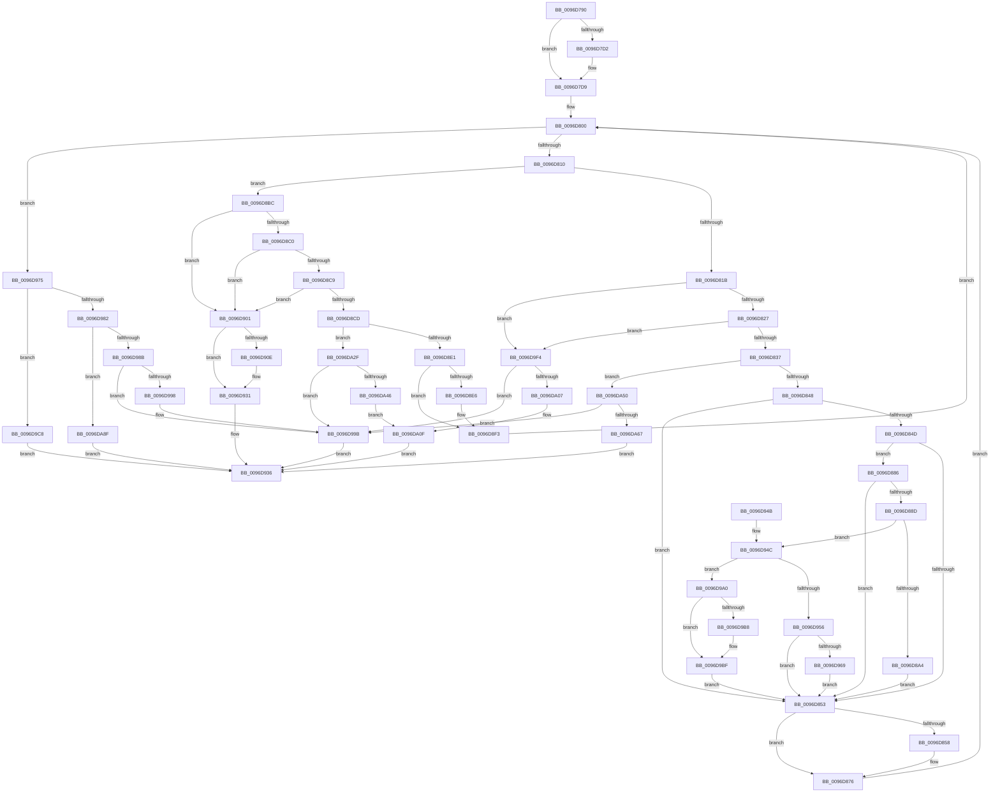

# HvCheckBin

- RVA: `0x0096D790`–`0x0096DABB` (길이 `811` bytes)
- VA: `0x000000014096D790`
- 실행 섹션: `PAGE`
- PDB 이름 있음: `예`; PDB Function 태그: `아니요`
- unwind 정보 RVA: `0x00095DDC`
- 디코드: `202`개 명령, `811/811` bytes 표시
- 미해석 바이트: `0` (있으면 어셈블리에 `.byte`로 보존)

> 이 문서는 커널 이미지의 기계어와 PDB 기호를 분석해 생성했습니다. 4번과 5번은 함수 원형과 자료형을 바이너리 사용 방식에서 추정한 C 해석이며 원본 소스 복구 결과는 아닙니다.

## 1. Dependencies

- 직접 호출 지점: **13**; 고유 호출 대상: **4**
- 직접 호출자로 확인된 함수: **1**
- RIP 상대 이미지 참조: **0**

### Outgoing calls
- `0x0096D86B` → [RtlSetBits](../../text/3E/RtlSetBits_function_003E1610.md) (function, `0x003E1610`)
- `0x0096D8A8` → [HvMoveLayoutStats](HvMoveLayoutStats_function_0096DAD0.md) (function, `0x0096DAD0`)
- `0x0096D8B1` → [HvMoveLayoutStats](HvMoveLayoutStats_function_0096DAD0.md) (function, `0x0096DAD0`)
- `0x0096D8E9` → [HvAddToLayoutStats](HvAddToLayoutStats_function_0096DAEC.md) (function, `0x0096DAEC`)
- `0x0096D8EE` → [HvMoveLayoutStats](HvMoveLayoutStats_function_0096DAD0.md) (function, `0x0096DAD0`)
- `0x0096D925` → [SetFailureLocation](../../text/46/SetFailureLocation_function_0046EF54.md) (function, `0x0046EF54`)
- `0x0096D95A` → [HvAddToLayoutStats](HvAddToLayoutStats_function_0096DAEC.md) (function, `0x0096DAEC`)
- `0x0096D9A4` → [HvAddToLayoutStats](HvAddToLayoutStats_function_0096DAEC.md) (function, `0x0096DAEC`)
- `0x0096D9AD` → [HvMoveLayoutStats](HvMoveLayoutStats_function_0096DAD0.md) (function, `0x0096DAD0`)
- `0x0096D9E7` → [SetFailureLocation](../../text/46/SetFailureLocation_function_0046EF54.md) (function, `0x0046EF54`)
- `0x0096DA1B` → [SetFailureLocation](../../text/46/SetFailureLocation_function_0046EF54.md) (function, `0x0046EF54`)
- `0x0096DA7B` → [SetFailureLocation](../../text/46/SetFailureLocation_function_0046EF54.md) (function, `0x0046EF54`)
- `0x0096DAAE` → [SetFailureLocation](../../text/46/SetFailureLocation_function_0046EF54.md) (function, `0x0046EF54`)

### Direct callers
- [HvCheckHive](HvCheckHive_function_0096D550.md) at `0x0096D630`

### Static image references
- 디코드된 RIP-relative 메모리 참조가 없습니다.

## 2. Other-region calls and transfers

- 다른 실행 섹션으로 향하는 call: **6**
  - `0x0096D86B` → [RtlSetBits](../../text/3E/RtlSetBits_function_003E1610.md) (`PAGE` → `.text`)
  - `0x0096D925` → [SetFailureLocation](../../text/46/SetFailureLocation_function_0046EF54.md) (`PAGE` → `.text`)
  - `0x0096D9E7` → [SetFailureLocation](../../text/46/SetFailureLocation_function_0046EF54.md) (`PAGE` → `.text`)
  - `0x0096DA1B` → [SetFailureLocation](../../text/46/SetFailureLocation_function_0046EF54.md) (`PAGE` → `.text`)
  - `0x0096DA7B` → [SetFailureLocation](../../text/46/SetFailureLocation_function_0046EF54.md) (`PAGE` → `.text`)
  - `0x0096DAAE` → [SetFailureLocation](../../text/46/SetFailureLocation_function_0046EF54.md) (`PAGE` → `.text`)
- 별도 외부 분기/꼬리 이동을 확인하지 못했습니다.

## 3. Assembly (complete function range)

```asm
0096D790  48 89 5C 24 08                  mov qword ptr [rsp + 8], rbx
0096D795  4C 89 4C 24 20                  mov qword ptr [rsp + 0x20], r9
0096D79A  44 89 44 24 18                  mov dword ptr [rsp + 0x18], r8d
0096D79F  55                              push rbp
0096D7A0  56                              push rsi
0096D7A1  57                              push rdi
0096D7A2  41 54                           push r12
0096D7A4  41 55                           push r13
0096D7A6  41 56                           push r14
0096D7A8  41 57                           push r15
0096D7AA  48 83 EC 30                     sub rsp, 0x30
0096D7AE  48 8B B4 24 A0 00 00 00         mov rsi, qword ptr [rsp + 0xa0]
0096D7B6  45 33 E4                        xor r12d, r12d
0096D7B9  44 89 A4 24 80 00 00 00         mov dword ptr [rsp + 0x80], r12d
0096D7C1  48 8B FA                        mov rdi, rdx
0096D7C4  45 8B CC                        mov r9d, r12d
0096D7C7  45 8B FC                        mov r15d, r12d
0096D7CA  41 8B EC                        mov ebp, r12d
0096D7CD  48 85 F6                        test rsi, rsi
0096D7D0  74 07                           je 0x14096d7d9
0096D7D2  48 89 96 48 01 00 00            mov qword ptr [rsi + 0x148], rdx
0096D7D9  4C 8B AC 24 98 00 00 00         mov r13, qword ptr [rsp + 0x98]
0096D7E1  48 8D 5A 20                     lea rbx, [rdx + 0x20]
0096D7E5  4C 8B B4 24 90 00 00 00         mov r14, qword ptr [rsp + 0x90]
0096D7ED  41 BA 6E 6B 00 00               mov r10d, 0x6b6e
0096D7F3  0F 1F 40 00                     nop dword ptr [rax]
0096D7F7  66 0F 1F 84 00 00 00 00 00      nop word ptr [rax + rax]
0096D800  8B 4F 08                        mov ecx, dword ptr [rdi + 8]
0096D803  4C 8D 04 39                     lea r8, [rcx + rdi]
0096D807  49 3B D8                        cmp rbx, r8
0096D80A  0F 83 65 01 00 00               jae 0x14096d975
0096D810  48 63 13                        movsxd rdx, dword ptr [rbx]
0096D813  85 D2                           test edx, edx
0096D815  0F 89 A1 00 00 00               jns 0x14096d8bc
0096D81B  8B C2                           mov eax, edx
0096D81D  F7 D8                           neg eax
0096D81F  3B C1                           cmp eax, ecx
0096D821  0F 87 CD 01 00 00               ja 0x14096d9f4
0096D827  48 8D 34 18                     lea rsi, [rax + rbx]
0096D82B  44 8B C8                        mov r9d, eax
0096D82E  49 3B F0                        cmp rsi, r8
0096D831  0F 87 BD 01 00 00               ja 0x14096d9f4
0096D837  2B EA                           sub ebp, edx
0096D839  44 2B FA                        sub r15d, edx
0096D83C  83 ED 04                        sub ebp, 4
0096D83F  44 3B F9                        cmp r15d, ecx
0096D842  0F 87 08 02 00 00               ja 0x14096da50
0096D848  4D 85 ED                        test r13, r13
0096D84B  74 06                           je 0x14096d853
0096D84D  49 83 F9 54                     cmp r9, 0x54
0096D851  73 33                           jae 0x14096d886
0096D853  4D 85 F6                        test r14, r14
0096D856  74 1E                           je 0x14096d876
0096D858  8B 57 04                        mov edx, dword ptr [rdi + 4]
0096D85B  41 B8 01 00 00 00               mov r8d, 1
0096D861  2B D7                           sub edx, edi
0096D863  49 8B CE                        mov rcx, r14
0096D866  03 D3                           add edx, ebx
0096D868  C1 EA 03                        shr edx, 3
0096D86B  E8 A0 3D A7 FF                  call 0x1403e1610
0096D870  41 BA 6E 6B 00 00               mov r10d, 0x6b6e
0096D876  44 8B 8C 24 80 00 00 00         mov r9d, dword ptr [rsp + 0x80]
0096D87E  48 8B DE                        mov rbx, rsi
0096D881  E9 7A FF FF FF                  jmp 0x14096d800
0096D886  66 44 39 53 04                  cmp word ptr [rbx + 4], r10w
0096D88B  75 C6                           jne 0x14096d853
0096D88D  8B 43 18                        mov eax, dword ptr [rbx + 0x18]
0096D890  44 8D 0C C5 28 00 00 00         lea r9d, [rax*8 + 0x28]
0096D898  0F B6 43 10                     movzx eax, byte ptr [rbx + 0x10]
0096D89C  A8 02                           test al, 2
0096D89E  0F 84 A8 00 00 00               je 0x14096d94c
0096D8A4  49 8D 4D 20                     lea rcx, [r13 + 0x20]
0096D8A8  E8 23 02 00 00                  call 0x14096dad0
0096D8AD  49 8D 4D 10                     lea rcx, [r13 + 0x10]
0096D8B1  E8 1A 02 00 00                  call 0x14096dad0
0096D8B6  4D 89 65 30                     mov qword ptr [r13 + 0x30], r12
0096D8BA  EB 97                           jmp 0x14096d853
0096D8BC  3B D1                           cmp edx, ecx
0096D8BE  77 41                           ja 0x14096d901
0096D8C0  48 8D 04 13                     lea rax, [rbx + rdx]
0096D8C4  49 3B C0                        cmp rax, r8
0096D8C7  77 38                           ja 0x14096d901
0096D8C9  85 D2                           test edx, edx
0096D8CB  74 34                           je 0x14096d901
0096D8CD  44 03 CA                        add r9d, edx
0096D8D0  44 89 8C 24 80 00 00 00         mov dword ptr [rsp + 0x80], r9d
0096D8D8  44 3B C9                        cmp r9d, ecx
0096D8DB  0F 87 4E 01 00 00               ja 0x14096da2f
0096D8E1  4D 85 ED                        test r13, r13
0096D8E4  74 0D                           je 0x14096d8f3
0096D8E6  49 8B CD                        mov rcx, r13
0096D8E9  E8 FE 01 00 00                  call 0x14096daec
0096D8EE  E8 DD 01 00 00                  call 0x14096dad0
0096D8F3  48 63 33                        movsxd rsi, dword ptr [rbx]
0096D8F6  48 03 F3                        add rsi, rbx
0096D8F9  48 8B DE                        mov rbx, rsi
0096D8FC  E9 FF FE FF FF                  jmp 0x14096d800
0096D901  48 8B B4 24 A0 00 00 00         mov rsi, qword ptr [rsp + 0xa0]
0096D909  48 85 F6                        test rsi, rsi
0096D90C  74 23                           je 0x14096d931
0096D90E  33 D2                           xor edx, edx
0096D910  C7 44 24 20 40 00 00 00         mov dword ptr [rsp + 0x20], 0x40
0096D918  41 B9 4C 01 00 C0               mov r9d, 0xc000014c
0096D91E  48 8B CE                        mov rcx, rsi
0096D921  44 8D 42 11                     lea r8d, [rdx + 0x11]
0096D925  E8 2A 16 B0 FF                  call 0x14046ef54
0096D92A  48 89 9E 50 01 00 00            mov qword ptr [rsi + 0x150], rbx
0096D931  B8 3C 00 00 00                  mov eax, 0x3c
0096D936  48 8B 5C 24 70                  mov rbx, qword ptr [rsp + 0x70]
0096D93B  48 83 C4 30                     add rsp, 0x30
0096D93F  41 5F                           pop r15
0096D941  41 5E                           pop r14
0096D943  41 5D                           pop r13
0096D945  41 5C                           pop r12
0096D947  5F                              pop rdi
0096D948  5E                              pop rsi
0096D949  5D                              pop rbp
0096D94A  C3                              ret
0096D94B  CC                              int3
0096D94C  44 2B CA                        sub r9d, edx
0096D94F  41 8B D1                        mov edx, r9d
0096D952  A8 01                           test al, 1
0096D954  75 4A                           jne 0x14096d9a0
0096D956  49 8D 4D 10                     lea rcx, [r13 + 0x10]
0096D95A  E8 8D 01 00 00                  call 0x14096daec
0096D95F  45 39 65 34                     cmp dword ptr [r13 + 0x34], r12d
0096D963  0F 85 EA FE FF FF               jne 0x14096d853
0096D969  8B 47 04                        mov eax, dword ptr [rdi + 4]
0096D96C  41 89 45 34                     mov dword ptr [r13 + 0x34], eax
0096D970  E9 DE FE FF FF                  jmp 0x14096d853
0096D975  43 8D 14 0F                     lea edx, [r15 + r9]
0096D979  48 83 C2 20                     add rdx, 0x20
0096D97D  48 3B D1                        cmp rdx, rcx
0096D980  75 46                           jne 0x14096d9c8
0096D982  49 3B D8                        cmp rbx, r8
0096D985  0F 85 04 01 00 00               jne 0x14096da8f
0096D98B  4C 8B 94 24 88 00 00 00         mov r10, qword ptr [rsp + 0x88]
0096D993  4D 85 D2                        test r10, r10
0096D996  74 03                           je 0x14096d99b
0096D998  41 01 2A                        add dword ptr [r10], ebp
0096D99B  41 8B C4                        mov eax, r12d
0096D99E  EB 96                           jmp 0x14096d936
0096D9A0  49 8D 4D 20                     lea rcx, [r13 + 0x20]
0096D9A4  E8 43 01 00 00                  call 0x14096daec
0096D9A9  49 8D 4D 10                     lea rcx, [r13 + 0x10]
0096D9AD  E8 1E 01 00 00                  call 0x14096dad0
0096D9B2  45 39 65 30                     cmp dword ptr [r13 + 0x30], r12d
0096D9B6  75 07                           jne 0x14096d9bf
0096D9B8  8B 47 04                        mov eax, dword ptr [rdi + 4]
0096D9BB  41 89 45 30                     mov dword ptr [r13 + 0x30], eax
0096D9BF  45 89 65 34                     mov dword ptr [r13 + 0x34], r12d
0096D9C3  E9 8B FE FF FF                  jmp 0x14096d853
0096D9C8  48 8B 8C 24 A0 00 00 00         mov rcx, qword ptr [rsp + 0xa0]
0096D9D0  33 D2                           xor edx, edx
0096D9D2  41 BC 4C 01 00 C0               mov r12d, 0xc000014c
0096D9D8  C7 44 24 20 60 00 00 00         mov dword ptr [rsp + 0x20], 0x60
0096D9E0  45 8B CC                        mov r9d, r12d
0096D9E3  44 8D 42 11                     lea r8d, [rdx + 0x11]
0096D9E7  E8 68 15 B0 FF                  call 0x14046ef54
0096D9EC  41 8B C4                        mov eax, r12d
0096D9EF  E9 42 FF FF FF                  jmp 0x14096d936
0096D9F4  48 8B B4 24 A0 00 00 00         mov rsi, qword ptr [rsp + 0xa0]
0096D9FC  41 BC 4C 01 00 C0               mov r12d, 0xc000014c
0096DA02  48 85 F6                        test rsi, rsi
0096DA05  74 94                           je 0x14096d99b
0096DA07  C7 44 24 20 20 00 00 00         mov dword ptr [rsp + 0x20], 0x20
0096DA0F  33 D2                           xor edx, edx
0096DA11  45 8B CC                        mov r9d, r12d
0096DA14  48 8B CE                        mov rcx, rsi
0096DA17  44 8D 42 11                     lea r8d, [rdx + 0x11]
0096DA1B  E8 34 15 B0 FF                  call 0x14046ef54
0096DA20  41 8B C4                        mov eax, r12d
0096DA23  48 89 9E 50 01 00 00            mov qword ptr [rsi + 0x150], rbx
0096DA2A  E9 07 FF FF FF                  jmp 0x14096d936
0096DA2F  48 8B B4 24 A0 00 00 00         mov rsi, qword ptr [rsp + 0xa0]
0096DA37  41 BC 4C 01 00 C0               mov r12d, 0xc000014c
0096DA3D  48 85 F6                        test rsi, rsi
0096DA40  0F 84 55 FF FF FF               je 0x14096d99b
0096DA46  C7 44 24 20 50 00 00 00         mov dword ptr [rsp + 0x20], 0x50
0096DA4E  EB BF                           jmp 0x14096da0f
0096DA50  48 8B BC 24 A0 00 00 00         mov rdi, qword ptr [rsp + 0xa0]
0096DA58  41 BC 4C 01 00 C0               mov r12d, 0xc000014c
0096DA5E  48 85 FF                        test rdi, rdi
0096DA61  0F 84 34 FF FF FF               je 0x14096d99b
0096DA67  33 D2                           xor edx, edx
0096DA69  C7 44 24 20 30 00 00 00         mov dword ptr [rsp + 0x20], 0x30
0096DA71  45 8B CC                        mov r9d, r12d
0096DA74  48 8B CF                        mov rcx, rdi
0096DA77  44 8D 42 11                     lea r8d, [rdx + 0x11]
0096DA7B  E8 D4 14 B0 FF                  call 0x14046ef54
0096DA80  41 8B C4                        mov eax, r12d
0096DA83  48 89 9F 50 01 00 00            mov qword ptr [rdi + 0x150], rbx
0096DA8A  E9 A7 FE FF FF                  jmp 0x14096d936
0096DA8F  48 8B 8C 24 A0 00 00 00         mov rcx, qword ptr [rsp + 0xa0]
0096DA97  33 D2                           xor edx, edx
0096DA99  41 BC 4C 01 00 C0               mov r12d, 0xc000014c
0096DA9F  C7 44 24 20 70 00 00 00         mov dword ptr [rsp + 0x20], 0x70
0096DAA7  45 8B CC                        mov r9d, r12d
0096DAAA  44 8D 42 11                     lea r8d, [rdx + 0x11]
0096DAAE  E8 A1 14 B0 FF                  call 0x14046ef54
0096DAB3  41 8B C4                        mov eax, r12d
0096DAB6  E9 7B FE FF FF                  jmp 0x14096d936
```

## 4. C-style interpretation (structured pseudocode)

```c
__int64 __fastcall HvCheckBin(__int64 a1, __int64 a2, int a3, __int64 a4, __int64 a5, __int64 a6, __int64 a7)
{
    __int64 result;
    __int64 v_r10;
    __int64 v_r12;
    __int64 v_r15;
    __int64 v_rbp;
    __int64 v_rsi;
    __int64 v_rsp;
    unsigned int v_stack_m48;
    unsigned int v_stack_p18;
    unsigned __int64 v_stack_p20;
    unsigned __int64 v_stack_p8;
    unsigned __int64 v_stack_p88;

    v_stack_p8 = v_rbx;
    v_stack_p20 = a4;
    v_stack_p18 = a3;
    v_rsp = (v_rsp) - (48);
    v_r12 = 0;
    v_stack_p18 = 0;
    if (a7 != 0) {
        *(unsigned __int64 *)(a7 + 328) = a2;
    }
loc_0096D800:
    if ((a2 + 32) >= ((unsigned int)(*(unsigned int *)(a2 + 8)) + a2 * 1)) goto loc_0096D975;
    if (!sign_flag) goto loc_0096D8BC;
    result = (unsigned int)(-((unsigned int)((unsigned int)((int)(*(unsigned int *)(a2 + 32))))));
    if (((unsigned int)(result)) > ((unsigned int)((unsigned int)(*(unsigned int *)(a2 + 8))))) goto loc_0096D9F4;
    if ((result + a2 + 32 * 1) > ((unsigned int)(*(unsigned int *)(a2 + 8)) + a2 * 1)) goto loc_0096D9F4;
    v_rbp = (unsigned int)((0) - ((unsigned int)((int)(*(unsigned int *)(a2 + 32)))));
    v_r15 = (unsigned int)((0) - ((unsigned int)((int)(*(unsigned int *)(a2 + 32)))));
    v_rbp = (unsigned int)((v_rbp) - (4));
    if (((unsigned int)(v_r15)) > ((unsigned int)((unsigned int)(*(unsigned int *)(a2 + 8))))) goto loc_0096DA50;
    if (a6 == 0) goto loc_0096D853;
    if (((unsigned int)((unsigned int)(result))) >= 84) goto loc_0096D886;
loc_0096D853:
    v_r10 = (unsigned int)(0x6B6EULL);
    if (a5 != 0) {
        a2 = *(unsigned int *)(a2 + 4);
        a3 = 1;
        a2 = (unsigned int)((a2) - ((unsigned int)(a2)));
        a1 = a5;
        a2 = (unsigned int)((a2) + ((unsigned int)(a2 + 32)));
        a2 = (unsigned int)((a2) >> (3));
        result = RtlSetBits(a1, a2, a3, (unsigned int)((unsigned int)(result)));
        v_r10 = 0x6B6EULL;
    }
    goto loc_0096D800;
loc_0096D886:
    if ((*(unsigned __int16 *)(result + a2 + 32 * 1 + 4)) != ((unsigned __int16)(v_r10))) goto loc_0096D853;
    if ((((unsigned __int8)(*(unsigned __int8 *)(result + a2 + 32 * 1 + 16))) & (2)) == 0) goto loc_0096D94C;
    result = HvMoveLayoutStats(a6 + 32, a2, a3, (unsigned int)(*(unsigned int *)(result + a2 + 32 * 1 + 24)) * 8 + 40);
    result = HvMoveLayoutStats(a6 + 16, a2, a3, (unsigned int)(*(unsigned int *)(result + a2 + 32 * 1 + 24)) * 8 + 40);
    *(unsigned __int64 *)(a6 + 48) = 0;
    goto loc_0096D853;
loc_0096D8BC:
    if (((unsigned int)(a2)) > ((unsigned int)(a6 + 16))) goto loc_0096D901;
    if ((result + a2 + 32 * 1 + a2 * 1) > a3) goto loc_0096D901;
    if ((unsigned int)(a2) == 0) goto loc_0096D901;
    a4 = (unsigned int)(((unsigned int)(*(unsigned int *)(result + a2 + 32 * 1 + 24)) * 8 + 40) + ((unsigned int)(a2)));
    v_stack_p18 = (unsigned int)(a4);
    if (((unsigned int)(a4)) > ((unsigned int)(a6 + 16))) goto loc_0096DA2F;
    result = result + a2 + 32 * 1 + a2 * 1;
    if (a6 != 0) {
        a1 = a6;
        result = HvAddToLayoutStats(a1, a2, a3, a4);
        result = HvMoveLayoutStats(a1, a2, a3, a4);
    }
    v_rsi = ((int)(*(unsigned int *)(result + a2 + 32 * 1))) + (result + a2 + 32 * 1);
    goto loc_0096D800;
loc_0096D901:
    if (a7 != 0) {
        a2 = 0;
        v_stack_m48 = 64;
        a4 = 0xC000014CULL;
        a1 = a7;
        a3 = a2 + 17;
        result = SetFailureLocation(a1, a2, a3, a4);
        *(unsigned __int64 *)(a7 + 336) = v_rsi;
    }
loc_0096D936:
    v_rsp = (v_rsp) + (48);
    return 60;
loc_0096D94C:
    a4 = (unsigned int)((a4) - (0));
    if (((60) & (1)) != 0) goto loc_0096D9A0;
    result = HvAddToLayoutStats(a6 + 16, (unsigned int)((unsigned int)(a4)), a3, a4);
    if ((*(unsigned int *)(a6 + 52)) != 0) goto loc_0096D853;
    *(unsigned int *)(a6 + 52) = (unsigned int)((unsigned int)(*(unsigned int *)(a2 + 4)));
    goto loc_0096D853;
loc_0096D975:
    a2 = (v_r15 + a4 * 1) + (32);
    if (a2 != (a6 + 16)) goto loc_0096D9C8;
    if (v_stack_p8 != a3) goto loc_0096DA8F;
    if (v_stack_p88 != 0) {
    }
    goto loc_0096D936;
loc_0096D9A0:
    result = HvAddToLayoutStats(a6 + 32, a2, a3, a4);
    result = HvMoveLayoutStats(a6 + 16, a2, a3, a4);
    if ((*(unsigned int *)(a6 + 48)) == 0) {
        result = *(unsigned int *)(a2 + 4);
        *(unsigned int *)(a6 + 48) = (unsigned int)(result);
    }
    *(unsigned int *)(a6 + 52) = 0;
    goto loc_0096D853;
loc_0096D9C8:
    a2 = 0;
    v_stack_p20 = 96;
    result = SetFailureLocation(a7, a2, a2 + 17, (unsigned int)((unsigned int)((unsigned int)(0xC000014CULL))));
    goto loc_0096D936;
loc_0096D9F4:
    if (a7 == 0) goto loc_0096D99B;
    v_stack_p20 = 32;
loc_0096DA0F:
    a2 = 0;
    result = SetFailureLocation(a7, a2, a2 + 17, (unsigned int)((unsigned int)((unsigned int)(0xC000014CULL))));
    *(unsigned __int64 *)(a7 + 336) = v_stack_p8;
    goto loc_0096D936;
loc_0096DA2F:
    if (a7 == 0) goto loc_0096D99B;
    v_stack_p20 = 80;
    goto loc_0096DA0F;
loc_0096DA50:
    if (a7 == 0) goto loc_0096D99B;
    a2 = 0;
    v_stack_p20 = 48;
    result = SetFailureLocation(a7, a2, a2 + 17, (unsigned int)((unsigned int)((unsigned int)(0xC000014CULL))));
    *(unsigned __int64 *)(a7 + 336) = v_stack_p8;
    goto loc_0096D936;
loc_0096DA8F:
    a2 = 0;
    v_stack_p20 = 112;
    result = SetFailureLocation(a7, a2, a2 + 17, (unsigned int)((unsigned int)((unsigned int)(0xC000014CULL))));
    goto loc_0096D936;
}
```

## 5. (Beta) C Style

```c
int64_t HvCheckBin(int64_t Arg1, void *Arg2, int32_t Arg3, int64_t Arg4, int64_t Arg5, int64_t Arg6, int64_t Arg7)
{
    uint8_t *arg2 = (uint8_t *)Arg2;

    int64_t result;
    int64_t local_r10;
    int64_t local_r12;
    int64_t local_r15;
    int64_t local_rbp;
    int64_t local_rsi;
    int64_t local_rsp;
    uint32_t v_stack_m48;
    uint32_t v_stack_p18;
    uint64_t v_stack_p20;
    uint64_t v_stack_p8;
    uint64_t v_stack_p88;

    v_stack_p8 = local_rbx;
    v_stack_p20 = Arg4;
    v_stack_p18 = Arg3;
    local_rsp = (local_rsp) - (48);
    local_r12 = 0;
    v_stack_p18 = 0;
    if (Arg7 != 0) {
        *(void **)(Arg7 + 0x148) = Arg2;
    }
loc_0096D800:
    if ((Arg2 + 32) >= ((uint32_t)(*(uint32_t *)(arg2 + 0x8)) + Arg2 * 1)) goto loc_0096D975;
    if (!sign_flag) goto loc_0096D8BC;
    result = (uint32_t)(-((uint32_t)((uint32_t)((int32_t)(*(uint32_t *)(arg2 + 0x20))))));
    if (((uint32_t)(result)) > ((uint32_t)((uint32_t)(*(uint32_t *)(arg2 + 0x8))))) goto loc_0096D9F4;
    if ((result + Arg2 + 32 * 1) > ((uint32_t)(*(uint32_t *)(arg2 + 0x8)) + Arg2 * 1)) goto loc_0096D9F4;
    local_rbp = (uint32_t)((0) - ((uint32_t)((int32_t)(*(uint32_t *)(arg2 + 0x20)))));
    local_r15 = (uint32_t)((0) - ((uint32_t)((int32_t)(*(uint32_t *)(arg2 + 0x20)))));
    local_rbp = (uint32_t)((local_rbp) - (4));
    if (((uint32_t)(local_r15)) > ((uint32_t)((uint32_t)(*(uint32_t *)(arg2 + 0x8))))) goto loc_0096DA50;
    if (Arg6 == 0) goto loc_0096D853;
    if (((uint32_t)((uint32_t)(result))) >= 84) goto loc_0096D886;
loc_0096D853:
    local_r10 = (uint32_t)(0x6B6EULL);
    if (Arg5 != 0) {
        Arg2 = *(uint32_t *)(arg2 + 0x4);
        Arg3 = 1;
        Arg2 = (uint32_t)((Arg2) - ((uint32_t)(Arg2)));
        Arg1 = Arg5;
        Arg2 = (uint32_t)((Arg2) + ((uint32_t)(Arg2 + 32)));
        Arg2 = (uint32_t)((Arg2) >> (3));
        result = RtlSetBits(Arg1, Arg2, Arg3, (uint32_t)((uint32_t)(result)));
        local_r10 = 0x6B6EULL;
    }
    goto loc_0096D800;
loc_0096D886:
    if ((*(uint16_t *)(result + arg2 + 0x20 * 1 + 0x4)) != ((uint16_t)(local_r10))) goto loc_0096D853;
    if ((((uint8_t)(*(uint8_t *)(result + arg2 + 0x20 * 1 + 0x10))) & (2)) == 0) goto loc_0096D94C;
    result = HvMoveLayoutStats(Arg6 + 32, Arg2, Arg3, (uint32_t)(*(uint32_t *)(result + arg2 + 0x20 * 1 + 0x18)) * 8 + 40);
    result = HvMoveLayoutStats(Arg6 + 16, Arg2, Arg3, (uint32_t)(*(uint32_t *)(result + arg2 + 0x20 * 1 + 0x18)) * 8 + 40);
    *(uint64_t *)(Arg6 + 0x30) = 0;
    goto loc_0096D853;
loc_0096D8BC:
    if (((uint32_t)(Arg2)) > ((uint32_t)(Arg6 + 16))) goto loc_0096D901;
    if ((result + Arg2 + 32 * 1 + Arg2 * 1) > Arg3) goto loc_0096D901;
    if ((uint32_t)(Arg2) == 0) goto loc_0096D901;
    Arg4 = (uint32_t)(((uint32_t)(*(uint32_t *)(result + arg2 + 0x20 * 1 + 0x18)) * 8 + 40) + ((uint32_t)(Arg2)));
    v_stack_p18 = (uint32_t)(Arg4);
    if (((uint32_t)(Arg4)) > ((uint32_t)(Arg6 + 16))) goto loc_0096DA2F;
    result = result + Arg2 + 32 * 1 + Arg2 * 1;
    if (Arg6 != 0) {
        Arg1 = Arg6;
        result = HvAddToLayoutStats(Arg1, Arg2, Arg3, Arg4);
        result = HvMoveLayoutStats(Arg1, Arg2, Arg3, Arg4);
    }
    local_rsi = ((int32_t)(*(uint32_t *)(result + arg2 + 0x20 * 1))) + (result + Arg2 + 32 * 1);
    goto loc_0096D800;
loc_0096D901:
    if (Arg7 != 0) {
        Arg2 = 0;
        v_stack_m48 = 64;
        Arg4 = 0xC000014CULL;
        Arg1 = Arg7;
        Arg3 = Arg2 + 17;
        result = SetFailureLocation(Arg1, Arg2, Arg3, Arg4);
        *(uint64_t *)(Arg7 + 0x150) = local_rsi;
    }
loc_0096D936:
    local_rsp = (local_rsp) + (48);
    return 60;
loc_0096D94C:
    Arg4 = (uint32_t)((Arg4) - (0));
    if (((60) & (1)) != 0) goto loc_0096D9A0;
    result = HvAddToLayoutStats(Arg6 + 16, (uint32_t)((uint32_t)(Arg4)), Arg3, Arg4);
    if ((*(uint32_t *)(Arg6 + 0x34)) != 0) goto loc_0096D853;
    *(uint32_t *)(Arg6 + 0x34) = (uint32_t)((uint32_t)(*(uint32_t *)(arg2 + 0x4)));
    goto loc_0096D853;
loc_0096D975:
    Arg2 = (local_r15 + Arg4 * 1) + (32);
    if (Arg2 != (Arg6 + 16)) goto loc_0096D9C8;
    if (v_stack_p8 != Arg3) goto loc_0096DA8F;
    if (v_stack_p88 != 0) {
    }
    goto loc_0096D936;
loc_0096D9A0:
    result = HvAddToLayoutStats(Arg6 + 32, Arg2, Arg3, Arg4);
    result = HvMoveLayoutStats(Arg6 + 16, Arg2, Arg3, Arg4);
    if ((*(uint32_t *)(Arg6 + 0x30)) == 0) {
        result = *(uint32_t *)(arg2 + 0x4);
        *(uint32_t *)(Arg6 + 0x30) = (uint32_t)(result);
    }
    *(uint32_t *)(Arg6 + 0x34) = 0;
    goto loc_0096D853;
loc_0096D9C8:
    Arg2 = 0;
    v_stack_p20 = 96;
    result = SetFailureLocation(Arg7, Arg2, Arg2 + 17, (uint32_t)((uint32_t)((uint32_t)(0xC000014CULL))));
    goto loc_0096D936;
loc_0096D9F4:
    if (Arg7 == 0) goto loc_0096D99B;
    v_stack_p20 = 32;
loc_0096DA0F:
    Arg2 = 0;
    result = SetFailureLocation(Arg7, Arg2, Arg2 + 17, (uint32_t)((uint32_t)((uint32_t)(0xC000014CULL))));
    *(uint64_t *)(Arg7 + 0x150) = v_stack_p8;
    goto loc_0096D936;
loc_0096DA2F:
    if (Arg7 == 0) goto loc_0096D99B;
    v_stack_p20 = 80;
    goto loc_0096DA0F;
loc_0096DA50:
    if (Arg7 == 0) goto loc_0096D99B;
    Arg2 = 0;
    v_stack_p20 = 48;
    result = SetFailureLocation(Arg7, Arg2, Arg2 + 17, (uint32_t)((uint32_t)((uint32_t)(0xC000014CULL))));
    *(uint64_t *)(Arg7 + 0x150) = v_stack_p8;
    goto loc_0096D936;
loc_0096DA8F:
    Arg2 = 0;
    v_stack_p20 = 112;
    result = SetFailureLocation(Arg7, Arg2, Arg2 + 17, (uint32_t)((uint32_t)((uint32_t)(0xC000014CULL))));
    goto loc_0096D936;
}
```

### 관측된 메모리 오프셋

구조체 형식이 확인되지 않은 접근은 인자 기준의 오프셋으로만 기록했습니다.

| 기준 인자 | 오프셋 표현 | 폭 (bit) | 접근 |
|---|---:|---:|---|
| `Arg2` | `+ 0x4` | `32` | `R` |
| `Arg2` | `+ 0x8` | `32` | `R` |
| `Arg2` | `+ 0x20` | `64` | `R` |

## 6. Execution-region graph

[열기: 2D/3D 그래프와 함수 탐색 컨트롤 패널](../../../control-panel.html?section=page&rva=0x0096D790&view=graph)

- 2D 그래프는 위에서 아래로 흐르고, 3D 그래프는 빈 공간을 드래그해 회전합니다. Shift+드래그는 이동, 휠은 확대·축소, 함수 노드 선택은 대상 보고서 이동입니다.

### Static fallback


