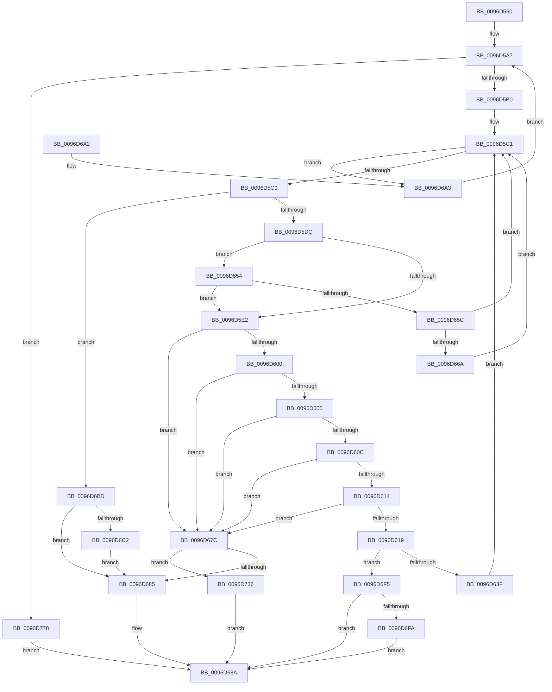

# HvCheckHive

- RVA: `0x0096D550`–`0x0096D77F` (길이 `559` bytes)
- VA: `0x000000014096D550`
- 실행 섹션: `PAGE`
- PDB 이름 있음: `예`; PDB Function 태그: `아니요`
- unwind 정보 RVA: `0x00095DC0`
- 디코드: `138`개 명령, `559/559` bytes 표시
- 미해석 바이트: `0` (있으면 어셈블리에 `.byte`로 보존)

> 이 문서는 커널 이미지의 기계어와 PDB 기호를 분석해 생성했습니다. 4번과 5번은 함수 원형과 자료형을 바이너리 사용 방식에서 추정한 C 해석이며 원본 소스 복구 결과는 아닙니다.

## 1. Dependencies

- 직접 호출 지점: **10**; 고유 호출 대상: **8**
- 직접 호출자로 확인된 함수: **1**
- RIP 상대 이미지 참조: **0**

### Outgoing calls
- `0x0096D57F` → [HvpGetBinContextInitialize](../../pagecmrc/BC/HvpGetBinContextInitialize_function_00BC98D0.md) (function, `0x00BC98D0`)
- `0x0096D5CE` → [HvpGetCellMap](../../pagecmrc/BC/HvpGetCellMap_function_00BC9710.md) (function, `0x00BC9710`)
- `0x0096D5ED` → [HvpMapEntryGetBinAddress](../../pagecmrc/BC/HvpMapEntryGetBinAddress_function_00BC9770.md) (function, `0x00BC9770`)
- `0x0096D630` → [HvCheckBin](HvCheckBin_function_0096D790.md) (function, `0x0096D790`)
- `0x0096D64A` → [HvpMapEntryReleaseBinAddress](../../pagecmrc/BC/HvpMapEntryReleaseBinAddress_function_00BC9790.md) (function, `0x00BC9790`)
- `0x0096D66D` → [HvAddToLayoutStats](HvAddToLayoutStats_function_0096DAEC.md) (function, `0x0096DAEC`)
- `0x0096D672` → [HvMoveLayoutStats](HvMoveLayoutStats_function_0096DAD0.md) (function, `0x0096DAD0`)
- `0x0096D6D9` → [SetFailureLocation](../../text/46/SetFailureLocation_function_0046EF54.md) (function, `0x0046EF54`)
- `0x0096D70E` → [SetFailureLocation](../../text/46/SetFailureLocation_function_0046EF54.md) (function, `0x0046EF54`)
- `0x0096D74D` → [SetFailureLocation](../../text/46/SetFailureLocation_function_0046EF54.md) (function, `0x0046EF54`)

### Direct callers
- [CmCheckRegistry](CmCheckRegistry_function_0096D2F4.md) at `0x0096D3F7`

### Static image references
- 디코드된 RIP-relative 메모리 참조가 없습니다.

## 2. Other-region calls and transfers

- 다른 실행 섹션으로 향하는 call: **7**
  - `0x0096D57F` → [HvpGetBinContextInitialize](../../pagecmrc/BC/HvpGetBinContextInitialize_function_00BC98D0.md) (`PAGE` → `PAGECMRC`)
  - `0x0096D5CE` → [HvpGetCellMap](../../pagecmrc/BC/HvpGetCellMap_function_00BC9710.md) (`PAGE` → `PAGECMRC`)
  - `0x0096D5ED` → [HvpMapEntryGetBinAddress](../../pagecmrc/BC/HvpMapEntryGetBinAddress_function_00BC9770.md) (`PAGE` → `PAGECMRC`)
  - `0x0096D64A` → [HvpMapEntryReleaseBinAddress](../../pagecmrc/BC/HvpMapEntryReleaseBinAddress_function_00BC9790.md) (`PAGE` → `PAGECMRC`)
  - `0x0096D6D9` → [SetFailureLocation](../../text/46/SetFailureLocation_function_0046EF54.md) (`PAGE` → `.text`)
  - `0x0096D70E` → [SetFailureLocation](../../text/46/SetFailureLocation_function_0046EF54.md) (`PAGE` → `.text`)
  - `0x0096D74D` → [SetFailureLocation](../../text/46/SetFailureLocation_function_0046EF54.md) (`PAGE` → `.text`)
- 별도 외부 분기/꼬리 이동을 확인하지 못했습니다.

## 3. Assembly (complete function range)

```asm
0096D550  48 8B C4                        mov rax, rsp
0096D553  48 89 58 08                     mov qword ptr [rax + 8], rbx
0096D557  4C 89 40 18                     mov qword ptr [rax + 0x18], r8
0096D55B  89 50 10                        mov dword ptr [rax + 0x10], edx
0096D55E  55                              push rbp
0096D55F  56                              push rsi
0096D560  57                              push rdi
0096D561  41 54                           push r12
0096D563  41 55                           push r13
0096D565  41 56                           push r14
0096D567  41 57                           push r15
0096D569  48 83 EC 50                     sub rsp, 0x50
0096D56D  45 33 C0                        xor r8d, r8d
0096D570  4C 8B F1                        mov r14, rcx
0096D573  48 8D 48 10                     lea rcx, [rax + 0x10]
0096D577  66 44 89 40 10                  mov word ptr [rax + 0x10], r8w
0096D57C  4D 8B E1                        mov r12, r9
0096D57F  E8 4C C3 25 00                  call 0x140bc98d0
0096D584  4C 8B AC 24 B8 00 00 00         mov r13, qword ptr [rsp + 0xb8]
0096D58C  41 8B D8                        mov ebx, r8d
0096D58F  4C 8B BC 24 B0 00 00 00         mov r15, qword ptr [rsp + 0xb0]
0096D597  41 8B F0                        mov esi, r8d
0096D59A  44 89 44 24 40                  mov dword ptr [rsp + 0x40], r8d
0096D59F  44 89 84 24 A0 00 00 00         mov dword ptr [rsp + 0xa0], r8d
0096D5A7  83 FE 01                        cmp esi, 1
0096D5AA  0F 87 C8 01 00 00               ja 0x14096d778
0096D5B0  8B C6                           mov eax, esi
0096D5B2  48 69 C8 78 02 00 00            imul rcx, rax, 0x278
0096D5B9  42 8B AC 31 18 01 00 00         mov ebp, dword ptr [rcx + r14 + 0x118]
0096D5C1  3B DD                           cmp ebx, ebp
0096D5C3  0F 83 DA 00 00 00               jae 0x14096d6a3
0096D5C9  8B D3                           mov edx, ebx
0096D5CB  49 8B CE                        mov rcx, r14
0096D5CE  E8 3D C1 25 00                  call 0x140bc9710
0096D5D3  48 85 C0                        test rax, rax
0096D5D6  0F 84 E1 00 00 00               je 0x14096d6bd
0096D5DC  F6 40 08 02                     test byte ptr [rax + 8], 2
0096D5E0  75 72                           jne 0x14096d654
0096D5E2  4C 8D 84 24 98 00 00 00         lea r8, [rsp + 0x98]
0096D5EA  48 8B D0                        mov rdx, rax
0096D5ED  E8 7E C1 25 00                  call 0x140bc9770
0096D5F2  8B CD                           mov ecx, ebp
0096D5F4  48 8B F8                        mov rdi, rax
0096D5F7  2B CB                           sub ecx, ebx
0096D5F9  8B 40 08                        mov eax, dword ptr [rax + 8]
0096D5FC  3B C1                           cmp eax, ecx
0096D5FE  77 7C                           ja 0x14096d67c
0096D600  83 F8 20                        cmp eax, 0x20
0096D603  72 77                           jb 0x14096d67c
0096D605  A9 FF 0F 00 00                  test eax, 0xfff
0096D60A  75 70                           jne 0x14096d67c
0096D60C  81 3F 68 62 69 6E               cmp dword ptr [rdi], 0x6e696268
0096D612  75 68                           jne 0x14096d67c
0096D614  39 5F 04                        cmp dword ptr [rdi + 4], ebx
0096D617  75 63                           jne 0x14096d67c
0096D619  4C 89 6C 24 30                  mov qword ptr [rsp + 0x30], r13
0096D61E  4C 8D 4C 24 40                  lea r9, [rsp + 0x40]
0096D623  4C 89 7C 24 28                  mov qword ptr [rsp + 0x28], r15
0096D628  48 8B D7                        mov rdx, rdi
0096D62B  4C 89 64 24 20                  mov qword ptr [rsp + 0x20], r12
0096D630  E8 5B 01 00 00                  call 0x14096d790
0096D635  8B F0                           mov esi, eax
0096D637  85 C0                           test eax, eax
0096D639  0F 88 B6 00 00 00               js 0x14096d6f5
0096D63F  03 5F 08                        add ebx, dword ptr [rdi + 8]
0096D642  4C 8D 84 24 98 00 00 00         lea r8, [rsp + 0x98]
0096D64A  E8 41 C1 25 00                  call 0x140bc9790
0096D64F  E9 6D FF FF FF                  jmp 0x14096d5c1
0096D654  48 8B 08                        mov rcx, qword ptr [rax]
0096D657  48 85 C9                        test rcx, rcx
0096D65A  74 86                           je 0x14096d5e2
0096D65C  8B 51 10                        mov edx, dword ptr [rcx + 0x10]
0096D65F  03 DA                           add ebx, edx
0096D661  4D 85 FF                        test r15, r15
0096D664  0F 84 57 FF FF FF               je 0x14096d5c1
0096D66A  49 8B CF                        mov rcx, r15
0096D66D  E8 7A 04 00 00                  call 0x14096daec
0096D672  E8 59 04 00 00                  call 0x14096dad0
0096D677  E9 45 FF FF FF                  jmp 0x14096d5c1
0096D67C  4D 85 ED                        test r13, r13
0096D67F  0F 85 B1 00 00 00               jne 0x14096d736
0096D685  B8 4C 01 00 C0                  mov eax, 0xc000014c
0096D68A  48 8B 9C 24 90 00 00 00         mov rbx, qword ptr [rsp + 0x90]
0096D692  48 83 C4 50                     add rsp, 0x50
0096D696  41 5F                           pop r15
0096D698  41 5E                           pop r14
0096D69A  41 5D                           pop r13
0096D69C  41 5C                           pop r12
0096D69E  5F                              pop rdi
0096D69F  5E                              pop rsi
0096D6A0  5D                              pop rbp
0096D6A1  C3                              ret
0096D6A2  CC                              int3
0096D6A3  8B B4 24 A0 00 00 00            mov esi, dword ptr [rsp + 0xa0]
0096D6AA  BB 00 00 00 80                  mov ebx, 0x80000000
0096D6AF  FF C6                           inc esi
0096D6B1  89 B4 24 A0 00 00 00            mov dword ptr [rsp + 0xa0], esi
0096D6B8  E9 EA FE FF FF                  jmp 0x14096d5a7
0096D6BD  4D 85 ED                        test r13, r13
0096D6C0  74 C3                           je 0x14096d685
0096D6C2  33 D2                           xor edx, edx
0096D6C4  C7 44 24 20 00 00 00 00         mov dword ptr [rsp + 0x20], 0
0096D6CC  41 B9 4C 01 00 C0               mov r9d, 0xc000014c
0096D6D2  49 8B CD                        mov rcx, r13
0096D6D5  44 8D 42 10                     lea r8d, [rdx + 0x10]
0096D6D9  E8 76 18 B0 FF                  call 0x14046ef54
0096D6DE  8B 84 24 A0 00 00 00            mov eax, dword ptr [rsp + 0xa0]
0096D6E5  41 89 85 28 01 00 00            mov dword ptr [r13 + 0x128], eax
0096D6EC  41 89 9D 2C 01 00 00            mov dword ptr [r13 + 0x12c], ebx
0096D6F3  EB 90                           jmp 0x14096d685
0096D6F5  4D 85 ED                        test r13, r13
0096D6F8  74 90                           je 0x14096d68a
0096D6FA  33 D2                           xor edx, edx
0096D6FC  C7 44 24 20 30 00 00 00         mov dword ptr [rsp + 0x20], 0x30
0096D704  44 8B CE                        mov r9d, esi
0096D707  49 8B CD                        mov rcx, r13
0096D70A  44 8D 42 10                     lea r8d, [rdx + 0x10]
0096D70E  E8 41 18 B0 FF                  call 0x14046ef54
0096D713  8B 84 24 A0 00 00 00            mov eax, dword ptr [rsp + 0xa0]
0096D71A  41 89 85 28 01 00 00            mov dword ptr [r13 + 0x128], eax
0096D721  8B C6                           mov eax, esi
0096D723  41 89 9D 2C 01 00 00            mov dword ptr [r13 + 0x12c], ebx
0096D72A  49 89 BD 30 01 00 00            mov qword ptr [r13 + 0x130], rdi
0096D731  E9 54 FF FF FF                  jmp 0x14096d68a
0096D736  33 D2                           xor edx, edx
0096D738  C7 44 24 20 20 00 00 00         mov dword ptr [rsp + 0x20], 0x20
0096D740  41 B9 4C 01 00 C0               mov r9d, 0xc000014c
0096D746  49 8B CD                        mov rcx, r13
0096D749  44 8D 42 10                     lea r8d, [rdx + 0x10]
0096D74D  E8 02 18 B0 FF                  call 0x14046ef54
0096D752  8B 84 24 A0 00 00 00            mov eax, dword ptr [rsp + 0xa0]
0096D759  41 89 85 28 01 00 00            mov dword ptr [r13 + 0x128], eax
0096D760  B8 4C 01 00 C0                  mov eax, 0xc000014c
0096D765  41 89 9D 2C 01 00 00            mov dword ptr [r13 + 0x12c], ebx
0096D76C  49 89 BD 30 01 00 00            mov qword ptr [r13 + 0x130], rdi
0096D773  E9 12 FF FF FF                  jmp 0x14096d68a
0096D778  33 C0                           xor eax, eax
0096D77A  E9 0B FF FF FF                  jmp 0x14096d68a
```

## 4. C-style interpretation (structured pseudocode)

```c
__int64 __fastcall HvCheckHive(__int64 a1, int a2, __int64 a3, __int64 a4, __int64 a5, __int64 a6)
{
    __int64 result;
    __int64 v_rbx;
    __int64 v_rsi;
    __int64 v_rsp;
    unsigned int v_stack_m48;
    unsigned __int64 v_stack_m58;
    unsigned __int64 v_stack_m60;
    unsigned __int64 v_stack_m68;
    unsigned __int64 v_stack_p10;
    unsigned int v_stack_p18;
    unsigned int v_stack_p20;
    unsigned __int64 v_stack_p8;
    unsigned int v_stack_pA0;

    *(unsigned __int64 *)(v_rsp + 8) = v_rbx;
    *(unsigned __int64 *)(v_rsp + 24) = a3;
    *(unsigned int *)(v_rsp + 16) = a2;
    v_rsp = (v_rsp) - (80);
    a3 = 0;
    *(unsigned __int16 *)(v_rsp + 16) = 0;
    result = HvpGetBinContextInitialize(v_rsp + 16, a2, a3, a4);
    v_stack_m48 = 0;
    v_stack_p18 = 0;
loc_0096D5A7:
    if (0 > 1) goto loc_0096D778;
    a1 = (v_rsp + 16) * (0);
loc_0096D5C1:
    if (0 >= ((unsigned int)((unsigned int)(*(unsigned int *)(a1 + a1 * 1 + 280))))) goto loc_0096D6A3;
    result = HvpGetCellMap(a1, 0, a3, a4);
    if (result == 0) goto loc_0096D6BD;
    if (((*(unsigned __int8 *)(result + 8)) & (2)) != 0) goto loc_0096D654;
loc_0096D5E2:
    result = HvpMapEntryGetBinAddress(a1, result, v_stack_p10, a4);
    a1 = (unsigned int)(((unsigned int)((unsigned int)((unsigned int)(*(unsigned int *)(a1 + a1 * 1 + 280))))) - (0));
    if (((unsigned int)((unsigned int)(*(unsigned int *)(result + 8)))) > ((unsigned int)(a1))) goto loc_0096D67C;
    if (((unsigned int)((unsigned int)(*(unsigned int *)(result + 8)))) < 32) goto loc_0096D67C;
    if ((((unsigned int)((unsigned int)(*(unsigned int *)(result + 8)))) & (0xFFFULL)) != 0) goto loc_0096D67C;
    if ((*(unsigned int *)(result)) != 0x6E696268ULL) goto loc_0096D67C;
    if ((*(unsigned int *)(result + 4)) != 0) goto loc_0096D67C;
    v_stack_m58 = a6;
    v_stack_m60 = a5;
    v_stack_m68 = a4;
    result = HvCheckBin(a1, result, v_stack_p10, v_stack_m48);
    if (sign_flag) goto loc_0096D6F5;
    v_rbx = (unsigned int)((0) + (*(unsigned int *)(result + 8)));
    result = HvpMapEntryReleaseBinAddress(a1, result, v_stack_p10, v_stack_m48);
    goto loc_0096D5C1;
loc_0096D654:
    if (*(unsigned __int64 *)(result) == 0) goto loc_0096D5E2;
    v_rbx = (unsigned int)((v_rbx) + ((unsigned int)((unsigned int)(*(unsigned int *)(*(unsigned __int64 *)(result) + 16)))));
    if (a5 == 0) goto loc_0096D5C1;
    result = HvAddToLayoutStats(a5, (unsigned int)(*(unsigned int *)(*(unsigned __int64 *)(result) + 16)), v_stack_p10, v_stack_m48);
    result = HvMoveLayoutStats(a5, (unsigned int)(*(unsigned int *)(*(unsigned __int64 *)(result) + 16)), v_stack_p10, v_stack_m48);
    goto loc_0096D5C1;
loc_0096D67C:
    if (a6 != 0) goto loc_0096D736;
loc_0096D685:
loc_0096D68A:
    v_rsp = (v_rsp) + (80);
    return (unsigned int)(0xC000014CULL);
loc_0096D6A3:
    v_rsi = (unsigned int)(((unsigned int)(v_stack_pA0)) + 1);
    v_stack_pA0 = (unsigned int)(v_rsi);
    goto loc_0096D5A7;
loc_0096D6BD:
    if (a6 == 0) goto loc_0096D685;
    a2 = 0;
    v_stack_p20 = 0;
    result = SetFailureLocation(a6, a2, a2 + 16, (unsigned int)(0xC000014CULL));
    *(unsigned int *)(a6 + 296) = (unsigned int)((unsigned int)(v_stack_pA0));
    *(unsigned int *)(a6 + 300) = (unsigned int)((unsigned int)(0x80000000ULL));
    goto loc_0096D685;
loc_0096D6F5:
    if (a6 == 0) goto loc_0096D68A;
    a2 = 0;
    v_stack_p20 = 48;
    result = SetFailureLocation(a6, a2, a2 + 16, (unsigned int)((unsigned int)(v_rsi)));
    *(unsigned int *)(a6 + 296) = (unsigned int)((unsigned int)(v_stack_pA0));
    *(unsigned int *)(a6 + 300) = (unsigned int)((unsigned int)(0x80000000ULL));
    *(unsigned __int64 *)(a6 + 304) = result;
    goto loc_0096D68A;
loc_0096D736:
    a2 = 0;
    v_stack_p20 = 32;
    result = SetFailureLocation(a6, a2, a2 + 16, (unsigned int)(0xC000014CULL));
    *(unsigned int *)(a6 + 296) = (unsigned int)((unsigned int)(v_stack_pA0));
    *(unsigned int *)(a6 + 300) = (unsigned int)((unsigned int)(0x80000000ULL));
    *(unsigned __int64 *)(a6 + 304) = result;
    goto loc_0096D68A;
loc_0096D778:
    result = 0;
    goto loc_0096D68A;
}
```

## 5. (Beta) C Style

```c
int64_t HvCheckHive(int64_t Arg1, int32_t Arg2, int64_t Arg3, int64_t Arg4, int64_t Arg5, int64_t Arg6)
{
    int64_t result;
    int64_t local_rbx;
    int64_t local_rsi;
    int64_t local_rsp;
    uint32_t v_stack_m48;
    uint64_t v_stack_m58;
    uint64_t v_stack_m60;
    uint64_t v_stack_m68;
    uint64_t v_stack_p10;
    uint32_t v_stack_p18;
    uint32_t v_stack_p20;
    uint64_t v_stack_p8;
    uint32_t v_stack_pA0;

    *(uint64_t *)(local_rsp + 0x8) = local_rbx;
    *(uint64_t *)(local_rsp + 0x18) = Arg3;
    *(uint32_t *)(local_rsp + 0x10) = Arg2;
    local_rsp = (local_rsp) - (80);
    Arg3 = 0;
    *(uint16_t *)(local_rsp + 0x10) = 0;
    result = HvpGetBinContextInitialize(local_rsp + 16, Arg2, Arg3, Arg4);
    v_stack_m48 = 0;
    v_stack_p18 = 0;
loc_0096D5A7:
    if (0 > 1) goto loc_0096D778;
    Arg1 = (local_rsp + 16) * (0);
loc_0096D5C1:
    if (0 >= ((uint32_t)((uint32_t)(*(uint32_t *)(Arg1 + Arg1 * 1 + 0x118))))) goto loc_0096D6A3;
    result = HvpGetCellMap(Arg1, 0, Arg3, Arg4);
    if (result == 0) goto loc_0096D6BD;
    if (((*(uint8_t *)(result + 0x8)) & (2)) != 0) goto loc_0096D654;
loc_0096D5E2:
    result = HvpMapEntryGetBinAddress(Arg1, result, v_stack_p10, Arg4);
    Arg1 = (uint32_t)(((uint32_t)((uint32_t)((uint32_t)(*(uint32_t *)(Arg1 + Arg1 * 1 + 0x118))))) - (0));
    if (((uint32_t)((uint32_t)(*(uint32_t *)(result + 0x8)))) > ((uint32_t)(Arg1))) goto loc_0096D67C;
    if (((uint32_t)((uint32_t)(*(uint32_t *)(result + 0x8)))) < 32) goto loc_0096D67C;
    if ((((uint32_t)((uint32_t)(*(uint32_t *)(result + 0x8)))) & (0xFFFULL)) != 0) goto loc_0096D67C;
    if ((*(uint32_t *)(result)) != 0x6E696268ULL) goto loc_0096D67C;
    if ((*(uint32_t *)(result + 0x4)) != 0) goto loc_0096D67C;
    v_stack_m58 = Arg6;
    v_stack_m60 = Arg5;
    v_stack_m68 = Arg4;
    result = HvCheckBin(Arg1, result, v_stack_p10, v_stack_m48);
    if (sign_flag) goto loc_0096D6F5;
    local_rbx = (uint32_t)((0) + (*(uint32_t *)(result + 0x8)));
    result = HvpMapEntryReleaseBinAddress(Arg1, result, v_stack_p10, v_stack_m48);
    goto loc_0096D5C1;
loc_0096D654:
    if (*(uint64_t *)(result) == 0) goto loc_0096D5E2;
    local_rbx = (uint32_t)((local_rbx) + ((uint32_t)((uint32_t)(*(uint32_t *)(*(uint64_t *)(result) + 0x10)))));
    if (Arg5 == 0) goto loc_0096D5C1;
    result = HvAddToLayoutStats(Arg5, (uint32_t)(*(uint32_t *)(*(uint64_t *)(result) + 0x10)), v_stack_p10, v_stack_m48);
    result = HvMoveLayoutStats(Arg5, (uint32_t)(*(uint32_t *)(*(uint64_t *)(result) + 0x10)), v_stack_p10, v_stack_m48);
    goto loc_0096D5C1;
loc_0096D67C:
    if (Arg6 != 0) goto loc_0096D736;
loc_0096D685:
loc_0096D68A:
    local_rsp = (local_rsp) + (80);
    return (uint32_t)(0xC000014CULL);
loc_0096D6A3:
    local_rsi = (uint32_t)(((uint32_t)(v_stack_pA0)) + 1);
    v_stack_pA0 = (uint32_t)(local_rsi);
    goto loc_0096D5A7;
loc_0096D6BD:
    if (Arg6 == 0) goto loc_0096D685;
    Arg2 = 0;
    v_stack_p20 = 0;
    result = SetFailureLocation(Arg6, Arg2, Arg2 + 16, (uint32_t)(0xC000014CULL));
    *(uint32_t *)(Arg6 + 0x128) = (uint32_t)((uint32_t)(v_stack_pA0));
    *(uint32_t *)(Arg6 + 0x12C) = (uint32_t)((uint32_t)(0x80000000ULL));
    goto loc_0096D685;
loc_0096D6F5:
    if (Arg6 == 0) goto loc_0096D68A;
    Arg2 = 0;
    v_stack_p20 = 48;
    result = SetFailureLocation(Arg6, Arg2, Arg2 + 16, (uint32_t)((uint32_t)(local_rsi)));
    *(uint32_t *)(Arg6 + 0x128) = (uint32_t)((uint32_t)(v_stack_pA0));
    *(uint32_t *)(Arg6 + 0x12C) = (uint32_t)((uint32_t)(0x80000000ULL));
    *(uint64_t *)(Arg6 + 0x130) = result;
    goto loc_0096D68A;
loc_0096D736:
    Arg2 = 0;
    v_stack_p20 = 32;
    result = SetFailureLocation(Arg6, Arg2, Arg2 + 16, (uint32_t)(0xC000014CULL));
    *(uint32_t *)(Arg6 + 0x128) = (uint32_t)((uint32_t)(v_stack_pA0));
    *(uint32_t *)(Arg6 + 0x12C) = (uint32_t)((uint32_t)(0x80000000ULL));
    *(uint64_t *)(Arg6 + 0x130) = result;
    goto loc_0096D68A;
loc_0096D778:
    result = 0;
    goto loc_0096D68A;
}
```

## 6. Execution-region graph

[열기: 2D/3D 그래프와 함수 탐색 컨트롤 패널](../../../control-panel.html?section=page&rva=0x0096D550&view=graph)

- 2D 그래프는 위에서 아래로 흐르고, 3D 그래프는 빈 공간을 드래그해 회전합니다. Shift+드래그는 이동, 휠은 확대·축소, 함수 노드 선택은 대상 보고서 이동입니다.

### Static fallback


