# NtQueryLicenseValue

- RVA: `0x0096BCC0`–`0x0096BFE4` (길이 `804` bytes)
- VA: `0x000000014096BCC0`
- 실행 섹션: `PAGE`
- PDB 이름 있음: `예`; PDB Function 태그: `아니요`
- unwind 정보 RVA: `0x0009528C`
- 디코드: `210`개 명령, `804/804` bytes 표시
- 미해석 바이트: `0` (있으면 어셈블리에 `.byte`로 보존)

> 이 문서는 커널 이미지의 기계어와 PDB 기호를 분석해 생성했습니다. 4번과 5번은 함수 원형과 자료형을 바이너리 사용 방식에서 추정한 C 해석이며 원본 소스 복구 결과는 아닙니다.

## 1. Dependencies

- 직접 호출 지점: **12**; 고유 호출 대상: **9**
- 직접 호출자로 확인된 함수: **2**
- RIP 상대 이미지 참조: **1**

### Outgoing calls
- `0x0096BDB2` → [ExAllocatePool2](../../poolcode/B8/ExAllocatePool2_function_00B820F0.md) (function, `0x00B820F0`)
- `0x0096BDD6` → [memcpy](../../text/6C/memcpy_function_006C6840.md) (function, `0x006C6840`)
- `0x0096BE53` → [ExAllocatePool2](../../poolcode/B8/ExAllocatePool2_function_00B820F0.md) (function, `0x00B820F0`)
- `0x0096BE77` → [ExRaiseAccessViolation](../8E/ExRaiseAccessViolation_function_008E9240.md) (function, `0x008E9240`)
- `0x0096BE84` → [ExRaiseDatatypeMisalignment](../89/ExRaiseDatatypeMisalignment_function_00899FD0.md) (function, `0x00899FD0`)
- `0x0096BED1` → [PsGetCurrentServerSiloGlobals](../../text/2F/PsGetCurrentServerSiloGlobals_function_002FE1F0.md) (function, `0x002FE1F0`)
- `0x0096BF0E` → [guard_dispatch_icall](../../text/6B/guard_dispatch_icall_function_006BAAD0.md) (function, `0x006BAAD0`)
- `0x0096BF48` → [memcpy](../../text/6C/memcpy_function_006C6840.md) (function, `0x006C6840`)
- `0x0096BF6F` → [ExFreePoolWithTag](../../poolcode/B8/ExFreePoolWithTag_function_00B82870.md) (function, `0x00B82870`)
- `0x0096BF83` → [ExFreePoolWithTag](../../poolcode/B8/ExFreePoolWithTag_function_00B82870.md) (function, `0x00B82870`)
- `0x0096BFA6` → [sub_0096BFF0](Unknown_function_0096BFF0.md) (function, `0x0096BFF0`)
- `0x0096BFDA` → [SLQueryLicenseValueInternal](../7C/SLQueryLicenseValueInternal_function_007C93EC.md) (function, `0x007C93EC`)

### Direct callers
- [ExpGetNtProductTypeFromLicenseValue](../7C/ExpGetNtProductTypeFromLicenseValue_function_007C699C.md) at `0x007C69EA`
- [MiMemoryLicense](../../init/C6/MiMemoryLicense_function_00C66E5C.md) at `0x00C66EFA`

### Static image references
- `0x0096BEDD` → RVA `0x00FD8490` (`PAGEDATA`; read)

## 2. Other-region calls and transfers

- 다른 실행 섹션으로 향하는 call: **8**
  - `0x0096BDB2` → [ExAllocatePool2](../../poolcode/B8/ExAllocatePool2_function_00B820F0.md) (`PAGE` → `POOLCODE`)
  - `0x0096BDD6` → [memcpy](../../text/6C/memcpy_function_006C6840.md) (`PAGE` → `.text`)
  - `0x0096BE53` → [ExAllocatePool2](../../poolcode/B8/ExAllocatePool2_function_00B820F0.md) (`PAGE` → `POOLCODE`)
  - `0x0096BED1` → [PsGetCurrentServerSiloGlobals](../../text/2F/PsGetCurrentServerSiloGlobals_function_002FE1F0.md) (`PAGE` → `.text`)
  - `0x0096BF0E` → [guard_dispatch_icall](../../text/6B/guard_dispatch_icall_function_006BAAD0.md) (`PAGE` → `.text`)
  - `0x0096BF48` → [memcpy](../../text/6C/memcpy_function_006C6840.md) (`PAGE` → `.text`)
  - `0x0096BF6F` → [ExFreePoolWithTag](../../poolcode/B8/ExFreePoolWithTag_function_00B82870.md) (`PAGE` → `POOLCODE`)
  - `0x0096BF83` → [ExFreePoolWithTag](../../poolcode/B8/ExFreePoolWithTag_function_00B82870.md) (`PAGE` → `POOLCODE`)
- 별도 외부 분기/꼬리 이동을 확인하지 못했습니다.

## 3. Assembly (complete function range)

```asm
0096BCC0  48 8B C4                        mov rax, rsp
0096BCC3  44 89 48 20                     mov dword ptr [rax + 0x20], r9d
0096BCC7  4C 89 40 18                     mov qword ptr [rax + 0x18], r8
0096BCCB  48 89 50 10                     mov qword ptr [rax + 0x10], rdx
0096BCCF  53                              push rbx
0096BCD0  56                              push rsi
0096BCD1  57                              push rdi
0096BCD2  41 54                           push r12
0096BCD4  41 55                           push r13
0096BCD6  41 56                           push r14
0096BCD8  41 57                           push r15
0096BCDA  48 83 EC 70                     sub rsp, 0x70
0096BCDE  45 8B F9                        mov r15d, r9d
0096BCE1  4D 8B F0                        mov r14, r8
0096BCE4  4C 8B E2                        mov r12, rdx
0096BCE7  0F 57 C0                        xorps xmm0, xmm0
0096BCEA  0F 11 40 B0                     movups xmmword ptr [rax - 0x50], xmm0
0096BCEE  33 FF                           xor edi, edi
0096BCF0  48 89 78 A8                     mov qword ptr [rax - 0x58], rdi
0096BCF4  89 78 08                        mov dword ptr [rax + 8], edi
0096BCF7  48 89 78 A0                     mov qword ptr [rax - 0x60], rdi
0096BCFB  89 78 9C                        mov dword ptr [rax - 0x64], edi
0096BCFE  65 48 8B 04 25 88 01 00 00      mov rax, qword ptr gs:[0x188]
0096BD07  0F B6 90 32 02 00 00            movzx edx, byte ptr [rax + 0x232]
0096BD0E  48 85 C9                        test rcx, rcx
0096BD11  0F 84 A1 02 00 00               je 0x14096bfb8
0096BD17  4C 8B AC 24 D0 00 00 00         mov r13, qword ptr [rsp + 0xd0]
0096BD1F  4D 85 ED                        test r13, r13
0096BD22  0F 84 90 02 00 00               je 0x14096bfb8
0096BD28  4D 85 C0                        test r8, r8
0096BD2B  0F 84 7E 02 00 00               je 0x14096bfaf
0096BD31  41 81 FF 00 00 80 00            cmp r15d, 0x800000
0096BD38  0F 87 81 02 00 00               ja 0x14096bfbf
0096BD3E  84 D2                           test dl, dl
0096BD40  0F 84 55 02 00 00               je 0x14096bf9b
0096BD46  48 BE 00 00 FF FF FF 7F 00 00   movabs rsi, 0x7fffffff0000
0096BD50  48 8B C6                        mov rax, rsi
0096BD53  48 3B CE                        cmp rcx, rsi
0096BD56  48 0F 42 C1                     cmovb rax, rcx
0096BD5A  90                              nop
0096BD5B  8B 10                           mov edx, dword ptr [rax]
0096BD5D  89 54 24 58                     mov dword ptr [rsp + 0x58], edx
0096BD61  48 8B 48 08                     mov rcx, qword ptr [rax + 8]
0096BD65  48 89 4C 24 60                  mov qword ptr [rsp + 0x60], rcx
0096BD6A  48 85 C9                        test rcx, rcx
0096BD6D  0F 84 25 01 00 00               je 0x14096be98
0096BD73  66 3B FA                        cmp di, dx
0096BD76  0F 84 1C 01 00 00               je 0x14096be98
0096BD7C  F6 C2 01                        test dl, 1
0096BD7F  0F 85 13 01 00 00               jne 0x14096be98
0096BD85  F6 C1 01                        test cl, 1
0096BD88  0F 85 F6 00 00 00               jne 0x14096be84
0096BD8E  0F B7 D2                        movzx edx, dx
0096BD91  48 8D 04 0A                     lea rax, [rdx + rcx]
0096BD95  48 3B C6                        cmp rax, rsi
0096BD98  0F 87 EB 00 00 00               ja 0x14096be89
0096BD9E  48 3B C1                        cmp rax, rcx
0096BDA1  0F 82 E2 00 00 00               jb 0x14096be89
0096BDA7  B9 00 01 00 00                  mov ecx, 0x100
0096BDAC  41 B8 53 4C 53 20               mov r8d, 0x20534c53
0096BDB2  E8 39 63 21 00                  call 0x140b820f0
0096BDB7  48 89 44 24 50                  mov qword ptr [rsp + 0x50], rax
0096BDBC  48 85 C0                        test rax, rax
0096BDBF  0F 84 B8 00 00 00               je 0x14096be7d
0096BDC5  44 0F B7 44 24 58               movzx r8d, word ptr [rsp + 0x58]
0096BDCB  48 8B 54 24 60                  mov rdx, qword ptr [rsp + 0x60]
0096BDD0  48 8B D8                        mov rbx, rax
0096BDD3  48 8B C8                        mov rcx, rax
0096BDD6  E8 65 AA D5 FF                  call 0x1406c6840
0096BDDB  48 89 5C 24 60                  mov qword ptr [rsp + 0x60], rbx
0096BDE0  4D 85 E4                        test r12, r12
0096BDE3  74 19                           je 0x14096bdfe
0096BDE5  48 8B CE                        mov rcx, rsi
0096BDE8  4C 3B E6                        cmp r12, rsi
0096BDEB  49 0F 42 CC                     cmovb rcx, r12
0096BDEF  8B 01                           mov eax, dword ptr [rcx]
0096BDF1  89 01                           mov dword ptr [rcx], eax
0096BDF3  41 8B 04 24                     mov eax, dword ptr [r12]
0096BDF7  89 84 24 B0 00 00 00            mov dword ptr [rsp + 0xb0], eax
0096BDFE  4D 85 F6                        test r14, r14
0096BE01  74 5F                           je 0x14096be62
0096BE03  45 85 FF                        test r15d, r15d
0096BE06  74 5A                           je 0x14096be62
0096BE08  49 8B D7                        mov rdx, r15
0096BE0B  49 8B C6                        mov rax, r14
0096BE0E  4D 8D 56 FF                     lea r10, [r14 - 1]
0096BE12  4D 03 D7                        add r10, r15
0096BE15  4D 3B F2                        cmp r14, r10
0096BE18  77 5D                           ja 0x14096be77
0096BE1A  4C 3B D6                        cmp r10, rsi
0096BE1D  73 58                           jae 0x14096be77
0096BE1F  49 81 E2 00 F0 FF FF            and r10, 0xfffffffffffff000
0096BE26  49 81 C2 00 10 00 00            add r10, 0x1000
0096BE2D  0F 1F 00                        nop dword ptr [rax]
0096BE30  44 0F B6 08                     movzx r9d, byte ptr [rax]
0096BE34  44 88 08                        mov byte ptr [rax], r9b
0096BE37  48 25 00 F0 FF FF               and rax, 0xfffffffffffff000
0096BE3D  48 05 00 10 00 00               add rax, 0x1000
0096BE43  49 3B C2                        cmp rax, r10
0096BE46  75 E8                           jne 0x14096be30
0096BE48  B9 00 01 00 00                  mov ecx, 0x100
0096BE4D  41 B8 53 4C 53 20               mov r8d, 0x20534c53
0096BE53  E8 98 62 21 00                  call 0x140b820f0
0096BE58  48 89 44 24 48                  mov qword ptr [rsp + 0x48], rax
0096BE5D  48 85 C0                        test rax, rax
0096BE60  74 2F                           je 0x14096be91
0096BE62  4C 3B EE                        cmp r13, rsi
0096BE65  49 0F 42 F5                     cmovb rsi, r13
0096BE69  8B 06                           mov eax, dword ptr [rsi]
0096BE6B  89 06                           mov dword ptr [rsi], eax
0096BE6D  41 8B 45 00                     mov eax, dword ptr [r13]
0096BE71  89 44 24 44                     mov dword ptr [rsp + 0x44], eax
0096BE75  EB 26                           jmp 0x14096be9d
0096BE77  E8 C4 D3 F7 FF                  call 0x1408e9240
0096BE7C  CC                              int3
0096BE7D  BF 17 00 00 C0                  mov edi, 0xc0000017
0096BE82  EB 19                           jmp 0x14096be9d
0096BE84  E8 47 E1 F2 FF                  call 0x140899fd0
0096BE89  0F B6 06                        movzx eax, byte ptr [rsi]
0096BE8C  E9 16 FF FF FF                  jmp 0x14096bda7
0096BE91  BF 17 00 00 C0                  mov edi, 0xc0000017
0096BE96  EB 05                           jmp 0x14096be9d
0096BE98  BF 0D 00 00 C0                  mov edi, 0xc000000d
0096BE9D  89 7C 24 40                     mov dword ptr [rsp + 0x40], edi
0096BEA1  EB 26                           jmp 0x14096bec9
0096BEA3  8B F8                           mov edi, eax
0096BEA5  89 44 24 40                     mov dword ptr [rsp + 0x40], eax
0096BEA9  4C 8B AC 24 D0 00 00 00         mov r13, qword ptr [rsp + 0xd0]
0096BEB1  44 8B BC 24 C8 00 00 00         mov r15d, dword ptr [rsp + 0xc8]
0096BEB9  4C 8B B4 24 C0 00 00 00         mov r14, qword ptr [rsp + 0xc0]
0096BEC1  4C 8B A4 24 B8 00 00 00         mov r12, qword ptr [rsp + 0xb8]
0096BEC9  85 FF                           test edi, edi
0096BECB  0F 88 8F 00 00 00               js 0x14096bf60
0096BED1  E8 1A 23 99 FF                  call 0x1402fe1f0
0096BED6  48 8B 88 68 03 00 00            mov rcx, qword ptr [rax + 0x368]
0096BEDD  48 8B 05 AC C5 66 00            mov rax, qword ptr [rip + 0x66c5ac]
0096BEE4  4C 8B 4C 24 48                  mov r9, qword ptr [rsp + 0x48]
0096BEE9  4C 8D 84 24 B0 00 00 00         lea r8, [rsp + 0xb0]
0096BEF1  48 85 C0                        test rax, rax
0096BEF4  0F 84 CC 00 00 00               je 0x14096bfc6
0096BEFA  48 8D 54 24 44                  lea rdx, [rsp + 0x44]
0096BEFF  48 89 54 24 28                  mov qword ptr [rsp + 0x28], rdx
0096BF04  44 89 7C 24 20                  mov dword ptr [rsp + 0x20], r15d
0096BF09  48 8D 54 24 58                  lea rdx, [rsp + 0x58]
0096BF0E  E8 BD EB D4 FF                  call 0x1406baad0
0096BF13  8B C8                           mov ecx, eax
0096BF15  8B F8                           mov edi, eax
0096BF17  4D 85 E4                        test r12, r12
0096BF1A  74 0B                           je 0x14096bf27
0096BF1C  8B 84 24 B0 00 00 00            mov eax, dword ptr [rsp + 0xb0]
0096BF23  41 89 04 24                     mov dword ptr [r12], eax
0096BF27  8B 44 24 44                     mov eax, dword ptr [rsp + 0x44]
0096BF2B  41 89 45 00                     mov dword ptr [r13], eax
0096BF2F  85 C9                           test ecx, ecx
0096BF31  78 25                           js 0x14096bf58
0096BF33  4D 85 F6                        test r14, r14
0096BF36  74 20                           je 0x14096bf58
0096BF38  44 3B F8                        cmp r15d, eax
0096BF3B  72 12                           jb 0x14096bf4f
0096BF3D  44 8B C0                        mov r8d, eax
0096BF40  48 8B 54 24 48                  mov rdx, qword ptr [rsp + 0x48]
0096BF45  49 8B CE                        mov rcx, r14
0096BF48  E8 F3 A8 D5 FF                  call 0x1406c6840
0096BF4D  EB 09                           jmp 0x14096bf58
0096BF4F  BF 23 00 00 C0                  mov edi, 0xc0000023
0096BF54  89 7C 24 40                     mov dword ptr [rsp + 0x40], edi
0096BF58  EB 06                           jmp 0x14096bf60
0096BF5A  8B F8                           mov edi, eax
0096BF5C  89 44 24 40                     mov dword ptr [rsp + 0x40], eax
0096BF60  48 8B 5C 24 50                  mov rbx, qword ptr [rsp + 0x50]
0096BF65  48 85 DB                        test rbx, rbx
0096BF68  74 0A                           je 0x14096bf74
0096BF6A  33 D2                           xor edx, edx
0096BF6C  48 8B CB                        mov rcx, rbx
0096BF6F  E8 FC 68 21 00                  call 0x140b82870
0096BF74  48 8B 44 24 48                  mov rax, qword ptr [rsp + 0x48]
0096BF79  48 85 C0                        test rax, rax
0096BF7C  74 0A                           je 0x14096bf88
0096BF7E  33 D2                           xor edx, edx
0096BF80  48 8B C8                        mov rcx, rax
0096BF83  E8 E8 68 21 00                  call 0x140b82870
0096BF88  8B C7                           mov eax, edi
0096BF8A  48 83 C4 70                     add rsp, 0x70
0096BF8E  41 5F                           pop r15
0096BF90  41 5E                           pop r14
0096BF92  41 5D                           pop r13
0096BF94  41 5C                           pop r12
0096BF96  5F                              pop rdi
0096BF97  5E                              pop rsi
0096BF98  5B                              pop rbx
0096BF99  C3                              ret
0096BF9A  CC                              int3
0096BF9B  4C 89 6C 24 20                  mov qword ptr [rsp + 0x20], r13
0096BFA0  45 8B CF                        mov r9d, r15d
0096BFA3  49 8B D4                        mov rdx, r12
0096BFA6  E8 45 00 00 00                  call 0x14096bff0
0096BFAB  8B F8                           mov edi, eax
0096BFAD  EB B1                           jmp 0x14096bf60
0096BFAF  45 85 C9                        test r9d, r9d
0096BFB2  0F 84 79 FD FF FF               je 0x14096bd31
0096BFB8  BF 0D 00 00 C0                  mov edi, 0xc000000d
0096BFBD  EB A1                           jmp 0x14096bf60
0096BFBF  BF 17 00 00 C0                  mov edi, 0xc0000017
0096BFC4  EB 9A                           jmp 0x14096bf60
0096BFC6  48 8D 44 24 44                  lea rax, [rsp + 0x44]
0096BFCB  48 89 44 24 28                  mov qword ptr [rsp + 0x28], rax
0096BFD0  44 89 7C 24 20                  mov dword ptr [rsp + 0x20], r15d
0096BFD5  48 8D 54 24 58                  lea rdx, [rsp + 0x58]
0096BFDA  E8 0D D4 E5 FF                  call 0x1407c93ec
0096BFDF  E9 2F FF FF FF                  jmp 0x14096bf13
```

## 4. C-style interpretation (structured pseudocode)

```c
__int64 __fastcall NtQueryLicenseValue(__int64 a1, __int64 a2, __int64 a3, int a4, __int64 a5)
{
    __int64 result;
    __int64 v_r10;
    __int64 v_rdi;
    __int64 v_rsi;
    __int64 v_rsp;
    unsigned __int64 v_stack_m48;
    unsigned int v_stack_m50;
    unsigned __int64 v_stack_m58;
    unsigned __int64 v_stack_m60;
    unsigned int v_stack_m64;
    unsigned int v_stack_m68;
    unsigned __int64 v_stack_m80;
    unsigned int v_stack_m88;
    unsigned __int64 v_stack_p10;
    unsigned __int64 v_stack_p18;
    unsigned int v_stack_p20;
    unsigned __int64 v_stack_p28;
    unsigned __int64 v_stack_p44;
    unsigned __int64 v_stack_p58;
    unsigned int v_stack_p8;

    *(unsigned int *)(v_rsp + 32) = a4;
    *(unsigned __int64 *)(v_rsp + 24) = a3;
    *(unsigned __int64 *)(v_rsp + 16) = a2;
    v_rsp = (v_rsp) - (112);
    *(unsigned __int64 *)(v_rsp - 80) = v_xmm0;
    v_rdi = 0;
    *(unsigned __int64 *)(v_rsp - 88) = 0;
    *(unsigned int *)(v_rsp + 8) = 0;
    *(unsigned __int64 *)(v_rsp - 96) = 0;
    *(unsigned int *)(v_rsp - 100) = 0;
    if (a1 == 0) goto loc_0096BFB8;
    if (a5 == 0) goto loc_0096BFB8;
    if (a3 == 0) goto loc_0096BFAF;
loc_0096BD31:
    if (((unsigned int)((unsigned int)(a4))) > 0x800000ULL) goto loc_0096BFBF;
    if ((unsigned __int8)(*(unsigned __int8 *)(*(unsigned __int64 *)(gs_base + (0 + 392)) + 562)) == 0) goto loc_0096BF9B;
    result = v_rsi;
    if (a1 < v_rsi) { result = a1; }
    v_stack_m50 = (unsigned int)((unsigned int)(*(unsigned int *)(result)));
    v_stack_m48 = *(unsigned __int64 *)(result + 8);
    if (*(unsigned __int64 *)(result + 8) == 0) goto loc_0096BE98;
    if (0 == ((unsigned __int16)((unsigned int)(*(unsigned int *)(result))))) goto loc_0096BE98;
    if ((((unsigned __int8)((unsigned int)(*(unsigned int *)(result)))) & (1)) != 0) goto loc_0096BE98;
    if ((((unsigned __int8)(*(unsigned __int64 *)(result + 8))) & (1)) != 0) goto loc_0096BE84;
    if (((unsigned __int16)((unsigned int)(*(unsigned int *)(result))) + *(unsigned __int64 *)(result + 8) * 1) > v_rsi) goto loc_0096BE89;
    if (((unsigned __int16)((unsigned int)(*(unsigned int *)(result))) + *(unsigned __int64 *)(result + 8) * 1) < (*(unsigned __int64 *)(result + 8))) goto loc_0096BE89;
loc_0096BDA7:
    result = ExAllocatePool2(256, (unsigned __int16)((unsigned int)(*(unsigned int *)(result))), (unsigned int)(0x20534C53ULL), a4);
    v_stack_m58 = result;
    if (result == 0) goto loc_0096BE7D;
    result = memcpy(result, v_stack_m48, v_stack_m50, a4);
    v_stack_m48 = result;
    if (a2 != 0) {
        a1 = v_rsi;
        if (a2 < v_rsi) { a1 = a2; }
        result = *(unsigned int *)(a1);
        *(unsigned int *)(a1) = (unsigned int)(result);
        result = *(unsigned int *)(a2);
        v_stack_p8 = (unsigned int)(result);
    }
    if (a3 == 0) goto loc_0096BE62;
    if ((unsigned int)((unsigned int)(a4)) == 0) goto loc_0096BE62;
    v_r10 = (a3 - 1) + ((unsigned int)(a4));
    if (a3 > v_r10) goto loc_0096BE77;
    if (v_r10 >= v_rsi) goto loc_0096BE77;
    v_r10 = (v_r10) & (0xFFFFFFFFFFFFF000ULL);
    v_r10 = (v_r10) + (0x1000ULL);
loc_0096BE30:
    *(unsigned __int8 *)(a3) = (unsigned __int8)(*(unsigned __int8 *)(a3));
    result = (a3) & (0xFFFFFFFFFFFFF000ULL);
    result = (result) + (0x1000ULL);
    if (result != v_r10) goto loc_0096BE30;
    result = ExAllocatePool2(256, (unsigned int)(a4), (unsigned int)(0x20534C53ULL), *(unsigned __int8 *)(a3));
    v_stack_m60 = result;
    if (result == 0) goto loc_0096BE91;
loc_0096BE62:
    if (a5 < v_rsi) { v_rsi = a5; }
    *(unsigned int *)(v_rsi) = (unsigned int)((unsigned int)(*(unsigned int *)(v_rsi)));
    v_stack_m64 = (unsigned int)((unsigned int)(*(unsigned int *)(a5)));
    goto loc_0096BE9D;
loc_0096BE77:
    result = ExRaiseAccessViolation(256, (unsigned int)(a4), (unsigned int)(0x20534C53ULL), *(unsigned __int8 *)(a3));
loc_0096BE7D:
    goto loc_0096BE9D;
loc_0096BE84:
    result = ExRaiseDatatypeMisalignment(256, (unsigned int)(a4), (unsigned int)(0x20534C53ULL), *(unsigned __int8 *)(a3));
loc_0096BE89:
    goto loc_0096BDA7;
loc_0096BE91:
    goto loc_0096BE9D;
loc_0096BE98:
loc_0096BE9D:
    v_stack_m68 = (unsigned int)((unsigned int)(0xC000000DULL));
    goto loc_0096BEC9;
loc_0096BEC9:
    if (sign_flag) goto loc_0096BF60;
    result = PsGetCurrentServerSiloGlobals(256, (unsigned int)(a4), (unsigned int)(0x20534C53ULL), *(unsigned __int8 *)(a3));
    if (*(unsigned __int64 *)(v_rip + 6735276) == 0) goto loc_0096BFC6;
    v_stack_m80 = v_stack_m64;
    v_stack_m88 = (unsigned int)((unsigned int)(a4));
    result = guard_dispatch_icall(*(unsigned __int64 *)(result + 872), v_stack_m50, v_stack_p8, v_stack_m60);
loc_0096BF13:
    if (a2 != 0) {
        result = v_stack_p8;
        *(unsigned int *)(a2) = (unsigned int)(result);
    }
    *(unsigned int *)(a5) = (unsigned int)((unsigned int)(v_stack_m64));
    if (sign_flag) goto loc_0096BF58;
    if (a3 == 0) goto loc_0096BF58;
    if (((unsigned int)((unsigned int)(a4))) < ((unsigned int)((unsigned int)(v_stack_m64)))) goto loc_0096BF4F;
    result = memcpy(a3, v_stack_m60, (unsigned int)((unsigned int)((unsigned int)(v_stack_m64))), v_stack_m60);
    goto loc_0096BF58;
loc_0096BF4F:
    v_stack_m68 = (unsigned int)((unsigned int)(0xC0000023ULL));
loc_0096BF58:
    goto loc_0096BF60;
loc_0096BF60:
    if (v_stack_m58 != 0) {
        a2 = 0;
        a1 = v_stack_m58;
        result = ExFreePoolWithTag(a1, a2, (unsigned int)((unsigned int)((unsigned int)(v_stack_m64))), v_stack_m60);
    }
    result = v_stack_m60;
    if (v_stack_m60 != 0) {
        a2 = 0;
        a1 = v_stack_m60;
        result = ExFreePoolWithTag(a1, a2, (unsigned int)((unsigned int)((unsigned int)(v_stack_m64))), v_stack_m60);
    }
    v_rsp = (v_rsp) + (112);
    return (unsigned int)((unsigned int)((unsigned int)(0xC0000023ULL)));
loc_0096BF9B:
    v_stack_p20 = a5;
    result = sub_0096BFF0(a1, 0, (unsigned int)((unsigned int)((unsigned int)(v_stack_m64))), (unsigned int)((unsigned int)((unsigned int)(a4))));
    goto loc_0096BF60;
loc_0096BFAF:
    if ((unsigned int)((unsigned int)((unsigned int)((unsigned int)(a4)))) == 0) goto loc_0096BD31;
loc_0096BFB8:
    goto loc_0096BF60;
loc_0096BFBF:
    goto loc_0096BF60;
loc_0096BFC6:
    v_stack_p28 = v_stack_p44;
    v_stack_p20 = (unsigned int)((unsigned int)(a4));
    result = SLQueryLicenseValueInternal(a1, v_stack_p58, (unsigned int)((unsigned int)((unsigned int)(v_stack_m64))), (unsigned int)((unsigned int)((unsigned int)(a4))));
    goto loc_0096BF13;
}
```

## 5. (Beta) C Style

```c
int64_t NtQueryLicenseValue(int64_t Arg1, int64_t Arg2, int64_t Arg3, int32_t Arg4, int64_t Arg5)
{
    int64_t result;
    int64_t local_r10;
    int64_t local_rdi;
    int64_t local_rsi;
    int64_t local_rsp;
    uint64_t v_stack_m48;
    uint32_t v_stack_m50;
    uint64_t v_stack_m58;
    uint64_t v_stack_m60;
    uint32_t v_stack_m64;
    uint32_t v_stack_m68;
    uint64_t v_stack_m80;
    uint32_t v_stack_m88;
    uint64_t v_stack_p10;
    uint64_t v_stack_p18;
    uint32_t v_stack_p20;
    uint64_t v_stack_p28;
    uint64_t v_stack_p44;
    uint64_t v_stack_p58;
    uint32_t v_stack_p8;

    *(uint32_t *)(local_rsp + 0x20) = Arg4;
    *(uint64_t *)(local_rsp + 0x18) = Arg3;
    *(uint64_t *)(local_rsp + 0x10) = Arg2;
    local_rsp = (local_rsp) - (112);
    *(uint64_t *)(local_rsp - 0x50) = v_xmm0;
    local_rdi = 0;
    *(uint64_t *)(local_rsp - 0x58) = 0;
    *(uint32_t *)(local_rsp + 0x8) = 0;
    *(uint64_t *)(local_rsp - 0x60) = 0;
    *(uint32_t *)(local_rsp - 0x64) = 0;
    if (Arg1 == 0) goto loc_0096BFB8;
    if (Arg5 == 0) goto loc_0096BFB8;
    if (Arg3 == 0) goto loc_0096BFAF;
loc_0096BD31:
    if (((uint32_t)((uint32_t)(Arg4))) > 0x800000ULL) goto loc_0096BFBF;
    if ((uint8_t)(*(uint8_t *)(*(uint64_t *)(gs_base + (0 + 0x188)) + 0x232)) == 0) goto loc_0096BF9B;
    result = local_rsi;
    if (Arg1 < local_rsi) { result = Arg1; }
    v_stack_m50 = (uint32_t)((uint32_t)(*(uint32_t *)(result)));
    v_stack_m48 = *(uint64_t *)(result + 0x8);
    if (*(uint64_t *)(result + 0x8) == 0) goto loc_0096BE98;
    if (0 == ((uint16_t)((uint32_t)(*(uint32_t *)(result))))) goto loc_0096BE98;
    if ((((uint8_t)((uint32_t)(*(uint32_t *)(result)))) & (1)) != 0) goto loc_0096BE98;
    if ((((uint8_t)(*(uint64_t *)(result + 0x8))) & (1)) != 0) goto loc_0096BE84;
    if (((uint16_t)((uint32_t)(*(uint32_t *)(result))) + *(uint64_t *)(result + 0x8) * 1) > local_rsi) goto loc_0096BE89;
    if (((uint16_t)((uint32_t)(*(uint32_t *)(result))) + *(uint64_t *)(result + 0x8) * 1) < (*(uint64_t *)(result + 0x8))) goto loc_0096BE89;
loc_0096BDA7:
    result = ExAllocatePool2(256, (uint16_t)((uint32_t)(*(uint32_t *)(result))), (uint32_t)(0x20534C53ULL), Arg4);
    v_stack_m58 = result;
    if (result == 0) goto loc_0096BE7D;
    result = memcpy(result, v_stack_m48, v_stack_m50, Arg4);
    v_stack_m48 = result;
    if (Arg2 != 0) {
        Arg1 = local_rsi;
        if (Arg2 < local_rsi) { Arg1 = Arg2; }
        result = *(uint32_t *)(Arg1);
        *(uint32_t *)(Arg1) = (uint32_t)(result);
        result = *(uint32_t *)(Arg2);
        v_stack_p8 = (uint32_t)(result);
    }
    if (Arg3 == 0) goto loc_0096BE62;
    if ((uint32_t)((uint32_t)(Arg4)) == 0) goto loc_0096BE62;
    local_r10 = (Arg3 - 1) + ((uint32_t)(Arg4));
    if (Arg3 > local_r10) goto loc_0096BE77;
    if (local_r10 >= local_rsi) goto loc_0096BE77;
    local_r10 = (local_r10) & (0xFFFFFFFFFFFFF000ULL);
    local_r10 = (local_r10) + (0x1000ULL);
loc_0096BE30:
    *(uint8_t *)(Arg3) = (uint8_t)(*(uint8_t *)(Arg3));
    result = (Arg3) & (0xFFFFFFFFFFFFF000ULL);
    result = (result) + (0x1000ULL);
    if (result != local_r10) goto loc_0096BE30;
    result = ExAllocatePool2(256, (uint32_t)(Arg4), (uint32_t)(0x20534C53ULL), *(uint8_t *)(Arg3));
    v_stack_m60 = result;
    if (result == 0) goto loc_0096BE91;
loc_0096BE62:
    if (Arg5 < local_rsi) { local_rsi = Arg5; }
    *(uint32_t *)(local_rsi) = (uint32_t)((uint32_t)(*(uint32_t *)(local_rsi)));
    v_stack_m64 = (uint32_t)((uint32_t)(*(uint32_t *)(Arg5)));
    goto loc_0096BE9D;
loc_0096BE77:
    result = ExRaiseAccessViolation(256, (uint32_t)(Arg4), (uint32_t)(0x20534C53ULL), *(uint8_t *)(Arg3));
loc_0096BE7D:
    goto loc_0096BE9D;
loc_0096BE84:
    result = ExRaiseDatatypeMisalignment(256, (uint32_t)(Arg4), (uint32_t)(0x20534C53ULL), *(uint8_t *)(Arg3));
loc_0096BE89:
    goto loc_0096BDA7;
loc_0096BE91:
    goto loc_0096BE9D;
loc_0096BE98:
loc_0096BE9D:
    v_stack_m68 = (uint32_t)((uint32_t)(0xC000000DULL));
    goto loc_0096BEC9;
loc_0096BEC9:
    if (sign_flag) goto loc_0096BF60;
    result = PsGetCurrentServerSiloGlobals(256, (uint32_t)(Arg4), (uint32_t)(0x20534C53ULL), *(uint8_t *)(Arg3));
    if (*(uint64_t *)(v_rip + 0x66C5AC) == 0) goto loc_0096BFC6;
    v_stack_m80 = v_stack_m64;
    v_stack_m88 = (uint32_t)((uint32_t)(Arg4));
    result = guard_dispatch_icall(*(uint64_t *)(result + 0x368), v_stack_m50, v_stack_p8, v_stack_m60);
loc_0096BF13:
    if (Arg2 != 0) {
        result = v_stack_p8;
        *(uint32_t *)(Arg2) = (uint32_t)(result);
    }
    *(uint32_t *)(Arg5) = (uint32_t)((uint32_t)(v_stack_m64));
    if (sign_flag) goto loc_0096BF58;
    if (Arg3 == 0) goto loc_0096BF58;
    if (((uint32_t)((uint32_t)(Arg4))) < ((uint32_t)((uint32_t)(v_stack_m64)))) goto loc_0096BF4F;
    result = memcpy(Arg3, v_stack_m60, (uint32_t)((uint32_t)((uint32_t)(v_stack_m64))), v_stack_m60);
    goto loc_0096BF58;
loc_0096BF4F:
    v_stack_m68 = (uint32_t)((uint32_t)(0xC0000023ULL));
loc_0096BF58:
    goto loc_0096BF60;
loc_0096BF60:
    if (v_stack_m58 != 0) {
        Arg2 = 0;
        Arg1 = v_stack_m58;
        result = ExFreePoolWithTag(Arg1, Arg2, (uint32_t)((uint32_t)((uint32_t)(v_stack_m64))), v_stack_m60);
    }
    result = v_stack_m60;
    if (v_stack_m60 != 0) {
        Arg2 = 0;
        Arg1 = v_stack_m60;
        result = ExFreePoolWithTag(Arg1, Arg2, (uint32_t)((uint32_t)((uint32_t)(v_stack_m64))), v_stack_m60);
    }
    local_rsp = (local_rsp) + (112);
    return (uint32_t)((uint32_t)((uint32_t)(0xC0000023ULL)));
loc_0096BF9B:
    v_stack_p20 = Arg5;
    result = sub_0096BFF0(Arg1, 0, (uint32_t)((uint32_t)((uint32_t)(v_stack_m64))), (uint32_t)((uint32_t)((uint32_t)(Arg4))));
    goto loc_0096BF60;
loc_0096BFAF:
    if ((uint32_t)((uint32_t)((uint32_t)((uint32_t)(Arg4)))) == 0) goto loc_0096BD31;
loc_0096BFB8:
    goto loc_0096BF60;
loc_0096BFBF:
    goto loc_0096BF60;
loc_0096BFC6:
    v_stack_p28 = v_stack_p44;
    v_stack_p20 = (uint32_t)((uint32_t)(Arg4));
    result = SLQueryLicenseValueInternal(Arg1, v_stack_p58, (uint32_t)((uint32_t)((uint32_t)(v_stack_m64))), (uint32_t)((uint32_t)((uint32_t)(Arg4))));
    goto loc_0096BF13;
}
```

## 6. Execution-region graph

[열기: 2D/3D 그래프와 함수 탐색 컨트롤 패널](../../../control-panel.html?section=page&rva=0x0096BCC0&view=graph)

- 2D 그래프는 위에서 아래로 흐르고, 3D 그래프는 빈 공간을 드래그해 회전합니다. Shift+드래그는 이동, 휠은 확대·축소, 함수 노드 선택은 대상 보고서 이동입니다.

### Static fallback

```mermaid
flowchart TD
  bb_0096BCC0[BB_0096BCC0]
  bb_0096BD17[BB_0096BD17]
  bb_0096BD28[BB_0096BD28]
  bb_0096BD31[BB_0096BD31]
  bb_0096BD3E[BB_0096BD3E]
  bb_0096BD46[BB_0096BD46]
  bb_0096BD73[BB_0096BD73]
  bb_0096BD7C[BB_0096BD7C]
  bb_0096BD85[BB_0096BD85]
  bb_0096BD8E[BB_0096BD8E]
  bb_0096BD9E[BB_0096BD9E]
  bb_0096BDA7[BB_0096BDA7]
  bb_0096BDC5[BB_0096BDC5]
  bb_0096BDE5[BB_0096BDE5]
  bb_0096BDFE[BB_0096BDFE]
  bb_0096BE03[BB_0096BE03]
  bb_0096BE08[BB_0096BE08]
  bb_0096BE1A[BB_0096BE1A]
  bb_0096BE1F[BB_0096BE1F]
  bb_0096BE30[BB_0096BE30]
  bb_0096BE48[BB_0096BE48]
  bb_0096BE62[BB_0096BE62]
  bb_0096BE77[BB_0096BE77]
  bb_0096BE7D[BB_0096BE7D]
  bb_0096BE84[BB_0096BE84]
  bb_0096BE89[BB_0096BE89]
  bb_0096BE91[BB_0096BE91]
  bb_0096BE98[BB_0096BE98]
  bb_0096BE9D[BB_0096BE9D]
  bb_0096BEA3[BB_0096BEA3]
  bb_0096BEC9[BB_0096BEC9]
  bb_0096BED1[BB_0096BED1]
  bb_0096BEFA[BB_0096BEFA]
  bb_0096BF13[BB_0096BF13]
  bb_0096BF1C[BB_0096BF1C]
  bb_0096BF27[BB_0096BF27]
  bb_0096BF33[BB_0096BF33]
  bb_0096BF38[BB_0096BF38]
  bb_0096BF3D[BB_0096BF3D]
  bb_0096BF4F[BB_0096BF4F]
  bb_0096BF58[BB_0096BF58]
  bb_0096BF5A[BB_0096BF5A]
  bb_0096BF60[BB_0096BF60]
  bb_0096BF6A[BB_0096BF6A]
  bb_0096BF74[BB_0096BF74]
  bb_0096BF7E[BB_0096BF7E]
  bb_0096BF88[BB_0096BF88]
  bb_0096BF9A[BB_0096BF9A]
  bb_0096BF9B[BB_0096BF9B]
  bb_0096BFAF[BB_0096BFAF]
  bb_0096BFB8[BB_0096BFB8]
  bb_0096BFBF[BB_0096BFBF]
  bb_0096BFC6[BB_0096BFC6]
  bb_0096BCC0 -->|branch| bb_0096BFB8
  bb_0096BCC0 -->|fallthrough| bb_0096BD17
  bb_0096BD17 -->|branch| bb_0096BFB8
  bb_0096BD17 -->|fallthrough| bb_0096BD28
  bb_0096BD28 -->|branch| bb_0096BFAF
  bb_0096BD28 -->|fallthrough| bb_0096BD31
  bb_0096BD31 -->|branch| bb_0096BFBF
  bb_0096BD31 -->|fallthrough| bb_0096BD3E
  bb_0096BD3E -->|branch| bb_0096BF9B
  bb_0096BD3E -->|fallthrough| bb_0096BD46
  bb_0096BD46 -->|branch| bb_0096BE98
  bb_0096BD46 -->|fallthrough| bb_0096BD73
  bb_0096BD73 -->|branch| bb_0096BE98
  bb_0096BD73 -->|fallthrough| bb_0096BD7C
  bb_0096BD7C -->|branch| bb_0096BE98
  bb_0096BD7C -->|fallthrough| bb_0096BD85
  bb_0096BD85 -->|branch| bb_0096BE84
  bb_0096BD85 -->|fallthrough| bb_0096BD8E
  bb_0096BD8E -->|branch| bb_0096BE89
  bb_0096BD8E -->|fallthrough| bb_0096BD9E
  bb_0096BD9E -->|branch| bb_0096BE89
  bb_0096BD9E -->|fallthrough| bb_0096BDA7
  bb_0096BDA7 -->|branch| bb_0096BE7D
  bb_0096BDA7 -->|fallthrough| bb_0096BDC5
  bb_0096BDC5 -->|branch| bb_0096BDFE
  bb_0096BDC5 -->|fallthrough| bb_0096BDE5
  bb_0096BDE5 -->|flow| bb_0096BDFE
  bb_0096BDFE -->|branch| bb_0096BE62
  bb_0096BDFE -->|fallthrough| bb_0096BE03
  bb_0096BE03 -->|branch| bb_0096BE62
  bb_0096BE03 -->|fallthrough| bb_0096BE08
  bb_0096BE08 -->|branch| bb_0096BE77
  bb_0096BE08 -->|fallthrough| bb_0096BE1A
  bb_0096BE1A -->|branch| bb_0096BE77
  bb_0096BE1A -->|fallthrough| bb_0096BE1F
  bb_0096BE1F -->|flow| bb_0096BE30
  bb_0096BE30 -->|branch| bb_0096BE30
  bb_0096BE30 -->|fallthrough| bb_0096BE48
  bb_0096BE48 -->|branch| bb_0096BE91
  bb_0096BE48 -->|fallthrough| bb_0096BE62
  bb_0096BE62 -->|branch| bb_0096BE9D
  bb_0096BE77 -->|flow| bb_0096BE7D
  bb_0096BE7D -->|branch| bb_0096BE9D
  bb_0096BE84 -->|flow| bb_0096BE89
  bb_0096BE89 -->|branch| bb_0096BDA7
  bb_0096BE91 -->|branch| bb_0096BE9D
  bb_0096BE98 -->|flow| bb_0096BE9D
  bb_0096BE9D -->|branch| bb_0096BEC9
  bb_0096BEA3 -->|flow| bb_0096BEC9
  bb_0096BEC9 -->|branch| bb_0096BF60
  bb_0096BEC9 -->|fallthrough| bb_0096BED1
  bb_0096BED1 -->|branch| bb_0096BFC6
  bb_0096BED1 -->|fallthrough| bb_0096BEFA
  bb_0096BEFA -->|flow| bb_0096BF13
  bb_0096BF13 -->|branch| bb_0096BF27
  bb_0096BF13 -->|fallthrough| bb_0096BF1C
  bb_0096BF1C -->|flow| bb_0096BF27
  bb_0096BF27 -->|branch| bb_0096BF58
  bb_0096BF27 -->|fallthrough| bb_0096BF33
  bb_0096BF33 -->|branch| bb_0096BF58
  bb_0096BF33 -->|fallthrough| bb_0096BF38
  bb_0096BF38 -->|branch| bb_0096BF4F
  bb_0096BF38 -->|fallthrough| bb_0096BF3D
  bb_0096BF3D -->|branch| bb_0096BF58
  bb_0096BF4F -->|flow| bb_0096BF58
  bb_0096BF58 -->|branch| bb_0096BF60
  bb_0096BF5A -->|flow| bb_0096BF60
  bb_0096BF60 -->|branch| bb_0096BF74
  bb_0096BF60 -->|fallthrough| bb_0096BF6A
  bb_0096BF6A -->|flow| bb_0096BF74
  bb_0096BF74 -->|branch| bb_0096BF88
  bb_0096BF74 -->|fallthrough| bb_0096BF7E
  bb_0096BF7E -->|flow| bb_0096BF88
  bb_0096BF9A -->|flow| bb_0096BF9B
  bb_0096BF9B -->|branch| bb_0096BF60
  bb_0096BFAF -->|branch| bb_0096BD31
  bb_0096BFAF -->|fallthrough| bb_0096BFB8
  bb_0096BFB8 -->|branch| bb_0096BF60
  bb_0096BFBF -->|branch| bb_0096BF60
  bb_0096BFC6 -->|branch| bb_0096BF13
```


