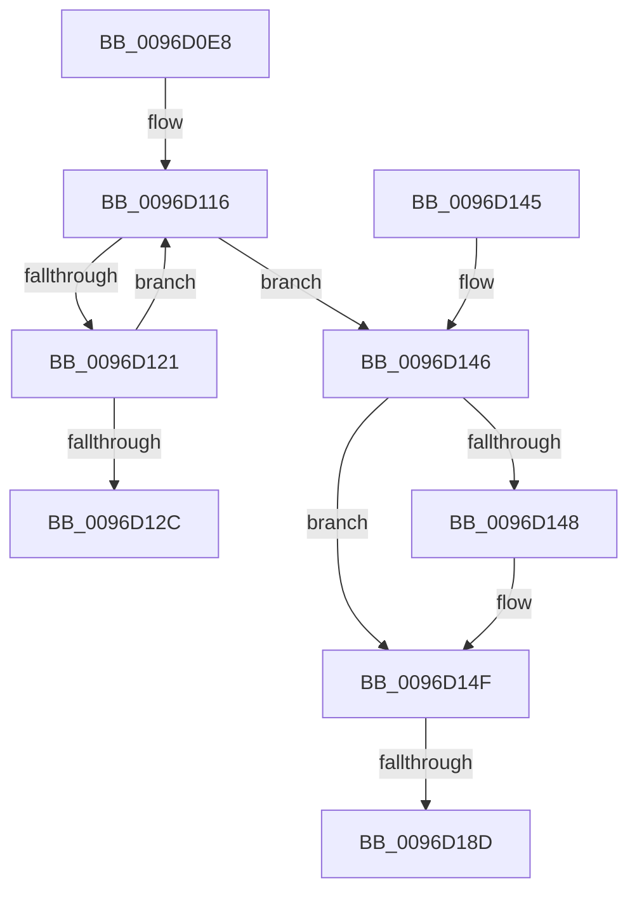

# ObDereferenceDeviceMap

- RVA: `0x0096D0E8`–`0x0096D1A1` (길이 `185` bytes)
- VA: `0x000000014096D0E8`
- 실행 섹션: `PAGE`
- PDB 이름 있음: `예`; PDB Function 태그: `예`
- unwind 정보 RVA: `0x0005C92C`
- 디코드: `50`개 명령, `185/185` bytes 표시
- 미해석 바이트: `0` (있으면 어셈블리에 `.byte`로 보존)

> 이 문서는 커널 이미지의 기계어와 PDB 기호를 분석해 생성했습니다. 4번과 5번은 함수 원형과 자료형을 바이너리 사용 방식에서 추정한 C 해석이며 원본 소스 복구 결과는 아닙니다.

## 1. Dependencies

- 직접 호출 지점: **3**; 고유 호출 대상: **3**
- 직접 호출자로 확인된 함수: **13**
- RIP 상대 이미지 참조: **0**

### Outgoing calls
- `0x0096D153` → [PsGetServerSiloGlobals](../../text/22/PsGetServerSiloGlobals_function_002250A0.md) (function, `0x002250A0`)
- `0x0096D179` → [KeAbPreAcquire](../../text/21/KeAbPreAcquire_function_00210230.md) (function, `0x00210230`)
- `0x0096D196` → [ExfAcquirePushLockExclusiveEx](../../text/20/ExfAcquirePushLockExclusiveEx_function_0020FC90.md) (function, `0x0020FC90`)

### Direct callers
- [ObCleanupSiloState](../74/ObCleanupSiloState_function_0074D778.md) at `0x0074D794`
- [ObpDeleteDeviceMap](../74/ObpDeleteDeviceMap_function_0074F2F0.md) at `0x0074F369`
- [ObpDirectoryTeardownCallback](../83/ObpDirectoryTeardownCallback_function_0083CEC0.md) at `0x0083CEEC`
- [ObpLookupObjectName](../89/ObpLookupObjectName_function_0089BE90.md) at `0x0089D17B`
- [ObpLookupObjectName](../89/ObpLookupObjectName_function_0089BE90.md) at `0x0089D5BA`
- [ObpLookupObjectName](../89/ObpLookupObjectName_function_0089BE90.md) at `0x0089D7BA`
- [ObpLookupObjectName](../89/ObpLookupObjectName_function_0089BE90.md) at `0x0089DC62`
- [ObClearProcessDeviceMap](../90/ObClearProcessDeviceMap_function_00907688.md) at `0x0090773A`
- [ObQueryDeviceMapInformation](ObQueryDeviceMapInformation_function_0096C5C0.md) at `0x0096CB8E`
- [ObpReferenceCurrentDeviceMap](ObpReferenceCurrentDeviceMap_function_0096CBD0.md) at `0x0096CE7B`
- [ObpSetCurrentProcessDeviceMap](ObpSetCurrentProcessDeviceMap_function_0096CF6C.md) at `0x0096D0A8`
- [sub_0096D28E](Unknown_function_0096D28E.md) at `0x0096D2E1`
- [SepDeleteLogonSessionTrack](../AA/SepDeleteLogonSessionTrack_function_00AA04E0.md) at `0x00AA0621`
- [SepDeReferenceLogonSession](../AF/SepDeReferenceLogonSession_function_00AF25EC.md) at `0x00AF27BD`
- [sub_00B2884E](../B2/Unknown_function_00B2884E.md) at `0x00B289E2`
- [sub_00B2884E](../B2/Unknown_function_00B2884E.md) at `0x00B28A0F`
- [sub_00B47284](../B4/Unknown_function_00B47284.md) at `0x00B473FF`
- [sub_00B47284](../B4/Unknown_function_00B47284.md) at `0x00B4741E`

### Static image references
- 디코드된 RIP-relative 메모리 참조가 없습니다.

## 2. Other-region calls and transfers

- 다른 실행 섹션으로 향하는 call: **3**
  - `0x0096D153` → [PsGetServerSiloGlobals](../../text/22/PsGetServerSiloGlobals_function_002250A0.md) (`PAGE` → `.text`)
  - `0x0096D179` → [KeAbPreAcquire](../../text/21/KeAbPreAcquire_function_00210230.md) (`PAGE` → `.text`)
  - `0x0096D196` → [ExfAcquirePushLockExclusiveEx](../../text/20/ExfAcquirePushLockExclusiveEx_function_0020FC90.md) (`PAGE` → `.text`)
- call이 아닌 외부 분기/꼬리 이동: **2**
  - `0x0096D187` → [sub_00B28A26](../B2/Unknown_function_00B28A26.md) (`tail-transfer`)
  - `0x0096D19C` → [sub_00B28A26](../B2/Unknown_function_00B28A26.md) (`tail-transfer`)

## 3. Assembly (complete function range)

```asm
0096D0E8  48 89 5C 24 08                  mov qword ptr [rsp + 8], rbx
0096D0ED  48 89 6C 24 10                  mov qword ptr [rsp + 0x10], rbp
0096D0F2  48 89 74 24 18                  mov qword ptr [rsp + 0x18], rsi
0096D0F7  57                              push rdi
0096D0F8  41 56                           push r14
0096D0FA  41 57                           push r15
0096D0FC  48 83 EC 20                     sub rsp, 0x20
0096D100  8B EA                           mov ebp, edx
0096D102  48 8B F9                        mov rdi, rcx
0096D105  0F 0D 89 F0 00 00 00            prefetchw byte ptr [rcx + 0xf0]
0096D10C  48 8B 81 F0 00 00 00            mov rax, qword ptr [rcx + 0xf0]
0096D113  44 8B FA                        mov r15d, edx
0096D116  48 8B C8                        mov rcx, rax
0096D119  49 2B CF                        sub rcx, r15
0096D11C  48 85 C9                        test rcx, rcx
0096D11F  7E 25                           jle 0x14096d146
0096D121  F0 48 0F B1 8F F0 00 00 00      lock cmpxchg qword ptr [rdi + 0xf0], rcx
0096D12A  75 EA                           jne 0x14096d116
0096D12C  48 8B 5C 24 40                  mov rbx, qword ptr [rsp + 0x40]
0096D131  48 8B 6C 24 48                  mov rbp, qword ptr [rsp + 0x48]
0096D136  48 8B 74 24 50                  mov rsi, qword ptr [rsp + 0x50]
0096D13B  48 83 C4 20                     add rsp, 0x20
0096D13F  41 5F                           pop r15
0096D141  41 5E                           pop r14
0096D143  5F                              pop rdi
0096D144  C3                              ret
0096D145  CC                              int3
0096D146  74 07                           je 0x14096d14f
0096D148  B9 0E 00 00 00                  mov ecx, 0xe
0096D14D  CD 29                           int 0x29
0096D14F  48 8B 4F 10                     mov rcx, qword ptr [rdi + 0x10]
0096D153  E8 48 7F 8B FF                  call 0x1402250a0
0096D158  65 48 8B 0C 25 88 01 00 00      mov rcx, qword ptr gs:[0x188]
0096D161  48 83 CB FF                     or rbx, 0xffffffffffffffff
0096D165  45 33 C0                        xor r8d, r8d
0096D168  33 D2                           xor edx, edx
0096D16A  48 8D 70 78                     lea rsi, [rax + 0x78]
0096D16E  66 01 99 E6 01 00 00            add word ptr [rcx + 0x1e6], bx
0096D175  48 8B CE                        mov rcx, rsi
0096D178  90                              nop
0096D179  E8 B2 30 8A FF                  call 0x140210230
0096D17E  F0 48 0F BA 2E 00               lock bts qword ptr [rsi], 0
0096D184  4C 8B F0                        mov r14, rax
0096D187  0F 83 99 B8 1B 00               jae 0x140b28a26
0096D18D  4C 8B C6                        mov r8, rsi
0096D190  48 8B D0                        mov rdx, rax
0096D193  48 8B CE                        mov rcx, rsi
0096D196  E8 F5 2A 8A FF                  call 0x14020fc90
0096D19B  90                              nop
0096D19C  E9 85 B8 1B 00                  jmp 0x140b28a26
```

## 4. C-style interpretation (structured pseudocode)

```c
__int64 __fastcall ObDereferenceDeviceMap(__int64 a1, int a2, int a3)
{
    __int64 result;
    __int64 v_rbx;
    __int64 v_rsp;
    unsigned __int64 v_stack_p10;
    unsigned __int64 v_stack_p18;
    unsigned __int64 v_stack_p8;

    v_stack_p8 = v_rbx;
    v_stack_p10 = v_rbp;
    v_stack_p18 = v_rsi;
    v_rsp = (v_rsp) - (32);
loc_0096D116:
    a1 = (*(unsigned __int64 *)(a1 + 240)) - ((unsigned int)(a2));
    if (condition_is_less_or_equal) goto loc_0096D146;
    if (a1 != 0) goto loc_0096D116;
    v_rsp = (v_rsp) + (32);
    return *(unsigned __int64 *)(a1 + 240);
loc_0096D146:
    if (!(condition_is_equal)) {
        a1 = 14;
    }
    result = PsGetServerSiloGlobals(*(unsigned __int64 *)(a1 + 16), a2, a3, a4);
    v_rbx = (v_stack_p8) | (-1);
    a3 = 0;
    a2 = 0;
    result = KeAbPreAcquire(result + 120, a2, a3, a4);
    result = ExfAcquirePushLockExclusiveEx(result + 120, result, result + 120, a4);
}
```

## 5. (Beta) C Style

```c
int64_t ObDereferenceDeviceMap(void *Arg1, int32_t Arg2, int32_t Arg3)
{
    uint8_t *arg1 = (uint8_t *)Arg1;

    int64_t result;
    int64_t local_rbx;
    int64_t local_rsp;
    uint64_t v_stack_p10;
    uint64_t v_stack_p18;
    uint64_t v_stack_p8;

    v_stack_p8 = local_rbx;
    v_stack_p10 = local_rbp;
    v_stack_p18 = local_rsi;
    local_rsp = (local_rsp) - (32);
loc_0096D116:
    Arg1 = (*(uint64_t *)(arg1 + 0xF0)) - ((uint32_t)(Arg2));
    if (condition_is_less_or_equal) goto loc_0096D146;
    if (Arg1 != NULL) goto loc_0096D116;
    local_rsp = (local_rsp) + (32);
    return *(uint64_t *)(arg1 + 0xF0);
loc_0096D146:
    if (!(condition_is_equal)) {
        Arg1 = 14;
    }
    result = PsGetServerSiloGlobals(*(uint64_t *)(arg1 + 0x10), Arg2, Arg3, a4);
    local_rbx = (v_stack_p8) | (-1);
    Arg3 = 0;
    Arg2 = 0;
    result = KeAbPreAcquire(result + 120, Arg2, Arg3, a4);
    result = ExfAcquirePushLockExclusiveEx(result + 120, result, result + 120, a4);
}
```

### 관측된 메모리 오프셋

구조체 형식이 확인되지 않은 접근은 인자 기준의 오프셋으로만 기록했습니다.

| 기준 인자 | 오프셋 표현 | 폭 (bit) | 접근 |
|---|---:|---:|---|
| `Arg1` | `+ 0x10` | `64` | `R` |
| `Arg1` | `+ 0xF0` | `8` | `R` |
| `Arg1` | `+ 0xF0` | `64` | `R` |

## 6. Execution-region graph

[열기: 2D/3D 그래프와 함수 탐색 컨트롤 패널](../../../control-panel.html?section=page&rva=0x0096D0E8&view=graph)

- 2D 그래프는 위에서 아래로 흐르고, 3D 그래프는 빈 공간을 드래그해 회전합니다. Shift+드래그는 이동, 휠은 확대·축소, 함수 노드 선택은 대상 보고서 이동입니다.

### Static fallback


