# ObpReferenceCurrentDeviceMap

- RVA: `0x0096CBD0`–`0x0096CE85` (길이 `693` bytes)
- VA: `0x000000014096CBD0`
- 실행 섹션: `PAGE`
- PDB 이름 있음: `예`; PDB Function 태그: `아니요`
- unwind 정보 RVA: `0x00095CBC`
- 디코드: `188`개 명령, `693/693` bytes 표시
- 미해석 바이트: `0` (있으면 어셈블리에 `.byte`로 보존)

> 이 문서는 커널 이미지의 기계어와 PDB 기호를 분석해 생성했습니다. 4번과 5번은 함수 원형과 자료형을 바이너리 사용 방식에서 추정한 C 해석이며 원본 소스 복구 결과는 아닙니다.

## 1. Dependencies

- 직접 호출 지점: **17**; 고유 호출 대상: **16**
- 직접 호출자로 확인된 함수: **2**
- RIP 상대 이미지 참조: **0**

### Outgoing calls
- `0x0096CC05` → [PsGetProcessServerSilo](../../text/44/PsGetProcessServerSilo_function_0044BEE0.md) (function, `0x0044BEE0`)
- `0x0096CC10` → [PsGetThreadServerSilo](../../text/22/PsGetThreadServerSilo_function_002247B0.md) (function, `0x002247B0`)
- `0x0096CC63` → [PspLockThreadSecurityShared](../../text/3C/PspLockThreadSecurityShared_function_003C4720.md) (function, `0x003C4720`)
- `0x0096CC95` → [ObfReferenceObjectWithTag](../../text/21/ObfReferenceObjectWithTag_function_00210710.md) (function, `0x00210710`)
- `0x0096CCA0` → [PspUnlockThreadSecurityShared](../../text/3C/PspUnlockThreadSecurityShared_function_003C2E40.md) (function, `0x003C2E40`)
- `0x0096CCC6` → [SeGetTokenDeviceMap](SeGetTokenDeviceMap_function_0096CE8C.md) (function, `0x0096CE8C`)
- `0x0096CCDC` → [ObfDereferenceObjectWithTag](../../text/2F/ObfDereferenceObjectWithTag_function_002F78E0.md) (function, `0x002F78E0`)
- `0x0096CD32` → [PsGetCurrentServerSiloGlobals](../../text/2F/PsGetCurrentServerSiloGlobals_function_002FE1F0.md) (function, `0x002FE1F0`)
- `0x0096CD54` → [KeAbPreAcquire](../../text/21/KeAbPreAcquire_function_00210230.md) (function, `0x00210230`)
- `0x0096CD75` → [ExfAcquirePushLockSharedEx](../../text/21/ExfAcquirePushLockSharedEx_function_0021044C.md) (function, `0x0021044C`)
- `0x0096CD9B` → [ExfReleasePushLockShared](../../text/26/ExfReleasePushLockShared_function_00263440.md) (function, `0x00263440`)
- `0x0096CDA3` → [KeAbPostRelease](../../text/2E/KeAbPostRelease_function_002E1600.md) (function, `0x002E1600`)
- `0x0096CDA8` → [KeLeaveGuardedRegion](../../text/2E/KeLeaveGuardedRegion_function_002E2C40.md) (function, `0x002E2C40`)
- `0x0096CE35` → [ObfDereferenceObjectWithTag](../../text/2F/ObfDereferenceObjectWithTag_function_002F78E0.md) (function, `0x002F78E0`)
- `0x0096CE3D` → [PsGetServerSiloGlobals](../../text/22/PsGetServerSiloGlobals_function_002250A0.md) (function, `0x002250A0`)
- `0x0096CE56` → [ObpSetCurrentProcessDeviceMap](ObpSetCurrentProcessDeviceMap_function_0096CF6C.md) (function, `0x0096CF6C`)
- `0x0096CE7B` → [ObDereferenceDeviceMap](ObDereferenceDeviceMap_function_0096D0E8.md) (function, `0x0096D0E8`)

### Direct callers
- [ObpLookupObjectName](../89/ObpLookupObjectName_function_0089BE90.md) at `0x0089D2EE`
- [ObQueryDeviceMapInformation](ObQueryDeviceMapInformation_function_0096C5C0.md) at `0x0096C632`

### Static image references
- 디코드된 RIP-relative 메모리 참조가 없습니다.

## 2. Other-region calls and transfers

- 다른 실행 섹션으로 향하는 call: **14**
  - `0x0096CC05` → [PsGetProcessServerSilo](../../text/44/PsGetProcessServerSilo_function_0044BEE0.md) (`PAGE` → `.text`)
  - `0x0096CC10` → [PsGetThreadServerSilo](../../text/22/PsGetThreadServerSilo_function_002247B0.md) (`PAGE` → `.text`)
  - `0x0096CC63` → [PspLockThreadSecurityShared](../../text/3C/PspLockThreadSecurityShared_function_003C4720.md) (`PAGE` → `.text`)
  - `0x0096CC95` → [ObfReferenceObjectWithTag](../../text/21/ObfReferenceObjectWithTag_function_00210710.md) (`PAGE` → `.text`)
  - `0x0096CCA0` → [PspUnlockThreadSecurityShared](../../text/3C/PspUnlockThreadSecurityShared_function_003C2E40.md) (`PAGE` → `.text`)
  - `0x0096CCDC` → [ObfDereferenceObjectWithTag](../../text/2F/ObfDereferenceObjectWithTag_function_002F78E0.md) (`PAGE` → `.text`)
  - `0x0096CD32` → [PsGetCurrentServerSiloGlobals](../../text/2F/PsGetCurrentServerSiloGlobals_function_002FE1F0.md) (`PAGE` → `.text`)
  - `0x0096CD54` → [KeAbPreAcquire](../../text/21/KeAbPreAcquire_function_00210230.md) (`PAGE` → `.text`)
  - `0x0096CD75` → [ExfAcquirePushLockSharedEx](../../text/21/ExfAcquirePushLockSharedEx_function_0021044C.md) (`PAGE` → `.text`)
  - `0x0096CD9B` → [ExfReleasePushLockShared](../../text/26/ExfReleasePushLockShared_function_00263440.md) (`PAGE` → `.text`)
  - `0x0096CDA3` → [KeAbPostRelease](../../text/2E/KeAbPostRelease_function_002E1600.md) (`PAGE` → `.text`)
  - `0x0096CDA8` → [KeLeaveGuardedRegion](../../text/2E/KeLeaveGuardedRegion_function_002E2C40.md) (`PAGE` → `.text`)
  - `0x0096CE35` → [ObfDereferenceObjectWithTag](../../text/2F/ObfDereferenceObjectWithTag_function_002F78E0.md) (`PAGE` → `.text`)
  - `0x0096CE3D` → [PsGetServerSiloGlobals](../../text/22/PsGetServerSiloGlobals_function_002250A0.md) (`PAGE` → `.text`)
- 별도 외부 분기/꼬리 이동을 확인하지 못했습니다.

## 3. Assembly (complete function range)

```asm
0096CBD0  48 89 5C 24 08                  mov qword ptr [rsp + 8], rbx
0096CBD5  48 89 54 24 10                  mov qword ptr [rsp + 0x10], rdx
0096CBDA  55                              push rbp
0096CBDB  56                              push rsi
0096CBDC  57                              push rdi
0096CBDD  41 54                           push r12
0096CBDF  41 55                           push r13
0096CBE1  41 56                           push r14
0096CBE3  41 57                           push r15
0096CBE5  48 83 EC 20                     sub rsp, 0x20
0096CBE9  8B D9                           mov ebx, ecx
0096CBEB  33 C9                           xor ecx, ecx
0096CBED  48 89 0A                        mov qword ptr [rdx], rcx
0096CBF0  8B F1                           mov esi, ecx
0096CBF2  65 48 8B 2C 25 88 01 00 00      mov rbp, qword ptr gs:[0x188]
0096CBFB  48 8B BD 20 02 00 00            mov rdi, qword ptr [rbp + 0x220]
0096CC02  48 8B CF                        mov rcx, rdi
0096CC05  E8 D6 F2 AD FF                  call 0x14044bee0
0096CC0A  48 8B CD                        mov rcx, rbp
0096CC0D  4C 8B F8                        mov r15, rax
0096CC10  E8 9B 7B 8B FF                  call 0x1402247b0
0096CC15  4C 3B F8                        cmp r15, rax
0096CC18  4C 8B E0                        mov r12, rax
0096CC1B  8B 85 A0 05 00 00               mov eax, dword ptr [rbp + 0x5a0]
0096CC21  41 0F 95 C6                     setne r14b
0096CC25  A8 08                           test al, 8
0096CC27  45 0F B6 EE                     movzx r13d, r14b
0096CC2B  0F 95 C1                        setne cl
0096CC2E  0F BA E3 0B                     bt ebx, 0xb
0096CC32  0F 93 C0                        setae al
0096CC35  84 C8                           test al, cl
0096CC37  0F 84 AD 00 00 00               je 0x14096ccea
0096CC3D  4D 3B FC                        cmp r15, r12
0096CC40  0F 85 A4 00 00 00               jne 0x14096ccea
0096CC46  8B 85 A0 05 00 00               mov eax, dword ptr [rbp + 0x5a0]
0096CC4C  A8 08                           test al, 8
0096CC4E  0F 84 96 00 00 00               je 0x14096ccea
0096CC54  65 4C 8B 3C 25 88 01 00 00      mov r15, qword ptr gs:[0x188]
0096CC5D  48 8B CD                        mov rcx, rbp
0096CC60  49 8B D7                        mov rdx, r15
0096CC63  E8 B8 7A A5 FF                  call 0x1403c4720
0096CC68  8B 85 A0 05 00 00               mov eax, dword ptr [rbp + 0x5a0]
0096CC6E  A8 08                           test al, 8
0096CC70  0F 84 F6 01 00 00               je 0x14096ce6c
0096CC76  48 8B 9D 48 06 00 00            mov rbx, qword ptr [rbp + 0x648]
0096CC7D  48 85 DB                        test rbx, rbx
0096CC80  75 0B                           jne 0x14096cc8d
0096CC82  48 8B 9D 38 05 00 00            mov rbx, qword ptr [rbp + 0x538]
0096CC89  48 83 E3 F8                     and rbx, 0xfffffffffffffff8
0096CC8D  BA 44 66 6C 74                  mov edx, 0x746c6644
0096CC92  48 8B CB                        mov rcx, rbx
0096CC95  E8 76 3A 8A FF                  call 0x140210710
0096CC9A  49 8B D7                        mov rdx, r15
0096CC9D  48 8B CD                        mov rcx, rbp
0096CCA0  E8 9B 61 A5 FF                  call 0x1403c2e40
0096CCA5  48 85 DB                        test rbx, rbx
0096CCA8  74 40                           je 0x14096ccea
0096CCAA  48 8B 43 18                     mov rax, qword ptr [rbx + 0x18]
0096CCAE  3D E7 03 00 00                  cmp eax, 0x3e7
0096CCB3  0F 84 65 01 00 00               je 0x14096ce1e
0096CCB9  48 8D 54 24 70                  lea rdx, [rsp + 0x70]
0096CCBE  48 89 74 24 70                  mov qword ptr [rsp + 0x70], rsi
0096CCC3  48 8B CB                        mov rcx, rbx
0096CCC6  E8 C1 01 00 00                  call 0x14096ce8c
0096CCCB  85 C0                           test eax, eax
0096CCCD  78 05                           js 0x14096ccd4
0096CCCF  48 8B 74 24 70                  mov rsi, qword ptr [rsp + 0x70]
0096CCD4  BA 44 66 6C 74                  mov edx, 0x746c6644
0096CCD9  48 8B CB                        mov rcx, rbx
0096CCDC  E8 FF AB 98 FF                  call 0x1402f78e0
0096CCE1  48 85 F6                        test rsi, rsi
0096CCE4  0F 85 2F 01 00 00               jne 0x14096ce19
0096CCEA  45 84 ED                        test r13b, r13b
0096CCED  0F 85 47 01 00 00               jne 0x14096ce3a
0096CCF3  48 8D 9F 18 03 00 00            lea rbx, [rdi + 0x318]
0096CCFA  4C 8B 74 24 68                  mov r14, qword ptr [rsp + 0x68]
0096CCFF  49 89 1E                        mov qword ptr [r14], rbx
0096CD02  0F 0D 0B                        prefetchw byte ptr [rbx]
0096CD05  48 8B 13                        mov rdx, qword ptr [rbx]
0096CD08  F6 C2 0F                        test dl, 0xf
0096CD0B  74 15                           je 0x14096cd22
0096CD0D  48 8D 4A FF                     lea rcx, [rdx - 1]
0096CD11  48 8B C2                        mov rax, rdx
0096CD14  F0 48 0F B1 0B                  lock cmpxchg qword ptr [rbx], rcx
0096CD19  74 07                           je 0x14096cd22
0096CD1B  48 8B D0                        mov rdx, rax
0096CD1E  A8 0F                           test al, 0xf
0096CD20  75 EB                           jne 0x14096cd0d
0096CD22  48 8B FA                        mov rdi, rdx
0096CD25  48 83 E7 F0                     and rdi, 0xfffffffffffffff0
0096CD29  F6 C2 0F                        test dl, 0xf
0096CD2C  0F 85 E3 00 00 00               jne 0x14096ce15
0096CD32  E8 B9 14 99 FF                  call 0x1402fe1f0
0096CD37  65 48 8B 0C 25 88 01 00 00      mov rcx, qword ptr gs:[0x188]
0096CD40  45 33 C0                        xor r8d, r8d
0096CD43  33 D2                           xor edx, edx
0096CD45  48 8D 70 78                     lea rsi, [rax + 0x78]
0096CD49  66 FF 89 E6 01 00 00            dec word ptr [rcx + 0x1e6]
0096CD50  48 8B CE                        mov rcx, rsi
0096CD53  90                              nop
0096CD54  E8 D7 34 8A FF                  call 0x140210230
0096CD59  48 8B F8                        mov rdi, rax
0096CD5C  BD 11 00 00 00                  mov ebp, 0x11
0096CD61  33 C0                           xor eax, eax
0096CD63  F0 48 0F B1 2E                  lock cmpxchg qword ptr [rsi], rbp
0096CD68  74 10                           je 0x14096cd7a
0096CD6A  4C 8B CE                        mov r9, rsi
0096CD6D  4C 8B C7                        mov r8, rdi
0096CD70  33 D2                           xor edx, edx
0096CD72  48 8B CE                        mov rcx, rsi
0096CD75  E8 D2 36 8A FF                  call 0x14021044c
0096CD7A  48 85 FF                        test rdi, rdi
0096CD7D  74 04                           je 0x14096cd83
0096CD7F  C6 47 0A 01                     mov byte ptr [rdi + 0xa], 1
0096CD83  48 8B 3B                        mov rdi, qword ptr [rbx]
0096CD86  48 83 E7 F0                     and rdi, 0xfffffffffffffff0
0096CD8A  75 43                           jne 0x14096cdcf
0096CD8C  48 8B C5                        mov rax, rbp
0096CD8F  33 DB                           xor ebx, ebx
0096CD91  F0 48 0F B1 1E                  lock cmpxchg qword ptr [rsi], rbx
0096CD96  74 08                           je 0x14096cda0
0096CD98  48 8B CE                        mov rcx, rsi
0096CD9B  E8 A0 66 8F FF                  call 0x140263440
0096CDA0  48 8B CE                        mov rcx, rsi
0096CDA3  E8 58 48 97 FF                  call 0x1402e1600
0096CDA8  E8 93 5E 97 FF                  call 0x1402e2c40
0096CDAD  48 85 FF                        test rdi, rdi
0096CDB0  0F 84 94 00 00 00               je 0x14096ce4a
0096CDB6  48 8B C7                        mov rax, rdi
0096CDB9  48 8B 5C 24 60                  mov rbx, qword ptr [rsp + 0x60]
0096CDBE  48 83 C4 20                     add rsp, 0x20
0096CDC2  41 5F                           pop r15
0096CDC4  41 5E                           pop r14
0096CDC6  41 5D                           pop r13
0096CDC8  41 5C                           pop r12
0096CDCA  5F                              pop rdi
0096CDCB  5E                              pop rsi
0096CDCC  5D                              pop rbp
0096CDCD  C3                              ret
0096CDCE  CC                              int3
0096CDCF  B8 0F 00 00 00                  mov eax, 0xf
0096CDD4  F0 48 0F C1 87 F0 00 00 00      lock xadd qword ptr [rdi + 0xf0], rax
0096CDDD  48 85 C0                        test rax, rax
0096CDE0  7E 7E                           jle 0x14096ce60
0096CDE2  0F 0D 0B                        prefetchw byte ptr [rbx]
0096CDE5  48 8B 03                        mov rax, qword ptr [rbx]
0096CDE8  48 8B C8                        mov rcx, rax
0096CDEB  83 E1 0F                        and ecx, 0xf
0096CDEE  48 83 C1 0E                     add rcx, 0xe
0096CDF2  48 83 F9 0F                     cmp rcx, 0xf
0096CDF6  77 7B                           ja 0x14096ce73
0096CDF8  48 8B C8                        mov rcx, rax
0096CDFB  48 83 E1 F0                     and rcx, 0xfffffffffffffff0
0096CDFF  48 3B F9                        cmp rdi, rcx
0096CE02  75 6F                           jne 0x14096ce73
0096CE04  48 8D 48 0E                     lea rcx, [rax + 0xe]
0096CE08  F0 48 0F B1 0B                  lock cmpxchg qword ptr [rbx], rcx
0096CE0D  0F 84 79 FF FF FF               je 0x14096cd8c
0096CE13  EB D3                           jmp 0x14096cde8
0096CE15  33 DB                           xor ebx, ebx
0096CE17  EB 94                           jmp 0x14096cdad
0096CE19  48 8B C6                        mov rax, rsi
0096CE1C  EB 9B                           jmp 0x14096cdb9
0096CE1E  48 C1 E8 20                     shr rax, 0x20
0096CE22  85 C0                           test eax, eax
0096CE24  0F 85 8F FE FF FF               jne 0x14096ccb9
0096CE2A  BA 44 66 6C 74                  mov edx, 0x746c6644
0096CE2F  48 8B CB                        mov rcx, rbx
0096CE32  41 B5 01                        mov r13b, 1
0096CE35  E8 A6 AA 98 FF                  call 0x1402f78e0
0096CE3A  49 8B CC                        mov rcx, r12
0096CE3D  E8 5E 82 8B FF                  call 0x1402250a0
0096CE42  48 8B D8                        mov rbx, rax
0096CE45  E9 B0 FE FF FF                  jmp 0x14096ccfa
0096CE4A  45 84 ED                        test r13b, r13b
0096CE4D  0F 85 63 FF FF FF               jne 0x14096cdb6
0096CE53  49 89 1E                        mov qword ptr [r14], rbx
0096CE56  E8 11 01 00 00                  call 0x14096cf6c
0096CE5B  E9 59 FF FF FF                  jmp 0x14096cdb9
0096CE60  B9 0E 00 00 00                  mov ecx, 0xe
0096CE65  CD 29                           int 0x29
0096CE67  E9 76 FF FF FF                  jmp 0x14096cde2
0096CE6C  33 DB                           xor ebx, ebx
0096CE6E  E9 27 FE FF FF                  jmp 0x14096cc9a
0096CE73  BA 0E 00 00 00                  mov edx, 0xe
0096CE78  48 8B CF                        mov rcx, rdi
0096CE7B  E8 68 02 00 00                  call 0x14096d0e8
0096CE80  E9 07 FF FF FF                  jmp 0x14096cd8c
```

## 4. C-style interpretation (structured pseudocode)

```c
__int64 __fastcall ObpReferenceCurrentDeviceMap(int a1, __int64 a2, int a3)
{
    __int64 result;
    __int64 v_r14;
    __int64 v_rbx;
    __int64 v_rdi;
    __int64 v_rsi;
    __int64 v_rsp;
    unsigned __int64 v_stack_p10;
    unsigned __int64 v_stack_p18;
    unsigned __int64 v_stack_p8;

    v_stack_p8 = v_rbx;
    v_stack_p10 = a2;
    v_rsp = (v_rsp) - (32);
    a1 = 0;
    *(unsigned __int64 *)(a2) = 0;
    result = PsGetProcessServerSilo(*(unsigned __int64 *)(*(unsigned __int64 *)(gs_base + (0 + 392)) + 544), a2, a3, a4);
    result = PsGetThreadServerSilo(*(unsigned __int64 *)(gs_base + (0 + 392)), a2, a3, a4);
    v_r14 = (result != result) ? 1 : 0;
    a1 = ((((unsigned __int8)((unsigned int)(*(unsigned int *)(*(unsigned __int64 *)(gs_base + (0 + 392)) + 1440)))) & (8)) != 0) ? 1 : 0;
    result = (condition_is_above_or_equal) ? 1 : 0;
    if ((((unsigned __int8)(result)) & ((unsigned __int8)(a1))) == 0) goto loc_0096CCEA;
    if (result != result) goto loc_0096CCEA;
    if ((((unsigned __int8)((unsigned int)(*(unsigned int *)(*(unsigned __int64 *)(gs_base + (0 + 392)) + 1440)))) & (8)) == 0) goto loc_0096CCEA;
    result = PspLockThreadSecurityShared(*(unsigned __int64 *)(gs_base + (0 + 392)), *(unsigned __int64 *)(gs_base + (0 + 392)), a3, a4);
    if ((((unsigned __int8)((unsigned int)(*(unsigned int *)(*(unsigned __int64 *)(gs_base + (0 + 392)) + 1440)))) & (8)) == 0) goto loc_0096CE6C;
    v_rbx = *(unsigned __int64 *)(*(unsigned __int64 *)(gs_base + (0 + 392)) + 1608);
    if (*(unsigned __int64 *)(*(unsigned __int64 *)(gs_base + (0 + 392)) + 1608) == 0) {
        v_rbx = *(unsigned __int64 *)(*(unsigned __int64 *)(gs_base + (0 + 392)) + 1336);
        v_rbx = (v_rbx) & (-8);
    }
    result = ObfReferenceObjectWithTag(v_rbx, (unsigned int)(0x746C6644ULL), a3, a4);
loc_0096CC9A:
    result = PspUnlockThreadSecurityShared(*(unsigned __int64 *)(gs_base + (0 + 392)), *(unsigned __int64 *)(gs_base + (0 + 392)), a3, a4);
    if (v_rbx == 0) goto loc_0096CCEA;
    if (((unsigned int)(*(unsigned __int64 *)(v_rbx + 24))) == 999) goto loc_0096CE1E;
loc_0096CCB9:
    v_stack_p18 = 0;
    result = SeGetTokenDeviceMap(v_rbx, v_stack_p18, a3, a4);
    v_rsi = 0;
    if (!(sign_flag)) {
        v_rsi = v_stack_p18;
    }
    result = ObfDereferenceObjectWithTag(v_rbx, (unsigned int)(0x746C6644ULL), a3, a4);
    if (v_rsi != 0) goto loc_0096CE19;
loc_0096CCEA:
    if ((unsigned __int8)((unsigned __int8)(v_r14)) != 0) goto loc_0096CE3A;
loc_0096CCFA:
    *(unsigned __int64 *)(v_stack_p10) = *(unsigned __int64 *)(*(unsigned __int64 *)(gs_base + (0 + 392)) + 544) + 792;
    if ((((unsigned __int8)(*(unsigned __int64 *)(*(unsigned __int64 *)(*(unsigned __int64 *)(gs_base + (0 + 392)) + 544) + 792))) & (15)) == 0) goto loc_0096CD22;
loc_0096CD0D:
    if ((((unsigned __int8)(*(unsigned __int64 *)(*(unsigned __int64 *)(*(unsigned __int64 *)(gs_base + (0 + 392)) + 544) + 792))) & (15)) == 0) goto loc_0096CD22;
    if ((((unsigned __int8)(*(unsigned __int64 *)(*(unsigned __int64 *)(*(unsigned __int64 *)(gs_base + (0 + 392)) + 544) + 792))) & (15)) != 0) goto loc_0096CD0D;
loc_0096CD22:
    v_rdi = (*(unsigned __int64 *)(*(unsigned __int64 *)(*(unsigned __int64 *)(gs_base + (0 + 392)) + 544) + 792)) & (-16);
    if ((((unsigned __int8)(*(unsigned __int64 *)(*(unsigned __int64 *)(*(unsigned __int64 *)(gs_base + (0 + 392)) + 544) + 792))) & (15)) != 0) goto loc_0096CE15;
    result = PsGetCurrentServerSiloGlobals(*(unsigned __int64 *)(*(unsigned __int64 *)(*(unsigned __int64 *)(gs_base + (0 + 392)) + 544) + 792) - 1, *(unsigned __int64 *)(*(unsigned __int64 *)(*(unsigned __int64 *)(gs_base + (0 + 392)) + 544) + 792), a3, a4);
    a3 = 0;
    a2 = 0;
    result = KeAbPreAcquire(result + 120, a2, a3, a4);
    result = 0;
    if (!(condition_is_equal)) {
        a4 = result + 120;
        a3 = 0;
        a2 = 0;
        a1 = result + 120;
        result = ExfAcquirePushLockSharedEx(a1, a2, a3, a4);
    }
    if (result != 0) {
        *(unsigned __int8 *)(result + 10) = 1;
    }
    v_rdi = (*(unsigned __int64 *)(*(unsigned __int64 *)(*(unsigned __int64 *)(gs_base + (0 + 392)) + 544) + 792)) & (-16);
    if (condition_is_not_equal) goto loc_0096CDCF;
loc_0096CD8C:
    v_rbx = 0;
    result = 17;
    if (!(condition_is_equal)) {
        a1 = result + 120;
        result = ExfReleasePushLockShared(a1, a2, a3, a4);
    }
    result = KeAbPostRelease(result + 120, a2, a3, a4);
    result = KeLeaveGuardedRegion(result + 120, a2, a3, a4);
loc_0096CDAD:
    if (v_rdi == 0) goto loc_0096CE4A;
loc_0096CDB6:
loc_0096CDB9:
    v_rsp = (v_rsp) + (32);
    return v_rdi;
loc_0096CDCF:
    if (condition_is_less_or_equal) goto loc_0096CE60;
loc_0096CDE2:
loc_0096CDE8:
    a1 = (unsigned int)((*(unsigned __int64 *)(v_stack_p8)) & (15));
    a1 = (a1) + (14);
    if (a1 > 15) goto loc_0096CE73;
    a1 = (*(unsigned __int64 *)(v_stack_p8)) & (-16);
    if (v_rdi != a1) goto loc_0096CE73;
    if (v_rdi == a1) goto loc_0096CD8C;
    goto loc_0096CDE8;
loc_0096CE15:
    v_rbx = 0;
    goto loc_0096CDAD;
loc_0096CE19:
    goto loc_0096CDB9;
loc_0096CE1E:
    result = (result + 120) >> (32);
    if ((unsigned int)(result) != 0) goto loc_0096CCB9;
    result = ObfDereferenceObjectWithTag(0, (unsigned int)(0x746C6644ULL), a3, a4);
loc_0096CE3A:
    result = PsGetServerSiloGlobals(result, (unsigned int)(0x746C6644ULL), a3, a4);
    goto loc_0096CCFA;
loc_0096CE4A:
    if (1 != 0) goto loc_0096CDB6;
    *(unsigned __int64 *)(v_stack_p10) = result;
    result = ObpSetCurrentProcessDeviceMap(result, (unsigned int)(0x746C6644ULL), a3, a4);
    goto loc_0096CDB9;
loc_0096CE60:
    goto loc_0096CDE2;
loc_0096CE6C:
    v_rbx = 0;
    goto loc_0096CC9A;
loc_0096CE73:
    result = ObDereferenceDeviceMap(v_rdi, 14, a3, a4);
    goto loc_0096CD8C;
}
```

## 5. (Beta) C Style

```c
int64_t ObpReferenceCurrentDeviceMap(int32_t Arg1, void *Arg2, int32_t Arg3)
{
    uint8_t *arg2 = (uint8_t *)Arg2;

    int64_t result;
    int64_t local_r14;
    int64_t local_rbx;
    int64_t local_rdi;
    int64_t local_rsi;
    int64_t local_rsp;
    uint64_t v_stack_p10;
    uint64_t v_stack_p18;
    uint64_t v_stack_p8;

    v_stack_p8 = local_rbx;
    v_stack_p10 = Arg2;
    local_rsp = (local_rsp) - (32);
    Arg1 = 0;
    *(uint64_t *)(arg2) = 0;
    result = PsGetProcessServerSilo(*(uint64_t *)(*(uint64_t *)(gs_base + (0 + 0x188)) + 0x220), Arg2, Arg3, a4);
    result = PsGetThreadServerSilo(*(uint64_t *)(gs_base + (0 + 0x188)), Arg2, Arg3, a4);
    local_r14 = (result != result) ? 1 : 0;
    Arg1 = ((((uint8_t)((uint32_t)(*(uint32_t *)(*(uint64_t *)(gs_base + (0 + 0x188)) + 0x5A0)))) & (8)) != 0) ? 1 : 0;
    result = (condition_is_above_or_equal) ? 1 : 0;
    if ((((uint8_t)(result)) & ((uint8_t)(Arg1))) == 0) goto loc_0096CCEA;
    if (result != result) goto loc_0096CCEA;
    if ((((uint8_t)((uint32_t)(*(uint32_t *)(*(uint64_t *)(gs_base + (0 + 0x188)) + 0x5A0)))) & (8)) == 0) goto loc_0096CCEA;
    result = PspLockThreadSecurityShared(*(uint64_t *)(gs_base + (0 + 0x188)), *(uint64_t *)(gs_base + (0 + 0x188)), Arg3, a4);
    if ((((uint8_t)((uint32_t)(*(uint32_t *)(*(uint64_t *)(gs_base + (0 + 0x188)) + 0x5A0)))) & (8)) == 0) goto loc_0096CE6C;
    local_rbx = *(uint64_t *)(*(uint64_t *)(gs_base + (0 + 0x188)) + 0x648);
    if (*(uint64_t *)(*(uint64_t *)(gs_base + (0 + 0x188)) + 0x648) == 0) {
        local_rbx = *(uint64_t *)(*(uint64_t *)(gs_base + (0 + 0x188)) + 0x538);
        local_rbx = (local_rbx) & (-8);
    }
    result = ObfReferenceObjectWithTag(local_rbx, (uint32_t)(0x746C6644ULL), Arg3, a4);
loc_0096CC9A:
    result = PspUnlockThreadSecurityShared(*(uint64_t *)(gs_base + (0 + 0x188)), *(uint64_t *)(gs_base + (0 + 0x188)), Arg3, a4);
    if (local_rbx == 0) goto loc_0096CCEA;
    if (((uint32_t)(*(uint64_t *)(local_rbx + 0x18))) == 999) goto loc_0096CE1E;
loc_0096CCB9:
    v_stack_p18 = 0;
    result = SeGetTokenDeviceMap(local_rbx, v_stack_p18, Arg3, a4);
    local_rsi = 0;
    if (!(sign_flag)) {
        local_rsi = v_stack_p18;
    }
    result = ObfDereferenceObjectWithTag(local_rbx, (uint32_t)(0x746C6644ULL), Arg3, a4);
    if (local_rsi != 0) goto loc_0096CE19;
loc_0096CCEA:
    if ((uint8_t)((uint8_t)(local_r14)) != 0) goto loc_0096CE3A;
loc_0096CCFA:
    *(uint64_t *)(v_stack_p10) = *(uint64_t *)(*(uint64_t *)(gs_base + (0 + 0x188)) + 0x220) + 792;
    if ((((uint8_t)(*(uint64_t *)(*(uint64_t *)(*(uint64_t *)(gs_base + (0 + 0x188)) + 0x220) + 0x318))) & (15)) == 0) goto loc_0096CD22;
loc_0096CD0D:
    if ((((uint8_t)(*(uint64_t *)(*(uint64_t *)(*(uint64_t *)(gs_base + (0 + 0x188)) + 0x220) + 0x318))) & (15)) == 0) goto loc_0096CD22;
    if ((((uint8_t)(*(uint64_t *)(*(uint64_t *)(*(uint64_t *)(gs_base + (0 + 0x188)) + 0x220) + 0x318))) & (15)) != 0) goto loc_0096CD0D;
loc_0096CD22:
    local_rdi = (*(uint64_t *)(*(uint64_t *)(*(uint64_t *)(gs_base + (0 + 0x188)) + 0x220) + 0x318)) & (-16);
    if ((((uint8_t)(*(uint64_t *)(*(uint64_t *)(*(uint64_t *)(gs_base + (0 + 0x188)) + 0x220) + 0x318))) & (15)) != 0) goto loc_0096CE15;
    result = PsGetCurrentServerSiloGlobals(*(uint64_t *)(*(uint64_t *)(*(uint64_t *)(gs_base + (0 + 0x188)) + 0x220) + 0x318) - 1, *(uint64_t *)(*(uint64_t *)(*(uint64_t *)(gs_base + (0 + 0x188)) + 0x220) + 0x318), Arg3, a4);
    Arg3 = 0;
    Arg2 = 0;
    result = KeAbPreAcquire(result + 120, Arg2, Arg3, a4);
    result = 0;
    if (!(condition_is_equal)) {
        a4 = result + 120;
        Arg3 = 0;
        Arg2 = 0;
        Arg1 = result + 120;
        result = ExfAcquirePushLockSharedEx(Arg1, Arg2, Arg3, a4);
    }
    if (result != 0) {
        *(uint8_t *)(result + 0xA) = 1;
    }
    local_rdi = (*(uint64_t *)(*(uint64_t *)(*(uint64_t *)(gs_base + (0 + 0x188)) + 0x220) + 0x318)) & (-16);
    if (condition_is_not_equal) goto loc_0096CDCF;
loc_0096CD8C:
    local_rbx = 0;
    result = 17;
    if (!(condition_is_equal)) {
        Arg1 = result + 120;
        result = ExfReleasePushLockShared(Arg1, Arg2, Arg3, a4);
    }
    result = KeAbPostRelease(result + 120, Arg2, Arg3, a4);
    result = KeLeaveGuardedRegion(result + 120, Arg2, Arg3, a4);
loc_0096CDAD:
    if (local_rdi == 0) goto loc_0096CE4A;
loc_0096CDB6:
loc_0096CDB9:
    local_rsp = (local_rsp) + (32);
    return local_rdi;
loc_0096CDCF:
    if (condition_is_less_or_equal) goto loc_0096CE60;
loc_0096CDE2:
loc_0096CDE8:
    Arg1 = (uint32_t)((*(uint64_t *)(v_stack_p8)) & (15));
    Arg1 = (Arg1) + (14);
    if (Arg1 > 15) goto loc_0096CE73;
    Arg1 = (*(uint64_t *)(v_stack_p8)) & (-16);
    if (local_rdi != Arg1) goto loc_0096CE73;
    if (local_rdi == Arg1) goto loc_0096CD8C;
    goto loc_0096CDE8;
loc_0096CE15:
    local_rbx = 0;
    goto loc_0096CDAD;
loc_0096CE19:
    goto loc_0096CDB9;
loc_0096CE1E:
    result = (result + 120) >> (32);
    if ((uint32_t)(result) != 0) goto loc_0096CCB9;
    result = ObfDereferenceObjectWithTag(0, (uint32_t)(0x746C6644ULL), Arg3, a4);
loc_0096CE3A:
    result = PsGetServerSiloGlobals(result, (uint32_t)(0x746C6644ULL), Arg3, a4);
    goto loc_0096CCFA;
loc_0096CE4A:
    if (1 != 0) goto loc_0096CDB6;
    *(uint64_t *)(v_stack_p10) = result;
    result = ObpSetCurrentProcessDeviceMap(result, (uint32_t)(0x746C6644ULL), Arg3, a4);
    goto loc_0096CDB9;
loc_0096CE60:
    goto loc_0096CDE2;
loc_0096CE6C:
    local_rbx = 0;
    goto loc_0096CC9A;
loc_0096CE73:
    result = ObDereferenceDeviceMap(local_rdi, 14, Arg3, a4);
    goto loc_0096CD8C;
}
```

### 관측된 메모리 오프셋

구조체 형식이 확인되지 않은 접근은 인자 기준의 오프셋으로만 기록했습니다.

| 기준 인자 | 오프셋 표현 | 폭 (bit) | 접근 |
|---|---:|---:|---|
| `Arg2` | `+ 0x0` | `64` | `W` |

## 6. Execution-region graph

[열기: 2D/3D 그래프와 함수 탐색 컨트롤 패널](../../../control-panel.html?section=page&rva=0x0096CBD0&view=graph)

- 2D 그래프는 위에서 아래로 흐르고, 3D 그래프는 빈 공간을 드래그해 회전합니다. Shift+드래그는 이동, 휠은 확대·축소, 함수 노드 선택은 대상 보고서 이동입니다.

### Static fallback

```mermaid
flowchart TD
  bb_0096CBD0[BB_0096CBD0]
  bb_0096CC3D[BB_0096CC3D]
  bb_0096CC46[BB_0096CC46]
  bb_0096CC54[BB_0096CC54]
  bb_0096CC76[BB_0096CC76]
  bb_0096CC82[BB_0096CC82]
  bb_0096CC8D[BB_0096CC8D]
  bb_0096CC9A[BB_0096CC9A]
  bb_0096CCAA[BB_0096CCAA]
  bb_0096CCB9[BB_0096CCB9]
  bb_0096CCCF[BB_0096CCCF]
  bb_0096CCD4[BB_0096CCD4]
  bb_0096CCEA[BB_0096CCEA]
  bb_0096CCF3[BB_0096CCF3]
  bb_0096CCFA[BB_0096CCFA]
  bb_0096CD0D[BB_0096CD0D]
  bb_0096CD1B[BB_0096CD1B]
  bb_0096CD22[BB_0096CD22]
  bb_0096CD32[BB_0096CD32]
  bb_0096CD6A[BB_0096CD6A]
  bb_0096CD7A[BB_0096CD7A]
  bb_0096CD7F[BB_0096CD7F]
  bb_0096CD83[BB_0096CD83]
  bb_0096CD8C[BB_0096CD8C]
  bb_0096CD98[BB_0096CD98]
  bb_0096CDA0[BB_0096CDA0]
  bb_0096CDAD[BB_0096CDAD]
  bb_0096CDB6[BB_0096CDB6]
  bb_0096CDB9[BB_0096CDB9]
  bb_0096CDCE[BB_0096CDCE]
  bb_0096CDCF[BB_0096CDCF]
  bb_0096CDE2[BB_0096CDE2]
  bb_0096CDE8[BB_0096CDE8]
  bb_0096CDF8[BB_0096CDF8]
  bb_0096CE04[BB_0096CE04]
  bb_0096CE13[BB_0096CE13]
  bb_0096CE15[BB_0096CE15]
  bb_0096CE19[BB_0096CE19]
  bb_0096CE1E[BB_0096CE1E]
  bb_0096CE2A[BB_0096CE2A]
  bb_0096CE3A[BB_0096CE3A]
  bb_0096CE4A[BB_0096CE4A]
  bb_0096CE53[BB_0096CE53]
  bb_0096CE60[BB_0096CE60]
  bb_0096CE6C[BB_0096CE6C]
  bb_0096CE73[BB_0096CE73]
  bb_0096CBD0 -->|branch| bb_0096CCEA
  bb_0096CBD0 -->|fallthrough| bb_0096CC3D
  bb_0096CC3D -->|branch| bb_0096CCEA
  bb_0096CC3D -->|fallthrough| bb_0096CC46
  bb_0096CC46 -->|branch| bb_0096CCEA
  bb_0096CC46 -->|fallthrough| bb_0096CC54
  bb_0096CC54 -->|branch| bb_0096CE6C
  bb_0096CC54 -->|fallthrough| bb_0096CC76
  bb_0096CC76 -->|branch| bb_0096CC8D
  bb_0096CC76 -->|fallthrough| bb_0096CC82
  bb_0096CC82 -->|flow| bb_0096CC8D
  bb_0096CC8D -->|flow| bb_0096CC9A
  bb_0096CC9A -->|branch| bb_0096CCEA
  bb_0096CC9A -->|fallthrough| bb_0096CCAA
  bb_0096CCAA -->|branch| bb_0096CE1E
  bb_0096CCAA -->|fallthrough| bb_0096CCB9
  bb_0096CCB9 -->|branch| bb_0096CCD4
  bb_0096CCB9 -->|fallthrough| bb_0096CCCF
  bb_0096CCCF -->|flow| bb_0096CCD4
  bb_0096CCD4 -->|branch| bb_0096CE19
  bb_0096CCD4 -->|fallthrough| bb_0096CCEA
  bb_0096CCEA -->|branch| bb_0096CE3A
  bb_0096CCEA -->|fallthrough| bb_0096CCF3
  bb_0096CCF3 -->|flow| bb_0096CCFA
  bb_0096CCFA -->|branch| bb_0096CD22
  bb_0096CCFA -->|fallthrough| bb_0096CD0D
  bb_0096CD0D -->|branch| bb_0096CD22
  bb_0096CD0D -->|fallthrough| bb_0096CD1B
  bb_0096CD1B -->|branch| bb_0096CD0D
  bb_0096CD1B -->|fallthrough| bb_0096CD22
  bb_0096CD22 -->|branch| bb_0096CE15
  bb_0096CD22 -->|fallthrough| bb_0096CD32
  bb_0096CD32 -->|branch| bb_0096CD7A
  bb_0096CD32 -->|fallthrough| bb_0096CD6A
  bb_0096CD6A -->|flow| bb_0096CD7A
  bb_0096CD7A -->|branch| bb_0096CD83
  bb_0096CD7A -->|fallthrough| bb_0096CD7F
  bb_0096CD7F -->|flow| bb_0096CD83
  bb_0096CD83 -->|branch| bb_0096CDCF
  bb_0096CD83 -->|fallthrough| bb_0096CD8C
  bb_0096CD8C -->|branch| bb_0096CDA0
  bb_0096CD8C -->|fallthrough| bb_0096CD98
  bb_0096CD98 -->|flow| bb_0096CDA0
  bb_0096CDA0 -->|flow| bb_0096CDAD
  bb_0096CDAD -->|branch| bb_0096CE4A
  bb_0096CDAD -->|fallthrough| bb_0096CDB6
  bb_0096CDB6 -->|flow| bb_0096CDB9
  bb_0096CDCE -->|flow| bb_0096CDCF
  bb_0096CDCF -->|branch| bb_0096CE60
  bb_0096CDCF -->|fallthrough| bb_0096CDE2
  bb_0096CDE2 -->|flow| bb_0096CDE8
  bb_0096CDE8 -->|branch| bb_0096CE73
  bb_0096CDE8 -->|fallthrough| bb_0096CDF8
  bb_0096CDF8 -->|branch| bb_0096CE73
  bb_0096CDF8 -->|fallthrough| bb_0096CE04
  bb_0096CE04 -->|branch| bb_0096CD8C
  bb_0096CE04 -->|fallthrough| bb_0096CE13
  bb_0096CE13 -->|branch| bb_0096CDE8
  bb_0096CE15 -->|branch| bb_0096CDAD
  bb_0096CE19 -->|branch| bb_0096CDB9
  bb_0096CE1E -->|branch| bb_0096CCB9
  bb_0096CE1E -->|fallthrough| bb_0096CE2A
  bb_0096CE2A -->|flow| bb_0096CE3A
  bb_0096CE3A -->|branch| bb_0096CCFA
  bb_0096CE4A -->|branch| bb_0096CDB6
  bb_0096CE4A -->|fallthrough| bb_0096CE53
  bb_0096CE53 -->|branch| bb_0096CDB9
  bb_0096CE60 -->|branch| bb_0096CDE2
  bb_0096CE6C -->|branch| bb_0096CC9A
  bb_0096CE73 -->|branch| bb_0096CD8C
```


