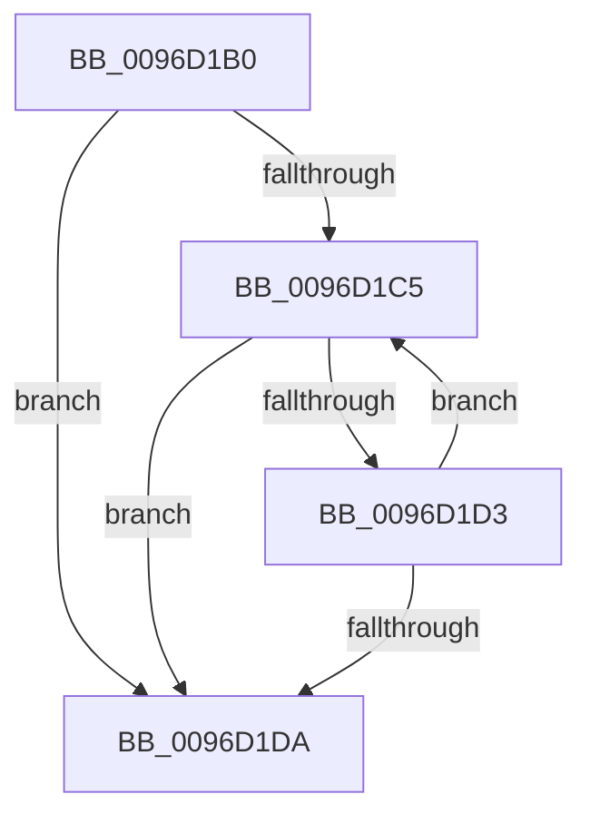

# ObpReferenceDeviceMapFastRef

- RVA: `0x0096D1B0`–`0x0096D1EB` (길이 `59` bytes)
- VA: `0x000000014096D1B0`
- 실행 섹션: `PAGE`
- PDB 이름 있음: `예`; PDB Function 태그: `아니요`
- unwind 정보 RVA: `0x00095D34`
- 디코드: `18`개 명령, `59/59` bytes 표시
- 미해석 바이트: `0` (있으면 어셈블리에 `.byte`로 보존)

> 이 문서는 커널 이미지의 기계어와 PDB 기호를 분석해 생성했습니다. 4번과 5번은 함수 원형과 자료형을 바이너리 사용 방식에서 추정한 C 해석이며 원본 소스 복구 결과는 아닙니다.

## 1. Dependencies

- 직접 호출 지점: **0**; 고유 호출 대상: **0**
- 직접 호출자로 확인된 함수: **1**
- RIP 상대 이미지 참조: **0**

### Outgoing calls
- 직접 디코드된 call 명령이 없습니다.

### Direct callers
- [ObpSetCurrentProcessDeviceMap](ObpSetCurrentProcessDeviceMap_function_0096CF6C.md) at `0x0096D0BC`

### Static image references
- 디코드된 RIP-relative 메모리 참조가 없습니다.

## 2. Other-region calls and transfers

- 다른 실행 섹션으로 향하는 call: **0**
- call이 아닌 외부 분기/꼬리 이동: **1**
  - `0x0096D1E5` → [sub_0096D287](Unknown_function_0096D287.md) (`tail-transfer`)

## 3. Assembly (complete function range)

```asm
0096D1B0  40 53                           push rbx
0096D1B2  48 83 EC 20                     sub rsp, 0x20
0096D1B6  48 8B D9                        mov rbx, rcx
0096D1B9  0F 0D 09                        prefetchw byte ptr [rcx]
0096D1BC  4C 8B 01                        mov r8, qword ptr [rcx]
0096D1BF  41 F6 C0 0F                     test r8b, 0xf
0096D1C3  74 15                           je 0x14096d1da
0096D1C5  49 8D 50 FF                     lea rdx, [r8 - 1]
0096D1C9  49 8B C0                        mov rax, r8
0096D1CC  F0 48 0F B1 11                  lock cmpxchg qword ptr [rcx], rdx
0096D1D1  74 07                           je 0x14096d1da
0096D1D3  4C 8B C0                        mov r8, rax
0096D1D6  A8 0F                           test al, 0xf
0096D1D8  75 EB                           jne 0x14096d1c5
0096D1DA  49 8B C0                        mov rax, r8
0096D1DD  48 83 E0 F0                     and rax, 0xfffffffffffffff0
0096D1E1  41 F6 C0 0F                     test r8b, 0xf
0096D1E5  0F 85 9C 00 00 00               jne 0x14096d287
```

## 4. C-style interpretation (structured pseudocode)

```c
__int64 __fastcall ObpReferenceDeviceMapFastRef(__int64 a1)
{
    __int64 result;
    __int64 v_rsp;

    v_rsp = (v_rsp) - (32);
    if ((((unsigned __int8)(*(unsigned __int64 *)(a1))) & (15)) == 0) goto loc_0096D1DA;
loc_0096D1C5:
    if ((((unsigned __int8)(*(unsigned __int64 *)(a1))) & (15)) == 0) goto loc_0096D1DA;
    if ((((unsigned __int8)(*(unsigned __int64 *)(a1))) & (15)) != 0) goto loc_0096D1C5;
loc_0096D1DA:
    result = (*(unsigned __int64 *)(a1)) & (-16);
}
```

## 5. (Beta) C Style

```c
int64_t ObpReferenceDeviceMapFastRef(void *Arg1)
{
    uint8_t *arg1 = (uint8_t *)Arg1;

    int64_t result;
    int64_t local_rsp;

    local_rsp = (local_rsp) - (32);
    if ((((uint8_t)(*(uint64_t *)(arg1))) & (15)) == 0) goto loc_0096D1DA;
loc_0096D1C5:
    if ((((uint8_t)(*(uint64_t *)(arg1))) & (15)) == 0) goto loc_0096D1DA;
    if ((((uint8_t)(*(uint64_t *)(arg1))) & (15)) != 0) goto loc_0096D1C5;
loc_0096D1DA:
    result = (*(uint64_t *)(arg1)) & (-16);
}
```

### 관측된 메모리 오프셋

구조체 형식이 확인되지 않은 접근은 인자 기준의 오프셋으로만 기록했습니다.

| 기준 인자 | 오프셋 표현 | 폭 (bit) | 접근 |
|---|---:|---:|---|
| `Arg1` | `+ 0x0` | `8` | `R` |
| `Arg1` | `+ 0x0` | `64` | `R` |

## 6. Execution-region graph

[열기: 2D/3D 그래프와 함수 탐색 컨트롤 패널](../../../control-panel.html?section=page&rva=0x0096D1B0&view=graph)

- 2D 그래프는 위에서 아래로 흐르고, 3D 그래프는 빈 공간을 드래그해 회전합니다. Shift+드래그는 이동, 휠은 확대·축소, 함수 노드 선택은 대상 보고서 이동입니다.

### Static fallback


