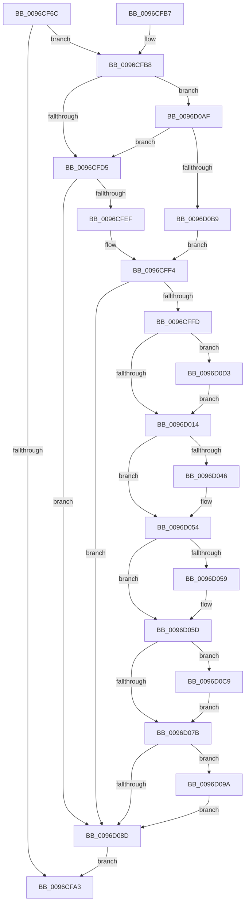

# ObpSetCurrentProcessDeviceMap

- RVA: `0x0096CF6C`–`0x0096D0DF` (길이 `371` bytes)
- VA: `0x000000014096CF6C`
- 실행 섹션: `PAGE`
- PDB 이름 있음: `예`; PDB Function 태그: `아니요`
- unwind 정보 RVA: `0x00095D0C`
- 디코드: `98`개 명령, `371/371` bytes 표시
- 미해석 바이트: `0` (있으면 어셈블리에 `.byte`로 보존)

> 이 문서는 커널 이미지의 기계어와 PDB 기호를 분석해 생성했습니다. 4번과 5번은 함수 원형과 자료형을 바이너리 사용 방식에서 추정한 C 해석이며 원본 소스 복구 결과는 아닙니다.

## 1. Dependencies

- 직접 호출 지점: **11**; 고유 호출 대상: **11**
- 직접 호출자로 확인된 함수: **2**
- RIP 상대 이미지 참조: **0**

### Outgoing calls
- `0x0096CF96` → [PsReferencePrimaryTokenWithTag](../../text/20/PsReferencePrimaryTokenWithTag_function_0020FF80.md) (function, `0x0020FF80`)
- `0x0096CFC1` → [PsGetCurrentServerSiloGlobals](../../text/2F/PsGetCurrentServerSiloGlobals_function_002FE1F0.md) (function, `0x002FE1F0`)
- `0x0096CFE2` → [SeGetTokenDeviceMap](SeGetTokenDeviceMap_function_0096CE8C.md) (function, `0x0096CE8C`)
- `0x0096D035` → [KeAbPreAcquire](../../text/21/KeAbPreAcquire_function_00210230.md) (function, `0x00210230`)
- `0x0096D04F` → [ExfAcquirePushLockExclusiveEx](../../text/20/ExfAcquirePushLockExclusiveEx_function_0020FC90.md) (function, `0x0020FC90`)
- `0x0096D07E` → [KeAbPostRelease](../../text/2E/KeAbPostRelease_function_002E1600.md) (function, `0x002E1600`)
- `0x0096D083` → [KeLeaveGuardedRegion](../../text/2E/KeLeaveGuardedRegion_function_002E2C40.md) (function, `0x002E2C40`)
- `0x0096D090` → [ObfDereferenceObject](../../text/2F/ObfDereferenceObject_function_002F9350.md) (function, `0x002F9350`)
- `0x0096D0A8` → [ObDereferenceDeviceMap](ObDereferenceDeviceMap_function_0096D0E8.md) (function, `0x0096D0E8`)
- `0x0096D0BC` → [ObpReferenceDeviceMapFastRef](ObpReferenceDeviceMapFastRef_function_0096D1B0.md) (function, `0x0096D1B0`)
- `0x0096D0CC` → [ExfTryToWakePushLock](../../text/26/ExfTryToWakePushLock_function_00265DD0.md) (function, `0x00265DD0`)

### Direct callers
- [ObpLookupObjectName](../89/ObpLookupObjectName_function_0089BE90.md) at `0x0089D7A1`
- [ObpReferenceCurrentDeviceMap](ObpReferenceCurrentDeviceMap_function_0096CBD0.md) at `0x0096CE56`

### Static image references
- 디코드된 RIP-relative 메모리 참조가 없습니다.

## 2. Other-region calls and transfers

- 다른 실행 섹션으로 향하는 call: **8**
  - `0x0096CF96` → [PsReferencePrimaryTokenWithTag](../../text/20/PsReferencePrimaryTokenWithTag_function_0020FF80.md) (`PAGE` → `.text`)
  - `0x0096CFC1` → [PsGetCurrentServerSiloGlobals](../../text/2F/PsGetCurrentServerSiloGlobals_function_002FE1F0.md) (`PAGE` → `.text`)
  - `0x0096D035` → [KeAbPreAcquire](../../text/21/KeAbPreAcquire_function_00210230.md) (`PAGE` → `.text`)
  - `0x0096D04F` → [ExfAcquirePushLockExclusiveEx](../../text/20/ExfAcquirePushLockExclusiveEx_function_0020FC90.md) (`PAGE` → `.text`)
  - `0x0096D07E` → [KeAbPostRelease](../../text/2E/KeAbPostRelease_function_002E1600.md) (`PAGE` → `.text`)
  - `0x0096D083` → [KeLeaveGuardedRegion](../../text/2E/KeLeaveGuardedRegion_function_002E2C40.md) (`PAGE` → `.text`)
  - `0x0096D090` → [ObfDereferenceObject](../../text/2F/ObfDereferenceObject_function_002F9350.md) (`PAGE` → `.text`)
  - `0x0096D0CC` → [ExfTryToWakePushLock](../../text/26/ExfTryToWakePushLock_function_00265DD0.md) (`PAGE` → `.text`)
- 별도 외부 분기/꼬리 이동을 확인하지 못했습니다.

## 3. Assembly (complete function range)

```asm
0096CF6C  48 89 5C 24 18                  mov qword ptr [rsp + 0x18], rbx
0096CF71  55                              push rbp
0096CF72  56                              push rsi
0096CF73  57                              push rdi
0096CF74  41 56                           push r14
0096CF76  41 57                           push r15
0096CF78  48 83 EC 20                     sub rsp, 0x20
0096CF7C  65 48 8B 04 25 88 01 00 00      mov rax, qword ptr gs:[0x188]
0096CF85  BA 44 66 6C 74                  mov edx, 0x746c6644
0096CF8A  33 F6                           xor esi, esi
0096CF8C  4C 8B B8 B8 00 00 00            mov r15, qword ptr [rax + 0xb8]
0096CF93  49 8B CF                        mov rcx, r15
0096CF96  E8 E5 2F 8A FF                  call 0x14020ff80
0096CF9B  4C 8B F0                        mov r14, rax
0096CF9E  48 85 C0                        test rax, rax
0096CFA1  75 15                           jne 0x14096cfb8
0096CFA3  48 8B 5C 24 60                  mov rbx, qword ptr [rsp + 0x60]
0096CFA8  48 8B C6                        mov rax, rsi
0096CFAB  48 83 C4 20                     add rsp, 0x20
0096CFAF  41 5F                           pop r15
0096CFB1  41 5E                           pop r14
0096CFB3  5F                              pop rdi
0096CFB4  5E                              pop rsi
0096CFB5  5D                              pop rbp
0096CFB6  C3                              ret
0096CFB7  CC                              int3
0096CFB8  48 8B 50 18                     mov rdx, qword ptr [rax + 0x18]
0096CFBC  48 89 54 24 58                  mov qword ptr [rsp + 0x58], rdx
0096CFC1  E8 2A 12 99 FF                  call 0x1402fe1f0
0096CFC6  48 8B E8                        mov rbp, rax
0096CFC9  81 FA E7 03 00 00               cmp edx, 0x3e7
0096CFCF  0F 84 DA 00 00 00               je 0x14096d0af
0096CFD5  48 21 74 24 50                  and qword ptr [rsp + 0x50], rsi
0096CFDA  48 8D 54 24 50                  lea rdx, [rsp + 0x50]
0096CFDF  49 8B CE                        mov rcx, r14
0096CFE2  E8 A5 FE FF FF                  call 0x14096ce8c
0096CFE7  85 C0                           test eax, eax
0096CFE9  0F 88 9E 00 00 00               js 0x14096d08d
0096CFEF  48 8B 74 24 50                  mov rsi, qword ptr [rsp + 0x50]
0096CFF4  48 85 F6                        test rsi, rsi
0096CFF7  0F 84 90 00 00 00               je 0x14096d08d
0096CFFD  B8 10 00 00 00                  mov eax, 0x10
0096D002  F0 48 0F C1 86 F0 00 00 00      lock xadd qword ptr [rsi + 0xf0], rax
0096D00B  48 85 C0                        test rax, rax
0096D00E  0F 8E BF 00 00 00               jle 0x14096d0d3
0096D014  65 48 8B 04 25 88 01 00 00      mov rax, qword ptr gs:[0x188]
0096D01D  48 83 CF FF                     or rdi, 0xffffffffffffffff
0096D021  48 83 C5 78                     add rbp, 0x78
0096D025  45 33 C0                        xor r8d, r8d
0096D028  33 D2                           xor edx, edx
0096D02A  48 8B CD                        mov rcx, rbp
0096D02D  66 01 B8 E6 01 00 00            add word ptr [rax + 0x1e6], di
0096D034  90                              nop
0096D035  E8 F6 31 8A FF                  call 0x140210230
0096D03A  F0 48 0F BA 6D 00 00            lock bts qword ptr [rbp], 0
0096D041  48 8B D8                        mov rbx, rax
0096D044  73 0E                           jae 0x14096d054
0096D046  4C 8B C5                        mov r8, rbp
0096D049  48 8B D0                        mov rdx, rax
0096D04C  48 8B CD                        mov rcx, rbp
0096D04F  E8 3C 2C 8A FF                  call 0x14020fc90
0096D054  48 85 DB                        test rbx, rbx
0096D057  74 04                           je 0x14096d05d
0096D059  C6 43 0A 01                     mov byte ptr [rbx + 0xa], 1
0096D05D  48 8B DE                        mov rbx, rsi
0096D060  48 83 CB 0F                     or rbx, 0xf
0096D064  49 87 9F 18 03 00 00            xchg qword ptr [r15 + 0x318], rbx
0096D06B  F0 48 0F C1 7D 00               lock xadd qword ptr [rbp], rdi
0096D071  40 80 E7 06                     and dil, 6
0096D075  40 80 FF 02                     cmp dil, 2
0096D079  74 4E                           je 0x14096d0c9
0096D07B  48 8B CD                        mov rcx, rbp
0096D07E  E8 7D 45 97 FF                  call 0x1402e1600
0096D083  E8 B8 5B 97 FF                  call 0x1402e2c40
0096D088  48 85 DB                        test rbx, rbx
0096D08B  75 0D                           jne 0x14096d09a
0096D08D  49 8B CE                        mov rcx, r14
0096D090  E8 BB C2 98 FF                  call 0x1402f9350
0096D095  E9 09 FF FF FF                  jmp 0x14096cfa3
0096D09A  8B D3                           mov edx, ebx
0096D09C  48 83 E3 F0                     and rbx, 0xfffffffffffffff0
0096D0A0  83 E2 0F                        and edx, 0xf
0096D0A3  48 8B CB                        mov rcx, rbx
0096D0A6  FF C2                           inc edx
0096D0A8  E8 3B 00 00 00                  call 0x14096d0e8
0096D0AD  EB DE                           jmp 0x14096d08d
0096D0AF  39 74 24 5C                     cmp dword ptr [rsp + 0x5c], esi
0096D0B3  0F 85 1C FF FF FF               jne 0x14096cfd5
0096D0B9  48 8B CD                        mov rcx, rbp
0096D0BC  E8 EF 00 00 00                  call 0x14096d1b0
0096D0C1  48 8B F0                        mov rsi, rax
0096D0C4  E9 2B FF FF FF                  jmp 0x14096cff4
0096D0C9  48 8B CD                        mov rcx, rbp
0096D0CC  E8 FF 8C 8F FF                  call 0x140265dd0
0096D0D1  EB A8                           jmp 0x14096d07b
0096D0D3  B9 0E 00 00 00                  mov ecx, 0xe
0096D0D8  CD 29                           int 0x29
0096D0DA  E9 35 FF FF FF                  jmp 0x14096d014
```

## 4. C-style interpretation (structured pseudocode)

```c
__int64 __fastcall ObpSetCurrentProcessDeviceMap(__int64 a1, __int64 a2, int a3)
{
    __int64 result;
    __int64 v_rbp;
    __int64 v_rbx;
    __int64 v_rdi;
    __int64 v_rsi;
    __int64 v_rsp;
    unsigned __int64 v_stack_p18;
    unsigned __int64 v_stack_p50;
    unsigned __int64 v_stack_p58;
    unsigned int v_stack_p5C;

    v_stack_p18 = v_rbx;
    v_rsp = (v_rsp) - (32);
    v_rsi = 0;
    result = PsReferencePrimaryTokenWithTag(*(unsigned __int64 *)(*(unsigned __int64 *)(gs_base + (0 + 392)) + 184), (unsigned int)(0x746C6644ULL), a3, a4);
    if (result != 0) goto loc_0096CFB8;
loc_0096CFA3:
    v_rsp = (v_rsp) + (32);
    return 0;
loc_0096CFB8:
    v_stack_p58 = *(unsigned __int64 *)(0 + 24);
    result = PsGetCurrentServerSiloGlobals(*(unsigned __int64 *)(*(unsigned __int64 *)(gs_base + (0 + 392)) + 184), *(unsigned __int64 *)(0 + 24), a3, a4);
    if (((unsigned int)(*(unsigned __int64 *)(0 + 24))) == 999) goto loc_0096D0AF;
loc_0096CFD5:
    result = SeGetTokenDeviceMap(result, v_stack_p50, a3, a4);
    if (sign_flag) goto loc_0096D08D;
loc_0096CFF4:
    if (v_stack_p50 == 0) goto loc_0096D08D;
    if (condition_is_less_or_equal) goto loc_0096D0D3;
loc_0096D014:
    v_rdi = (v_rdi) | (-1);
    v_rbp = (result) + (120);
    a3 = 0;
    a2 = 0;
    result = KeAbPreAcquire(v_rbp, a2, a3, a4);
    if (!(condition_is_above_or_equal)) {
        a3 = v_rbp;
        a2 = result;
        a1 = v_rbp;
        result = ExfAcquirePushLockExclusiveEx(a1, a2, a3, a4);
    }
    if (result != 0) {
        *(unsigned __int8 *)(result + 10) = 1;
    }
    v_rbx = (v_stack_p50) | (15);
    v_rdi = (unsigned __int8)((v_rdi) & (6));
    if (((unsigned __int8)(v_rdi)) == 2) goto loc_0096D0C9;
loc_0096D07B:
    result = KeAbPostRelease(v_rbp, a2, a3, a4);
    result = KeLeaveGuardedRegion(v_rbp, a2, a3, a4);
    if (v_rbx != 0) goto loc_0096D09A;
loc_0096D08D:
    result = ObfDereferenceObject(result, a2, a3, a4);
    goto loc_0096CFA3;
loc_0096D09A:
    v_rbx = (v_rbx) & (-16);
    a2 = (unsigned int)(((unsigned int)((unsigned int)(v_rbx))) & (15));
    a2 = (unsigned int)((a2) + 1);
    result = ObDereferenceDeviceMap(v_rbx, a2, a3, a4);
    goto loc_0096D08D;
loc_0096D0AF:
    if (v_stack_p5C != ((unsigned int)(v_stack_p50))) goto loc_0096CFD5;
    result = ObpReferenceDeviceMapFastRef(v_rbp, a2, a3, a4);
    goto loc_0096CFF4;
loc_0096D0C9:
    result = ExfTryToWakePushLock(v_rbp, a2, a3, a4);
    goto loc_0096D07B;
loc_0096D0D3:
    goto loc_0096D014;
}
```

## 5. (Beta) C Style

```c
int64_t ObpSetCurrentProcessDeviceMap(int64_t Arg1, int64_t Arg2, int32_t Arg3)
{
    int64_t result;
    int64_t local_rbp;
    int64_t local_rbx;
    int64_t local_rdi;
    int64_t local_rsi;
    int64_t local_rsp;
    uint64_t v_stack_p18;
    uint64_t v_stack_p50;
    uint64_t v_stack_p58;
    uint32_t v_stack_p5C;

    v_stack_p18 = local_rbx;
    local_rsp = (local_rsp) - (32);
    local_rsi = 0;
    result = PsReferencePrimaryTokenWithTag(*(uint64_t *)(*(uint64_t *)(gs_base + (0 + 0x188)) + 0xB8), (uint32_t)(0x746C6644ULL), Arg3, a4);
    if (result != 0) goto loc_0096CFB8;
loc_0096CFA3:
    local_rsp = (local_rsp) + (32);
    return 0;
loc_0096CFB8:
    v_stack_p58 = *(uint64_t *)(0 + 0x18);
    result = PsGetCurrentServerSiloGlobals(*(uint64_t *)(*(uint64_t *)(gs_base + (0 + 0x188)) + 0xB8), *(uint64_t *)(0 + 0x18), Arg3, a4);
    if (((uint32_t)(*(uint64_t *)(0 + 0x18))) == 999) goto loc_0096D0AF;
loc_0096CFD5:
    result = SeGetTokenDeviceMap(result, v_stack_p50, Arg3, a4);
    if (sign_flag) goto loc_0096D08D;
loc_0096CFF4:
    if (v_stack_p50 == 0) goto loc_0096D08D;
    if (condition_is_less_or_equal) goto loc_0096D0D3;
loc_0096D014:
    local_rdi = (local_rdi) | (-1);
    local_rbp = (result) + (120);
    Arg3 = 0;
    Arg2 = 0;
    result = KeAbPreAcquire(local_rbp, Arg2, Arg3, a4);
    if (!(condition_is_above_or_equal)) {
        Arg3 = local_rbp;
        Arg2 = result;
        Arg1 = local_rbp;
        result = ExfAcquirePushLockExclusiveEx(Arg1, Arg2, Arg3, a4);
    }
    if (result != 0) {
        *(uint8_t *)(result + 0xA) = 1;
    }
    local_rbx = (v_stack_p50) | (15);
    local_rdi = (uint8_t)((local_rdi) & (6));
    if (((uint8_t)(local_rdi)) == 2) goto loc_0096D0C9;
loc_0096D07B:
    result = KeAbPostRelease(local_rbp, Arg2, Arg3, a4);
    result = KeLeaveGuardedRegion(local_rbp, Arg2, Arg3, a4);
    if (local_rbx != 0) goto loc_0096D09A;
loc_0096D08D:
    result = ObfDereferenceObject(result, Arg2, Arg3, a4);
    goto loc_0096CFA3;
loc_0096D09A:
    local_rbx = (local_rbx) & (-16);
    Arg2 = (uint32_t)(((uint32_t)((uint32_t)(local_rbx))) & (15));
    Arg2 = (uint32_t)((Arg2) + 1);
    result = ObDereferenceDeviceMap(local_rbx, Arg2, Arg3, a4);
    goto loc_0096D08D;
loc_0096D0AF:
    if (v_stack_p5C != ((uint32_t)(v_stack_p50))) goto loc_0096CFD5;
    result = ObpReferenceDeviceMapFastRef(local_rbp, Arg2, Arg3, a4);
    goto loc_0096CFF4;
loc_0096D0C9:
    result = ExfTryToWakePushLock(local_rbp, Arg2, Arg3, a4);
    goto loc_0096D07B;
loc_0096D0D3:
    goto loc_0096D014;
}
```

## 6. Execution-region graph

[열기: 2D/3D 그래프와 함수 탐색 컨트롤 패널](../../../control-panel.html?section=page&rva=0x0096CF6C&view=graph)

- 2D 그래프는 위에서 아래로 흐르고, 3D 그래프는 빈 공간을 드래그해 회전합니다. Shift+드래그는 이동, 휠은 확대·축소, 함수 노드 선택은 대상 보고서 이동입니다.

### Static fallback


