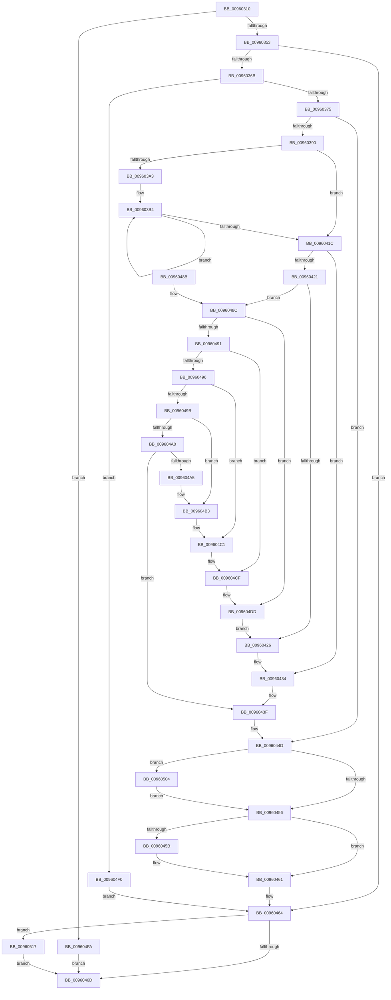

# PfCalculateProcessHash

- RVA: `0x00960310`–`0x00960526` (길이 `534` bytes)
- VA: `0x0000000140960310`
- 실행 섹션: `PAGE`
- PDB 이름 있음: `예`; PDB Function 태그: `아니요`
- unwind 정보 RVA: `0x000930EC`
- 디코드: `152`개 명령, `534/534` bytes 표시
- 미해석 바이트: `0` (있으면 어셈블리에 `.byte`로 보존)

> 이 문서는 커널 이미지의 기계어와 PDB 기호를 분석해 생성했습니다. 4번과 5번은 함수 원형과 자료형을 바이너리 사용 방식에서 추정한 C 해석이며 원본 소스 복구 결과는 아닙니다.

## 1. Dependencies

- 직접 호출 지점: **4**; 고유 호출 대상: **4**
- 직접 호출자로 확인된 함수: **4**
- RIP 상대 이미지 참조: **0**

### Outgoing calls
- `0x00960357` → [PsGetAllocatedFullProcessImageName](PsGetAllocatedFullProcessImageName_function_00960530.md) (function, `0x00960530`)
- `0x0096037E` → [RtlUpcaseUnicodeString](RtlUpcaseUnicodeString_function_00960780.md) (function, `0x00960780`)
- `0x0096050D` → [PfpLogApplicationEvent](../../text/3B/PfpLogApplicationEvent_function_003BA3A0.md) (function, `0x003BA3A0`)
- `0x0096051C` → [ExFreePoolWithTag](../../poolcode/B8/ExFreePoolWithTag_function_00B82870.md) (function, `0x00B82870`)

### Direct callers
- [PfSnSetAltPrefetchParam](../75/PfSnSetAltPrefetchParam_function_00752424.md) at `0x00752563`
- [PfProcessCreateNotification](../95/PfProcessCreateNotification_function_0095EB98.md) at `0x0095EC08`
- [PfSnBeginAppLaunch](../95/PfSnBeginAppLaunch_function_0095EC44.md) at `0x0095ECEA`
- [PfSnOperationProcess](PfSnOperationProcess_function_009615A4.md) at `0x00961653`

### Static image references
- 디코드된 RIP-relative 메모리 참조가 없습니다.

## 2. Other-region calls and transfers

- 다른 실행 섹션으로 향하는 call: **2**
  - `0x0096050D` → [PfpLogApplicationEvent](../../text/3B/PfpLogApplicationEvent_function_003BA3A0.md) (`PAGE` → `.text`)
  - `0x0096051C` → [ExFreePoolWithTag](../../poolcode/B8/ExFreePoolWithTag_function_00B82870.md) (`PAGE` → `POOLCODE`)
- 별도 외부 분기/꼬리 이동을 확인하지 못했습니다.

## 3. Assembly (complete function range)

```asm
00960310  48 8B C4                        mov rax, rsp
00960313  48 89 58 10                     mov qword ptr [rax + 0x10], rbx
00960317  48 89 68 18                     mov qword ptr [rax + 0x18], rbp
0096031B  56                              push rsi
0096031C  57                              push rdi
0096031D  41 54                           push r12
0096031F  41 56                           push r14
00960321  41 57                           push r15
00960323  48 83 EC 20                     sub rsp, 0x20
00960327  45 33 FF                        xor r15d, r15d
0096032A  48 8B FA                        mov rdi, rdx
0096032D  48 83 E7 FE                     and rdi, 0xfffffffffffffffe
00960331  4C 89 78 08                     mov qword ptr [rax + 8], r15
00960335  4C 8B F2                        mov r14, rdx
00960338  48 8B E9                        mov rbp, rcx
0096033B  45 8D 67 01                     lea r12d, [r15 + 1]
0096033F  4D 23 F4                        and r14, r12
00960342  48 0F 44 FA                     cmove rdi, rdx
00960346  4C 39 B9 A8 02 00 00            cmp qword ptr [rcx + 0x2a8], r15
0096034D  0F 84 A7 01 00 00               je 0x1409604fa
00960353  48 8D 50 08                     lea rdx, [rax + 8]
00960357  E8 D4 01 00 00                  call 0x140960530
0096035C  48 8B 5C 24 50                  mov rbx, qword ptr [rsp + 0x50]
00960361  8B F0                           mov esi, eax
00960363  85 C0                           test eax, eax
00960365  0F 88 F9 00 00 00               js 0x140960464
0096036B  66 44 39 3B                     cmp word ptr [rbx], r15w
0096036F  0F 84 7B 01 00 00               je 0x1409604f0
00960375  45 33 C0                        xor r8d, r8d
00960378  48 8B D3                        mov rdx, rbx
0096037B  48 8B CB                        mov rcx, rbx
0096037E  E8 FD 03 00 00                  call 0x140960780
00960383  44 39 BD 84 03 00 00            cmp dword ptr [rbp + 0x384], r15d
0096038A  0F 85 BD 00 00 00               jne 0x14096044d
00960390  44 0F B7 0B                     movzx r9d, word ptr [rbx]
00960394  B9 2F CB 04 00                  mov ecx, 0x4cb2f
00960399  4C 8B 43 08                     mov r8, qword ptr [rbx + 8]
0096039D  49 83 F9 08                     cmp r9, 8
009603A1  72 79                           jb 0x14096041c
009603A3  45 8B D1                        mov r10d, r9d
009603A6  49 C1 EA 03                     shr r10, 3
009603AA  49 8B C2                        mov rax, r10
009603AD  48 F7 D8                        neg rax
009603B0  4D 8D 0C C1                     lea r9, [r9 + rax*8]
009603B4  41 0F B6 00                     movzx eax, byte ptr [r8]
009603B8  48 6B C9 25                     imul rcx, rcx, 0x25
009603BC  48 03 C8                        add rcx, rax
009603BF  41 0F B6 40 01                  movzx eax, byte ptr [r8 + 1]
009603C4  48 6B D1 25                     imul rdx, rcx, 0x25
009603C8  48 03 D0                        add rdx, rax
009603CB  41 0F B6 40 02                  movzx eax, byte ptr [r8 + 2]
009603D0  48 6B CA 25                     imul rcx, rdx, 0x25
009603D4  48 03 C8                        add rcx, rax
009603D7  41 0F B6 40 03                  movzx eax, byte ptr [r8 + 3]
009603DC  48 6B D1 25                     imul rdx, rcx, 0x25
009603E0  48 03 D0                        add rdx, rax
009603E3  41 0F B6 40 04                  movzx eax, byte ptr [r8 + 4]
009603E8  48 6B CA 25                     imul rcx, rdx, 0x25
009603EC  48 03 C8                        add rcx, rax
009603EF  41 0F B6 40 05                  movzx eax, byte ptr [r8 + 5]
009603F4  48 6B D1 25                     imul rdx, rcx, 0x25
009603F8  48 03 D0                        add rdx, rax
009603FB  41 0F B6 40 06                  movzx eax, byte ptr [r8 + 6]
00960400  48 6B CA 25                     imul rcx, rdx, 0x25
00960404  48 03 C8                        add rcx, rax
00960407  41 0F B6 40 07                  movzx eax, byte ptr [r8 + 7]
0096040C  48 6B C9 25                     imul rcx, rcx, 0x25
00960410  49 83 C0 08                     add r8, 8
00960414  48 03 C8                        add rcx, rax
00960417  4D 2B D4                        sub r10, r12
0096041A  75 98                           jne 0x1409603b4
0096041C  4D 2B CC                        sub r9, r12
0096041F  74 13                           je 0x140960434
00960421  4D 2B CC                        sub r9, r12
00960424  75 66                           jne 0x14096048c
00960426  41 0F B6 00                     movzx eax, byte ptr [r8]
0096042A  48 6B C9 25                     imul rcx, rcx, 0x25
0096042E  48 03 C8                        add rcx, rax
00960431  4D 03 C4                        add r8, r12
00960434  41 0F B6 00                     movzx eax, byte ptr [r8]
00960438  48 6B C9 25                     imul rcx, rcx, 0x25
0096043C  48 03 C8                        add rcx, rax
0096043F  41 3B CC                        cmp ecx, r12d
00960442  90                              nop
00960443  41 0F 46 CC                     cmovbe ecx, r12d
00960447  89 8D 84 03 00 00               mov dword ptr [rbp + 0x384], ecx
0096044D  45 85 F6                        test r14d, r14d
00960450  0F 85 AE 00 00 00               jne 0x140960504
00960456  48 85 FF                        test rdi, rdi
00960459  74 06                           je 0x140960461
0096045B  48 89 1F                        mov qword ptr [rdi], rbx
0096045E  49 8B DF                        mov rbx, r15
00960461  41 8B F7                        mov esi, r15d
00960464  48 85 DB                        test rbx, rbx
00960467  0F 85 AA 00 00 00               jne 0x140960517
0096046D  48 8B 5C 24 58                  mov rbx, qword ptr [rsp + 0x58]
00960472  48 F7 DF                        neg rdi
00960475  48 8B 6C 24 60                  mov rbp, qword ptr [rsp + 0x60]
0096047A  1B C0                           sbb eax, eax
0096047C  23 C6                           and eax, esi
0096047E  48 83 C4 20                     add rsp, 0x20
00960482  41 5F                           pop r15
00960484  41 5E                           pop r14
00960486  41 5C                           pop r12
00960488  5F                              pop rdi
00960489  5E                              pop rsi
0096048A  C3                              ret
0096048B  CC                              int3
0096048C  4D 2B CC                        sub r9, r12
0096048F  74 4C                           je 0x1409604dd
00960491  4D 2B CC                        sub r9, r12
00960494  74 39                           je 0x1409604cf
00960496  4D 2B CC                        sub r9, r12
00960499  74 26                           je 0x1409604c1
0096049B  4D 2B CC                        sub r9, r12
0096049E  74 13                           je 0x1409604b3
009604A0  4D 3B CC                        cmp r9, r12
009604A3  75 9A                           jne 0x14096043f
009604A5  41 0F B6 00                     movzx eax, byte ptr [r8]
009604A9  48 6B C9 25                     imul rcx, rcx, 0x25
009604AD  48 03 C8                        add rcx, rax
009604B0  4D 03 C4                        add r8, r12
009604B3  41 0F B6 00                     movzx eax, byte ptr [r8]
009604B7  48 6B C9 25                     imul rcx, rcx, 0x25
009604BB  48 03 C8                        add rcx, rax
009604BE  4D 03 C4                        add r8, r12
009604C1  41 0F B6 00                     movzx eax, byte ptr [r8]
009604C5  48 6B C9 25                     imul rcx, rcx, 0x25
009604C9  48 03 C8                        add rcx, rax
009604CC  4D 03 C4                        add r8, r12
009604CF  41 0F B6 00                     movzx eax, byte ptr [r8]
009604D3  48 6B C9 25                     imul rcx, rcx, 0x25
009604D7  48 03 C8                        add rcx, rax
009604DA  4D 03 C4                        add r8, r12
009604DD  41 0F B6 00                     movzx eax, byte ptr [r8]
009604E1  48 6B C9 25                     imul rcx, rcx, 0x25
009604E5  48 03 C8                        add rcx, rax
009604E8  4D 03 C4                        add r8, r12
009604EB  E9 36 FF FF FF                  jmp 0x140960426
009604F0  BE 72 02 00 C0                  mov esi, 0xc0000272
009604F5  E9 6A FF FF FF                  jmp 0x140960464
009604FA  BE 25 02 00 C0                  mov esi, 0xc0000225
009604FF  E9 69 FF FF FF                  jmp 0x14096046d
00960504  45 33 C0                        xor r8d, r8d
00960507  48 8B D3                        mov rdx, rbx
0096050A  48 8B CD                        mov rcx, rbp
0096050D  E8 8E 9E A5 FF                  call 0x1403ba3a0
00960512  E9 3F FF FF FF                  jmp 0x140960456
00960517  33 D2                           xor edx, edx
00960519  48 8B CB                        mov rcx, rbx
0096051C  E8 4F 23 22 00                  call 0x140b82870
00960521  E9 47 FF FF FF                  jmp 0x14096046d
```

## 4. C-style interpretation (structured pseudocode)

```c
__int64 __fastcall PfCalculateProcessHash(__int64 a1, __int64 a2, int a3)
{
    __int64 result;
    __int64 v_r10;
    __int64 v_r14;
    __int64 v_r15;
    __int64 v_rbx;
    __int64 v_rdi;
    __int64 v_rsp;
    unsigned __int64 v_stack_p10;
    unsigned __int64 v_stack_p18;
    unsigned __int64 v_stack_p8;

    *(unsigned __int64 *)(v_rsp + 16) = v_rbx;
    *(unsigned __int64 *)(v_rsp + 24) = v_rbp;
    v_rsp = (v_rsp) - (32);
    v_r15 = 0;
    v_rdi = (a2) & (-2);
    *(unsigned __int64 *)(v_rsp + 8) = 0;
    v_r14 = (a2) & (v_r15 + 1);
    if (condition_is_equal) { v_rdi = a2; }
    if ((*(unsigned __int64 *)(a1 + 680)) == 0) goto loc_009604FA;
    result = PsGetAllocatedFullProcessImageName(a1, v_rsp + 8, a3, a4);
    if (sign_flag) goto loc_00960464;
    if ((*(unsigned __int16 *)(v_stack_p8)) == 0) goto loc_009604F0;
    a3 = 0;
    result = RtlUpcaseUnicodeString(v_stack_p8, v_stack_p8, a3, a4);
    if ((*(unsigned int *)(a1 + 900)) != 0) goto loc_0096044D;
    if ((*(unsigned __int16 *)(v_stack_p8)) < 8) goto loc_0096041C;
    v_r10 = ((unsigned int)((unsigned int)(*(unsigned __int16 *)(v_stack_p8)))) >> (3);
    result = -(v_r10);
loc_009603B4:
    a1 = ((unsigned int)(0x4CB2FULL)) * ((unsigned int)(0x4CB2FULL));
    a1 = (a1) + (*(unsigned __int8 *)(*(unsigned __int64 *)(v_stack_p8 + 8)));
    a2 = (v_stack_p8) * (a1);
    a2 = (a2) + (*(unsigned __int8 *)(*(unsigned __int64 *)(v_stack_p8 + 8) + 1));
    a1 = (a1) * (a2);
    a1 = (a1) + (*(unsigned __int8 *)(*(unsigned __int64 *)(v_stack_p8 + 8) + 2));
    a2 = (a2) * (a1);
    a2 = (a2) + (*(unsigned __int8 *)(*(unsigned __int64 *)(v_stack_p8 + 8) + 3));
    a1 = (a1) * (a2);
    a1 = (a1) + (*(unsigned __int8 *)(*(unsigned __int64 *)(v_stack_p8 + 8) + 4));
    a2 = (a2) * (a1);
    a2 = (a2) + (*(unsigned __int8 *)(*(unsigned __int64 *)(v_stack_p8 + 8) + 5));
    a1 = (a1) * (a2);
    a1 = (a1) + (*(unsigned __int8 *)(*(unsigned __int64 *)(v_stack_p8 + 8) + 6));
    a1 = (a1) * (a1);
    a3 = (*(unsigned __int64 *)(v_stack_p8 + 8)) + (8);
    a1 = (a1) + (*(unsigned __int8 *)(*(unsigned __int64 *)(v_stack_p8 + 8) + 7));
    v_r10 = (v_r10) - (v_r15 + 1);
    if (condition_is_not_equal) goto loc_009603B4;
loc_0096041C:
    a4 = (*(unsigned __int16 *)(v_stack_p8) + result * 8) - (v_r15 + 1);
    if (condition_is_equal) goto loc_00960434;
    a4 = (a4) - (v_r15 + 1);
    if (condition_is_not_equal) goto loc_0096048C;
loc_00960426:
    a1 = (a1) * (a1);
    a1 = (a1) + (*(unsigned __int8 *)(a3));
    a3 = (a3) + (v_r15 + 1);
loc_00960434:
    a1 = (a1) * (a1);
    a1 = (a1) + (*(unsigned __int8 *)(a3));
loc_0096043F:
    if (((unsigned int)(a1)) <= ((unsigned int)(v_r15 + 1))) { a1 = (unsigned int)(v_r15 + 1); }
    *(unsigned int *)(a1 + 900) = (unsigned int)(a1);
loc_0096044D:
    if ((unsigned int)(v_r14) != 0) goto loc_00960504;
loc_00960456:
    v_rbx = v_stack_p8;
    if (v_rdi != 0) {
        *(unsigned __int64 *)(v_rdi) = v_stack_p8;
        v_rbx = 0;
    }
loc_00960464:
    if (v_rbx != 0) goto loc_00960517;
loc_0096046D:
    v_rdi = -(v_rdi);
    result = (unsigned int)((*(unsigned __int8 *)(a3)) & (0));
    v_rsp = (v_rsp) + (32);
    return result;
loc_0096048C:
    a4 = (a4) - (v_r15 + 1);
    if (condition_is_equal) goto loc_009604DD;
    a4 = (a4) - (v_r15 + 1);
    if (condition_is_equal) goto loc_009604CF;
    a4 = (a4) - (v_r15 + 1);
    if (condition_is_equal) goto loc_009604C1;
    a4 = (a4) - (v_r15 + 1);
    if (condition_is_equal) goto loc_009604B3;
    if (a4 != (v_r15 + 1)) goto loc_0096043F;
    a1 = (a1) * (a1);
    a1 = (a1) + (*(unsigned __int8 *)(a3));
    a3 = (a3) + (v_r15 + 1);
loc_009604B3:
    a1 = (a1) * (a1);
    a1 = (a1) + (*(unsigned __int8 *)(a3));
    a3 = (a3) + (v_r15 + 1);
loc_009604C1:
    a1 = (a1) * (a1);
    a1 = (a1) + (*(unsigned __int8 *)(a3));
    a3 = (a3) + (v_r15 + 1);
loc_009604CF:
    a1 = (a1) * (a1);
    a1 = (a1) + (*(unsigned __int8 *)(a3));
    a3 = (a3) + (v_r15 + 1);
loc_009604DD:
    a1 = (a1) * (a1);
    a1 = (a1) + (*(unsigned __int8 *)(a3));
    a3 = (a3) + (v_r15 + 1);
    goto loc_00960426;
loc_009604F0:
    goto loc_00960464;
loc_009604FA:
    goto loc_0096046D;
loc_00960504:
    a3 = 0;
    result = PfpLogApplicationEvent(v_stack_p18, v_stack_p10, a3, a4);
    goto loc_00960456;
loc_00960517:
    a2 = 0;
    result = ExFreePoolWithTag(v_stack_p10, a2, a3, a4);
    goto loc_0096046D;
}
```

## 5. (Beta) C Style

```c
int64_t PfCalculateProcessHash(void *Arg1, int64_t Arg2, int32_t Arg3)
{
    uint8_t *arg1 = (uint8_t *)Arg1;

    int64_t result;
    int64_t local_r10;
    int64_t local_r14;
    int64_t local_r15;
    int64_t local_rbx;
    int64_t local_rdi;
    int64_t local_rsp;
    uint64_t v_stack_p10;
    uint64_t v_stack_p18;
    uint64_t v_stack_p8;

    *(uint64_t *)(local_rsp + 0x10) = local_rbx;
    *(uint64_t *)(local_rsp + 0x18) = local_rbp;
    local_rsp = (local_rsp) - (32);
    local_r15 = 0;
    local_rdi = (Arg2) & (-2);
    *(uint64_t *)(local_rsp + 0x8) = 0;
    local_r14 = (Arg2) & (local_r15 + 1);
    if (condition_is_equal) { local_rdi = Arg2; }
    if ((*(uint64_t *)(arg1 + 0x2A8)) == 0) goto loc_009604FA;
    result = PsGetAllocatedFullProcessImageName(Arg1, local_rsp + 8, Arg3, a4);
    if (sign_flag) goto loc_00960464;
    if ((*(uint16_t *)(v_stack_p8)) == 0) goto loc_009604F0;
    Arg3 = 0;
    result = RtlUpcaseUnicodeString(v_stack_p8, v_stack_p8, Arg3, a4);
    if ((*(uint32_t *)(arg1 + 0x384)) != 0) goto loc_0096044D;
    if ((*(uint16_t *)(v_stack_p8)) < 8) goto loc_0096041C;
    local_r10 = ((uint32_t)((uint32_t)(*(uint16_t *)(v_stack_p8)))) >> (3);
    result = -(local_r10);
loc_009603B4:
    Arg1 = ((uint32_t)(0x4CB2FULL)) * ((uint32_t)(0x4CB2FULL));
    Arg1 = (Arg1) + (*(uint8_t *)(*(uint64_t *)(v_stack_p8 + 0x8)));
    Arg2 = (v_stack_p8) * (Arg1);
    Arg2 = (Arg2) + (*(uint8_t *)(*(uint64_t *)(v_stack_p8 + 0x8) + 0x1));
    Arg1 = (Arg1) * (Arg2);
    Arg1 = (Arg1) + (*(uint8_t *)(*(uint64_t *)(v_stack_p8 + 0x8) + 0x2));
    Arg2 = (Arg2) * (Arg1);
    Arg2 = (Arg2) + (*(uint8_t *)(*(uint64_t *)(v_stack_p8 + 0x8) + 0x3));
    Arg1 = (Arg1) * (Arg2);
    Arg1 = (Arg1) + (*(uint8_t *)(*(uint64_t *)(v_stack_p8 + 0x8) + 0x4));
    Arg2 = (Arg2) * (Arg1);
    Arg2 = (Arg2) + (*(uint8_t *)(*(uint64_t *)(v_stack_p8 + 0x8) + 0x5));
    Arg1 = (Arg1) * (Arg2);
    Arg1 = (Arg1) + (*(uint8_t *)(*(uint64_t *)(v_stack_p8 + 0x8) + 0x6));
    Arg1 = (Arg1) * (Arg1);
    Arg3 = (*(uint64_t *)(v_stack_p8 + 0x8)) + (8);
    Arg1 = (Arg1) + (*(uint8_t *)(*(uint64_t *)(v_stack_p8 + 0x8) + 0x7));
    local_r10 = (local_r10) - (local_r15 + 1);
    if (condition_is_not_equal) goto loc_009603B4;
loc_0096041C:
    a4 = (*(uint16_t *)(v_stack_p8) + result * 8) - (local_r15 + 1);
    if (condition_is_equal) goto loc_00960434;
    a4 = (a4) - (local_r15 + 1);
    if (condition_is_not_equal) goto loc_0096048C;
loc_00960426:
    Arg1 = (Arg1) * (Arg1);
    Arg1 = (Arg1) + (*(uint8_t *)(Arg3));
    Arg3 = (Arg3) + (local_r15 + 1);
loc_00960434:
    Arg1 = (Arg1) * (Arg1);
    Arg1 = (Arg1) + (*(uint8_t *)(Arg3));
loc_0096043F:
    if (((uint32_t)(Arg1)) <= ((uint32_t)(local_r15 + 1))) { Arg1 = (uint32_t)(local_r15 + 1); }
    *(uint32_t *)(arg1 + 0x384) = (uint32_t)(Arg1);
loc_0096044D:
    if ((uint32_t)(local_r14) != 0) goto loc_00960504;
loc_00960456:
    local_rbx = v_stack_p8;
    if (local_rdi != 0) {
        *(uint64_t *)(local_rdi) = v_stack_p8;
        local_rbx = 0;
    }
loc_00960464:
    if (local_rbx != 0) goto loc_00960517;
loc_0096046D:
    local_rdi = -(local_rdi);
    result = (uint32_t)((*(uint8_t *)(Arg3)) & (0));
    local_rsp = (local_rsp) + (32);
    return result;
loc_0096048C:
    a4 = (a4) - (local_r15 + 1);
    if (condition_is_equal) goto loc_009604DD;
    a4 = (a4) - (local_r15 + 1);
    if (condition_is_equal) goto loc_009604CF;
    a4 = (a4) - (local_r15 + 1);
    if (condition_is_equal) goto loc_009604C1;
    a4 = (a4) - (local_r15 + 1);
    if (condition_is_equal) goto loc_009604B3;
    if (a4 != (local_r15 + 1)) goto loc_0096043F;
    Arg1 = (Arg1) * (Arg1);
    Arg1 = (Arg1) + (*(uint8_t *)(Arg3));
    Arg3 = (Arg3) + (local_r15 + 1);
loc_009604B3:
    Arg1 = (Arg1) * (Arg1);
    Arg1 = (Arg1) + (*(uint8_t *)(Arg3));
    Arg3 = (Arg3) + (local_r15 + 1);
loc_009604C1:
    Arg1 = (Arg1) * (Arg1);
    Arg1 = (Arg1) + (*(uint8_t *)(Arg3));
    Arg3 = (Arg3) + (local_r15 + 1);
loc_009604CF:
    Arg1 = (Arg1) * (Arg1);
    Arg1 = (Arg1) + (*(uint8_t *)(Arg3));
    Arg3 = (Arg3) + (local_r15 + 1);
loc_009604DD:
    Arg1 = (Arg1) * (Arg1);
    Arg1 = (Arg1) + (*(uint8_t *)(Arg3));
    Arg3 = (Arg3) + (local_r15 + 1);
    goto loc_00960426;
loc_009604F0:
    goto loc_00960464;
loc_009604FA:
    goto loc_0096046D;
loc_00960504:
    Arg3 = 0;
    result = PfpLogApplicationEvent(v_stack_p18, v_stack_p10, Arg3, a4);
    goto loc_00960456;
loc_00960517:
    Arg2 = 0;
    result = ExFreePoolWithTag(v_stack_p10, Arg2, Arg3, a4);
    goto loc_0096046D;
}
```

### 관측된 메모리 오프셋

구조체 형식이 확인되지 않은 접근은 인자 기준의 오프셋으로만 기록했습니다.

| 기준 인자 | 오프셋 표현 | 폭 (bit) | 접근 |
|---|---:|---:|---|
| `Arg1` | `+ 0x2A8` | `64` | `R` |
| `Arg1` | `+ 0x384` | `32` | `R` |
| `Arg1` | `+ 0x384` | `32` | `W` |

## 6. Execution-region graph

[열기: 2D/3D 그래프와 함수 탐색 컨트롤 패널](../../../control-panel.html?section=page&rva=0x00960310&view=graph)

- 2D 그래프는 위에서 아래로 흐르고, 3D 그래프는 빈 공간을 드래그해 회전합니다. Shift+드래그는 이동, 휠은 확대·축소, 함수 노드 선택은 대상 보고서 이동입니다.

### Static fallback


