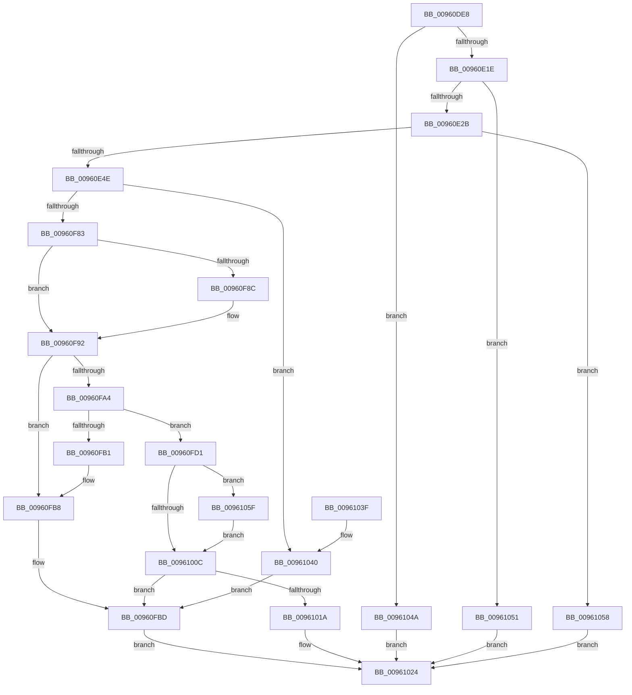

# PfSnBeginTrace

- RVA: `0x00960DE8`–`0x00961077` (길이 `655` bytes)
- VA: `0x0000000140960DE8`
- 실행 섹션: `PAGE`
- PDB 이름 있음: `예`; PDB Function 태그: `아니요`
- unwind 정보 RVA: `0x00093208`
- 디코드: `148`개 명령, `655/655` bytes 표시
- 미해석 바이트: `0` (있으면 어셈블리에 `.byte`로 보존)

> 이 문서는 커널 이미지의 기계어와 PDB 기호를 분석해 생성했습니다. 4번과 5번은 함수 원형과 자료형을 바이너리 사용 방식에서 추정한 C 해석이며 원본 소스 복구 결과는 아닙니다.

## 1. Dependencies

- 직접 호출 지점: **11**; 고유 호출 대상: **11**
- 직접 호출자로 확인된 함수: **1**
- RIP 상대 이미지 참조: **6**

### Outgoing calls
- `0x00960E3D` → [ExAllocatePool2](../../poolcode/B8/ExAllocatePool2_function_00B820F0.md) (function, `0x00B820F0`)
- `0x00960E56` → [memset](../../text/6C/memset_function_006C6C40.md) (function, `0x006C6C40`)
- `0x00960E68` → [KeInitializeTimer](../../text/45/KeInitializeTimer_function_0045B590.md) (function, `0x0045B590`)
- `0x00960EC4` → [KeInitializeDpc](../../text/45/KeInitializeDpc_function_0045BBD0.md) (function, `0x0045BBD0`)
- `0x00960ED4` → [ExAcquireRundownProtection](../../text/21/ExAcquireRundownProtection_function_00216620.md) (function, `0x00216620`)
- `0x00960EE1` → [ObfReferenceObjectWithTag](../../text/21/ObfReferenceObjectWithTag_function_00210710.md) (function, `0x00210710`)
- `0x00960F92` → [PfSnTraceBufferAllocate](../../text/49/PfSnTraceBufferAllocate_function_0049E594.md) (function, `0x0049E594`)
- `0x00960FC0` → [PfSnCleanupTrace](../8B/PfSnCleanupTrace_function_008B0B7C.md) (function, `0x008B0B7C`)
- `0x00960FCA` → [ExFreePoolWithTag](../../poolcode/B8/ExFreePoolWithTag_function_00B82870.md) (function, `0x00B82870`)
- `0x0096100F` → [PfSnActivateTrace](../../text/41/PfSnActivateTrace_function_0041BDAC.md) (function, `0x0041BDAC`)
- `0x00961069` → [PsGetThreadId](../../text/45/PsGetThreadId_function_00452220.md) (function, `0x00452220`)

### Direct callers
- [PfSnBeginScenario](../95/PfSnBeginScenario_function_0095EFC0.md) at `0x0095F177`

### Static image references
- `0x00960E00` → RVA `0x00E66F38` (`.data`; read)
- `0x00960E09` → RVA `0x00E67248` (`.data`; read)
- `0x00960E1E` → RVA `0x00FD8050` (`PAGEDATA`; read)
- `0x00960E82` → RVA `0x0048AEC0` (`PfSnTraceTimerRoutine`; read)
- `0x00960EED` → RVA `0x008B0490` (`PfSnEndTraceWorkerThreadRoutine`; read)
- `0x00960F56` → RVA `0x00E66F18` (`.data`; read)

## 2. Other-region calls and transfers

- 다른 실행 섹션으로 향하는 call: **10**
  - `0x00960E3D` → [ExAllocatePool2](../../poolcode/B8/ExAllocatePool2_function_00B820F0.md) (`PAGE` → `POOLCODE`)
  - `0x00960E56` → [memset](../../text/6C/memset_function_006C6C40.md) (`PAGE` → `.text`)
  - `0x00960E68` → [KeInitializeTimer](../../text/45/KeInitializeTimer_function_0045B590.md) (`PAGE` → `.text`)
  - `0x00960EC4` → [KeInitializeDpc](../../text/45/KeInitializeDpc_function_0045BBD0.md) (`PAGE` → `.text`)
  - `0x00960ED4` → [ExAcquireRundownProtection](../../text/21/ExAcquireRundownProtection_function_00216620.md) (`PAGE` → `.text`)
  - `0x00960EE1` → [ObfReferenceObjectWithTag](../../text/21/ObfReferenceObjectWithTag_function_00210710.md) (`PAGE` → `.text`)
  - `0x00960F92` → [PfSnTraceBufferAllocate](../../text/49/PfSnTraceBufferAllocate_function_0049E594.md) (`PAGE` → `.text`)
  - `0x00960FCA` → [ExFreePoolWithTag](../../poolcode/B8/ExFreePoolWithTag_function_00B82870.md) (`PAGE` → `POOLCODE`)
  - `0x0096100F` → [PfSnActivateTrace](../../text/41/PfSnActivateTrace_function_0041BDAC.md) (`PAGE` → `.text`)
  - `0x00961069` → [PsGetThreadId](../../text/45/PsGetThreadId_function_00452220.md) (`PAGE` → `.text`)
- 별도 외부 분기/꼬리 이동을 확인하지 못했습니다.

## 3. Assembly (complete function range)

```asm
00960DE8  48 89 5C 24 08                  mov qword ptr [rsp + 8], rbx
00960DED  48 89 6C 24 10                  mov qword ptr [rsp + 0x10], rbp
00960DF2  48 89 74 24 18                  mov qword ptr [rsp + 0x18], rsi
00960DF7  57                              push rdi
00960DF8  41 56                           push r14
00960DFA  41 57                           push r15
00960DFC  48 83 EC 20                     sub rsp, 0x20
00960E00  8B 05 32 61 50 00               mov eax, dword ptr [rip + 0x506132]
00960E06  49 8B F1                        mov rsi, r9
00960E09  39 05 39 64 50 00               cmp dword ptr [rip + 0x506439], eax
00960E0F  4D 8B F0                        mov r14, r8
00960E12  4C 63 FA                        movsxd r15, edx
00960E15  48 8B E9                        mov rbp, rcx
00960E18  0F 83 2C 02 00 00               jae 0x14096104a
00960E1E  80 3D 2B 72 67 00 00            cmp byte ptr [rip + 0x67722b], 0
00960E25  0F 84 26 02 00 00               je 0x140961051
00960E2B  BF 58 02 00 00                  mov edi, 0x258
00960E30  41 B8 43 63 50 54               mov r8d, 0x54506343
00960E36  8B D7                           mov edx, edi
00960E38  B9 40 00 00 00                  mov ecx, 0x40
00960E3D  E8 AE 12 22 00                  call 0x140b820f0
00960E42  48 8B D8                        mov rbx, rax
00960E45  48 85 C0                        test rax, rax
00960E48  0F 84 0A 02 00 00               je 0x140961058
00960E4E  44 8B C7                        mov r8d, edi
00960E51  33 D2                           xor edx, edx
00960E53  48 8B C8                        mov rcx, rax
00960E56  E8 E5 5D D6 FF                  call 0x1406c6c40
00960E5B  48 8D 8B 88 00 00 00            lea rcx, [rbx + 0x88]
00960E62  C7 03 41 53 43 43               mov dword ptr [rbx], 0x43435341
00960E68  E8 23 A7 AF FF                  call 0x14045b590
00960E6D  48 8D 7B 68                     lea rdi, [rbx + 0x68]
00960E71  4C 8B C3                        mov r8, rbx
00960E74  48 89 7F 08                     mov qword ptr [rdi + 8], rdi
00960E78  48 8D 8B D0 00 00 00            lea rcx, [rbx + 0xd0]
00960E7F  48 89 3F                        mov qword ptr [rdi], rdi
00960E82  48 8D 15 37 A0 B2 FF            lea rdx, [rip - 0x4d5fc9]
00960E89  48 83 A3 80 00 00 00 00         and qword ptr [rbx + 0x80], 0
00960E91  C7 83 C8 01 00 00 2D 00 00 C0   mov dword ptr [rbx + 0x1c8], 0xc000002d
00960E9B  48 A1 14 00 00 00 80 F7 FF FF   movabs rax, qword ptr [0xfffff78000000014]
00960EA5  48 89 83 D0 01 00 00            mov qword ptr [rbx + 0x1d0], rax
00960EAC  48 83 A3 08 02 00 00 00         and qword ptr [rbx + 0x208], 0
00960EB4  48 83 A3 10 02 00 00 00         and qword ptr [rbx + 0x210], 0
00960EBC  48 83 A3 10 01 00 00 00         and qword ptr [rbx + 0x110], 0
00960EC4  E8 07 AD AF FF                  call 0x14045bbd0
00960EC9  48 8D 8B 68 01 00 00            lea rcx, [rbx + 0x168]
00960ED0  48 83 21 00                     and qword ptr [rcx], 0
00960ED4  E8 47 57 8B FF                  call 0x140216620
00960ED9  BA 50 66 57 73                  mov edx, 0x73576650
00960EDE  49 8B CE                        mov rcx, r14
00960EE1  E8 2A F8 8A FF                  call 0x140210710
00960EE6  4C 89 B3 60 01 00 00            mov qword ptr [rbx + 0x160], r14
00960EED  48 8D 05 9C F5 F4 FF            lea rax, [rip - 0xb0a64]
00960EF4  48 83 A3 70 01 00 00 00         and qword ptr [rbx + 0x170], 0
00960EFC  33 C9                           xor ecx, ecx
00960EFE  48 89 83 80 01 00 00            mov qword ptr [rbx + 0x180], rax
00960F05  BA FE FF 00 00                  mov edx, 0xfffe
00960F0A  48 89 9B 88 01 00 00            mov qword ptr [rbx + 0x188], rbx
00960F11  83 A3 90 01 00 00 00            and dword ptr [rbx + 0x190], 0
00960F18  0F 28 45 00                     movaps xmm0, xmmword ptr [rbp]
00960F1C  39 4C 24 60                     cmp dword ptr [rsp + 0x60], ecx
00960F20  0F B7 83 E6 01 00 00            movzx eax, word ptr [rbx + 0x1e6]
00960F27  0F 11 43 18                     movups xmmword ptr [rbx + 0x18], xmm0
00960F2B  0F 95 C1                        setne cl
00960F2E  66 23 C2                        and ax, dx
00960F31  0F 28 4D 10                     movaps xmm1, xmmword ptr [rbp + 0x10]
00960F35  66 0B C8                        or cx, ax
00960F38  0F 11 4B 28                     movups xmmword ptr [rbx + 0x28], xmm1
00960F3C  49 8B C7                        mov rax, r15
00960F3F  0F 28 45 20                     movaps xmm0, xmmword ptr [rbp + 0x20]
00960F43  0F 11 43 38                     movups xmmword ptr [rbx + 0x38], xmm0
00960F47  48 C1 E0 04                     shl rax, 4
00960F4B  0F 28 4D 30                     movaps xmm1, xmmword ptr [rbp + 0x30]
00960F4F  66 89 8B E6 01 00 00            mov word ptr [rbx + 0x1e6], cx
00960F56  48 8D 0D BB 5F 50 00            lea rcx, [rip + 0x505fbb]
00960F5D  48 03 C1                        add rax, rcx
00960F60  44 89 7B 58                     mov dword ptr [rbx + 0x58], r15d
00960F64  0F 11 4B 48                     movups xmmword ptr [rbx + 0x48], xmm1
00960F68  8B 08                           mov ecx, dword ptr [rax]
00960F6A  89 8B 54 01 00 00               mov dword ptr [rbx + 0x154], ecx
00960F70  48 8B 40 08                     mov rax, qword ptr [rax + 8]
00960F74  48 89 83 C8 00 00 00            mov qword ptr [rbx + 0xc8], rax
00960F7B  85 C9                           test ecx, ecx
00960F7D  0F 84 BD 00 00 00               je 0x140961040
00960F83  B8 00 00 10 00                  mov eax, 0x100000
00960F88  3B C8                           cmp ecx, eax
00960F8A  7E 06                           jle 0x140960f92
00960F8C  89 83 54 01 00 00               mov dword ptr [rbx + 0x154], eax
00960F92  E8 FD D5 B3 FF                  call 0x14049e594
00960F97  48 89 43 60                     mov qword ptr [rbx + 0x60], rax
00960F9B  48 8B 43 60                     mov rax, qword ptr [rbx + 0x60]
00960F9F  48 85 C0                        test rax, rax
00960FA2  74 14                           je 0x140960fb8
00960FA4  48 8B 43 60                     mov rax, qword ptr [rbx + 0x60]
00960FA8  48 8B 4F 08                     mov rcx, qword ptr [rdi + 8]
00960FAC  48 39 39                        cmp qword ptr [rcx], rdi
00960FAF  74 20                           je 0x140960fd1
00960FB1  B9 03 00 00 00                  mov ecx, 3
00960FB6  CD 29                           int 0x29
00960FB8  BF 9A 00 00 C0                  mov edi, 0xc000009a
00960FBD  48 8B CB                        mov rcx, rbx
00960FC0  E8 B7 FB F4 FF                  call 0x1408b0b7c
00960FC5  33 D2                           xor edx, edx
00960FC7  48 8B CB                        mov rcx, rbx
00960FCA  E8 A1 18 22 00                  call 0x140b82870
00960FCF  EB 53                           jmp 0x140961024
00960FD1  48 89 38                        mov qword ptr [rax], rdi
00960FD4  48 89 48 08                     mov qword ptr [rax + 8], rcx
00960FD8  48 89 01                        mov qword ptr [rcx], rax
00960FDB  48 89 47 08                     mov qword ptr [rdi + 8], rax
00960FDF  48 8D 83 A0 01 00 00            lea rax, [rbx + 0x1a0]
00960FE6  48 83 8B A8 01 00 00 FF         or qword ptr [rbx + 0x1a8], 0xffffffffffffffff
00960FEE  C7 43 78 01 00 00 00            mov dword ptr [rbx + 0x78], 1
00960FF5  48 C7 83 A0 01 00 00 F0 FF FF FF  mov qword ptr [rbx + 0x1a0], 0xfffffffffffffff0
00961000  48 89 83 98 01 00 00            mov qword ptr [rbx + 0x198], rax
00961007  48 85 F6                        test rsi, rsi
0096100A  75 53                           jne 0x14096105f
0096100C  48 8B CB                        mov rcx, rbx
0096100F  E8 98 AD AB FF                  call 0x14041bdac
00961014  8B F8                           mov edi, eax
00961016  85 C0                           test eax, eax
00961018  78 A3                           js 0x140960fbd
0096101A  48 8B 44 24 68                  mov rax, qword ptr [rsp + 0x68]
0096101F  33 FF                           xor edi, edi
00961021  48 89 18                        mov qword ptr [rax], rbx
00961024  48 8B 5C 24 40                  mov rbx, qword ptr [rsp + 0x40]
00961029  8B C7                           mov eax, edi
0096102B  48 8B 6C 24 48                  mov rbp, qword ptr [rsp + 0x48]
00961030  48 8B 74 24 50                  mov rsi, qword ptr [rsp + 0x50]
00961035  48 83 C4 20                     add rsp, 0x20
00961039  41 5F                           pop r15
0096103B  41 5E                           pop r14
0096103D  5F                              pop rdi
0096103E  C3                              ret
0096103F  CC                              int3
00961040  BF 0D 00 00 C0                  mov edi, 0xc000000d
00961045  E9 73 FF FF FF                  jmp 0x140960fbd
0096104A  BF CE 00 00 C0                  mov edi, 0xc00000ce
0096104F  EB D3                           jmp 0x140961024
00961051  BF A3 00 00 C0                  mov edi, 0xc00000a3
00961056  EB CC                           jmp 0x140961024
00961058  BF 9A 00 00 C0                  mov edi, 0xc000009a
0096105D  EB C5                           jmp 0x140961024
0096105F  48 8B CE                        mov rcx, rsi
00961062  48 89 B3 B0 01 00 00            mov qword ptr [rbx + 0x1b0], rsi
00961069  E8 B2 11 AF FF                  call 0x140452220
0096106E  48 89 83 B8 01 00 00            mov qword ptr [rbx + 0x1b8], rax
00961075  EB 95                           jmp 0x14096100c
```

## 4. C-style interpretation (structured pseudocode)

```c
__int64 __fastcall PfSnBeginTrace(__int64 a1, int a2, __int64 a3, __int64 a4, unsigned int a5, __int64 a6)
{
    __int64 result;
    __int64 v_rdi;
    __int64 v_rsp;
    unsigned __int64 v_stack_p10;
    unsigned __int64 v_stack_p18;
    unsigned __int64 v_stack_p8;

    v_stack_p8 = v_rbx;
    v_stack_p10 = v_rbp;
    v_stack_p18 = v_rsi;
    v_rsp = (v_rsp) - (32);
    if ((*(unsigned int *)(v_rip + 5268537)) >= ((unsigned int)((unsigned int)(*(unsigned int *)(v_rip + 5267762))))) goto loc_0096104A;
    if ((*(unsigned __int8 *)(v_rip + 6779435)) == 0) goto loc_00961051;
    result = ExAllocatePool2(64, 600, (unsigned int)(0x54506343ULL), a4);
    if (result == 0) goto loc_00961058;
    a2 = 0;
    result = memset(result, a2, 600, a4);
    *(unsigned int *)(result) = 0x43435341ULL;
    result = KeInitializeTimer(result + 136, a2, 600, a4);
    *(unsigned __int64 *)(result + 104 + 8) = result + 104;
    *(unsigned __int64 *)(result + 104) = result + 104;
    *(unsigned int *)(result + 456) = 0xC000002DULL;
    *(unsigned __int64 *)(result + 464) = result;
    result = KeInitializeDpc(result + 208, v_rip - 5070793, result, a4);
    result = ExAcquireRundownProtection(result + 360, v_rip - 5070793, result, a4);
    result = ObfReferenceObjectWithTag(a3, (unsigned int)(0x73576650ULL), result, a4);
    *(unsigned __int64 *)(result + 352) = a3;
    a1 = 0;
    *(unsigned __int64 *)(result + 384) = v_rip - 723556;
    *(unsigned __int64 *)(result + 392) = result;
    *(unsigned __int64 *)(result + 24) = v_xmm0;
    a1 = (a5 != 0) ? 1 : 0;
    result = (unsigned __int16)((*(unsigned __int16 *)(result + 486)) & ((unsigned __int16)((unsigned int)(0xFFFEULL))));
    a1 = (unsigned __int16)((a1) | ((unsigned __int16)(result)));
    *(unsigned __int64 *)(result + 40) = v_xmm1;
    *(unsigned __int64 *)(result + 56) = v_xmm0;
    result = ((int)(a2)) << (4);
    *(unsigned __int16 *)(result + 486) = (unsigned __int16)(a1);
    result = (result) + (v_rip + 5267387);
    *(unsigned int *)(result + 88) = (unsigned int)((int)(a2));
    *(unsigned __int64 *)(result + 72) = v_xmm1;
    *(unsigned int *)(result + 340) = (unsigned int)((unsigned int)(*(unsigned int *)(result)));
    *(unsigned __int64 *)(result + 200) = *(unsigned __int64 *)(result + 8);
    if ((unsigned int)((unsigned int)(*(unsigned int *)(result))) == 0) goto loc_00961040;
    if (((unsigned int)((unsigned int)(*(unsigned int *)(result)))) >= = ((unsigned int)((unsigned int)(0x100000ULL)))) {
        *(unsigned int *)(result + 340) = (unsigned int)((unsigned int)(0x100000ULL));
    }
    result = PfSnTraceBufferAllocate((unsigned int)(*(unsigned int *)(result)), (unsigned int)(0xFFFEULL), result, a4);
    *(unsigned __int64 *)(result + 96) = result;
    if (*(unsigned __int64 *)(result + 96) == 0) goto loc_00960FB8;
    if ((*(unsigned __int64 *)(*(unsigned __int64 *)(result + 104 + 8))) == (result + 104)) goto loc_00960FD1;
loc_00960FB8:
loc_00960FBD:
    result = PfSnCleanupTrace(result, (unsigned int)(0xFFFEULL), result, a4);
    a2 = 0;
    result = ExFreePoolWithTag(result, a2, result, a4);
    goto loc_00961024;
loc_00960FD1:
    *(unsigned __int64 *)(result) = (unsigned int)(0xC000009AULL);
    *(unsigned __int64 *)(result + 8) = result;
    *(unsigned __int64 *)(result) = result;
    *(unsigned __int64 *)((unsigned int)(0xC000009AULL) + 8) = result;
    *(unsigned int *)(result + 120) = 1;
    *(unsigned __int64 *)(result + 416) = -16;
    *(unsigned __int64 *)(result + 408) = result + 416;
    if (a4 != 0) goto loc_0096105F;
loc_0096100C:
    result = PfSnActivateTrace(result, a2, result, a4);
    if (sign_flag) goto loc_00960FBD;
    v_rdi = 0;
    *(unsigned __int64 *)(a6) = result;
loc_00961024:
    v_rsp = (v_rsp) + (32);
    return 0;
loc_00961040:
    goto loc_00960FBD;
loc_0096104A:
    goto loc_00961024;
loc_00961051:
    goto loc_00961024;
loc_00961058:
    goto loc_00961024;
loc_0096105F:
    *(unsigned __int64 *)(v_stack_p8 + 432) = v_stack_p18;
    result = PsGetThreadId(v_stack_p18, a2, result, a4);
    *(unsigned __int64 *)(v_stack_p8 + 440) = result;
    goto loc_0096100C;
}
```

## 5. (Beta) C Style

```c
int64_t PfSnBeginTrace(void *Arg1, int32_t Arg2, int64_t Arg3, int64_t Arg4, uint32_t Arg5, void *Arg6)
{
    uint8_t *arg1 = (uint8_t *)Arg1;
    uint8_t *arg6 = (uint8_t *)Arg6;

    int64_t result;
    int64_t local_rdi;
    int64_t local_rsp;
    uint64_t v_stack_p10;
    uint64_t v_stack_p18;
    uint64_t v_stack_p8;

    v_stack_p8 = local_rbx;
    v_stack_p10 = local_rbp;
    v_stack_p18 = local_rsi;
    local_rsp = (local_rsp) - (32);
    if ((*(uint32_t *)(v_rip + 0x506439)) >= ((uint32_t)((uint32_t)(*(uint32_t *)(v_rip + 0x506132))))) goto loc_0096104A;
    if ((*(uint8_t *)(v_rip + 0x67722B)) == 0) goto loc_00961051;
    result = ExAllocatePool2(64, 600, (uint32_t)(0x54506343ULL), Arg4);
    if (result == 0) goto loc_00961058;
    Arg2 = 0;
    result = memset(result, Arg2, 600, Arg4);
    *(uint32_t *)(result) = 0x43435341ULL;
    result = KeInitializeTimer(result + 136, Arg2, 600, Arg4);
    *(uint64_t *)(result + 0x68 + 0x8) = result + 104;
    *(uint64_t *)(result + 0x68) = result + 104;
    *(uint32_t *)(result + 0x1C8) = 0xC000002DULL;
    *(uint64_t *)(result + 0x1D0) = result;
    result = KeInitializeDpc(result + 208, v_rip - 5070793, result, Arg4);
    result = ExAcquireRundownProtection(result + 360, v_rip - 5070793, result, Arg4);
    result = ObfReferenceObjectWithTag(Arg3, (uint32_t)(0x73576650ULL), result, Arg4);
    *(uint64_t *)(result + 0x160) = Arg3;
    Arg1 = 0;
    *(uint64_t *)(result + 0x180) = v_rip - 723556;
    *(uint64_t *)(result + 0x188) = result;
    *(uint64_t *)(result + 0x18) = v_xmm0;
    Arg1 = (Arg5 != 0) ? 1 : 0;
    result = (uint16_t)((*(uint16_t *)(result + 0x1E6)) & ((uint16_t)((uint32_t)(0xFFFEULL))));
    Arg1 = (uint16_t)((Arg1) | ((uint16_t)(result)));
    *(uint64_t *)(result + 0x28) = v_xmm1;
    *(uint64_t *)(result + 0x38) = v_xmm0;
    result = ((int32_t)(Arg2)) << (4);
    *(uint16_t *)(result + 0x1E6) = (uint16_t)(Arg1);
    result = (result) + (v_rip + 5267387);
    *(uint32_t *)(result + 0x58) = (uint32_t)((int32_t)(Arg2));
    *(uint64_t *)(result + 0x48) = v_xmm1;
    *(uint32_t *)(result + 0x154) = (uint32_t)((uint32_t)(*(uint32_t *)(result)));
    *(uint64_t *)(result + 0xC8) = *(uint64_t *)(result + 0x8);
    if ((uint32_t)((uint32_t)(*(uint32_t *)(result))) == 0) goto loc_00961040;
    if (((uint32_t)((uint32_t)(*(uint32_t *)(result)))) >= = ((uint32_t)((uint32_t)(0x100000ULL)))) {
        *(uint32_t *)(result + 0x154) = (uint32_t)((uint32_t)(0x100000ULL));
    }
    result = PfSnTraceBufferAllocate((uint32_t)(*(uint32_t *)(result)), (uint32_t)(0xFFFEULL), result, Arg4);
    *(uint64_t *)(result + 0x60) = result;
    if (*(uint64_t *)(result + 0x60) == 0) goto loc_00960FB8;
    if ((*(uint64_t *)(*(uint64_t *)(result + 0x68 + 0x8))) == (result + 104)) goto loc_00960FD1;
loc_00960FB8:
loc_00960FBD:
    result = PfSnCleanupTrace(result, (uint32_t)(0xFFFEULL), result, Arg4);
    Arg2 = 0;
    result = ExFreePoolWithTag(result, Arg2, result, Arg4);
    goto loc_00961024;
loc_00960FD1:
    *(uint64_t *)(result) = (uint32_t)(0xC000009AULL);
    *(uint64_t *)(result + 0x8) = result;
    *(uint64_t *)(result) = result;
    *(uint64_t *)((uint32_t)(0xC000009AULL) + 0x8) = result;
    *(uint32_t *)(result + 0x78) = 1;
    *(uint64_t *)(result + 0x1A0) = -16;
    *(uint64_t *)(result + 0x198) = result + 416;
    if (Arg4 != 0) goto loc_0096105F;
loc_0096100C:
    result = PfSnActivateTrace(result, Arg2, result, Arg4);
    if (sign_flag) goto loc_00960FBD;
    local_rdi = 0;
    *(uint64_t *)(arg6) = result;
loc_00961024:
    local_rsp = (local_rsp) + (32);
    return 0;
loc_00961040:
    goto loc_00960FBD;
loc_0096104A:
    goto loc_00961024;
loc_00961051:
    goto loc_00961024;
loc_00961058:
    goto loc_00961024;
loc_0096105F:
    *(uint64_t *)(v_stack_p8 + 0x1B0) = v_stack_p18;
    result = PsGetThreadId(v_stack_p18, Arg2, result, Arg4);
    *(uint64_t *)(v_stack_p8 + 0x1B8) = result;
    goto loc_0096100C;
}
```

### 관측된 메모리 오프셋

구조체 형식이 확인되지 않은 접근은 인자 기준의 오프셋으로만 기록했습니다.

| 기준 인자 | 오프셋 표현 | 폭 (bit) | 접근 |
|---|---:|---:|---|
| `Arg1` | `+ 0x0` | `128` | `R` |
| `Arg1` | `+ 0x10` | `128` | `R` |
| `Arg1` | `+ 0x20` | `128` | `R` |
| `Arg1` | `+ 0x30` | `128` | `R` |
| `Arg6` | `+ 0x0` | `64` | `W` |

## 6. Execution-region graph

[열기: 2D/3D 그래프와 함수 탐색 컨트롤 패널](../../../control-panel.html?section=page&rva=0x00960DE8&view=graph)

- 2D 그래프는 위에서 아래로 흐르고, 3D 그래프는 빈 공간을 드래그해 회전합니다. Shift+드래그는 이동, 휠은 확대·축소, 함수 노드 선택은 대상 보고서 이동입니다.

### Static fallback


