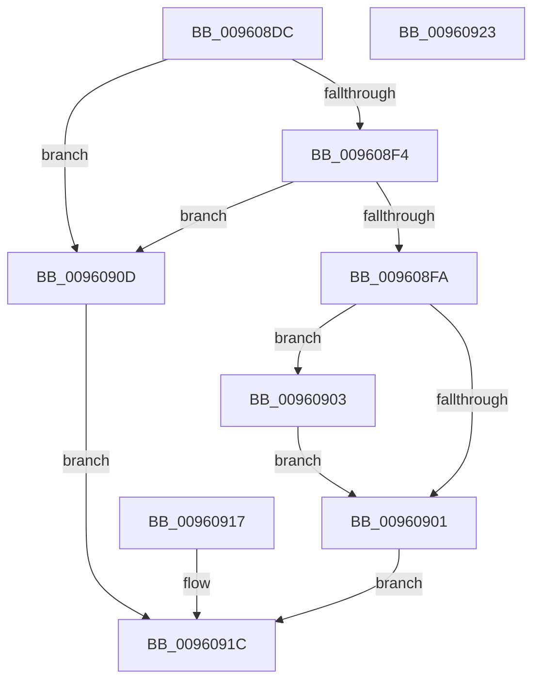

# PfSnCaptureParamBlockString

- RVA: `0x009608DC`–`0x00960924` (길이 `72` bytes)
- VA: `0x00000001409608DC`
- 실행 섹션: `PAGE`
- PDB 이름 있음: `예`; PDB Function 태그: `아니요`
- unwind 정보 RVA: `0x00093184`
- 디코드: `26`개 명령, `72/72` bytes 표시
- 미해석 바이트: `0` (있으면 어셈블리에 `.byte`로 보존)

> 이 문서는 커널 이미지의 기계어와 PDB 기호를 분석해 생성했습니다. 4번과 5번은 함수 원형과 자료형을 바이너리 사용 방식에서 추정한 C 해석이며 원본 소스 복구 결과는 아닙니다.

## 1. Dependencies

- 직접 호출 지점: **0**; 고유 호출 대상: **0**
- 직접 호출자로 확인된 함수: **1**
- RIP 상대 이미지 참조: **0**

### Outgoing calls
- 직접 디코드된 call 명령이 없습니다.

### Direct callers
- [PfSnScanCommandLine](../95/PfSnScanCommandLine_function_0095FE78.md) at `0x0095FEC4`

### Static image references
- 디코드된 RIP-relative 메모리 참조가 없습니다.

## 2. Other-region calls and transfers

- 다른 실행 섹션으로 향하는 call: **0**
- 별도 외부 분기/꼬리 이동을 확인하지 못했습니다.

## 3. Assembly (complete function range)

```asm
009608DC  48 83 EC 18                     sub rsp, 0x18
009608E0  0F 10 02                        movups xmm0, xmmword ptr [rdx]
009608E3  F3 41 0F 7F 00                  movdqu xmmword ptr [r8], xmm0
009608E8  90                              nop
009608E9  4D 8B 48 08                     mov r9, qword ptr [r8 + 8]
009608ED  33 D2                           xor edx, edx
009608EF  4D 85 C9                        test r9, r9
009608F2  74 19                           je 0x14096090d
009608F4  66 41 39 10                     cmp word ptr [r8], dx
009608F8  74 13                           je 0x14096090d
009608FA  8B 41 08                        mov eax, dword ptr [rcx + 8]
009608FD  A8 01                           test al, 1
009608FF  74 02                           je 0x140960903
00960901  EB 19                           jmp 0x14096091c
00960903  49 8D 04 09                     lea rax, [r9 + rcx]
00960907  49 89 40 08                     mov qword ptr [r8 + 8], rax
0096090B  EB F4                           jmp 0x140960901
0096090D  BA 25 02 00 C0                  mov edx, 0xc0000225
00960912  89 14 24                        mov dword ptr [rsp], edx
00960915  EB 05                           jmp 0x14096091c
00960917  8B D0                           mov edx, eax
00960919  89 04 24                        mov dword ptr [rsp], eax
0096091C  8B C2                           mov eax, edx
0096091E  48 83 C4 18                     add rsp, 0x18
00960922  C3                              ret
00960923  CC                              int3
```

## 4. C-style interpretation (structured pseudocode)

```c
__int64 __fastcall PfSnCaptureParamBlockString(__int64 a1, __int64 a2, __int64 a3)
{
    __int64 v_rsp;
    unsigned int v_stack_m18;

    v_rsp = (v_rsp) - (24);
    *(unsigned __int64 *)(a3) = v_xmm0;
    a2 = 0;
    if (*(unsigned __int64 *)(a3 + 8) == 0) goto loc_0096090D;
    if ((*(unsigned __int16 *)(a3)) == 0) goto loc_0096090D;
    if ((((unsigned __int8)((unsigned int)(*(unsigned int *)(a1 + 8)))) & (1)) == 0) goto loc_00960903;
loc_00960901:
    goto loc_0096091C;
loc_00960903:
    *(unsigned __int64 *)(a3 + 8) = *(unsigned __int64 *)(a3 + 8) + a1 * 1;
    goto loc_00960901;
loc_0096090D:
    v_stack_m18 = (unsigned int)((unsigned int)(0xC0000225ULL));
    goto loc_0096091C;
loc_0096091C:
    v_rsp = (v_rsp) + (24);
    return (unsigned int)((unsigned int)((unsigned int)(0xC0000225ULL)));
}
```

## 5. (Beta) C Style

```c
int64_t PfSnCaptureParamBlockString(void *Arg1, void *Arg2, void *Arg3)
{
    uint8_t *arg1 = (uint8_t *)Arg1;
    uint8_t *arg2 = (uint8_t *)Arg2;
    uint8_t *arg3 = (uint8_t *)Arg3;

    int64_t local_rsp;
    uint32_t v_stack_m18;

    local_rsp = (local_rsp) - (24);
    *(uint64_t *)(arg3) = v_xmm0;
    Arg2 = 0;
    if (*(uint64_t *)(arg3 + 0x8) == 0) goto loc_0096090D;
    if ((*(uint16_t *)(arg3)) == 0) goto loc_0096090D;
    if ((((uint8_t)((uint32_t)(*(uint32_t *)(arg1 + 0x8)))) & (1)) == 0) goto loc_00960903;
loc_00960901:
    goto loc_0096091C;
loc_00960903:
    *(uint64_t *)(arg3 + 0x8) = *(uint64_t *)(arg3 + 0x8) + Arg1 * 1;
    goto loc_00960901;
loc_0096090D:
    v_stack_m18 = (uint32_t)((uint32_t)(0xC0000225ULL));
    goto loc_0096091C;
loc_0096091C:
    local_rsp = (local_rsp) + (24);
    return (uint32_t)((uint32_t)((uint32_t)(0xC0000225ULL)));
}
```

### 관측된 메모리 오프셋

구조체 형식이 확인되지 않은 접근은 인자 기준의 오프셋으로만 기록했습니다.

| 기준 인자 | 오프셋 표현 | 폭 (bit) | 접근 |
|---|---:|---:|---|
| `Arg1` | `+ 0x8` | `32` | `R` |
| `Arg2` | `+ 0x0` | `128` | `R` |
| `Arg3` | `+ 0x0` | `16` | `R` |
| `Arg3` | `+ 0x0` | `128` | `W` |
| `Arg3` | `+ 0x8` | `64` | `R` |
| `Arg3` | `+ 0x8` | `64` | `W` |

## 6. Execution-region graph

[열기: 2D/3D 그래프와 함수 탐색 컨트롤 패널](../../../control-panel.html?section=page&rva=0x009608DC&view=graph)

- 2D 그래프는 위에서 아래로 흐르고, 3D 그래프는 빈 공간을 드래그해 회전합니다. Shift+드래그는 이동, 휠은 확대·축소, 함수 노드 선택은 대상 보고서 이동입니다.

### Static fallback


