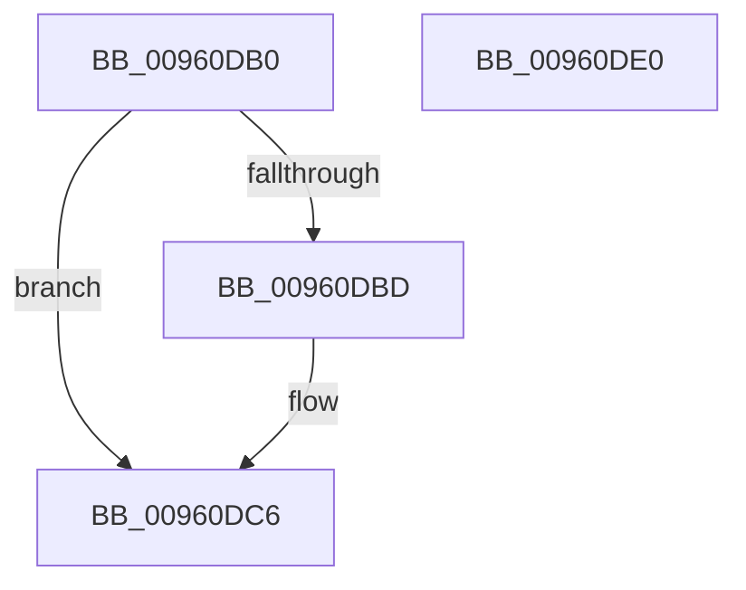

# PfSnFailProcessTrace

- RVA: `0x00960DB0`–`0x00960DE1` (길이 `49` bytes)
- VA: `0x0000000140960DB0`
- 실행 섹션: `PAGE`
- PDB 이름 있음: `예`; PDB Function 태그: `아니요`
- unwind 정보 RVA: `0x0005C788`
- 디코드: `11`개 명령, `49/49` bytes 표시
- 미해석 바이트: `0` (있으면 어셈블리에 `.byte`로 보존)

> 이 문서는 커널 이미지의 기계어와 PDB 기호를 분석해 생성했습니다. 4번과 5번은 함수 원형과 자료형을 바이너리 사용 방식에서 추정한 C 해석이며 원본 소스 복구 결과는 아닙니다.

## 1. Dependencies

- 직접 호출 지점: **1**; 고유 호출 대상: **1**
- 직접 호출자로 확인된 함수: **4**
- RIP 상대 이미지 참조: **0**

### Outgoing calls
- `0x00960DD6` → [PfSnEndProcessTrace](../90/PfSnEndProcessTrace_function_00903E04.md) (function, `0x00903E04`)

### Direct callers
- [PfSnLogStreamCreate](PfSnLogStreamCreate_function_009605B0.md) at `0x0096074C`
- [PfSnLogHelper](PfSnLogHelper_function_00960C1C.md) at `0x00960C74`
- [PfSnNameRemoveAll](PfSnNameRemoveAll_function_00960C90.md) at `0x00960D2B`
- [PfSnVolumeKeyQuery](../A1/PfSnVolumeKeyQuery_function_00A18928.md) at `0x00A189DE`

### Static image references
- 디코드된 RIP-relative 메모리 참조가 없습니다.

## 2. Other-region calls and transfers

- 다른 실행 섹션으로 향하는 call: **0**
- 별도 외부 분기/꼬리 이동을 확인하지 못했습니다.

## 3. Assembly (complete function range)

```asm
00960DB0  48 83 EC 28                     sub rsp, 0x28
00960DB4  F6 81 E4 01 00 00 02            test byte ptr [rcx + 0x1e4], 2
00960DBB  75 09                           jne 0x140960dc6
00960DBD  66 F0 83 89 E4 01 00 00 02      lock or word ptr [rcx + 0x1e4], 2
00960DC6  4C 8D 41 18                     lea r8, [rcx + 0x18]
00960DCA  BA 0A 00 00 00                  mov edx, 0xa
00960DCF  48 8B 89 60 01 00 00            mov rcx, qword ptr [rcx + 0x160]
00960DD6  E8 29 30 FA FF                  call 0x140903e04
00960DDB  48 83 C4 28                     add rsp, 0x28
00960DDF  C3                              ret
00960DE0  CC                              int3
```

## 4. C-style interpretation (structured pseudocode)

```c
__int64 __fastcall PfSnFailProcessTrace(__int64 a1)
{
    __int64 result;
    __int64 v_rsp;

    v_rsp = (v_rsp) - (40);
    if (((*(unsigned __int8 *)(a1 + 484)) & (2)) == 0) {
    }
    result = PfSnEndProcessTrace(*(unsigned __int64 *)(a1 + 352), 10, a1 + 24, a4);
    v_rsp = (v_rsp) + (40);
    return result;
}
```

## 5. (Beta) C Style

```c
int64_t PfSnFailProcessTrace(void *Arg1)
{
    uint8_t *arg1 = (uint8_t *)Arg1;

    int64_t result;
    int64_t local_rsp;

    local_rsp = (local_rsp) - (40);
    if (((*(uint8_t *)(arg1 + 0x1E4)) & (2)) == 0) {
    }
    result = PfSnEndProcessTrace(*(uint64_t *)(arg1 + 0x160), 10, Arg1 + 24, a4);
    local_rsp = (local_rsp) + (40);
    return result;
}
```

### 관측된 메모리 오프셋

구조체 형식이 확인되지 않은 접근은 인자 기준의 오프셋으로만 기록했습니다.

| 기준 인자 | 오프셋 표현 | 폭 (bit) | 접근 |
|---|---:|---:|---|
| `Arg1` | `+ 0x18` | `64` | `R` |
| `Arg1` | `+ 0x160` | `64` | `R` |
| `Arg1` | `+ 0x1E4` | `8` | `R` |
| `Arg1` | `+ 0x1E4` | `16` | `R/W` |

## 6. Execution-region graph

[열기: 2D/3D 그래프와 함수 탐색 컨트롤 패널](../../../control-panel.html?section=page&rva=0x00960DB0&view=graph)

- 2D 그래프는 위에서 아래로 흐르고, 3D 그래프는 빈 공간을 드래그해 회전합니다. Shift+드래그는 이동, 휠은 확대·축소, 함수 노드 선택은 대상 보고서 이동입니다.

### Static fallback


