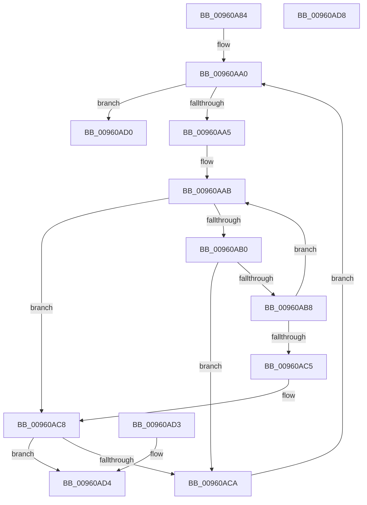

# PfSnFindString

- RVA: `0x00960A84`–`0x00960AD9` (길이 `85` bytes)
- VA: `0x0000000140960A84`
- 실행 섹션: `PAGE`
- PDB 이름 있음: `예`; PDB Function 태그: `아니요`
- unwind 정보 RVA: `0x000DB714`
- 디코드: `31`개 명령, `85/85` bytes 표시
- 미해석 바이트: `0` (있으면 어셈블리에 `.byte`로 보존)

> 이 문서는 커널 이미지의 기계어와 PDB 기호를 분석해 생성했습니다. 4번과 5번은 함수 원형과 자료형을 바이너리 사용 방식에서 추정한 C 해석이며 원본 소스 복구 결과는 아닙니다.

## 1. Dependencies

- 직접 호출 지점: **0**; 고유 호출 대상: **0**
- 직접 호출자로 확인된 함수: **1**
- RIP 상대 이미지 참조: **0**

### Outgoing calls
- 직접 디코드된 call 명령이 없습니다.

### Direct callers
- [PfSnParsePrefetchParam](PfSnParsePrefetchParam_function_0096092C.md) at `0x009609AB`

### Static image references
- 디코드된 RIP-relative 메모리 참조가 없습니다.

## 2. Other-region calls and transfers

- 다른 실행 섹션으로 향하는 call: **0**
- 별도 외부 분기/꼬리 이동을 확인하지 못했습니다.

## 3. Assembly (complete function range)

```asm
00960A84  0F B7 01                        movzx eax, word ptr [rcx]
00960A87  4C 8B 41 08                     mov r8, qword ptr [rcx + 8]
00960A8B  4C 8B 5A 08                     mov r11, qword ptr [rdx + 8]
00960A8F  48 D1 E8                        shr rax, 1
00960A92  4D 8D 0C 40                     lea r9, [r8 + rax*2]
00960A96  0F B7 02                        movzx eax, word ptr [rdx]
00960A99  48 D1 E8                        shr rax, 1
00960A9C  4D 8D 14 43                     lea r10, [r11 + rax*2]
00960AA0  4D 3B C1                        cmp r8, r9
00960AA3  73 2B                           jae 0x140960ad0
00960AA5  49 8B CB                        mov rcx, r11
00960AA8  49 8B D0                        mov rdx, r8
00960AAB  49 3B CA                        cmp rcx, r10
00960AAE  73 18                           jae 0x140960ac8
00960AB0  0F B7 01                        movzx eax, word ptr [rcx]
00960AB3  66 39 02                        cmp word ptr [rdx], ax
00960AB6  75 12                           jne 0x140960aca
00960AB8  48 83 C1 02                     add rcx, 2
00960ABC  48 83 C2 02                     add rdx, 2
00960AC0  49 3B D1                        cmp rdx, r9
00960AC3  72 E6                           jb 0x140960aab
00960AC5  49 3B CA                        cmp rcx, r10
00960AC8  74 0A                           je 0x140960ad4
00960ACA  49 83 C0 02                     add r8, 2
00960ACE  EB D0                           jmp 0x140960aa0
00960AD0  33 C0                           xor eax, eax
00960AD2  C3                              ret
00960AD3  CC                              int3
00960AD4  49 8B C0                        mov rax, r8
00960AD7  C3                              ret
00960AD8  CC                              int3
```

## 4. C-style interpretation (structured pseudocode)

```c
__int64 __fastcall PfSnFindString(__int64 a1, __int64 a2)
{
    __int64 result;

    result = (*(unsigned __int16 *)(a1)) >> (1);
    result = (*(unsigned __int16 *)(a2)) >> (1);
loc_00960AA0:
    if ((*(unsigned __int64 *)(a1 + 8)) >= (*(unsigned __int64 *)(a1 + 8) + result * 2)) goto loc_00960AD0;
loc_00960AAB:
    if ((*(unsigned __int64 *)(a2 + 8)) >= (*(unsigned __int64 *)(a2 + 8) + result * 2)) goto loc_00960AC8;
    if ((*(unsigned __int16 *)(*(unsigned __int64 *)(a1 + 8))) != ((unsigned __int16)(*(unsigned __int16 *)(*(unsigned __int64 *)(a2 + 8))))) goto loc_00960ACA;
    a1 = (*(unsigned __int64 *)(a2 + 8)) + (2);
    a2 = (*(unsigned __int64 *)(a1 + 8)) + (2);
    if (a2 < (*(unsigned __int64 *)(a1 + 8) + result * 2)) goto loc_00960AAB;
loc_00960AC8:
    if (a1 == (*(unsigned __int64 *)(a2 + 8) + result * 2)) goto loc_00960AD4;
loc_00960ACA:
    a3 = (*(unsigned __int64 *)(a1 + 8)) + (2);
    goto loc_00960AA0;
loc_00960AD0:
    result = 0;
    return result;
loc_00960AD4:
    return a3;
}
```

## 5. (Beta) C Style

```c
int64_t PfSnFindString(void *Arg1, void *Arg2)
{
    uint8_t *arg1 = (uint8_t *)Arg1;
    uint8_t *arg2 = (uint8_t *)Arg2;

    int64_t result;

    result = (*(uint16_t *)(arg1)) >> (1);
    result = (*(uint16_t *)(arg2)) >> (1);
loc_00960AA0:
    if ((*(uint64_t *)(arg1 + 0x8)) >= (*(uint64_t *)(arg1 + 0x8) + result * 2)) goto loc_00960AD0;
loc_00960AAB:
    if ((*(uint64_t *)(arg2 + 0x8)) >= (*(uint64_t *)(arg2 + 0x8) + result * 2)) goto loc_00960AC8;
    if ((*(uint16_t *)(*(uint64_t *)(arg1 + 0x8))) != ((uint16_t)(*(uint16_t *)(*(uint64_t *)(arg2 + 0x8))))) goto loc_00960ACA;
    Arg1 = (*(uint64_t *)(arg2 + 0x8)) + (2);
    Arg2 = (*(uint64_t *)(arg1 + 0x8)) + (2);
    if (Arg2 < (*(uint64_t *)(arg1 + 0x8) + result * 2)) goto loc_00960AAB;
loc_00960AC8:
    if (Arg1 == (*(uint64_t *)(arg2 + 0x8) + result * 2)) goto loc_00960AD4;
loc_00960ACA:
    a3 = (*(uint64_t *)(arg1 + 0x8)) + (2);
    goto loc_00960AA0;
loc_00960AD0:
    result = 0;
    return result;
loc_00960AD4:
    return a3;
}
```

### 관측된 메모리 오프셋

구조체 형식이 확인되지 않은 접근은 인자 기준의 오프셋으로만 기록했습니다.

| 기준 인자 | 오프셋 표현 | 폭 (bit) | 접근 |
|---|---:|---:|---|
| `Arg1` | `+ 0x0` | `16` | `R` |
| `Arg1` | `+ 0x8` | `64` | `R` |
| `Arg2` | `+ 0x0` | `16` | `R` |
| `Arg2` | `+ 0x8` | `64` | `R` |

## 6. Execution-region graph

[열기: 2D/3D 그래프와 함수 탐색 컨트롤 패널](../../../control-panel.html?section=page&rva=0x00960A84&view=graph)

- 2D 그래프는 위에서 아래로 흐르고, 3D 그래프는 빈 공간을 드래그해 회전합니다. Shift+드래그는 이동, 휠은 확대·축소, 함수 노드 선택은 대상 보고서 이동입니다.

### Static fallback


