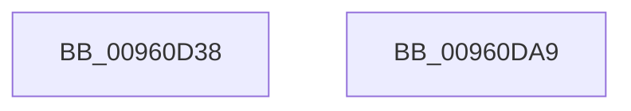

# PfSnGetNLLogEntry

- RVA: `0x00960D38`–`0x00960DAA` (길이 `114` bytes)
- VA: `0x0000000140960D38`
- 실행 섹션: `PAGE`
- PDB 이름 있음: `예`; PDB Function 태그: `아니요`
- unwind 정보 RVA: `0x0005C954`
- 디코드: `35`개 명령, `114/114` bytes 표시
- 미해석 바이트: `0` (있으면 어셈블리에 `.byte`로 보존)

> 이 문서는 커널 이미지의 기계어와 PDB 기호를 분석해 생성했습니다. 4번과 5번은 함수 원형과 자료형을 바이너리 사용 방식에서 추정한 C 해석이며 원본 소스 복구 결과는 아닙니다.

## 1. Dependencies

- 직접 호출 지점: **1**; 고유 호출 대상: **1**
- 직접 호출자로 확인된 함수: **2**
- RIP 상대 이미지 참조: **0**

### Outgoing calls
- `0x00960D64` → [memset](../../text/6C/memset_function_006C6C40.md) (function, `0x006C6C40`)

### Direct callers
- [PfSnLogVolumeCreate](PfSnLogVolumeCreate_function_00960AE0.md) at `0x00960B63`
- [PfSnNameRemoveAll](PfSnNameRemoveAll_function_00960C90.md) at `0x00960CFB`

### Static image references
- 디코드된 RIP-relative 메모리 참조가 없습니다.

## 2. Other-region calls and transfers

- 다른 실행 섹션으로 향하는 call: **1**
  - `0x00960D64` → [memset](../../text/6C/memset_function_006C6C40.md) (`PAGE` → `.text`)
- 별도 외부 분기/꼬리 이동을 확인하지 못했습니다.

## 3. Assembly (complete function range)

```asm
00960D38  48 89 5C 24 08                  mov qword ptr [rsp + 8], rbx
00960D3D  48 89 6C 24 10                  mov qword ptr [rsp + 0x10], rbp
00960D42  48 89 74 24 18                  mov qword ptr [rsp + 0x18], rsi
00960D47  57                              push rdi
00960D48  48 83 EC 20                     sub rsp, 0x20
00960D4C  48 8D 71 17                     lea rsi, [rcx + 0x17]
00960D50  41 8B F8                        mov edi, r8d
00960D53  8B DA                           mov ebx, edx
00960D55  45 8B C0                        mov r8d, r8d
00960D58  48 83 E6 F8                     and rsi, 0xfffffffffffffff8
00960D5C  33 D2                           xor edx, edx
00960D5E  48 8B CE                        mov rcx, rsi
00960D61  41 8B E9                        mov ebp, r9d
00960D64  E8 D7 5E D6 FF                  call 0x1406c6c40
00960D69  8B 0E                           mov ecx, dword ptr [rsi]
00960D6B  48 8B C6                        mov rax, rsi
00960D6E  8B D1                           mov edx, ecx
00960D70  89 6E 04                        mov dword ptr [rsi + 4], ebp
00960D73  48 8B 6C 24 38                  mov rbp, qword ptr [rsp + 0x38]
00960D78  33 D3                           xor edx, ebx
00960D7A  48 8B 5C 24 30                  mov rbx, qword ptr [rsp + 0x30]
00960D7F  83 E2 07                        and edx, 7
00960D82  33 D1                           xor edx, ecx
00960D84  8D 0C FD 00 00 00 00            lea ecx, [rdi*8]
00960D8B  33 CA                           xor ecx, edx
00960D8D  81 E1 F8 FF FF 7F               and ecx, 0x7ffffff8
00960D93  33 CA                           xor ecx, edx
00960D95  89 0E                           mov dword ptr [rsi], ecx
00960D97  8B 4C 24 50                     mov ecx, dword ptr [rsp + 0x50]
00960D9B  89 4E 08                        mov dword ptr [rsi + 8], ecx
00960D9E  48 8B 74 24 40                  mov rsi, qword ptr [rsp + 0x40]
00960DA3  48 83 C4 20                     add rsp, 0x20
00960DA7  5F                              pop rdi
00960DA8  C3                              ret
00960DA9  CC                              int3
```

## 4. C-style interpretation (structured pseudocode)

```c
__int64 __fastcall PfSnGetNLLogEntry(__int64 a1, int a2, int a3, int a4, unsigned int a5)
{
    __int64 result;
    __int64 v_rsi;
    __int64 v_rsp;
    unsigned __int64 v_stack_p10;
    unsigned __int64 v_stack_p18;
    unsigned __int64 v_stack_p8;

    v_stack_p8 = v_rbx;
    v_stack_p10 = v_rbp;
    v_stack_p18 = v_rsi;
    v_rsp = (v_rsp) - (32);
    v_rsi = (a1 + 23) & (-8);
    a2 = 0;
    result = memset(v_rsi, a2, (unsigned int)(a3), a4);
    *(unsigned int *)(v_rsi + 4) = (unsigned int)((unsigned int)(a4));
    a2 = (unsigned int)(((unsigned int)((unsigned int)((unsigned int)(*(unsigned int *)(v_rsi))))) ^ ((unsigned int)((unsigned int)(a2))));
    a2 = (unsigned int)((a2) & (7));
    a2 = (unsigned int)((a2) ^ ((unsigned int)((unsigned int)(*(unsigned int *)(v_rsi)))));
    a1 = (unsigned int)(((unsigned int)(a3) * 8) ^ (a2));
    a1 = (unsigned int)((a1) & (0x7FFFFFF8ULL));
    a1 = (unsigned int)((a1) ^ (a2));
    *(unsigned int *)(v_rsi) = (unsigned int)(a1);
    *(unsigned int *)(v_rsi + 8) = (unsigned int)((unsigned int)(a5));
    v_rsp = (v_rsp) + (32);
    return v_rsi;
}
```

## 5. (Beta) C Style

```c
int64_t PfSnGetNLLogEntry(void *Arg1, int32_t Arg2, int32_t Arg3, int32_t Arg4, uint32_t Arg5)
{
    uint8_t *arg1 = (uint8_t *)Arg1;

    int64_t result;
    int64_t local_rsi;
    int64_t local_rsp;
    uint64_t v_stack_p10;
    uint64_t v_stack_p18;
    uint64_t v_stack_p8;

    v_stack_p8 = local_rbx;
    v_stack_p10 = local_rbp;
    v_stack_p18 = local_rsi;
    local_rsp = (local_rsp) - (32);
    local_rsi = (Arg1 + 23) & (-8);
    Arg2 = 0;
    result = memset(local_rsi, Arg2, (uint32_t)(Arg3), Arg4);
    *(uint32_t *)(local_rsi + 0x4) = (uint32_t)((uint32_t)(Arg4));
    Arg2 = (uint32_t)(((uint32_t)((uint32_t)((uint32_t)(*(uint32_t *)(local_rsi))))) ^ ((uint32_t)((uint32_t)(Arg2))));
    Arg2 = (uint32_t)((Arg2) & (7));
    Arg2 = (uint32_t)((Arg2) ^ ((uint32_t)((uint32_t)(*(uint32_t *)(local_rsi)))));
    Arg1 = (uint32_t)(((uint32_t)(Arg3) * 8) ^ (Arg2));
    Arg1 = (uint32_t)((Arg1) & (0x7FFFFFF8ULL));
    Arg1 = (uint32_t)((Arg1) ^ (Arg2));
    *(uint32_t *)(local_rsi) = (uint32_t)(Arg1);
    *(uint32_t *)(local_rsi + 0x8) = (uint32_t)((uint32_t)(Arg5));
    local_rsp = (local_rsp) + (32);
    return local_rsi;
}
```

### 관측된 메모리 오프셋

구조체 형식이 확인되지 않은 접근은 인자 기준의 오프셋으로만 기록했습니다.

| 기준 인자 | 오프셋 표현 | 폭 (bit) | 접근 |
|---|---:|---:|---|
| `Arg1` | `+ 0x0` | `32` | `R` |
| `Arg1` | `+ 0x0` | `32` | `W` |
| `Arg1` | `+ 0x4` | `32` | `W` |
| `Arg1` | `+ 0x8` | `32` | `W` |
| `Arg1` | `+ 0x17` | `64` | `R` |

## 6. Execution-region graph

[열기: 2D/3D 그래프와 함수 탐색 컨트롤 패널](../../../control-panel.html?section=page&rva=0x00960D38&view=graph)

- 2D 그래프는 위에서 아래로 흐르고, 3D 그래프는 빈 공간을 드래그해 회전합니다. Shift+드래그는 이동, 휠은 확대·축소, 함수 노드 선택은 대상 보고서 이동입니다.

### Static fallback


