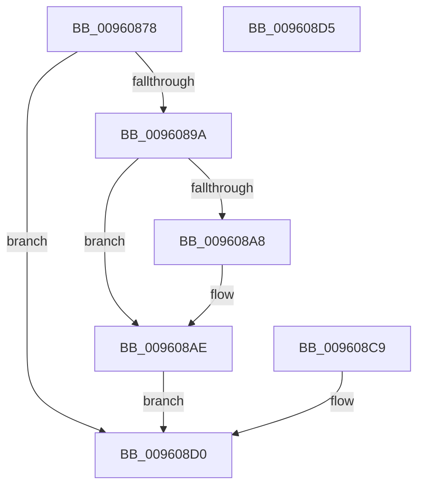

# PfSnGetUnsafeProcessParameters

- RVA: `0x00960878`–`0x009608D6` (길이 `94` bytes)
- VA: `0x0000000140960878`
- 실행 섹션: `PAGE`
- PDB 이름 있음: `예`; PDB Function 태그: `아니요`
- unwind 정보 RVA: `0x00093160`
- 디코드: `26`개 명령, `94/94` bytes 표시
- 미해석 바이트: `0` (있으면 어셈블리에 `.byte`로 보존)

> 이 문서는 커널 이미지의 기계어와 PDB 기호를 분석해 생성했습니다. 4번과 5번은 함수 원형과 자료형을 바이너리 사용 방식에서 추정한 C 해석이며 원본 소스 복구 결과는 아닙니다.

## 1. Dependencies

- 직접 호출 지점: **1**; 고유 호출 대상: **1**
- 직접 호출자로 확인된 함수: **1**
- RIP 상대 이미지 참조: **0**

### Outgoing calls
- `0x009608A8` → [ExRaiseDatatypeMisalignment](../89/ExRaiseDatatypeMisalignment_function_00899FD0.md) (function, `0x00899FD0`)

### Direct callers
- [PfSnScanCommandLine](../95/PfSnScanCommandLine_function_0095FE78.md) at `0x0095FEAE`

### Static image references
- 디코드된 RIP-relative 메모리 참조가 없습니다.

## 2. Other-region calls and transfers

- 다른 실행 섹션으로 향하는 call: **0**
- 별도 외부 분기/꼬리 이동을 확인하지 못했습니다.

## 3. Assembly (complete function range)

```asm
00960878  48 83 EC 38                     sub rsp, 0x38
0096087C  65 48 8B 04 25 88 01 00 00      mov rax, qword ptr gs:[0x188]
00960885  48 8B 88 B8 00 00 00            mov rcx, qword ptr [rax + 0xb8]
0096088C  48 8B 91 E0 02 00 00            mov rdx, qword ptr [rcx + 0x2e0]
00960893  33 C0                           xor eax, eax
00960895  48 85 D2                        test rdx, rdx
00960898  74 36                           je 0x1409608d0
0096089A  48 8B 42 20                     mov rax, qword ptr [rdx + 0x20]
0096089E  48 89 44 24 20                  mov qword ptr [rsp + 0x20], rax
009608A3  90                              nop
009608A4  A8 07                           test al, 7
009608A6  74 06                           je 0x1409608ae
009608A8  E8 23 97 F3 FF                  call 0x140899fd0
009608AD  CC                              int3
009608AE  48 B9 00 00 FF FF FF 7F 00 00   movabs rcx, 0x7fffffff0000
009608B8  48 3B C1                        cmp rax, rcx
009608BB  48 0F 43 C1                     cmovae rax, rcx
009608BF  90                              nop
009608C0  8A 00                           mov al, byte ptr [rax]
009608C2  48 8B 44 24 20                  mov rax, qword ptr [rsp + 0x20]
009608C7  EB 07                           jmp 0x1409608d0
009608C9  33 C0                           xor eax, eax
009608CB  48 89 44 24 20                  mov qword ptr [rsp + 0x20], rax
009608D0  48 83 C4 38                     add rsp, 0x38
009608D4  C3                              ret
009608D5  CC                              int3
```

## 4. C-style interpretation (structured pseudocode)

```c
__int64 __fastcall PfSnGetUnsafeProcessParameters(void)
{
    __int64 result;
    __int64 v_rsp;
    unsigned __int64 v_stack_m18;

    v_rsp = (v_rsp) - (56);
    result = 0;
    if (*(unsigned __int64 *)(*(unsigned __int64 *)(*(unsigned __int64 *)(gs_base + (0 + 392)) + 184) + 736) == 0) goto loc_009608D0;
    v_stack_m18 = *(unsigned __int64 *)(*(unsigned __int64 *)(*(unsigned __int64 *)(*(unsigned __int64 *)(gs_base + (0 + 392)) + 184) + 736) + 32);
    result = *(unsigned __int64 *)(*(unsigned __int64 *)(*(unsigned __int64 *)(*(unsigned __int64 *)(gs_base + (0 + 392)) + 184) + 736) + 32);
    if ((((unsigned __int8)(*(unsigned __int64 *)(*(unsigned __int64 *)(*(unsigned __int64 *)(*(unsigned __int64 *)(gs_base + (0 + 392)) + 184) + 736) + 32))) & (7)) != 0) {
        result = ExRaiseDatatypeMisalignment(*(unsigned __int64 *)(*(unsigned __int64 *)(gs_base + (0 + 392)) + 184), *(unsigned __int64 *)(*(unsigned __int64 *)(*(unsigned __int64 *)(gs_base + (0 + 392)) + 184) + 736), a3, a4);
    }
    if (result >= (*(unsigned __int64 *)(*(unsigned __int64 *)(gs_base + (0 + 392)) + 184))) { result = *(unsigned __int64 *)(*(unsigned __int64 *)(gs_base + (0 + 392)) + 184); }
    goto loc_009608D0;
loc_009608D0:
    v_rsp = (v_rsp) + (56);
    return v_stack_m18;
}
```

## 5. (Beta) C Style

```c
void PfSnGetUnsafeProcessParameters(void)
{
    int64_t result;
    int64_t local_rsp;
    uint64_t v_stack_m18;

    local_rsp = (local_rsp) - (56);
    result = 0;
    if (*(uint64_t *)(*(uint64_t *)(*(uint64_t *)(gs_base + (0 + 0x188)) + 0xB8) + 0x2E0) == 0) goto loc_009608D0;
    v_stack_m18 = *(uint64_t *)(*(uint64_t *)(*(uint64_t *)(*(uint64_t *)(gs_base + (0 + 0x188)) + 0xB8) + 0x2E0) + 0x20);
    result = *(uint64_t *)(*(uint64_t *)(*(uint64_t *)(*(uint64_t *)(gs_base + (0 + 0x188)) + 0xB8) + 0x2E0) + 0x20);
    if ((((uint8_t)(*(uint64_t *)(*(uint64_t *)(*(uint64_t *)(*(uint64_t *)(gs_base + (0 + 0x188)) + 0xB8) + 0x2E0) + 0x20))) & (7)) != 0) {
        result = ExRaiseDatatypeMisalignment(*(uint64_t *)(*(uint64_t *)(gs_base + (0 + 0x188)) + 0xB8), *(uint64_t *)(*(uint64_t *)(*(uint64_t *)(gs_base + (0 + 0x188)) + 0xB8) + 0x2E0), a3, a4);
    }
    if (result >= (*(uint64_t *)(*(uint64_t *)(gs_base + (0 + 0x188)) + 0xB8))) { result = *(uint64_t *)(*(uint64_t *)(gs_base + (0 + 0x188)) + 0xB8); }
    goto loc_009608D0;
loc_009608D0:
    local_rsp = (local_rsp) + (56);
    return v_stack_m18;
}
```

## 6. Execution-region graph

[열기: 2D/3D 그래프와 함수 탐색 컨트롤 패널](../../../control-panel.html?section=page&rva=0x00960878&view=graph)

- 2D 그래프는 위에서 아래로 흐르고, 3D 그래프는 빈 공간을 드래그해 회전합니다. Shift+드래그는 이동, 휠은 확대·축소, 함수 노드 선택은 대상 보고서 이동입니다.

### Static fallback


