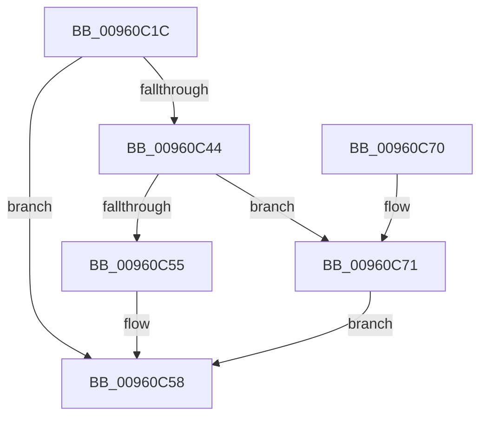

# PfSnLogHelper

- RVA: `0x00960C1C`–`0x00960C87` (길이 `107` bytes)
- VA: `0x0000000140960C1C`
- 실행 섹션: `PAGE`
- PDB 이름 있음: `예`; PDB Function 태그: `아니요`
- unwind 정보 RVA: `0x0008CEBC`
- 디코드: `32`개 명령, `107/107` bytes 표시
- 미해석 바이트: `0` (있으면 어셈블리에 `.byte`로 보존)

> 이 문서는 커널 이미지의 기계어와 PDB 기호를 분석해 생성했습니다. 4번과 5번은 함수 원형과 자료형을 바이너리 사용 방식에서 추정한 C 해석이며 원본 소스 복구 결과는 아닙니다.

## 1. Dependencies

- 직접 호출 지점: **4**; 고유 호출 대상: **4**
- 직접 호출자로 확인된 함수: **1**
- RIP 상대 이미지 참조: **0**

### Outgoing calls
- `0x00960C37` → [PfSnReferenceProcessTrace](../../text/34/PfSnReferenceProcessTrace_function_00344A80.md) (function, `0x00344A80`)
- `0x00960C4C` → [PfSnTraceGetLogEntry](../../text/34/PfSnTraceGetLogEntry_function_003437A0.md) (function, `0x003437A0`)
- `0x00960C74` → [PfSnFailProcessTrace](PfSnFailProcessTrace_function_00960DB0.md) (function, `0x00960DB0`)
- `0x00960C80` → [ExReleaseRundownProtection](../../text/34/ExReleaseRundownProtection_function_00349E80.md) (function, `0x00349E80`)

### Direct callers
- [PfSnLogVolumeCreate](PfSnLogVolumeCreate_function_00960AE0.md) at `0x00960B1F`

### Static image references
- 디코드된 RIP-relative 메모리 참조가 없습니다.

## 2. Other-region calls and transfers

- 다른 실행 섹션으로 향하는 call: **3**
  - `0x00960C37` → [PfSnReferenceProcessTrace](../../text/34/PfSnReferenceProcessTrace_function_00344A80.md) (`PAGE` → `.text`)
  - `0x00960C4C` → [PfSnTraceGetLogEntry](../../text/34/PfSnTraceGetLogEntry_function_003437A0.md) (`PAGE` → `.text`)
  - `0x00960C80` → [ExReleaseRundownProtection](../../text/34/ExReleaseRundownProtection_function_00349E80.md) (`PAGE` → `.text`)
- 별도 외부 분기/꼬리 이동을 확인하지 못했습니다.

## 3. Assembly (complete function range)

```asm
00960C1C  48 89 5C 24 08                  mov qword ptr [rsp + 8], rbx
00960C21  48 89 6C 24 10                  mov qword ptr [rsp + 0x10], rbp
00960C26  48 89 74 24 18                  mov qword ptr [rsp + 0x18], rsi
00960C2B  57                              push rdi
00960C2C  48 83 EC 20                     sub rsp, 0x20
00960C30  49 8B F0                        mov rsi, r8
00960C33  8B EA                           mov ebp, edx
00960C35  33 DB                           xor ebx, ebx
00960C37  E8 44 3E 9E FF                  call 0x140344a80
00960C3C  48 8B F8                        mov rdi, rax
00960C3F  48 85 C0                        test rax, rax
00960C42  74 14                           je 0x140960c58
00960C44  4C 8B C6                        mov r8, rsi
00960C47  8B D5                           mov edx, ebp
00960C49  48 8B C8                        mov rcx, rax
00960C4C  E8 4F 2B 9E FF                  call 0x1403437a0
00960C51  85 C0                           test eax, eax
00960C53  78 1C                           js 0x140960c71
00960C55  48 8B DF                        mov rbx, rdi
00960C58  48 8B 6C 24 38                  mov rbp, qword ptr [rsp + 0x38]
00960C5D  48 8B C3                        mov rax, rbx
00960C60  48 8B 5C 24 30                  mov rbx, qword ptr [rsp + 0x30]
00960C65  48 8B 74 24 40                  mov rsi, qword ptr [rsp + 0x40]
00960C6A  48 83 C4 20                     add rsp, 0x20
00960C6E  5F                              pop rdi
00960C6F  C3                              ret
00960C70  CC                              int3
00960C71  48 8B CF                        mov rcx, rdi
00960C74  E8 37 01 00 00                  call 0x140960db0
00960C79  48 8D 8F 68 01 00 00            lea rcx, [rdi + 0x168]
00960C80  E8 FB 91 9E FF                  call 0x140349e80
00960C85  EB D1                           jmp 0x140960c58
```

## 4. C-style interpretation (structured pseudocode)

```c
__int64 __fastcall PfSnLogHelper(__int64 a1, int a2, __int64 a3)
{
    __int64 result;
    __int64 v_rbx;
    __int64 v_rsp;
    unsigned __int64 v_stack_p10;
    unsigned __int64 v_stack_p18;
    unsigned __int64 v_stack_p8;

    v_stack_p8 = v_rbx;
    v_stack_p10 = v_rbp;
    v_stack_p18 = v_rsi;
    v_rsp = (v_rsp) - (32);
    v_rbx = 0;
    result = PfSnReferenceProcessTrace(a1, a2, a3, a4);
    if (result == 0) goto loc_00960C58;
    result = PfSnTraceGetLogEntry(result, (unsigned int)((unsigned int)((unsigned int)(a2))), a3, a4);
    if (sign_flag) goto loc_00960C71;
loc_00960C58:
    v_rsp = (v_rsp) + (32);
    return result;
loc_00960C71:
    result = PfSnFailProcessTrace(result, (unsigned int)((unsigned int)((unsigned int)(a2))), a3, a4);
    result = ExReleaseRundownProtection(result + 360, (unsigned int)((unsigned int)((unsigned int)(a2))), a3, a4);
    goto loc_00960C58;
}
```

## 5. (Beta) C Style

```c
int64_t PfSnLogHelper(int64_t Arg1, int32_t Arg2, int64_t Arg3)
{
    int64_t result;
    int64_t local_rbx;
    int64_t local_rsp;
    uint64_t v_stack_p10;
    uint64_t v_stack_p18;
    uint64_t v_stack_p8;

    v_stack_p8 = local_rbx;
    v_stack_p10 = local_rbp;
    v_stack_p18 = local_rsi;
    local_rsp = (local_rsp) - (32);
    local_rbx = 0;
    result = PfSnReferenceProcessTrace(Arg1, Arg2, Arg3, a4);
    if (result == 0) goto loc_00960C58;
    result = PfSnTraceGetLogEntry(result, (uint32_t)((uint32_t)((uint32_t)(Arg2))), Arg3, a4);
    if (sign_flag) goto loc_00960C71;
loc_00960C58:
    local_rsp = (local_rsp) + (32);
    return result;
loc_00960C71:
    result = PfSnFailProcessTrace(result, (uint32_t)((uint32_t)((uint32_t)(Arg2))), Arg3, a4);
    result = ExReleaseRundownProtection(result + 360, (uint32_t)((uint32_t)((uint32_t)(Arg2))), Arg3, a4);
    goto loc_00960C58;
}
```

## 6. Execution-region graph

[열기: 2D/3D 그래프와 함수 탐색 컨트롤 패널](../../../control-panel.html?section=page&rva=0x00960C1C&view=graph)

- 2D 그래프는 위에서 아래로 흐르고, 3D 그래프는 빈 공간을 드래그해 회전합니다. Shift+드래그는 이동, 휠은 확대·축소, 함수 노드 선택은 대상 보고서 이동입니다.

### Static fallback


