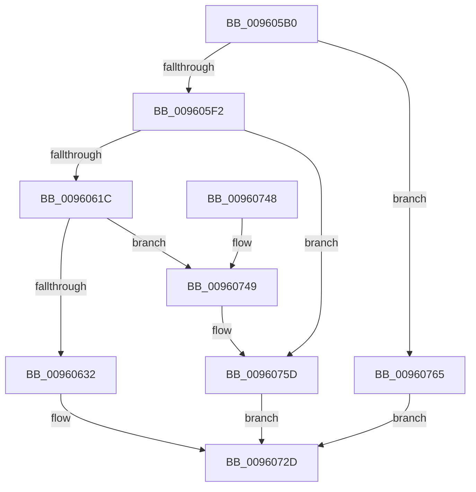

# PfSnLogStreamCreate

- RVA: `0x009605B0`–`0x0096076D` (길이 `445` bytes)
- VA: `0x00000001409605B0`
- 실행 섹션: `PAGE`
- PDB 이름 있음: `예`; PDB Function 태그: `아니요`
- unwind 정보 RVA: `0x00093108`
- 디코드: `124`개 명령, `445/445` bytes 표시
- 미해석 바이트: `0` (있으면 어셈블리에 `.byte`로 보존)

> 이 문서는 커널 이미지의 기계어와 PDB 기호를 분석해 생성했습니다. 4번과 5번은 함수 원형과 자료형을 바이너리 사용 방식에서 추정한 C 해석이며 원본 소스 복구 결과는 아닙니다.

## 1. Dependencies

- 직접 호출 지점: **7**; 고유 호출 대상: **6**
- 직접 호출자로 확인된 함수: **1**
- RIP 상대 이미지 참조: **0**

### Outgoing calls
- `0x0096060B` → [PfSnReferenceProcessTrace](../../text/34/PfSnReferenceProcessTrace_function_00344A80.md) (function, `0x00344A80`)
- `0x00960625` → [PfSnTraceGetLogEntry](../../text/34/PfSnTraceGetLogEntry_function_003437A0.md) (function, `0x003437A0`)
- `0x0096066D` → [memset](../../text/6C/memset_function_006C6C40.md) (function, `0x006C6C40`)
- `0x00960716` → [RtlUpcaseUnicodeString](RtlUpcaseUnicodeString_function_00960780.md) (function, `0x00960780`)
- `0x00960728` → [ExReleaseRundownProtection](../../text/34/ExReleaseRundownProtection_function_00349E80.md) (function, `0x00349E80`)
- `0x0096074C` → [PfSnFailProcessTrace](PfSnFailProcessTrace_function_00960DB0.md) (function, `0x00960DB0`)
- `0x00960758` → [ExReleaseRundownProtection](../../text/34/ExReleaseRundownProtection_function_00349E80.md) (function, `0x00349E80`)

### Direct callers
- [sub_00342803](../../text/34/Unknown_function_00342803.md) at `0x00342818`

### Static image references
- 디코드된 RIP-relative 메모리 참조가 없습니다.

## 2. Other-region calls and transfers

- 다른 실행 섹션으로 향하는 call: **5**
  - `0x0096060B` → [PfSnReferenceProcessTrace](../../text/34/PfSnReferenceProcessTrace_function_00344A80.md) (`PAGE` → `.text`)
  - `0x00960625` → [PfSnTraceGetLogEntry](../../text/34/PfSnTraceGetLogEntry_function_003437A0.md) (`PAGE` → `.text`)
  - `0x0096066D` → [memset](../../text/6C/memset_function_006C6C40.md) (`PAGE` → `.text`)
  - `0x00960728` → [ExReleaseRundownProtection](../../text/34/ExReleaseRundownProtection_function_00349E80.md) (`PAGE` → `.text`)
  - `0x00960758` → [ExReleaseRundownProtection](../../text/34/ExReleaseRundownProtection_function_00349E80.md) (`PAGE` → `.text`)
- 별도 외부 분기/꼬리 이동을 확인하지 못했습니다.

## 3. Assembly (complete function range)

```asm
009605B0  48 89 5C 24 18                  mov qword ptr [rsp + 0x18], rbx
009605B5  48 89 4C 24 08                  mov qword ptr [rsp + 8], rcx
009605BA  55                              push rbp
009605BB  56                              push rsi
009605BC  57                              push rdi
009605BD  41 54                           push r12
009605BF  41 55                           push r13
009605C1  41 56                           push r14
009605C3  41 57                           push r15
009605C5  48 8B EC                        mov rbp, rsp
009605C8  48 83 EC 40                     sub rsp, 0x40
009605CC  8B 41 20                        mov eax, dword ptr [rcx + 0x20]
009605CF  45 33 FF                        xor r15d, r15d
009605D2  44 0F B7 61 22                  movzx r12d, word ptr [rcx + 0x22]
009605D7  48 8B F9                        mov rdi, rcx
009605DA  0F B7 C0                        movzx eax, ax
009605DD  44 89 7D F4                     mov dword ptr [rbp - 0xc], r15d
009605E1  44 89 7D E4                     mov dword ptr [rbp - 0x1c], r15d
009605E5  4C 89 7D 48                     mov qword ptr [rbp + 0x48], r15
009605E9  44 3B E0                        cmp r12d, eax
009605EC  0F 86 73 01 00 00               jbe 0x140960765
009605F2  48 8B 09                        mov rcx, qword ptr [rcx]
009605F5  44 2B E0                        sub r12d, eax
009605F8  46 8D 34 65 46 00 00 00         lea r14d, [r12*2 + 0x46]
00960600  41 8B DE                        mov ebx, r14d
00960603  48 83 C3 0F                     add rbx, 0xf
00960607  48 C1 EB 04                     shr rbx, 4
0096060B  E8 70 44 9E FF                  call 0x140344a80
00960610  4C 8B E8                        mov r13, rax
00960613  48 85 C0                        test rax, rax
00960616  0F 84 41 01 00 00               je 0x14096075d
0096061C  4C 8D 45 48                     lea r8, [rbp + 0x48]
00960620  8B D3                           mov edx, ebx
00960622  48 8B C8                        mov rcx, rax
00960625  E8 76 31 9E FF                  call 0x1403437a0
0096062A  85 C0                           test eax, eax
0096062C  0F 88 17 01 00 00               js 0x140960749
00960632  48 8B 57 10                     mov rdx, qword ptr [rdi + 0x10]
00960636  8D 4B FF                        lea ecx, [rbx - 1]
00960639  4C 8B 45 48                     mov r8, qword ptr [rbp + 0x48]
0096063D  41 8D 5E F0                     lea ebx, [r14 - 0x10]
00960641  48 C1 E1 04                     shl rcx, 4
00960645  0F 57 C0                        xorps xmm0, xmm0
00960648  48 83 C9 05                     or rcx, 5
0096064C  41 0F 11 00                     movups xmmword ptr [r8], xmm0
00960650  49 89 08                        mov qword ptr [r8], rcx
00960653  4D 8D 70 17                     lea r14, [r8 + 0x17]
00960657  49 89 50 08                     mov qword ptr [r8 + 8], rdx
0096065B  49 83 E6 F8                     and r14, 0xfffffffffffffff8
0096065F  8B 77 2C                        mov esi, dword ptr [rdi + 0x2c]
00960662  49 8B CE                        mov rcx, r14
00960665  8B 7F 28                        mov edi, dword ptr [rdi + 0x28]
00960668  33 D2                           xor edx, edx
0096066A  44 8B C3                        mov r8d, ebx
0096066D  E8 CE 65 D6 FF                  call 0x1406c6c40
00960672  4C 8B 45 40                     mov r8, qword ptr [rbp + 0x40]
00960676  8D 04 DD 00 00 00 00            lea eax, [rbx*8]
0096067D  41 8B 0E                        mov ecx, dword ptr [r14]
00960680  41 0F B7 D4                     movzx edx, r12w
00960684  83 E1 F8                        and ecx, 0xfffffff8
00960687  41 89 7E 04                     mov dword ptr [r14 + 4], edi
0096068B  33 C1                           xor eax, ecx
0096068D  41 89 76 08                     mov dword ptr [r14 + 8], esi
00960691  25 F8 FF FF 7F                  and eax, 0x7ffffff8
00960696  66 44 89 7D F0                  mov word ptr [rbp - 0x10], r15w
0096069B  33 C1                           xor eax, ecx
0096069D  66 03 D2                        add dx, dx
009606A0  41 89 06                        mov dword ptr [r14], eax
009606A3  49 8D 46 2C                     lea rax, [r14 + 0x2c]
009606A7  48 89 45 F8                     mov qword ptr [rbp - 8], rax
009606AB  41 8B 40 20                     mov eax, dword ptr [r8 + 0x20]
009606AF  0F B7 C8                        movzx ecx, ax
009606B2  49 8B 40 18                     mov rax, qword ptr [r8 + 0x18]
009606B6  66 89 55 F2                     mov word ptr [rbp - 0xe], dx
009606BA  66 89 55 E0                     mov word ptr [rbp - 0x20], dx
009606BE  66 89 55 E2                     mov word ptr [rbp - 0x1e], dx
009606C2  48 8D 55 E0                     lea rdx, [rbp - 0x20]
009606C6  48 8D 0C 48                     lea rcx, [rax + rcx*2]
009606CA  49 8B 40 08                     mov rax, qword ptr [r8 + 8]
009606CE  49 89 46 18                     mov qword ptr [r14 + 0x18], rax
009606D2  41 8B 40 30                     mov eax, dword ptr [r8 + 0x30]
009606D6  41 89 46 20                     mov dword ptr [r14 + 0x20], eax
009606DA  49 8B 40 10                     mov rax, qword ptr [r8 + 0x10]
009606DE  49 89 46 10                     mov qword ptr [r14 + 0x10], rax
009606E2  41 8B 46 28                     mov eax, dword ptr [r14 + 0x28]
009606E6  48 89 4D E8                     mov qword ptr [rbp - 0x18], rcx
009606EA  8B C8                           mov ecx, eax
009606EC  41 33 48 24                     xor ecx, dword ptr [r8 + 0x24]
009606F0  83 E1 01                        and ecx, 1
009606F3  33 C8                           xor ecx, eax
009606F5  41 89 4E 28                     mov dword ptr [r14 + 0x28], ecx
009606F9  41 8B 40 24                     mov eax, dword ptr [r8 + 0x24]
009606FD  45 33 C0                        xor r8d, r8d
00960700  03 C0                           add eax, eax
00960702  33 C1                           xor eax, ecx
00960704  83 E0 04                        and eax, 4
00960707  33 C1                           xor eax, ecx
00960709  48 8D 4D F0                     lea rcx, [rbp - 0x10]
0096070D  41 89 46 28                     mov dword ptr [r14 + 0x28], eax
00960711  66 45 89 66 2A                  mov word ptr [r14 + 0x2a], r12w
00960716  E8 65 00 00 00                  call 0x140960780
0096071B  49 8D 8D 68 01 00 00            lea rcx, [r13 + 0x168]
00960722  66 47 89 7C 66 2C               mov word ptr [r14 + r12*2 + 0x2c], r15w
00960728  E8 53 97 9E FF                  call 0x140349e80
0096072D  48 8B 9C 24 90 00 00 00         mov rbx, qword ptr [rsp + 0x90]
00960735  41 8B C7                        mov eax, r15d
00960738  48 83 C4 40                     add rsp, 0x40
0096073C  41 5F                           pop r15
0096073E  41 5E                           pop r14
00960740  41 5D                           pop r13
00960742  41 5C                           pop r12
00960744  5F                              pop rdi
00960745  5E                              pop rsi
00960746  5D                              pop rbp
00960747  C3                              ret
00960748  CC                              int3
00960749  49 8B CD                        mov rcx, r13
0096074C  E8 5F 06 00 00                  call 0x140960db0
00960751  49 8D 8D 68 01 00 00            lea rcx, [r13 + 0x168]
00960758  E8 23 97 9E FF                  call 0x140349e80
0096075D  41 BF 7A 01 00 C0               mov r15d, 0xc000017a
00960763  EB C8                           jmp 0x14096072d
00960765  41 BF BB 00 00 C0               mov r15d, 0xc00000bb
0096076B  EB C0                           jmp 0x14096072d
```

## 4. C-style interpretation (structured pseudocode)

```c
__int64 __fastcall PfSnLogStreamCreate(__int64 a1)
{
    __int64 result;
    __int64 v_r12;
    __int64 v_r14;
    __int64 v_r15;
    __int64 v_rbx;
    __int64 v_rsp;
    unsigned __int64 v_stack_m40;
    unsigned int v_stack_m44;
    unsigned __int16 v_stack_m46;
    unsigned __int16 v_stack_m48;
    unsigned __int64 v_stack_m50;
    unsigned int v_stack_m54;
    unsigned __int16 v_stack_m56;
    unsigned __int16 v_stack_m58;
    unsigned __int64 v_stack_p10;
    unsigned __int64 v_stack_p18;
    unsigned __int64 v_stack_p8;

    v_stack_p18 = v_rbx;
    v_stack_p8 = a1;
    v_rsp = (v_rsp) - (64);
    v_r15 = 0;
    v_stack_m44 = 0;
    v_stack_m54 = 0;
    v_stack_p10 = 0;
    if (((unsigned int)(*(unsigned __int16 *)(a1 + 34))) <= ((unsigned int)((unsigned __int16)((unsigned int)(*(unsigned int *)(a1 + 32)))))) goto loc_00960765;
    v_r12 = (unsigned int)((*(unsigned __int16 *)(a1 + 34)) - ((unsigned int)((unsigned __int16)((unsigned int)(*(unsigned int *)(a1 + 32))))));
    v_rbx = ((unsigned int)((unsigned int)(v_r12 * 2 + 70))) + (15);
    v_rbx = (v_rbx) >> (4);
    result = PfSnReferenceProcessTrace(*(unsigned __int64 *)(a1), a2, a3, a4);
    if (result == 0) goto loc_0096075D;
    result = PfSnTraceGetLogEntry(result, (unsigned int)((unsigned int)(v_rbx)), v_stack_p10, a4);
    if (sign_flag) goto loc_00960749;
    a1 = (v_rbx - 1) << (4);
    a1 = (a1) | (5);
    *(unsigned __int64 *)(v_stack_p10) = v_xmm0;
    *(unsigned __int64 *)(v_stack_p10) = a1;
    *(unsigned __int64 *)(v_stack_p10 + 8) = *(unsigned __int64 *)(a1 + 16);
    v_r14 = (v_stack_p10 + 23) & (-8);
    a2 = 0;
    result = memset(v_r14, a2, (unsigned int)((unsigned int)(v_r12 * 2 + 70 - 16)), a4);
    a1 = (unsigned int)(((unsigned int)(*(unsigned int *)(v_r14))) & (0xFFFFFFF8ULL));
    *(unsigned int *)(v_r14 + 4) = (unsigned int)((unsigned int)(*(unsigned int *)(a1 + 40)));
    result = (unsigned int)((v_r12 * 2 + 70 - 16 * 8) ^ ((unsigned int)(a1)));
    *(unsigned int *)(v_r14 + 8) = (unsigned int)((unsigned int)(*(unsigned int *)(a1 + 44)));
    result = (unsigned int)((result) & (0x7FFFFFF8ULL));
    v_stack_m48 = 0;
    result = (unsigned int)((result) ^ ((unsigned int)(a1)));
    a2 = (unsigned __int16)(((unsigned __int16)(v_r12)) + ((unsigned __int16)((unsigned __int16)(v_r12))));
    *(unsigned int *)(v_r14) = (unsigned int)(result);
    v_stack_m40 = v_r14 + 44;
    v_stack_m46 = (unsigned __int16)(a2);
    v_stack_m58 = (unsigned __int16)(a2);
    v_stack_m56 = (unsigned __int16)(a2);
    *(unsigned __int64 *)(v_r14 + 24) = *(unsigned __int64 *)(v_stack_p8 + 8);
    *(unsigned int *)(v_r14 + 32) = (unsigned int)((unsigned int)(*(unsigned int *)(v_stack_p8 + 48)));
    *(unsigned __int64 *)(v_r14 + 16) = *(unsigned __int64 *)(v_stack_p8 + 16);
    v_stack_m50 = *(unsigned __int64 *)(v_stack_p8 + 24) + (unsigned __int16)((unsigned int)(*(unsigned int *)(v_stack_p8 + 32))) * 2;
    a1 = (unsigned int)(((unsigned int)((unsigned int)((unsigned int)(*(unsigned int *)(v_r14 + 40))))) ^ (*(unsigned int *)(v_stack_p8 + 36)));
    a1 = (unsigned int)((a1) & (1));
    a1 = (unsigned int)((a1) ^ ((unsigned int)((unsigned int)(*(unsigned int *)(v_r14 + 40)))));
    *(unsigned int *)(v_r14 + 40) = (unsigned int)(a1);
    a3 = 0;
    result = (unsigned int)(((unsigned int)(*(unsigned int *)(v_stack_p8 + 36))) + ((unsigned int)((unsigned int)(*(unsigned int *)(v_stack_p8 + 36)))));
    result = (unsigned int)((result) ^ ((unsigned int)(a1)));
    result = (unsigned int)((result) & (4));
    result = (unsigned int)((result) ^ ((unsigned int)(a1)));
    *(unsigned int *)(v_r14 + 40) = (unsigned int)(result);
    *(unsigned __int16 *)(v_r14 + 42) = (unsigned __int16)(v_r12);
    result = RtlUpcaseUnicodeString(v_stack_m48, v_stack_m58, a3, a4);
    *(unsigned __int16 *)(v_r14 + v_r12 * 2 + 44) = 0;
    result = ExReleaseRundownProtection(result + 360, v_stack_m58, a3, a4);
loc_0096072D:
    v_rsp = (v_rsp) + (64);
    return 0;
loc_00960749:
    result = PfSnFailProcessTrace(result, v_stack_m58, a3, a4);
    result = ExReleaseRundownProtection(result + 360, v_stack_m58, a3, a4);
loc_0096075D:
    goto loc_0096072D;
loc_00960765:
    goto loc_0096072D;
}
```

## 5. (Beta) C Style

```c
int64_t PfSnLogStreamCreate(void *Arg1)
{
    uint8_t *arg1 = (uint8_t *)Arg1;

    int64_t result;
    int64_t local_r12;
    int64_t local_r14;
    int64_t local_r15;
    int64_t local_rbx;
    int64_t local_rsp;
    uint64_t v_stack_m40;
    uint32_t v_stack_m44;
    uint16_t v_stack_m46;
    uint16_t v_stack_m48;
    uint64_t v_stack_m50;
    uint32_t v_stack_m54;
    uint16_t v_stack_m56;
    uint16_t v_stack_m58;
    uint64_t v_stack_p10;
    uint64_t v_stack_p18;
    uint64_t v_stack_p8;

    v_stack_p18 = local_rbx;
    v_stack_p8 = Arg1;
    local_rsp = (local_rsp) - (64);
    local_r15 = 0;
    v_stack_m44 = 0;
    v_stack_m54 = 0;
    v_stack_p10 = 0;
    if (((uint32_t)(*(uint16_t *)(arg1 + 0x22))) <= ((uint32_t)((uint16_t)((uint32_t)(*(uint32_t *)(arg1 + 0x20)))))) goto loc_00960765;
    local_r12 = (uint32_t)((*(uint16_t *)(arg1 + 0x22)) - ((uint32_t)((uint16_t)((uint32_t)(*(uint32_t *)(arg1 + 0x20))))));
    local_rbx = ((uint32_t)((uint32_t)(local_r12 * 2 + 70))) + (15);
    local_rbx = (local_rbx) >> (4);
    result = PfSnReferenceProcessTrace(*(uint64_t *)(arg1), a2, a3, a4);
    if (result == 0) goto loc_0096075D;
    result = PfSnTraceGetLogEntry(result, (uint32_t)((uint32_t)(local_rbx)), v_stack_p10, a4);
    if (sign_flag) goto loc_00960749;
    Arg1 = (local_rbx - 1) << (4);
    Arg1 = (Arg1) | (5);
    *(uint64_t *)(v_stack_p10) = v_xmm0;
    *(void **)(v_stack_p10) = Arg1;
    *(uint64_t *)(v_stack_p10 + 0x8) = *(uint64_t *)(arg1 + 0x10);
    local_r14 = (v_stack_p10 + 23) & (-8);
    a2 = 0;
    result = memset(local_r14, a2, (uint32_t)((uint32_t)(local_r12 * 2 + 70 - 16)), a4);
    Arg1 = (uint32_t)(((uint32_t)(*(uint32_t *)(local_r14))) & (0xFFFFFFF8ULL));
    *(uint32_t *)(local_r14 + 0x4) = (uint32_t)((uint32_t)(*(uint32_t *)(arg1 + 0x28)));
    result = (uint32_t)((local_r12 * 2 + 70 - 16 * 8) ^ ((uint32_t)(Arg1)));
    *(uint32_t *)(local_r14 + 0x8) = (uint32_t)((uint32_t)(*(uint32_t *)(arg1 + 0x2C)));
    result = (uint32_t)((result) & (0x7FFFFFF8ULL));
    v_stack_m48 = 0;
    result = (uint32_t)((result) ^ ((uint32_t)(Arg1)));
    a2 = (uint16_t)(((uint16_t)(local_r12)) + ((uint16_t)((uint16_t)(local_r12))));
    *(uint32_t *)(local_r14) = (uint32_t)(result);
    v_stack_m40 = local_r14 + 44;
    v_stack_m46 = (uint16_t)(a2);
    v_stack_m58 = (uint16_t)(a2);
    v_stack_m56 = (uint16_t)(a2);
    *(uint64_t *)(local_r14 + 0x18) = *(uint64_t *)(v_stack_p8 + 0x8);
    *(uint32_t *)(local_r14 + 0x20) = (uint32_t)((uint32_t)(*(uint32_t *)(v_stack_p8 + 0x30)));
    *(uint64_t *)(local_r14 + 0x10) = *(uint64_t *)(v_stack_p8 + 0x10);
    v_stack_m50 = *(uint64_t *)(v_stack_p8 + 0x18) + (uint16_t)((uint32_t)(*(uint32_t *)(v_stack_p8 + 0x20))) * 2;
    Arg1 = (uint32_t)(((uint32_t)((uint32_t)((uint32_t)(*(uint32_t *)(local_r14 + 0x28))))) ^ (*(uint32_t *)(v_stack_p8 + 0x24)));
    Arg1 = (uint32_t)((Arg1) & (1));
    Arg1 = (uint32_t)((Arg1) ^ ((uint32_t)((uint32_t)(*(uint32_t *)(local_r14 + 0x28)))));
    *(uint32_t *)(local_r14 + 0x28) = (uint32_t)(Arg1);
    a3 = 0;
    result = (uint32_t)(((uint32_t)(*(uint32_t *)(v_stack_p8 + 0x24))) + ((uint32_t)((uint32_t)(*(uint32_t *)(v_stack_p8 + 0x24)))));
    result = (uint32_t)((result) ^ ((uint32_t)(Arg1)));
    result = (uint32_t)((result) & (4));
    result = (uint32_t)((result) ^ ((uint32_t)(Arg1)));
    *(uint32_t *)(local_r14 + 0x28) = (uint32_t)(result);
    *(uint16_t *)(local_r14 + 0x2A) = (uint16_t)(local_r12);
    result = RtlUpcaseUnicodeString(v_stack_m48, v_stack_m58, a3, a4);
    *(uint16_t *)(local_r14 + local_r12 * 2 + 0x2C) = 0;
    result = ExReleaseRundownProtection(result + 360, v_stack_m58, a3, a4);
loc_0096072D:
    local_rsp = (local_rsp) + (64);
    return 0;
loc_00960749:
    result = PfSnFailProcessTrace(result, v_stack_m58, a3, a4);
    result = ExReleaseRundownProtection(result + 360, v_stack_m58, a3, a4);
loc_0096075D:
    goto loc_0096072D;
loc_00960765:
    goto loc_0096072D;
}
```

### 관측된 메모리 오프셋

구조체 형식이 확인되지 않은 접근은 인자 기준의 오프셋으로만 기록했습니다.

| 기준 인자 | 오프셋 표현 | 폭 (bit) | 접근 |
|---|---:|---:|---|
| `Arg1` | `+ 0x0` | `64` | `R` |
| `Arg1` | `+ 0x10` | `64` | `R` |
| `Arg1` | `+ 0x20` | `32` | `R` |
| `Arg1` | `+ 0x22` | `16` | `R` |
| `Arg1` | `+ 0x28` | `32` | `R` |
| `Arg1` | `+ 0x2C` | `32` | `R` |

## 6. Execution-region graph

[열기: 2D/3D 그래프와 함수 탐색 컨트롤 패널](../../../control-panel.html?section=page&rva=0x009605B0&view=graph)

- 2D 그래프는 위에서 아래로 흐르고, 3D 그래프는 빈 공간을 드래그해 회전합니다. Shift+드래그는 이동, 휠은 확대·축소, 함수 노드 선택은 대상 보고서 이동입니다.

### Static fallback


