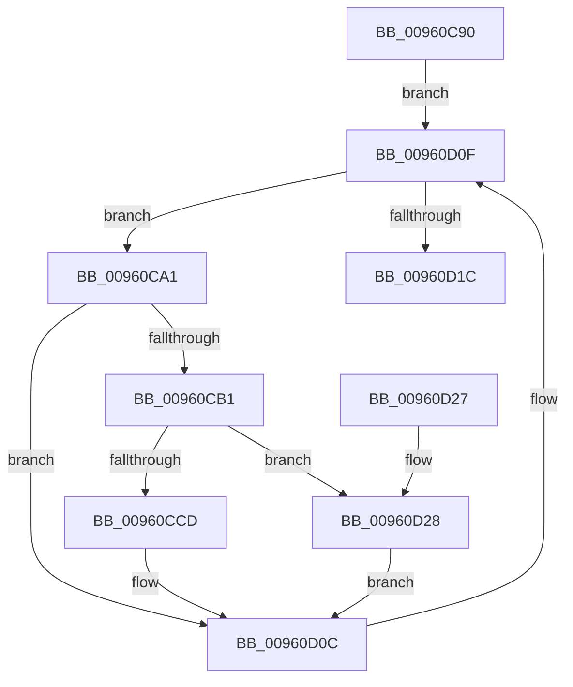

# PfSnNameRemoveAll

- RVA: `0x00960C90`–`0x00960D32` (길이 `162` bytes)
- VA: `0x0000000140960C90`
- 실행 섹션: `PAGE`
- PDB 이름 있음: `예`; PDB Function 태그: `아니요`
- unwind 정보 RVA: `0x000931F8`
- 디코드: `46`개 명령, `162/162` bytes 표시
- 미해석 바이트: `0` (있으면 어셈블리에 `.byte`로 보존)

> 이 문서는 커널 이미지의 기계어와 PDB 기호를 분석해 생성했습니다. 4번과 5번은 함수 원형과 자료형을 바이너리 사용 방식에서 추정한 C 해석이며 원본 소스 복구 결과는 아닙니다.

## 1. Dependencies

- 직접 호출 지점: **5**; 고유 호출 대상: **5**
- 직접 호출자로 확인된 함수: **1**
- RIP 상대 이미지 참조: **0**

### Outgoing calls
- `0x00960CA8` → [PfSnNameRemove](../../text/43/PfSnNameRemove_function_0043E3C0.md) (function, `0x0043E3C0`)
- `0x00960CC4` → [PfSnTraceGetLogEntry](../../text/34/PfSnTraceGetLogEntry_function_003437A0.md) (function, `0x003437A0`)
- `0x00960CFB` → [PfSnGetNLLogEntry](PfSnGetNLLogEntry_function_00960D38.md) (function, `0x00960D38`)
- `0x00960D0F` → [PfSnActiveTraceGetNext](../../text/34/PfSnActiveTraceGetNext_function_0034DA70.md) (function, `0x0034DA70`)
- `0x00960D2B` → [PfSnFailProcessTrace](PfSnFailProcessTrace_function_00960DB0.md) (function, `0x00960DB0`)

### Direct callers
- [sub_003427B2](../../text/34/Unknown_function_003427B2.md) at `0x003427E7`

### Static image references
- 디코드된 RIP-relative 메모리 참조가 없습니다.

## 2. Other-region calls and transfers

- 다른 실행 섹션으로 향하는 call: **3**
  - `0x00960CA8` → [PfSnNameRemove](../../text/43/PfSnNameRemove_function_0043E3C0.md) (`PAGE` → `.text`)
  - `0x00960CC4` → [PfSnTraceGetLogEntry](../../text/34/PfSnTraceGetLogEntry_function_003437A0.md) (`PAGE` → `.text`)
  - `0x00960D0F` → [PfSnActiveTraceGetNext](../../text/34/PfSnActiveTraceGetNext_function_0034DA70.md) (`PAGE` → `.text`)
- 별도 외부 분기/꼬리 이동을 확인하지 못했습니다.

## 3. Assembly (complete function range)

```asm
00960C90  48 89 5C 24 08                  mov qword ptr [rsp + 8], rbx
00960C95  57                              push rdi
00960C96  48 83 EC 30                     sub rsp, 0x30
00960C9A  48 8B F9                        mov rdi, rcx
00960C9D  33 C9                           xor ecx, ecx
00960C9F  EB 6E                           jmp 0x140960d0f
00960CA1  48 8B 57 10                     mov rdx, qword ptr [rdi + 0x10]
00960CA5  48 8B CB                        mov rcx, rbx
00960CA8  E8 13 D7 AD FF                  call 0x14043e3c0
00960CAD  85 C0                           test eax, eax
00960CAF  74 5B                           je 0x140960d0c
00960CB1  48 83 64 24 48 00               and qword ptr [rsp + 0x48], 0
00960CB7  4C 8D 44 24 48                  lea r8, [rsp + 0x48]
00960CBC  BA 04 00 00 00                  mov edx, 4
00960CC1  48 8B CB                        mov rcx, rbx
00960CC4  E8 D7 2A 9E FF                  call 0x1403437a0
00960CC9  85 C0                           test eax, eax
00960CCB  78 5B                           js 0x140960d28
00960CCD  48 8B 47 10                     mov rax, qword ptr [rdi + 0x10]
00960CD1  BA 03 00 00 00                  mov edx, 3
00960CD6  48 8B 4C 24 48                  mov rcx, qword ptr [rsp + 0x48]
00960CDB  0F 57 C0                        xorps xmm0, xmm0
00960CDE  44 8D 42 25                     lea r8d, [rdx + 0x25]
00960CE2  0F 11 01                        movups xmmword ptr [rcx], xmm0
00960CE5  48 C7 01 35 00 00 00            mov qword ptr [rcx], 0x35
00960CEC  48 89 41 08                     mov qword ptr [rcx + 8], rax
00960CF0  8B 47 2C                        mov eax, dword ptr [rdi + 0x2c]
00960CF3  44 8B 4F 28                     mov r9d, dword ptr [rdi + 0x28]
00960CF7  89 44 24 20                     mov dword ptr [rsp + 0x20], eax
00960CFB  E8 38 00 00 00                  call 0x140960d38
00960D00  83 60 10 FC                     and dword ptr [rax + 0x10], 0xfffffffc
00960D04  48 8B 4F 10                     mov rcx, qword ptr [rdi + 0x10]
00960D08  48 89 48 18                     mov qword ptr [rax + 0x18], rcx
00960D0C  48 8B CB                        mov rcx, rbx
00960D0F  E8 5C CD 9E FF                  call 0x14034da70
00960D14  48 8B D8                        mov rbx, rax
00960D17  48 85 C0                        test rax, rax
00960D1A  75 85                           jne 0x140960ca1
00960D1C  48 8B 5C 24 40                  mov rbx, qword ptr [rsp + 0x40]
00960D21  48 83 C4 30                     add rsp, 0x30
00960D25  5F                              pop rdi
00960D26  C3                              ret
00960D27  CC                              int3
00960D28  48 8B CB                        mov rcx, rbx
00960D2B  E8 80 00 00 00                  call 0x140960db0
00960D30  EB DA                           jmp 0x140960d0c
```

## 4. C-style interpretation (structured pseudocode)

```c
__int64 __fastcall PfSnNameRemoveAll(__int64 a1)
{
    __int64 result;
    __int64 v_rsp;
    unsigned int v_stack_m18;
    unsigned __int64 v_stack_p10;
    unsigned __int64 v_stack_p8;

    v_stack_p8 = v_rbx;
    v_rsp = (v_rsp) - (48);
    a1 = 0;
    goto loc_00960D0F;
loc_00960CA1:
    result = PfSnNameRemove(v_rbx, *(unsigned __int64 *)(a1 + 16), a3, a4);
    if ((unsigned int)(result) == 0) goto loc_00960D0C;
    result = PfSnTraceGetLogEntry(v_rbx, 4, v_stack_p10, a4);
    if (sign_flag) goto loc_00960D28;
    *(unsigned __int64 *)(v_stack_p10) = v_xmm0;
    *(unsigned __int64 *)(v_stack_p10) = 53;
    *(unsigned __int64 *)(v_stack_p10 + 8) = *(unsigned __int64 *)(a1 + 16);
    v_stack_m18 = (unsigned int)((unsigned int)(*(unsigned int *)(a1 + 44)));
    result = PfSnGetNLLogEntry(v_stack_p10, 3, 3 + 37, (unsigned int)(*(unsigned int *)(a1 + 40)));
    *(unsigned __int64 *)(result + 24) = *(unsigned __int64 *)(a1 + 16);
loc_00960D0C:
loc_00960D0F:
    result = PfSnActiveTraceGetNext(v_rbx, 3, 3 + 37, (unsigned int)(*(unsigned int *)(a1 + 40)));
    if (result != 0) goto loc_00960CA1;
    v_rsp = (v_rsp) + (48);
    return result;
loc_00960D28:
    result = PfSnFailProcessTrace(v_stack_p8, 3, 3 + 37, (unsigned int)(*(unsigned int *)(a1 + 40)));
    goto loc_00960D0C;
}
```

## 5. (Beta) C Style

```c
int64_t PfSnNameRemoveAll(void *Arg1)
{
    uint8_t *arg1 = (uint8_t *)Arg1;

    int64_t result;
    int64_t local_rsp;
    uint32_t v_stack_m18;
    uint64_t v_stack_p10;
    uint64_t v_stack_p8;

    v_stack_p8 = local_rbx;
    local_rsp = (local_rsp) - (48);
    Arg1 = 0;
    goto loc_00960D0F;
loc_00960CA1:
    result = PfSnNameRemove(local_rbx, *(uint64_t *)(arg1 + 0x10), a3, a4);
    if ((uint32_t)(result) == 0) goto loc_00960D0C;
    result = PfSnTraceGetLogEntry(local_rbx, 4, v_stack_p10, a4);
    if (sign_flag) goto loc_00960D28;
    *(uint64_t *)(v_stack_p10) = v_xmm0;
    *(uint64_t *)(v_stack_p10) = 53;
    *(uint64_t *)(v_stack_p10 + 0x8) = *(uint64_t *)(arg1 + 0x10);
    v_stack_m18 = (uint32_t)((uint32_t)(*(uint32_t *)(arg1 + 0x2C)));
    result = PfSnGetNLLogEntry(v_stack_p10, 3, 3 + 37, (uint32_t)(*(uint32_t *)(arg1 + 0x28)));
    *(uint64_t *)(result + 0x18) = *(uint64_t *)(arg1 + 0x10);
loc_00960D0C:
loc_00960D0F:
    result = PfSnActiveTraceGetNext(local_rbx, 3, 3 + 37, (uint32_t)(*(uint32_t *)(arg1 + 0x28)));
    if (result != 0) goto loc_00960CA1;
    local_rsp = (local_rsp) + (48);
    return result;
loc_00960D28:
    result = PfSnFailProcessTrace(v_stack_p8, 3, 3 + 37, (uint32_t)(*(uint32_t *)(arg1 + 0x28)));
    goto loc_00960D0C;
}
```

### 관측된 메모리 오프셋

구조체 형식이 확인되지 않은 접근은 인자 기준의 오프셋으로만 기록했습니다.

| 기준 인자 | 오프셋 표현 | 폭 (bit) | 접근 |
|---|---:|---:|---|
| `Arg1` | `+ 0x10` | `64` | `R` |
| `Arg1` | `+ 0x28` | `32` | `R` |
| `Arg1` | `+ 0x2C` | `32` | `R` |

## 6. Execution-region graph

[열기: 2D/3D 그래프와 함수 탐색 컨트롤 패널](../../../control-panel.html?section=page&rva=0x00960C90&view=graph)

- 2D 그래프는 위에서 아래로 흐르고, 3D 그래프는 빈 공간을 드래그해 회전합니다. Shift+드래그는 이동, 휠은 확대·축소, 함수 노드 선택은 대상 보고서 이동입니다.

### Static fallback


