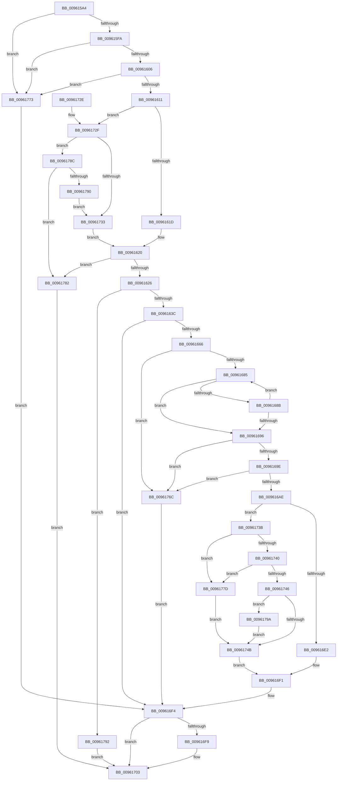

# PfSnOperationProcess

- RVA: `0x009615A4`–`0x0096179F` (길이 `507` bytes)
- VA: `0x00000001409615A4`
- 실행 섹션: `PAGE`
- PDB 이름 있음: `예`; PDB Function 태그: `아니요`
- unwind 정보 RVA: `0x000932D4`
- 디코드: `137`개 명령, `507/507` bytes 표시
- 미해석 바이트: `0` (있으면 어셈블리에 `.byte`로 보존)

> 이 문서는 커널 이미지의 기계어와 PDB 기호를 분석해 생성했습니다. 4번과 5번은 함수 원형과 자료형을 바이너리 사용 방식에서 추정한 C 해석이며 원본 소스 복구 결과는 아닙니다.

## 1. Dependencies

- 직접 호출 지점: **8**; 고유 호출 대상: **8**
- 직접 호출자로 확인된 함수: **1**
- RIP 상대 이미지 참조: **2**

### Outgoing calls
- `0x009615DE` → [memset](../../text/6C/memset_function_006C6C40.md) (function, `0x006C6C40`)
- `0x0096162F` → [PfSnCheckScenario](../95/PfSnCheckScenario_function_0095EF5C.md) (function, `0x0095EF5C`)
- `0x00961653` → [PfCalculateProcessHash](PfCalculateProcessHash_function_00960310.md) (function, `0x00960310`)
- `0x009616C9` → [RtlStringCbPrintfW](../../text/40/RtlStringCbPrintfW_function_0040FB40.md) (function, `0x0040FB40`)
- `0x009616EC` → [PfSnEndProcessTrace](../90/PfSnEndProcessTrace_function_00903E04.md) (function, `0x00903E04`)
- `0x009616FE` → [ExFreePoolWithTag](../../poolcode/B8/ExFreePoolWithTag_function_00B82870.md) (function, `0x00B82870`)
- `0x0096170C` → [_security_check_cookie](../../text/6A/_security_check_cookie_function_006AC640.md) (function, `0x006AC640`)
- `0x00961765` → [PfSnBeginScenario](../95/PfSnBeginScenario_function_0095EFC0.md) (function, `0x0095EFC0`)

### Direct callers
- [PfSnSetPrefetcherInformation](PfSnSetPrefetcherInformation_function_0096139C.md) at `0x00961587`

### Static image references
- `0x009615C3` → RVA `0x00E0A740` (`.data`; read)
- `0x009616B5` → RVA `0x00B01570` (` ?? ::NNGAKEGL::`string'`; read)

## 2. Other-region calls and transfers

- 다른 실행 섹션으로 향하는 call: **4**
  - `0x009615DE` → [memset](../../text/6C/memset_function_006C6C40.md) (`PAGE` → `.text`)
  - `0x009616C9` → [RtlStringCbPrintfW](../../text/40/RtlStringCbPrintfW_function_0040FB40.md) (`PAGE` → `.text`)
  - `0x009616FE` → [ExFreePoolWithTag](../../poolcode/B8/ExFreePoolWithTag_function_00B82870.md) (`PAGE` → `POOLCODE`)
  - `0x0096170C` → [_security_check_cookie](../../text/6A/_security_check_cookie_function_006AC640.md) (`PAGE` → `.text`)
- 별도 외부 분기/꼬리 이동을 확인하지 못했습니다.

## 3. Assembly (complete function range)

```asm
009615A4  48 8B C4                        mov rax, rsp
009615A7  48 89 58 10                     mov qword ptr [rax + 0x10], rbx
009615AB  48 89 70 18                     mov qword ptr [rax + 0x18], rsi
009615AF  48 89 78 20                     mov qword ptr [rax + 0x20], rdi
009615B3  55                              push rbp
009615B4  41 56                           push r14
009615B6  41 57                           push r15
009615B8  48 8D 68 A1                     lea rbp, [rax - 0x5f]
009615BC  48 81 EC 90 00 00 00            sub rsp, 0x90
009615C3  48 8B 05 76 91 4A 00            mov rax, qword ptr [rip + 0x4a9176]
009615CA  48 33 C4                        xor rax, rsp
009615CD  48 89 45 37                     mov qword ptr [rbp + 0x37], rax
009615D1  33 D2                           xor edx, edx
009615D3  48 8B F1                        mov rsi, rcx
009615D6  48 8D 4D F7                     lea rcx, [rbp - 9]
009615DA  44 8D 42 40                     lea r8d, [rdx + 0x40]
009615DE  E8 5D 56 D6 FF                  call 0x1406c6c40
009615E3  45 33 FF                        xor r15d, r15d
009615E6  80 3E 01                        cmp byte ptr [rsi], 1
009615E9  41 8B FF                        mov edi, r15d
009615EC  44 89 7D E7                     mov dword ptr [rbp - 0x19], r15d
009615F0  4C 89 7D EF                     mov qword ptr [rbp - 0x11], r15
009615F4  0F 85 79 01 00 00               jne 0x140961773
009615FA  8A 4E 01                        mov cl, byte ptr [rsi + 1]
009615FD  80 F9 02                        cmp cl, 2
00961600  0F 83 6D 01 00 00               jae 0x140961773
00961606  66 44 39 7E 02                  cmp word ptr [rsi + 2], r15w
0096160B  0F 85 62 01 00 00               jne 0x140961773
00961611  8B 46 04                        mov eax, dword ptr [rsi + 4]
00961614  F6 C1 01                        test cl, 1
00961617  0F 84 12 01 00 00               je 0x14096172f
0096161D  83 F8 02                        cmp eax, 2
00961620  0F 83 5C 01 00 00               jae 0x140961782
00961626  48 8D 55 E7                     lea rdx, [rbp - 0x19]
0096162A  B9 01 00 00 00                  mov ecx, 1
0096162F  E8 28 D9 FF FF                  call 0x14095ef5c
00961634  85 C0                           test eax, eax
00961636  0F 88 56 01 00 00               js 0x140961792
0096163C  65 48 8B 04 25 88 01 00 00      mov rax, qword ptr gs:[0x188]
00961645  48 8D 55 EF                     lea rdx, [rbp - 0x11]
00961649  4C 8B B0 B8 00 00 00            mov r14, qword ptr [rax + 0xb8]
00961650  49 8B CE                        mov rcx, r14
00961653  E8 B8 EC FF FF                  call 0x140960310
00961658  48 8B 7D EF                     mov rdi, qword ptr [rbp - 0x11]
0096165C  8B D8                           mov ebx, eax
0096165E  85 C0                           test eax, eax
00961660  0F 88 8E 00 00 00               js 0x1409616f4
00961666  44 0F B7 07                     movzx r8d, word ptr [rdi]
0096166A  41 8B CF                        mov ecx, r15d
0096166D  48 8B 57 08                     mov rdx, qword ptr [rdi + 8]
00961671  41 D1 E8                        shr r8d, 1
00961674  48 8D 42 FE                     lea rax, [rdx - 2]
00961678  4A 8D 04 40                     lea rax, [rax + r8*2]
0096167C  48 3B C2                        cmp rax, rdx
0096167F  0F 82 E7 00 00 00               jb 0x14096176c
00961685  66 83 38 5C                     cmp word ptr [rax], 0x5c
00961689  74 0B                           je 0x140961696
0096168B  FF C1                           inc ecx
0096168D  48 83 E8 02                     sub rax, 2
00961691  48 3B C2                        cmp rax, rdx
00961694  73 EF                           jae 0x140961685
00961696  85 C9                           test ecx, ecx
00961698  0F 84 CE 00 00 00               je 0x14096176c
0096169E  44 2B C1                        sub r8d, ecx
009616A1  4E 8D 0C 42                     lea r9, [rdx + r8*2]
009616A5  4D 85 C9                        test r9, r9
009616A8  0F 84 BE 00 00 00               je 0x14096176c
009616AE  41 8B 86 84 03 00 00            mov eax, dword ptr [r14 + 0x384]
009616B5  4C 8D 05 B4 FE 19 00            lea r8, [rip + 0x19feb4]
009616BC  BA 3C 00 00 00                  mov edx, 0x3c
009616C1  89 44 24 20                     mov dword ptr [rsp + 0x20], eax
009616C5  48 8D 4D F7                     lea rcx, [rbp - 9]
009616C9  E8 72 E4 AA FF                  call 0x14040fb40
009616CE  8B 4E 04                        mov ecx, dword ptr [rsi + 4]
009616D1  8B D1                           mov edx, ecx
009616D3  8B 46 08                        mov eax, dword ptr [rsi + 8]
009616D6  83 E2 01                        and edx, 1
009616D9  F6 46 01 01                     test byte ptr [rsi + 1], 1
009616DD  89 45 33                        mov dword ptr [rbp + 0x33], eax
009616E0  74 59                           je 0x14096173b
009616E2  83 C2 08                        add edx, 8
009616E5  4C 8D 45 F7                     lea r8, [rbp - 9]
009616E9  49 8B CE                        mov rcx, r14
009616EC  E8 13 27 FA FF                  call 0x140903e04
009616F1  41 8B DF                        mov ebx, r15d
009616F4  48 85 FF                        test rdi, rdi
009616F7  74 0A                           je 0x140961703
009616F9  33 D2                           xor edx, edx
009616FB  48 8B CF                        mov rcx, rdi
009616FE  E8 6D 11 22 00                  call 0x140b82870
00961703  8B C3                           mov eax, ebx
00961705  48 8B 4D 37                     mov rcx, qword ptr [rbp + 0x37]
00961709  48 33 CC                        xor rcx, rsp
0096170C  E8 2F AF D4 FF                  call 0x1406ac640
00961711  4C 8D 9C 24 90 00 00 00         lea r11, [rsp + 0x90]
00961719  49 8B 5B 28                     mov rbx, qword ptr [r11 + 0x28]
0096171D  49 8B 73 30                     mov rsi, qword ptr [r11 + 0x30]
00961721  49 8B 7B 38                     mov rdi, qword ptr [r11 + 0x38]
00961725  49 8B E3                        mov rsp, r11
00961728  41 5F                           pop r15
0096172A  41 5E                           pop r14
0096172C  5D                              pop rbp
0096172D  C3                              ret
0096172E  CC                              int3
0096172F  A8 04                           test al, 4
00961731  75 59                           jne 0x14096178c
00961733  83 F8 08                        cmp eax, 8
00961736  E9 E5 FE FF FF                  jmp 0x140961620
0096173B  F6 C1 02                        test cl, 2
0096173E  75 3D                           jne 0x14096177d
00961740  83 7D E7 02                     cmp dword ptr [rbp - 0x19], 2
00961744  74 37                           je 0x14096177d
00961746  F6 C1 04                        test cl, 4
00961749  75 4F                           jne 0x14096179a
0096174B  44 8B CA                        mov r9d, edx
0096174E  4C 89 7C 24 28                  mov qword ptr [rsp + 0x28], r15
00961753  48 8D 55 F7                     lea rdx, [rbp - 9]
00961757  4C 89 7C 24 20                  mov qword ptr [rsp + 0x20], r15
0096175C  41 B8 01 00 00 00               mov r8d, 1
00961762  49 8B CE                        mov rcx, r14
00961765  E8 56 D8 FF FF                  call 0x14095efc0
0096176A  EB 85                           jmp 0x1409616f1
0096176C  BB E5 00 00 C0                  mov ebx, 0xc00000e5
00961771  EB 81                           jmp 0x1409616f4
00961773  BB 0D 00 00 C0                  mov ebx, 0xc000000d
00961778  E9 77 FF FF FF                  jmp 0x1409616f4
0096177D  83 CA 02                        or edx, 2
00961780  EB C9                           jmp 0x14096174b
00961782  BB 0D 00 00 C0                  mov ebx, 0xc000000d
00961787  E9 77 FF FF FF                  jmp 0x140961703
0096178C  A8 03                           test al, 3
0096178E  75 F2                           jne 0x140961782
00961790  EB A1                           jmp 0x140961733
00961792  41 8B DF                        mov ebx, r15d
00961795  E9 69 FF FF FF                  jmp 0x140961703
0096179A  83 CA 04                        or edx, 4
0096179D  EB AC                           jmp 0x14096174b
```

## 4. C-style interpretation (structured pseudocode)

```c
__int64 __fastcall PfSnOperationProcess(__int64 a1, int a2)
{
    __int64 result;
    __int64 v_r15;
    __int64 v_rsp;
    unsigned __int64 v_stack_m18;
    unsigned __int64 v_stack_m68;
    unsigned __int64 v_stack_m70;
    unsigned int v_stack_m88;

    *(unsigned __int64 *)(v_rsp + 16) = v_rbx;
    *(unsigned __int64 *)(v_rsp + 24) = v_rsi;
    *(unsigned __int64 *)(v_rsp + 32) = v_rdi;
    v_rsp = (v_rsp) - (144);
    result = (*(unsigned __int64 *)(v_rip + 4886902)) ^ (v_rsp);
    *(unsigned __int64 *)(v_rsp - 95 + 55) = result;
    a2 = 0;
    result = memset(v_rsp - 95 - 9, a2, a2 + 64, a4);
    v_r15 = 0;
    *(unsigned int *)(v_rsp - 95 - 25) = 0;
    *(unsigned __int64 *)(v_rsp - 95 - 17) = 0;
    if ((*(unsigned __int8 *)(a1)) != 1) goto loc_00961773;
    if (((unsigned __int8)(*(unsigned __int8 *)(a1 + 1))) >= 2) goto loc_00961773;
    if ((*(unsigned __int16 *)(a1 + 2)) != 0) goto loc_00961773;
    if ((((unsigned __int8)(*(unsigned __int8 *)(a1 + 1))) & (1)) == 0) goto loc_0096172F;
loc_00961620:
    if (((unsigned int)((unsigned int)(*(unsigned int *)(a1 + 4)))) >= 2) goto loc_00961782;
    result = PfSnCheckScenario(1, v_rsp - 95 - 25, a2 + 64, a4);
    if (sign_flag) goto loc_00961792;
    result = PfCalculateProcessHash(*(unsigned __int64 *)(*(unsigned __int64 *)(gs_base + (0 + 392)) + 184), v_rsp - 95 - 17, a2 + 64, a4);
    if (sign_flag) goto loc_009616F4;
    a3 = (unsigned int)((*(unsigned __int16 *)(*(unsigned __int64 *)(v_rsp - 95 - 17))) >> (1));
    if ((*(unsigned __int64 *)(*(unsigned __int64 *)(v_rsp - 95 - 17) + 8) - 2 + a3 * 2) < (*(unsigned __int64 *)(*(unsigned __int64 *)(v_rsp - 95 - 17) + 8))) goto loc_0096176C;
loc_00961685:
    if ((*(unsigned __int16 *)(*(unsigned __int64 *)(*(unsigned __int64 *)(v_rsp - 95 - 17) + 8) - 2 + a3 * 2)) == 92) goto loc_00961696;
    a1 = (unsigned int)((0) + 1);
    result = (*(unsigned __int64 *)(*(unsigned __int64 *)(v_rsp - 95 - 17) + 8) - 2 + a3 * 2) - (2);
    if (result >= (*(unsigned __int64 *)(*(unsigned __int64 *)(v_rsp - 95 - 17) + 8))) goto loc_00961685;
loc_00961696:
    if ((unsigned int)(a1) == 0) goto loc_0096176C;
    a3 = (unsigned int)((a3) - ((unsigned int)(a1)));
    if (*(unsigned __int64 *)(*(unsigned __int64 *)(v_rsp - 95 - 17) + 8) + a3 * 2 == 0) goto loc_0096176C;
    v_stack_m88 = (unsigned int)((unsigned int)(*(unsigned int *)(*(unsigned __int64 *)(*(unsigned __int64 *)(gs_base + (0 + 392)) + 184) + 900)));
    result = RtlStringCbPrintfW(v_rsp - 95 - 9, 60, v_rip + 1703604, *(unsigned __int64 *)(*(unsigned __int64 *)(v_rsp - 95 - 17) + 8) + a3 * 2);
    a2 = (unsigned int)(((unsigned int)((unsigned int)((unsigned int)(*(unsigned int *)(a1 + 4))))) & (1));
    *(unsigned int *)(v_rsp - 95 + 51) = (unsigned int)((unsigned int)(*(unsigned int *)(a1 + 8)));
    if (((*(unsigned __int8 *)(a1 + 1)) & (1)) == 0) goto loc_0096173B;
    a2 = (unsigned int)((a2) + (8));
    result = PfSnEndProcessTrace(*(unsigned __int64 *)(*(unsigned __int64 *)(gs_base + (0 + 392)) + 184), a2, v_rsp - 95 - 9, *(unsigned __int64 *)(*(unsigned __int64 *)(v_rsp - 95 - 17) + 8) + a3 * 2);
loc_009616F1:
loc_009616F4:
    if (*(unsigned __int64 *)(v_rsp - 95 - 17) != 0) {
        a2 = 0;
        a1 = *(unsigned __int64 *)(v_rsp - 95 - 17);
        result = ExFreePoolWithTag(a1, a2, v_rsp - 95 - 9, *(unsigned __int64 *)(*(unsigned __int64 *)(v_rsp - 95 - 17) + 8) + a3 * 2);
    }
    a1 = (*(unsigned __int64 *)(v_rsp - 95 + 55)) ^ (v_rsp);
    result = _security_check_cookie(a1, a2, v_rsp - 95 - 9, *(unsigned __int64 *)(*(unsigned __int64 *)(v_rsp - 95 - 17) + 8) + a3 * 2);
    return result;
loc_0096172F:
    if ((((unsigned __int8)(result)) & (4)) != 0) goto loc_0096178C;
loc_00961733:
    goto loc_00961620;
loc_0096173B:
    if ((((unsigned __int8)(a1)) & (2)) != 0) goto loc_0096177D;
    if ((*(unsigned int *)(v_rsp - 95 - 25)) == 2) goto loc_0096177D;
    if ((((unsigned __int8)(a1)) & (4)) != 0) goto loc_0096179A;
loc_0096174B:
    v_stack_m68 = 0;
    v_stack_m70 = 0;
    result = PfSnBeginScenario(*(unsigned __int64 *)(*(unsigned __int64 *)(gs_base + (0 + 392)) + 184), v_rsp - 95 - 9, 1, 0);
    goto loc_009616F1;
loc_0096176C:
    goto loc_009616F4;
loc_00961773:
    goto loc_009616F4;
loc_0096177D:
    a2 = (unsigned int)((v_rsp - 95 - 9) | (2));
    goto loc_0096174B;
loc_00961782:
    goto loc_00961703;
loc_0096178C:
    if ((((unsigned __int8)(result)) & (3)) != 0) goto loc_00961782;
    goto loc_00961733;
loc_00961792:
    goto loc_00961703;
loc_0096179A:
    a2 = (unsigned int)((a2) | (4));
    goto loc_0096174B;
}
```

## 5. (Beta) C Style

```c
int64_t PfSnOperationProcess(void *Arg1, int32_t Arg2)
{
    uint8_t *arg1 = (uint8_t *)Arg1;

    int64_t result;
    int64_t local_r15;
    int64_t local_rsp;
    uint64_t v_stack_m18;
    uint64_t v_stack_m68;
    uint64_t v_stack_m70;
    uint32_t v_stack_m88;

    *(uint64_t *)(local_rsp + 0x10) = local_rbx;
    *(uint64_t *)(local_rsp + 0x18) = local_rsi;
    *(uint64_t *)(local_rsp + 0x20) = local_rdi;
    local_rsp = (local_rsp) - (144);
    result = (*(uint64_t *)(v_rip + 0x4A9176)) ^ (local_rsp);
    *(uint64_t *)(local_rsp - 0x5F + 0x37) = result;
    Arg2 = 0;
    result = memset(local_rsp - 95 - 9, Arg2, Arg2 + 64, a4);
    local_r15 = 0;
    *(uint32_t *)(local_rsp - 0x5F - 0x19) = 0;
    *(uint64_t *)(local_rsp - 0x5F - 0x11) = 0;
    if ((*(uint8_t *)(arg1)) != 1) goto loc_00961773;
    if (((uint8_t)(*(uint8_t *)(arg1 + 0x1))) >= 2) goto loc_00961773;
    if ((*(uint16_t *)(arg1 + 0x2)) != 0) goto loc_00961773;
    if ((((uint8_t)(*(uint8_t *)(arg1 + 0x1))) & (1)) == 0) goto loc_0096172F;
loc_00961620:
    if (((uint32_t)((uint32_t)(*(uint32_t *)(arg1 + 0x4)))) >= 2) goto loc_00961782;
    result = PfSnCheckScenario(1, local_rsp - 95 - 25, Arg2 + 64, a4);
    if (sign_flag) goto loc_00961792;
    result = PfCalculateProcessHash(*(uint64_t *)(*(uint64_t *)(gs_base + (0 + 0x188)) + 0xB8), local_rsp - 95 - 17, Arg2 + 64, a4);
    if (sign_flag) goto loc_009616F4;
    a3 = (uint32_t)((*(uint16_t *)(*(uint64_t *)(local_rsp - 0x5F - 0x11))) >> (1));
    if ((*(uint64_t *)(*(uint64_t *)(local_rsp - 0x5F - 0x11) + 0x8) - 2 + a3 * 2) < (*(uint64_t *)(*(uint64_t *)(local_rsp - 0x5F - 0x11) + 0x8))) goto loc_0096176C;
loc_00961685:
    if ((*(uint16_t *)(*(uint64_t *)(*(uint64_t *)(local_rsp - 0x5F - 0x11) + 0x8) - 0x2 + a3 * 2)) == 92) goto loc_00961696;
    Arg1 = (uint32_t)((0) + 1);
    result = (*(uint64_t *)(*(uint64_t *)(local_rsp - 0x5F - 0x11) + 0x8) - 2 + a3 * 2) - (2);
    if (result >= (*(uint64_t *)(*(uint64_t *)(local_rsp - 0x5F - 0x11) + 0x8))) goto loc_00961685;
loc_00961696:
    if ((uint32_t)(Arg1) == 0) goto loc_0096176C;
    a3 = (uint32_t)((a3) - ((uint32_t)(Arg1)));
    if (*(uint64_t *)(*(uint64_t *)(local_rsp - 0x5F - 0x11) + 0x8) + a3 * 2 == 0) goto loc_0096176C;
    v_stack_m88 = (uint32_t)((uint32_t)(*(uint32_t *)(*(uint64_t *)(*(uint64_t *)(gs_base + (0 + 0x188)) + 0xB8) + 0x384)));
    result = RtlStringCbPrintfW(local_rsp - 95 - 9, 60, v_rip + 1703604, *(uint64_t *)(*(uint64_t *)(local_rsp - 0x5F - 0x11) + 0x8) + a3 * 2);
    Arg2 = (uint32_t)(((uint32_t)((uint32_t)((uint32_t)(*(uint32_t *)(arg1 + 0x4))))) & (1));
    *(uint32_t *)(local_rsp - 0x5F + 0x33) = (uint32_t)((uint32_t)(*(uint32_t *)(arg1 + 0x8)));
    if (((*(uint8_t *)(arg1 + 0x1)) & (1)) == 0) goto loc_0096173B;
    Arg2 = (uint32_t)((Arg2) + (8));
    result = PfSnEndProcessTrace(*(uint64_t *)(*(uint64_t *)(gs_base + (0 + 0x188)) + 0xB8), Arg2, local_rsp - 95 - 9, *(uint64_t *)(*(uint64_t *)(local_rsp - 0x5F - 0x11) + 0x8) + a3 * 2);
loc_009616F1:
loc_009616F4:
    if (*(uint64_t *)(local_rsp - 0x5F - 0x11) != 0) {
        Arg2 = 0;
        Arg1 = *(uint64_t *)(local_rsp - 0x5F - 0x11);
        result = ExFreePoolWithTag(Arg1, Arg2, local_rsp - 95 - 9, *(uint64_t *)(*(uint64_t *)(local_rsp - 0x5F - 0x11) + 0x8) + a3 * 2);
    }
    Arg1 = (*(uint64_t *)(local_rsp - 0x5F + 0x37)) ^ (local_rsp);
    result = _security_check_cookie(Arg1, Arg2, local_rsp - 95 - 9, *(uint64_t *)(*(uint64_t *)(local_rsp - 0x5F - 0x11) + 0x8) + a3 * 2);
    return result;
loc_0096172F:
    if ((((uint8_t)(result)) & (4)) != 0) goto loc_0096178C;
loc_00961733:
    goto loc_00961620;
loc_0096173B:
    if ((((uint8_t)(Arg1)) & (2)) != 0) goto loc_0096177D;
    if ((*(uint32_t *)(local_rsp - 0x5F - 0x19)) == 2) goto loc_0096177D;
    if ((((uint8_t)(Arg1)) & (4)) != 0) goto loc_0096179A;
loc_0096174B:
    v_stack_m68 = 0;
    v_stack_m70 = 0;
    result = PfSnBeginScenario(*(uint64_t *)(*(uint64_t *)(gs_base + (0 + 0x188)) + 0xB8), local_rsp - 95 - 9, 1, 0);
    goto loc_009616F1;
loc_0096176C:
    goto loc_009616F4;
loc_00961773:
    goto loc_009616F4;
loc_0096177D:
    Arg2 = (uint32_t)((local_rsp - 95 - 9) | (2));
    goto loc_0096174B;
loc_00961782:
    goto loc_00961703;
loc_0096178C:
    if ((((uint8_t)(result)) & (3)) != 0) goto loc_00961782;
    goto loc_00961733;
loc_00961792:
    goto loc_00961703;
loc_0096179A:
    Arg2 = (uint32_t)((Arg2) | (4));
    goto loc_0096174B;
}
```

### 관측된 메모리 오프셋

구조체 형식이 확인되지 않은 접근은 인자 기준의 오프셋으로만 기록했습니다.

| 기준 인자 | 오프셋 표현 | 폭 (bit) | 접근 |
|---|---:|---:|---|
| `Arg1` | `+ 0x0` | `8` | `R` |
| `Arg1` | `+ 0x1` | `8` | `R` |
| `Arg1` | `+ 0x2` | `16` | `R` |
| `Arg1` | `+ 0x4` | `32` | `R` |
| `Arg1` | `+ 0x8` | `32` | `R` |

## 6. Execution-region graph

[열기: 2D/3D 그래프와 함수 탐색 컨트롤 패널](../../../control-panel.html?section=page&rva=0x009615A4&view=graph)

- 2D 그래프는 위에서 아래로 흐르고, 3D 그래프는 빈 공간을 드래그해 회전합니다. Shift+드래그는 이동, 휠은 확대·축소, 함수 노드 선택은 대상 보고서 이동입니다.

### Static fallback


