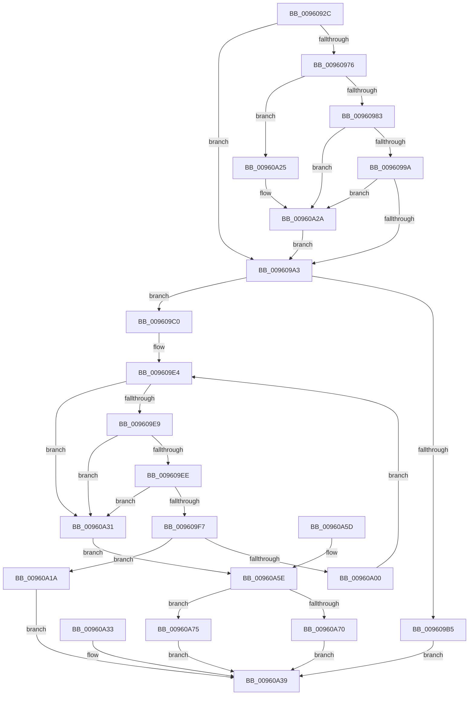

# PfSnParsePrefetchParam

- RVA: `0x0096092C`–`0x00960A7C` (길이 `336` bytes)
- VA: `0x000000014096092C`
- 실행 섹션: `PAGE`
- PDB 이름 있음: `예`; PDB Function 태그: `아니요`
- unwind 정보 RVA: `0x000931A8`
- 디코드: `95`개 명령, `336/336` bytes 표시
- 미해석 바이트: `0` (있으면 어셈블리에 `.byte`로 보존)

> 이 문서는 커널 이미지의 기계어와 PDB 기호를 분석해 생성했습니다. 4번과 5번은 함수 원형과 자료형을 바이너리 사용 방식에서 추정한 C 해석이며 원본 소스 복구 결과는 아닙니다.

## 1. Dependencies

- 직접 호출 지점: **6**; 고유 호출 대상: **6**
- 직접 호출자로 확인된 함수: **1**
- RIP 상대 이미지 참조: **2**

### Outgoing calls
- `0x00960966` → [RtlInitUnicodeString](../../text/42/RtlInitUnicodeString_function_0042A780.md) (function, `0x0042A780`)
- `0x009609AB` → [PfSnFindString](PfSnFindString_function_00960A84.md) (function, `0x00960A84`)
- `0x009609F7` → [iswdigit](../../text/50/iswdigit_function_005007E0.md) (function, `0x005007E0`)
- `0x00960A25` → [ExRaiseDatatypeMisalignment](../89/ExRaiseDatatypeMisalignment_function_00899FD0.md) (function, `0x00899FD0`)
- `0x00960A43` → [_security_check_cookie](../../text/6A/_security_check_cookie_function_006AC640.md) (function, `0x006AC640`)
- `0x00960A66` → [wtol](../../text/50/wtol_function_00500400.md) (function, `0x00500400`)

### Direct callers
- [PfSnScanCommandLine](../95/PfSnScanCommandLine_function_0095FE78.md) at `0x0095FED7`

### Static image references
- `0x0096093D` → RVA `0x00E0A740` (`.data`; read)
- `0x0096095A` → RVA `0x00B01510` (` ?? ::NNGAKEGL::`string'`; read)

## 2. Other-region calls and transfers

- 다른 실행 섹션으로 향하는 call: **4**
  - `0x00960966` → [RtlInitUnicodeString](../../text/42/RtlInitUnicodeString_function_0042A780.md) (`PAGE` → `.text`)
  - `0x009609F7` → [iswdigit](../../text/50/iswdigit_function_005007E0.md) (`PAGE` → `.text`)
  - `0x00960A43` → [_security_check_cookie](../../text/6A/_security_check_cookie_function_006AC640.md) (`PAGE` → `.text`)
  - `0x00960A66` → [wtol](../../text/50/wtol_function_00500400.md) (`PAGE` → `.text`)
- 별도 외부 분기/꼬리 이동을 확인하지 못했습니다.

## 3. Assembly (complete function range)

```asm
0096092C  48 89 5C 24 18                  mov qword ptr [rsp + 0x18], rbx
00960931  56                              push rsi
00960932  57                              push rdi
00960933  41 54                           push r12
00960935  41 56                           push r14
00960937  41 57                           push r15
00960939  48 83 EC 70                     sub rsp, 0x70
0096093D  48 8B 05 FC 9D 4A 00            mov rax, qword ptr [rip + 0x4a9dfc]
00960944  48 33 C4                        xor rax, rsp
00960947  48 89 44 24 68                  mov qword ptr [rsp + 0x68], rax
0096094C  4C 8B FA                        mov r15, rdx
0096094F  48 8B F1                        mov rsi, rcx
00960952  0F 57 C0                        xorps xmm0, xmm0
00960955  0F 11 44 24 38                  movups xmmword ptr [rsp + 0x38], xmm0
0096095A  48 8D 15 AF 0B 1A 00            lea rdx, [rip + 0x1a0baf]
00960961  48 8D 4C 24 38                  lea rcx, [rsp + 0x38]
00960966  E8 15 9E AC FF                  call 0x14042a780
0096096B  90                              nop
0096096C  0F B7 06                        movzx eax, word ptr [rsi]
0096096F  33 DB                           xor ebx, ebx
00960971  66 85 C0                        test ax, ax
00960974  74 2D                           je 0x1409609a3
00960976  48 8B 4E 08                     mov rcx, qword ptr [rsi + 8]
0096097A  F6 C1 01                        test cl, 1
0096097D  0F 85 A2 00 00 00               jne 0x140960a25
00960983  48 8D 14 01                     lea rdx, [rcx + rax]
00960987  48 B8 00 00 FF FF FF 7F 00 00   movabs rax, 0x7fffffff0000
00960991  48 3B D0                        cmp rdx, rax
00960994  0F 87 90 00 00 00               ja 0x140960a2a
0096099A  48 3B D1                        cmp rdx, rcx
0096099D  0F 82 87 00 00 00               jb 0x140960a2a
009609A3  48 8D 54 24 38                  lea rdx, [rsp + 0x38]
009609A8  48 8B CE                        mov rcx, rsi
009609AB  E8 D4 00 00 00                  call 0x140960a84
009609B0  48 85 C0                        test rax, rax
009609B3  75 0B                           jne 0x1409609c0
009609B5  BB 25 02 00 C0                  mov ebx, 0xc0000225
009609BA  89 5C 24 20                     mov dword ptr [rsp + 0x20], ebx
009609BE  EB 79                           jmp 0x140960a39
009609C0  0F B7 7C 24 38                  movzx edi, word ptr [rsp + 0x38]
009609C5  48 03 F8                        add rdi, rax
009609C8  48 89 7C 24 28                  mov qword ptr [rsp + 0x28], rdi
009609CD  44 0F B7 36                     movzx r14d, word ptr [rsi]
009609D1  4C 03 76 08                     add r14, qword ptr [rsi + 8]
009609D5  48 8D 74 24 48                  lea rsi, [rsp + 0x48]
009609DA  48 89 74 24 30                  mov qword ptr [rsp + 0x30], rsi
009609DF  4C 8D 64 24 66                  lea r12, [rsp + 0x66]
009609E4  49 3B FE                        cmp rdi, r14
009609E7  73 48                           jae 0x140960a31
009609E9  49 3B F4                        cmp rsi, r12
009609EC  73 43                           jae 0x140960a31
009609EE  0F B7 0F                        movzx ecx, word ptr [rdi]
009609F1  66 83 F9 20                     cmp cx, 0x20
009609F5  74 3A                           je 0x140960a31
009609F7  E8 E4 FD B9 FF                  call 0x1405007e0
009609FC  85 C0                           test eax, eax
009609FE  74 1A                           je 0x140960a1a
00960A00  0F B7 07                        movzx eax, word ptr [rdi]
00960A03  66 89 06                        mov word ptr [rsi], ax
00960A06  48 83 C7 02                     add rdi, 2
00960A0A  48 89 7C 24 28                  mov qword ptr [rsp + 0x28], rdi
00960A0F  48 83 C6 02                     add rsi, 2
00960A13  48 89 74 24 30                  mov qword ptr [rsp + 0x30], rsi
00960A18  EB CA                           jmp 0x1409609e4
00960A1A  BB 0D 00 00 C0                  mov ebx, 0xc000000d
00960A1F  89 5C 24 20                     mov dword ptr [rsp + 0x20], ebx
00960A23  EB 14                           jmp 0x140960a39
00960A25  E8 A6 95 F3 FF                  call 0x140899fd0
00960A2A  8A 00                           mov al, byte ptr [rax]
00960A2C  E9 72 FF FF FF                  jmp 0x1409609a3
00960A31  EB 2B                           jmp 0x140960a5e
00960A33  8B D8                           mov ebx, eax
00960A35  89 44 24 20                     mov dword ptr [rsp + 0x20], eax
00960A39  8B C3                           mov eax, ebx
00960A3B  48 8B 4C 24 68                  mov rcx, qword ptr [rsp + 0x68]
00960A40  48 33 CC                        xor rcx, rsp
00960A43  E8 F8 BB D4 FF                  call 0x1406ac640
00960A48  48 8B 9C 24 B0 00 00 00         mov rbx, qword ptr [rsp + 0xb0]
00960A50  48 83 C4 70                     add rsp, 0x70
00960A54  41 5F                           pop r15
00960A56  41 5E                           pop r14
00960A58  41 5C                           pop r12
00960A5A  5F                              pop rdi
00960A5B  5E                              pop rsi
00960A5C  C3                              ret
00960A5D  CC                              int3
00960A5E  66 89 1E                        mov word ptr [rsi], bx
00960A61  48 8D 4C 24 48                  lea rcx, [rsp + 0x48]
00960A66  E8 95 F9 B9 FF                  call 0x140500400
00960A6B  83 F8 10                        cmp eax, 0x10
00960A6E  77 05                           ja 0x140960a75
00960A70  41 89 07                        mov dword ptr [r15], eax
00960A73  EB C4                           jmp 0x140960a39
00960A75  BB 0D 00 00 C0                  mov ebx, 0xc000000d
00960A7A  EB BD                           jmp 0x140960a39
```

## 4. C-style interpretation (structured pseudocode)

```c
__int64 __fastcall PfSnParsePrefetchParam(__int64 a1, __int64 a2)
{
    __int64 result;
    __int64 v_r14;
    __int64 v_rbx;
    __int64 v_rdi;
    __int64 v_rsi;
    __int64 v_rsp;
    unsigned __int64 v_stack_m30;
    unsigned __int64 v_stack_m32;
    unsigned __int64 v_stack_m50;
    unsigned __int64 v_stack_m60;
    unsigned __int64 v_stack_m68;
    unsigned __int64 v_stack_m70;
    unsigned int v_stack_m78;
    unsigned __int64 v_stack_p18;
    unsigned __int64 v_stack_p48;

    v_stack_p18 = v_rbx;
    v_rsp = (v_rsp) - (112);
    result = (*(unsigned __int64 *)(v_rip + 4890108)) ^ (v_rsp);
    v_stack_m30 = result;
    v_stack_m60 = v_xmm0;
    result = RtlInitUnicodeString(v_stack_m60, v_rip + 1706927, a3, a4);
    v_rbx = 0;
    if ((unsigned __int16)(*(unsigned __int16 *)(a1)) == 0) goto loc_009609A3;
    if ((((unsigned __int8)(*(unsigned __int64 *)(a1 + 8))) & (1)) != 0) goto loc_00960A25;
    if ((*(unsigned __int64 *)(a1 + 8) + *(unsigned __int16 *)(a1) * 1) > (*(unsigned __int16 *)(a1))) goto loc_00960A2A;
    if ((*(unsigned __int64 *)(a1 + 8) + *(unsigned __int16 *)(a1) * 1) < (*(unsigned __int64 *)(a1 + 8))) goto loc_00960A2A;
loc_009609A3:
    result = PfSnFindString(a1, v_stack_m60, a3, a4);
    if (result != 0) goto loc_009609C0;
    v_stack_m78 = (unsigned int)((unsigned int)(0xC0000225ULL));
    goto loc_00960A39;
loc_009609C0:
    v_rdi = (v_stack_m60) + (result);
    v_stack_m70 = v_rdi;
    v_r14 = (*(unsigned __int16 *)(a1)) + (*(unsigned __int64 *)(a1 + 8));
    v_stack_m68 = v_stack_m50;
loc_009609E4:
    if (v_rdi >= v_r14) goto loc_00960A31;
    if (v_stack_m50 >= v_stack_m32) goto loc_00960A31;
    if (((unsigned __int16)(*(unsigned __int16 *)(v_rdi))) == 32) goto loc_00960A31;
    result = iswdigit(*(unsigned __int16 *)(v_rdi), v_stack_m60, a3, a4);
    if ((unsigned int)(result) == 0) goto loc_00960A1A;
    *(unsigned __int16 *)(v_stack_m50) = (unsigned __int16)(*(unsigned __int16 *)(v_rdi));
    v_rdi = (v_rdi) + (2);
    v_stack_m70 = v_rdi;
    v_rsi = (v_stack_m50) + (2);
    v_stack_m68 = v_rsi;
    goto loc_009609E4;
loc_00960A1A:
    v_stack_m78 = (unsigned int)((unsigned int)(0xC000000DULL));
    goto loc_00960A39;
loc_00960A25:
    result = ExRaiseDatatypeMisalignment(*(unsigned __int16 *)(v_rdi), v_stack_m60, a3, a4);
loc_00960A2A:
    goto loc_009609A3;
loc_00960A31:
    goto loc_00960A5E;
loc_00960A39:
    a1 = (v_stack_m30) ^ (v_rsp);
    result = _security_check_cookie(a1, v_stack_m60, a3, a4);
    v_rsp = (v_rsp) + (112);
    return result;
loc_00960A5E:
    *(unsigned __int16 *)(v_rsi) = (unsigned __int16)(v_stack_p18);
    result = wtol(v_stack_p48, v_stack_m60, a3, a4);
    if (((unsigned int)(result)) > 16) goto loc_00960A75;
    *(unsigned int *)(a2) = (unsigned int)(result);
    goto loc_00960A39;
loc_00960A75:
    goto loc_00960A39;
}
```

## 5. (Beta) C Style

```c
int64_t PfSnParsePrefetchParam(void *Arg1, void *Arg2)
{
    uint8_t *arg1 = (uint8_t *)Arg1;
    uint8_t *arg2 = (uint8_t *)Arg2;

    int64_t result;
    int64_t local_r14;
    int64_t local_rbx;
    int64_t local_rdi;
    int64_t local_rsi;
    int64_t local_rsp;
    uint64_t v_stack_m30;
    uint64_t v_stack_m32;
    uint64_t v_stack_m50;
    uint64_t v_stack_m60;
    uint64_t v_stack_m68;
    uint64_t v_stack_m70;
    uint32_t v_stack_m78;
    uint64_t v_stack_p18;
    uint64_t v_stack_p48;

    v_stack_p18 = local_rbx;
    local_rsp = (local_rsp) - (112);
    result = (*(uint64_t *)(v_rip + 0x4A9DFC)) ^ (local_rsp);
    v_stack_m30 = result;
    v_stack_m60 = v_xmm0;
    result = RtlInitUnicodeString(v_stack_m60, v_rip + 1706927, a3, a4);
    local_rbx = 0;
    if ((uint16_t)(*(uint16_t *)(arg1)) == 0) goto loc_009609A3;
    if ((((uint8_t)(*(uint64_t *)(arg1 + 0x8))) & (1)) != 0) goto loc_00960A25;
    if ((*(uint64_t *)(arg1 + 0x8) + *(uint16_t *)(arg1) * 1) > (*(uint16_t *)(arg1))) goto loc_00960A2A;
    if ((*(uint64_t *)(arg1 + 0x8) + *(uint16_t *)(arg1) * 1) < (*(uint64_t *)(arg1 + 0x8))) goto loc_00960A2A;
loc_009609A3:
    result = PfSnFindString(Arg1, v_stack_m60, a3, a4);
    if (result != 0) goto loc_009609C0;
    v_stack_m78 = (uint32_t)((uint32_t)(0xC0000225ULL));
    goto loc_00960A39;
loc_009609C0:
    local_rdi = (v_stack_m60) + (result);
    v_stack_m70 = local_rdi;
    local_r14 = (*(uint16_t *)(arg1)) + (*(uint64_t *)(arg1 + 0x8));
    v_stack_m68 = v_stack_m50;
loc_009609E4:
    if (local_rdi >= local_r14) goto loc_00960A31;
    if (v_stack_m50 >= v_stack_m32) goto loc_00960A31;
    if (((uint16_t)(*(uint16_t *)(local_rdi))) == 32) goto loc_00960A31;
    result = iswdigit(*(uint16_t *)(local_rdi), v_stack_m60, a3, a4);
    if ((uint32_t)(result) == 0) goto loc_00960A1A;
    *(uint16_t *)(v_stack_m50) = (uint16_t)(*(uint16_t *)(local_rdi));
    local_rdi = (local_rdi) + (2);
    v_stack_m70 = local_rdi;
    local_rsi = (v_stack_m50) + (2);
    v_stack_m68 = local_rsi;
    goto loc_009609E4;
loc_00960A1A:
    v_stack_m78 = (uint32_t)((uint32_t)(0xC000000DULL));
    goto loc_00960A39;
loc_00960A25:
    result = ExRaiseDatatypeMisalignment(*(uint16_t *)(local_rdi), v_stack_m60, a3, a4);
loc_00960A2A:
    goto loc_009609A3;
loc_00960A31:
    goto loc_00960A5E;
loc_00960A39:
    Arg1 = (v_stack_m30) ^ (local_rsp);
    result = _security_check_cookie(Arg1, v_stack_m60, a3, a4);
    local_rsp = (local_rsp) + (112);
    return result;
loc_00960A5E:
    *(uint16_t *)(local_rsi) = (uint16_t)(v_stack_p18);
    result = wtol(v_stack_p48, v_stack_m60, a3, a4);
    if (((uint32_t)(result)) > 16) goto loc_00960A75;
    *(uint32_t *)(arg2) = (uint32_t)(result);
    goto loc_00960A39;
loc_00960A75:
    goto loc_00960A39;
}
```

### 관측된 메모리 오프셋

구조체 형식이 확인되지 않은 접근은 인자 기준의 오프셋으로만 기록했습니다.

| 기준 인자 | 오프셋 표현 | 폭 (bit) | 접근 |
|---|---:|---:|---|
| `Arg1` | `+ 0x0` | `16` | `R` |
| `Arg1` | `+ 0x8` | `64` | `R` |
| `Arg2` | `+ 0x0` | `32` | `W` |

## 6. Execution-region graph

[열기: 2D/3D 그래프와 함수 탐색 컨트롤 패널](../../../control-panel.html?section=page&rva=0x0096092C&view=graph)

- 2D 그래프는 위에서 아래로 흐르고, 3D 그래프는 빈 공간을 드래그해 회전합니다. Shift+드래그는 이동, 휠은 확대·축소, 함수 노드 선택은 대상 보고서 이동입니다.

### Static fallback


