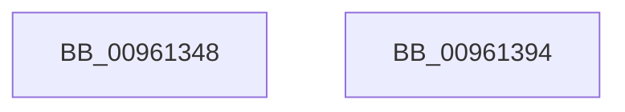

# PfSnPowerBoostInitialize

- RVA: `0x00961348`–`0x00961395` (길이 `77` bytes)
- VA: `0x0000000140961348`
- 실행 섹션: `PAGE`
- PDB 이름 있음: `예`; PDB Function 태그: `아니요`
- unwind 정보 RVA: `0x0005CF00`
- 디코드: `18`개 명령, `77/77` bytes 표시
- 미해석 바이트: `0` (있으면 어셈블리에 `.byte`로 보존)

> 이 문서는 커널 이미지의 기계어와 PDB 기호를 분석해 생성했습니다. 4번과 5번은 함수 원형과 자료형을 바이너리 사용 방식에서 추정한 C 해석이며 원본 소스 복구 결과는 아닙니다.

## 1. Dependencies

- 직접 호출 지점: **2**; 고유 호출 대상: **2**
- 직접 호출자로 확인된 함수: **1**
- RIP 상대 이미지 참조: **2**

### Outgoing calls
- `0x00961376` → [KeInitializeTimer](../../text/45/KeInitializeTimer_function_0045B590.md) (function, `0x0045B590`)
- `0x00961389` → [KeInitializeDpc](../../text/45/KeInitializeDpc_function_0045BBD0.md) (function, `0x0045BBD0`)

### Direct callers
- [PfSnAsyncContextInitialize](PfSnAsyncContextInitialize_function_00961168.md) at `0x00961208`

### Static image references
- `0x00961352` → RVA `0x007523C0` (`PfSnPowerBoostWorker`; read)
- `0x00961382` → RVA `0x005CE190` (`PfSnPowerBoostDpc`; read)

## 2. Other-region calls and transfers

- 다른 실행 섹션으로 향하는 call: **2**
  - `0x00961376` → [KeInitializeTimer](../../text/45/KeInitializeTimer_function_0045B590.md) (`PAGE` → `.text`)
  - `0x00961389` → [KeInitializeDpc](../../text/45/KeInitializeDpc_function_0045BBD0.md) (`PAGE` → `.text`)
- 별도 외부 분기/꼬리 이동을 확인하지 못했습니다.

## 3. Assembly (complete function range)

```asm
00961348  40 53                           push rbx
0096134A  48 83 EC 20                     sub rsp, 0x20
0096134E  48 83 21 00                     and qword ptr [rcx], 0
00961352  48 8D 05 67 10 DF FF            lea rax, [rip - 0x20ef99]
00961359  48 83 A1 88 00 00 00 00         and qword ptr [rcx + 0x88], 0
00961361  48 8B D9                        mov rbx, rcx
00961364  48 89 81 98 00 00 00            mov qword ptr [rcx + 0x98], rax
0096136B  48 89 89 A0 00 00 00            mov qword ptr [rcx + 0xa0], rcx
00961372  48 83 C1 08                     add rcx, 8
00961376  E8 15 A2 AF FF                  call 0x14045b590
0096137B  48 8D 4B 48                     lea rcx, [rbx + 0x48]
0096137F  4C 8B C3                        mov r8, rbx
00961382  48 8D 15 07 CE C6 FF            lea rdx, [rip - 0x3931f9]
00961389  E8 42 A8 AF FF                  call 0x14045bbd0
0096138E  48 83 C4 20                     add rsp, 0x20
00961392  5B                              pop rbx
00961393  C3                              ret
00961394  CC                              int3
```

## 4. C-style interpretation (structured pseudocode)

```c
__int64 __fastcall PfSnPowerBoostInitialize(__int64 a1)
{
    __int64 result;
    __int64 v_rsp;

    v_rsp = (v_rsp) - (32);
    *(unsigned __int64 *)(a1 + 152) = v_rip - 2158489;
    *(unsigned __int64 *)(a1 + 160) = a1;
    a1 = (a1) + (8);
    result = KeInitializeTimer(a1, a2, a3, a4);
    result = KeInitializeDpc(a1 + 72, v_rip - 3748345, a1, a4);
    v_rsp = (v_rsp) + (32);
    return result;
}
```

## 5. (Beta) C Style

```c
int64_t PfSnPowerBoostInitialize(void *Arg1)
{
    uint8_t *arg1 = (uint8_t *)Arg1;

    int64_t result;
    int64_t local_rsp;

    local_rsp = (local_rsp) - (32);
    *(uint64_t *)(arg1 + 0x98) = v_rip - 2158489;
    *(void **)(arg1 + 0xA0) = Arg1;
    Arg1 = (Arg1) + (8);
    result = KeInitializeTimer(Arg1, a2, a3, a4);
    result = KeInitializeDpc(Arg1 + 72, v_rip - 3748345, Arg1, a4);
    local_rsp = (local_rsp) + (32);
    return result;
}
```

### 관측된 메모리 오프셋

구조체 형식이 확인되지 않은 접근은 인자 기준의 오프셋으로만 기록했습니다.

| 기준 인자 | 오프셋 표현 | 폭 (bit) | 접근 |
|---|---:|---:|---|
| `Arg1` | `+ 0x0` | `64` | `R/W` |
| `Arg1` | `+ 0x48` | `64` | `R` |
| `Arg1` | `+ 0x88` | `64` | `R/W` |
| `Arg1` | `+ 0x98` | `64` | `W` |
| `Arg1` | `+ 0xA0` | `64` | `W` |

## 6. Execution-region graph

[열기: 2D/3D 그래프와 함수 탐색 컨트롤 패널](../../../control-panel.html?section=page&rva=0x00961348&view=graph)

- 2D 그래프는 위에서 아래로 흐르고, 3D 그래프는 빈 공간을 드래그해 회전합니다. Shift+드래그는 이동, 휠은 확대·축소, 함수 노드 선택은 대상 보고서 이동입니다.

### Static fallback


